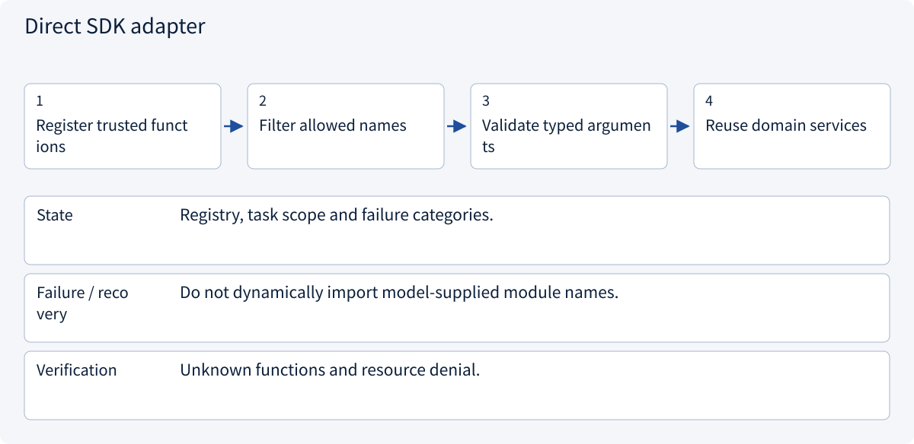
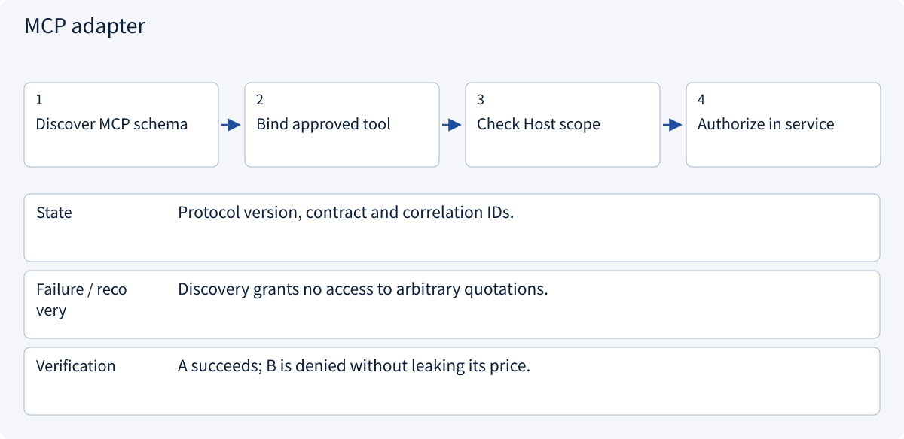
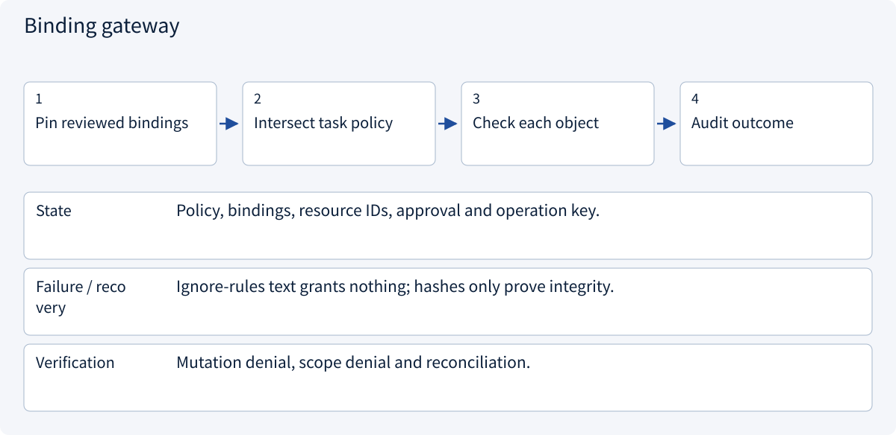

# 2.6.4 Tool binding, MCP and permission intersections

> Visual route · Established approaches · Reference code

Based on Agent Skills format; version pins, bundle digests and tool bindings are example Host conventions, not execution authority.

## Start with the problem

Does a Skill instructing “read everything and order” grant those abilities? Does MCP discovery grant object access?


## See the mechanism

Trusted task policy, deployed capabilities and reviewed bindings constrain actions; services authorize objects again. Skills supply method, Function Calling expresses proposals and MCP carries capability calls.


## Choose an established approach


| Approach | Mechanism | Use when | Tradeoff / boundary |
|---|---|---|---|
| Direct SDK adapter | Use registered application functions | Small stable internal tools | Object authorization still required |
| MCP adapter | Client invokes server contracts | Independent tools and multiple Hosts | Protocol success is not task acceptance |
| Binding gateway | Intersect task policy with reviewed bindings | Multiple Skills/tenants and write actions | Declarations are not authority |

## Inside the mainstream approaches

### 1 · Direct SDK adapter



**Concrete trace:** Direct SDK can read evidence while the Skill supplies review method.

<details><summary>Expand steps, state and failure boundaries</summary>

1. Register trusted functions
2. Filter allowed names
3. Validate typed arguments
4. Reuse domain services

**State** Registry, task scope and failure categories.

**Failure / recovery** Do not dynamically import model-supplied module names.

**Verification** Unknown functions and resource denial.

</details>

### 2 · MCP adapter



**Concrete trace:** Real SDK tests read A and reject B.

<details><summary>Expand steps, state and failure boundaries</summary>

1. Discover MCP schema
2. Bind approved tool
3. Check Host scope
4. Authorize in service

**State** Protocol version, contract and correlation IDs.

**Failure / recovery** Discovery grants no access to arbitrary quotations.

**Verification** A succeeds; B is denied without leaking its price.

</details>

### 3 · Binding gateway



**Concrete trace:** Activating a method cannot create an order or read another customer.

<details><summary>Expand steps, state and failure boundaries</summary>

1. Pin reviewed bindings
2. Intersect task policy
3. Check each object
4. Audit outcome

**State** Policy, bindings, resource IDs, approval and operation key.

**Failure / recovery** Ignore-rules text grants nothing; hashes only prove integrity.

**Verification** Mutation denial, scope denial and reconciliation.

</details>

## Reference code

Expand the implementation corresponding to this mechanism. Training code is provided but not executed. See the reference-code guide for dependencies and verification limits.

[Reference code and verification limits](code-guide.md)

<details><summary>Expand code and limits</summary>

```python
"""Skill method + trusted Host policy + an actual in-memory MCP call; no LLM."""

from .mcp_host_bridge import call_authorized, check_quote_access
from .mcp_server_example import build_server
from .skill_host import build_host


async def review_quote(quote_id: str) -> dict:
    from mcp import Client

    service, session = build_host()
    service.activate("quote-review", session)
    check_quote_access(
        "read_quote",
        {"quote_id": quote_id},
        session.policy.allowed_tools,
        session.policy.quote_ids,
    )
    async with Client(build_server()) as client:

        async def adapter(tool, arguments, policy):
            return await call_authorized(
                client, tool, arguments, policy.allowed_tools, policy.quote_ids
            )

        return await service.invoke(
            "quote-review", "read_quote", {"quote_id": quote_id}, session, adapter
        )


# The skill explains how to review a quote. It does not grant access to B or create orders.
```

</details>

## The Host connects method to execution

Trusted deployment bindings intersect task permissions and currently deployed tools. This example binds only read_quote; neither model nor Skill text can add create_order. An adapter can map the semantic binding to MCP or a direct SDK without claiming a universal binding field.

Host checks tool/arguments/resource scope; the MCP service checks object access again. Activation prepares context and never automatically runs scripts or tools.

The real in-memory SDK returns A at 180 cents with unknown shipping and rejects B. Discovery, valid schema and authentication do not substitute for object authorization. Writes additionally require approval, stable operation IDs and reconciliation.

These tests make no model request, purchase or training run. They check specified contracts, not arbitrary third-party Skill safety; digests detect changes rather than establish trust.


References: [Agent Skills Host Integration](https://agentskills.io/client-implementation/adding-skills-support), [MCP Architecture](https://modelcontextprotocol.io/docs/2026-07-28/learn/architecture)。


## Change a condition

Can allowed-tools in a Skill override a Host ban on create_order?

<details><summary>Suggested answer</summary>

No. Trusted Policy and registry bindings govern this example; declarations cannot bypass task or server authorization.

</details>

[Official sources and approach rationale](resources.md)
