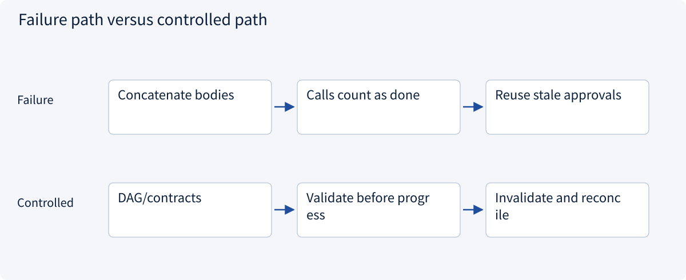
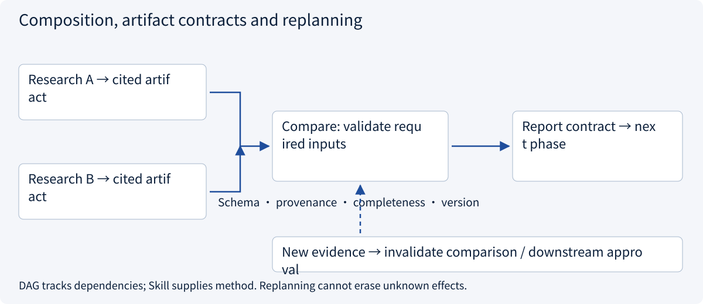
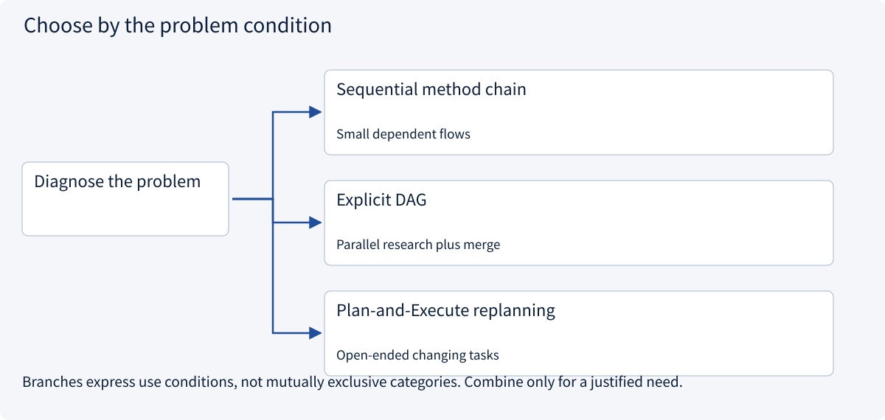
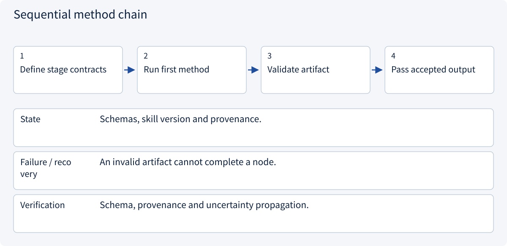
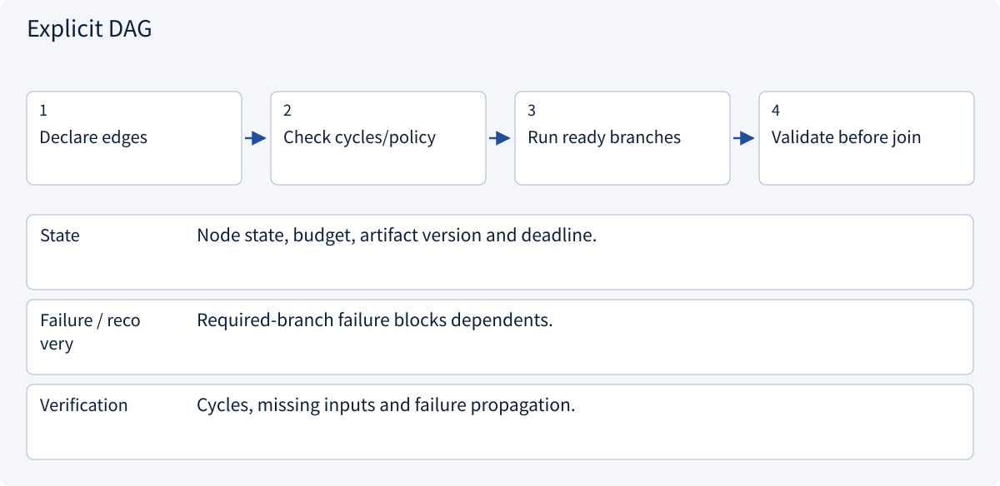
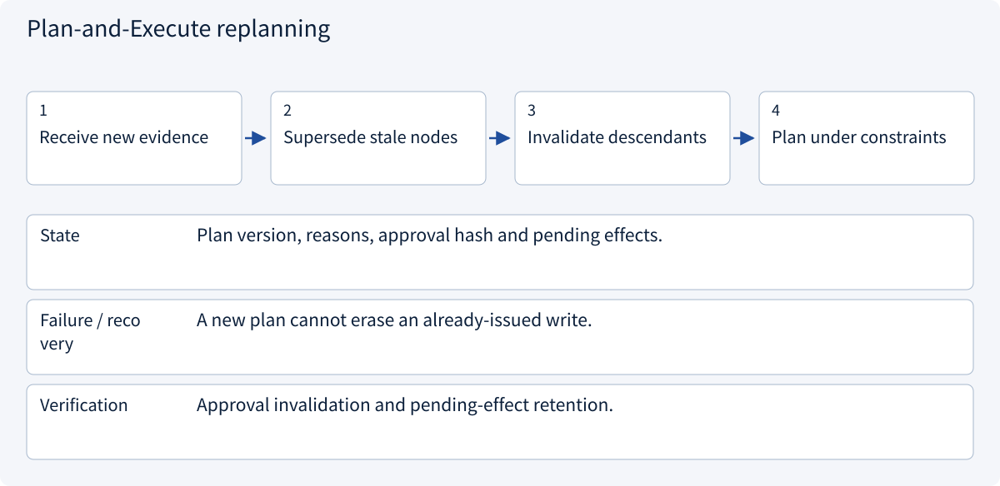

# 2.6.5 Composition, artifact contracts and replanning

> Visual route · Established approaches · Reference code

Based on Agent Skills format; version pins, bundle digests and tool bindings are example Host conventions, not execution authority.

## Start with the problem

Why does concatenating three Skills still produce wrong order, conflicts and approval based on stale evidence?




## See the mechanism

Compose around task dependencies and typed artifacts. Methods do not replace state machines. Validate artifacts before advancing; invalidate descendants after evidence changes and reconcile pending effects.



## Choose an established approach



| Approach | Mechanism | Use when | Tradeoff / boundary |
|---|---|---|---|
| Sequential method chain | Accepted output becomes next input | Small dependent flows | Stop on invalid intermediate output |
| Explicit DAG | Schedule ready permitted methods | Parallel research plus merge | Define join, cancellation and conflicts |
| Plan-and-Execute replanning | Evidence revises affected steps | Open-ended changing tasks | Preserve policy and known effects |

## Inside the mainstream approaches

### 1 · Sequential method chain



**Concrete trace:** Unknown shipping must stay unknown in later stages.

<details><summary>Expand steps, state and failure boundaries</summary>

1. Define stage contracts
2. Run first method
3. Validate artifact
4. Pass accepted output

**State** Schemas, skill version and provenance.

**Failure / recovery** An invalid artifact cannot complete a node.

**Verification** Schema, provenance and uncertainty propagation.

</details>

### 2 · Explicit DAG



**Concrete trace:** Independent markets run together; comparison waits for necessary evidence.

<details><summary>Expand steps, state and failure boundaries</summary>

1. Declare edges
2. Check cycles/policy
3. Run ready branches
4. Validate before join

**State** Node state, budget, artifact version and deadline.

**Failure / recovery** Required-branch failure blocks dependents.

**Verification** Cycles, missing inputs and failure propagation.

</details>

### 3 · Plan-and-Execute replanning



**Concrete trace:** Recompare/reapprove changed quotes; reconcile unknown writes first.

<details><summary>Expand steps, state and failure boundaries</summary>

1. Receive new evidence
2. Supersede stale nodes
3. Invalidate descendants
4. Plan under constraints

**State** Plan version, reasons, approval hash and pending effects.

**Failure / recovery** A new plan cannot erase an already-issued write.

**Verification** Approval invalidation and pending-effect retention.

</details>

## Reference code

Expand the implementation corresponding to this mechanism. Training code is provided but not executed. See the reference-code guide for dependencies and verification limits.

[Reference code and verification limits](code-guide.md)

<details><summary>Expand code and limits</summary>

```python
"""Compose artifacts with explicit contracts; do not concatenate arbitrary skill bodies."""

from dataclasses import dataclass

from .skill_planning import Step, ready_steps


@dataclass(frozen=True)
class Artifact:
    contract: str
    skill_version: str
    source_ids: tuple[str, ...]
    complete: bool


def next_steps(
    plan: list[Step],
    completed: dict[str, Artifact],
    allowed: set[str],
    expected_contracts: dict[str, str],
) -> list[Step]:
    names = {step.name for step in plan}
    if not set(completed) <= names:
        raise ValueError("Artifact refers to an unknown plan node")
    for node, artifact in completed.items():
        if (
            not artifact.complete
            or artifact.contract != expected_contracts[node]
            or not artifact.source_ids
        ):
            raise ValueError("Artifact lacks acceptance, matching schema or provenance")
    return ready_steps(plan, set(completed), allowed)


# A new quote version invalidates its comparison and dependent approval artifacts.
# The caller must remove invalid descendants; the plan never treats a call as completion.
```

</details>

## Compose artifact contracts, not role instructions

Artifacts need schema versions, provenance and acceptance status. Consumers validate them before advancing. A portable format does not guarantee arbitrary methods are semantically compatible.

| Failure | Response |
|---|---|
| Claimed completion without shipping | Keep incomplete; block comparison |
| Incompatible schema | Adapt explicitly or reject |
| Conflicting methods | Resolve from trusted task constraints/contracts |
| Changed quotation | Invalidate comparison and dependent approval |
| Unknown write outcome | Reconcile; a new plan cannot erase it |

The reference validates completeness/provenance before selecting ready nodes. It demonstrates orchestration contracts, not autonomous universal planning or installed third-party Skills. Parallel methods still require Runtime budgets, cancellation, checkpoints and version control.


References: [Agent Skills Specification](https://agentskills.io/specification)。


## Change a condition

Can a changed quotation keep the old action approval?

<details><summary>Suggested answer</summary>

No. Invalidate dependent comparison/approval; already-issued operations still need reconciliation.

</details>

<details><summary>Optional derivation and boundaries</summary>

**Reusable skills do not replace live planning**

A skill captures a reusable method: when it applies, required inputs, steps, constraints and completion criteria. Load relevant instructions when needed rather than placing every procedure in every context.

A plan is task-specific and changes when evidence changes. Track completed, pending and blocked steps without turning speculation into facts. A reusable procedure may be outdated or unsuitable for the current task.

Evaluate a skill through outcomes and failure cases. More detailed instructions can introduce conflicts and cost as well as improve consistency.

**Check your understanding**

Should a failed step be marked complete because the plan says it should have worked?

<details><summary>Suggested answer</summary>

No. State follows observed results. Revise the plan and retain the unresolved condition.

</details>


</details>

[Official sources and approach rationale](resources.md)
