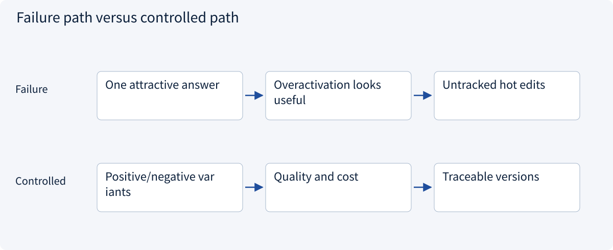
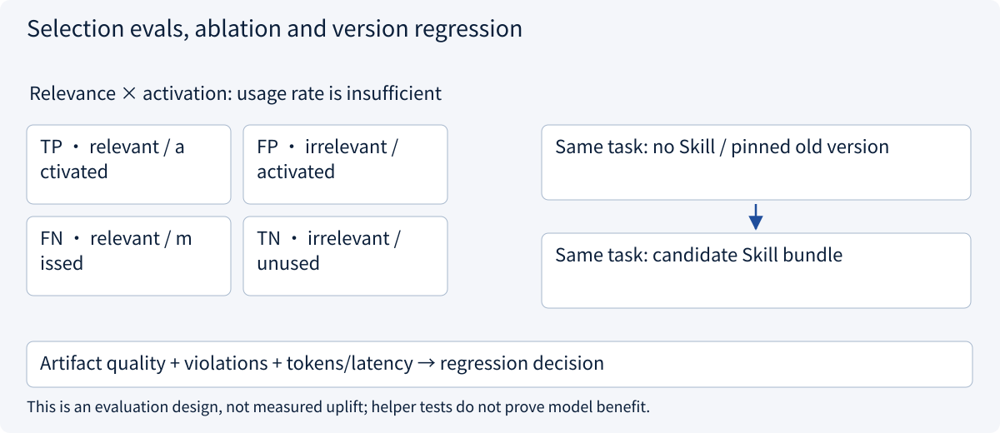
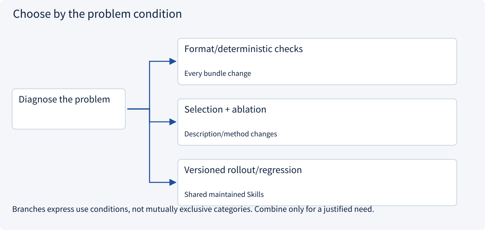
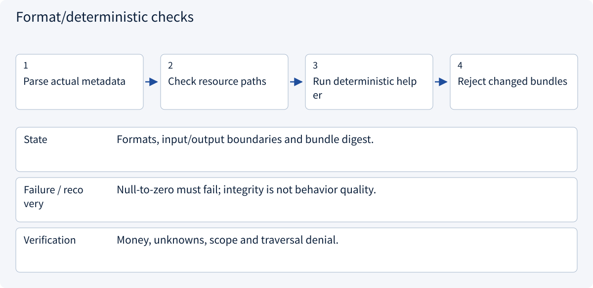
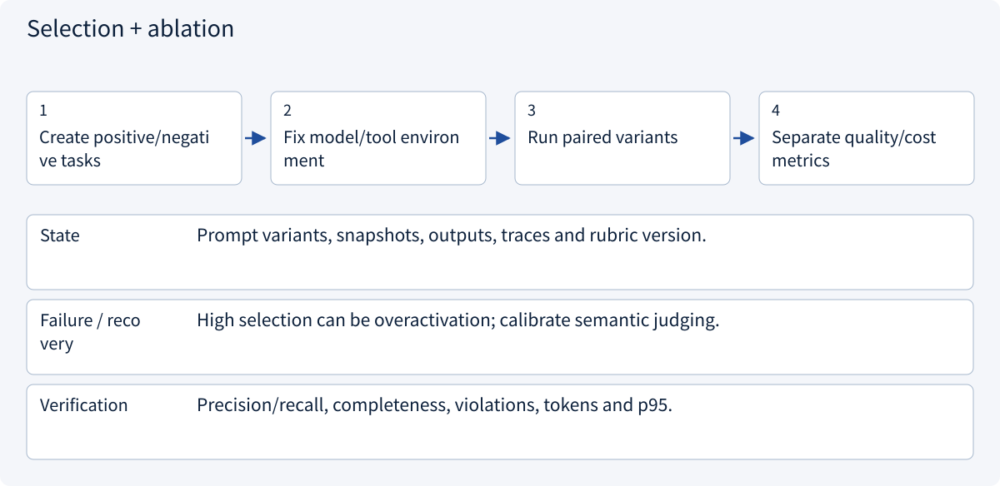
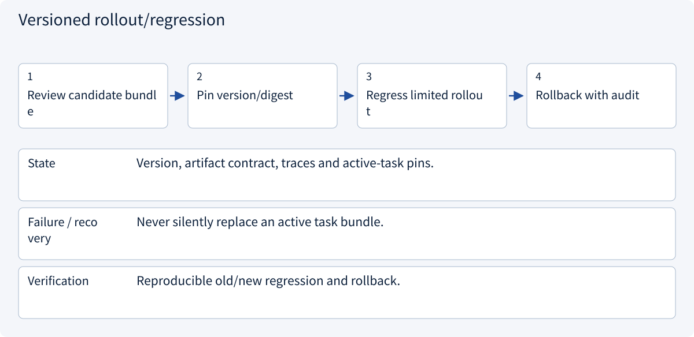

# 2.6.6 Selection evals, ablation and version regression

> Visual route · Established approaches · Reference code

Based on Agent Skills format; version pins, bundle digests and tool bindings are example Host conventions, not execution authority.

## Start with the problem

Why is one good answer insufficient? What should change checks cover after editing descriptions or helpers?




## See the mechanism

Separate selection, artifact quality and operating cost. Pair identical tasks with/without Skills and old/new versions; pin reviewed bytes for reproducible regression and rollback.



## Choose an established approach



| Approach | Mechanism | Use when | Tradeoff / boundary |
|---|---|---|---|
| Format/deterministic checks | Check metadata, paths and calculations | Every bundle change | Does not test model selection/use |
| Selection + ablation | Compare selection and paired task quality | Description/method changes | Fix model, tool snapshots and rubrics |
| Versioned rollout/regression | Pin bundles, record traces, roll back | Shared maintained Skills | Example mechanisms, not a rollout platform |

## Inside the mainstream approaches

### 1 · Format/deterministic checks



**Concrete trace:** Reject a definitive A total when shipping remains unknown.

<details><summary>Expand steps, state and failure boundaries</summary>

1. Parse actual metadata
2. Check resource paths
3. Run deterministic helper
4. Reject changed bundles

**State** Formats, input/output boundaries and bundle digest.

**Failure / recovery** Null-to-zero must fail; integrity is not behavior quality.

**Verification** Money, unknowns, scope and traversal denial.

</details>

### 2 · Selection + ablation



**Concrete trace:** Review reports should activate; weather requests should not. No fabricated results.

<details><summary>Expand steps, state and failure boundaries</summary>

1. Create positive/negative tasks
2. Fix model/tool environment
3. Run paired variants
4. Separate quality/cost metrics

**State** Prompt variants, snapshots, outputs, traces and rubric version.

**Failure / recovery** High selection can be overactivation; calibrate semantic judging.

**Verification** Precision/recall, completeness, violations, tokens and p95.

</details>

### 3 · Versioned rollout/regression



**Concrete trace:** Keep old packages/contracts available for tasks already pinned to them.

<details><summary>Expand steps, state and failure boundaries</summary>

1. Review candidate bundle
2. Pin version/digest
3. Regress limited rollout
4. Rollback with audit

**State** Version, artifact contract, traces and active-task pins.

**Failure / recovery** Never silently replace an active task bundle.

**Verification** Reproducible old/new regression and rollback.

</details>

## Reference code

Expand the implementation corresponding to this mechanism. Training code is provided but not executed. See the reference-code guide for dependencies and verification limits.

[Reference code and verification limits](code-guide.md)

<details><summary>Expand code and limits</summary>

```python
"""Selection metrics are separate from output quality and operational cost."""

from dataclasses import dataclass


@dataclass(frozen=True)
class SelectionCase:
    should_activate: bool
    activated: bool


def selection_metrics(cases: list[SelectionCase]) -> dict:
    tp = sum(x.should_activate and x.activated for x in cases)
    fp = sum(not x.should_activate and x.activated for x in cases)
    fn = sum(x.should_activate and not x.activated for x in cases)
    return {
        "precision": tp / (tp + fp) if tp + fp else None,
        "recall": tp / (tp + fn) if tp + fn else None,
        "false_activations": fp,
        "missed_activations": fn,
    }


# None means undefined, never a fabricated perfect score.
# Run paired tasks with/without the skill and compare evidence validity, completeness,
# forbidden effects, context tokens and latency. This file does not fabricate model results.
```

</details>

## Separate selection, output quality and operating cost

Selection checks need relevant, irrelevant and adjacent requests. Paired runs keep model/tool snapshots/tasks fixed while comparing no Skill and old/new versions. Operational records measure context, duplicate activation, latency and recovery failures; usage alone is not benefit.

| Change | Observe |
|---|---|
| Description | Selection precision/recall on varied positive and negative tasks |
| Method | Unknown shipping, currencies, conditions, citations, completeness |
| Helper | Normal, boundary and invalid inputs; reviewed digest update |
| Registry version | Active pins, reproducibility, new-task routing and rollback |

Precision is TP/(TP+FP); recall is TP/(TP+FN). Zero denominators are undefined. Humans/calibrated judges can assess semantic artifacts; arithmetic, permissions and duplicate effects need independent deterministic checks.

Current checks cover format, helpers, loading and authorization, with no model-selection experiment or uplift statistic. Skill evaluation belongs to the architecture evaluation module; telemetry and trust connect to observability and security, whose evidence remains distinct.


References: [Agent Skills Evaluation](https://agentskills.io/skill-creation/evaluating-skills)。


## Change a condition

Do passing helper tests prove a 20% model success improvement?

<details><summary>Suggested answer</summary>

No. Deterministic correctness and model benefit differ; without paired measurements there is no improvement statistic.

</details>

[Official sources and approach rationale](resources.md)
