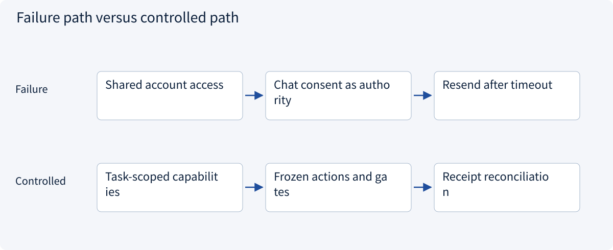
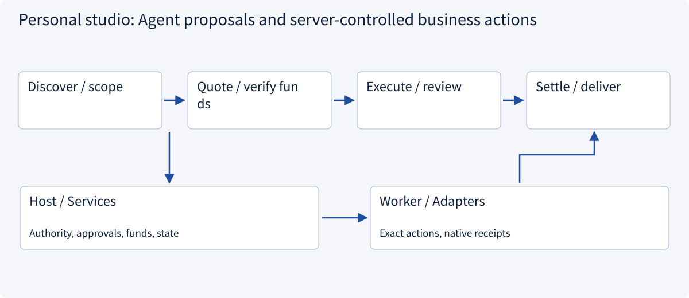
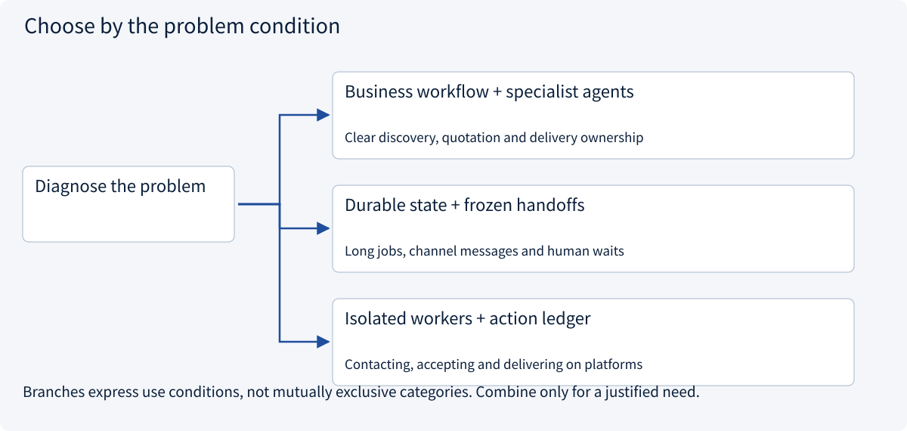
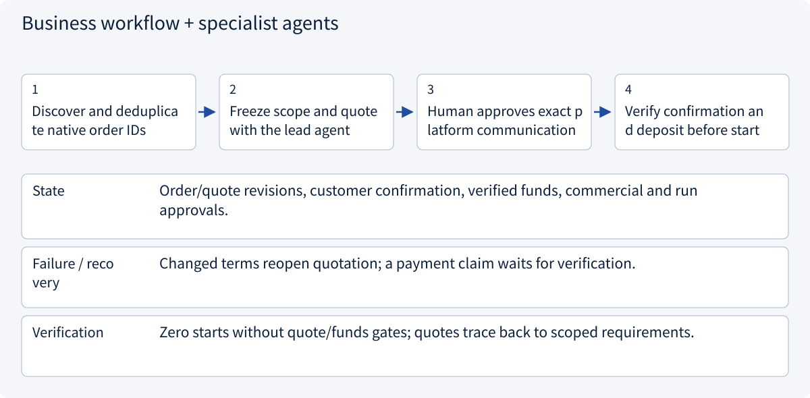
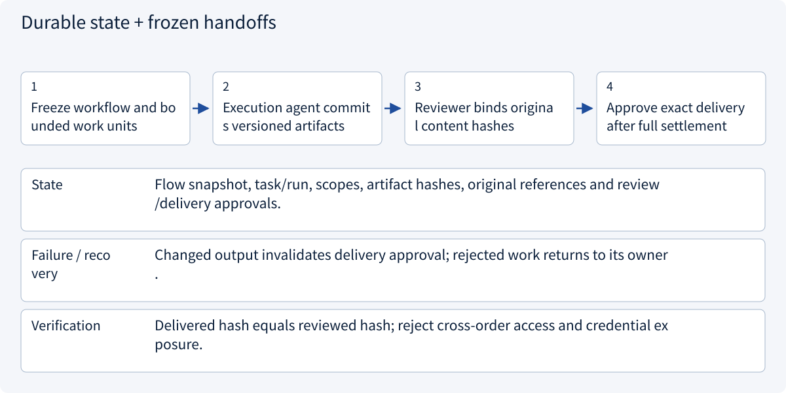
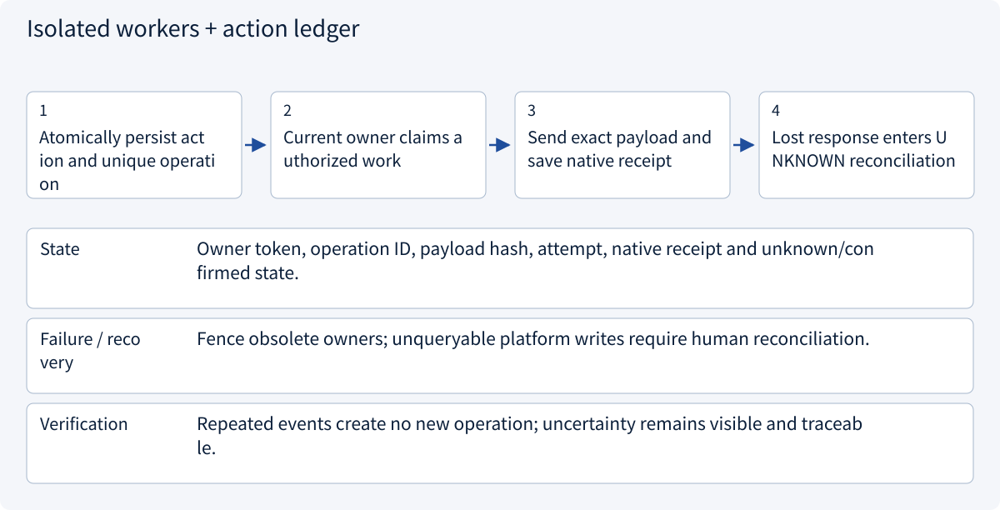
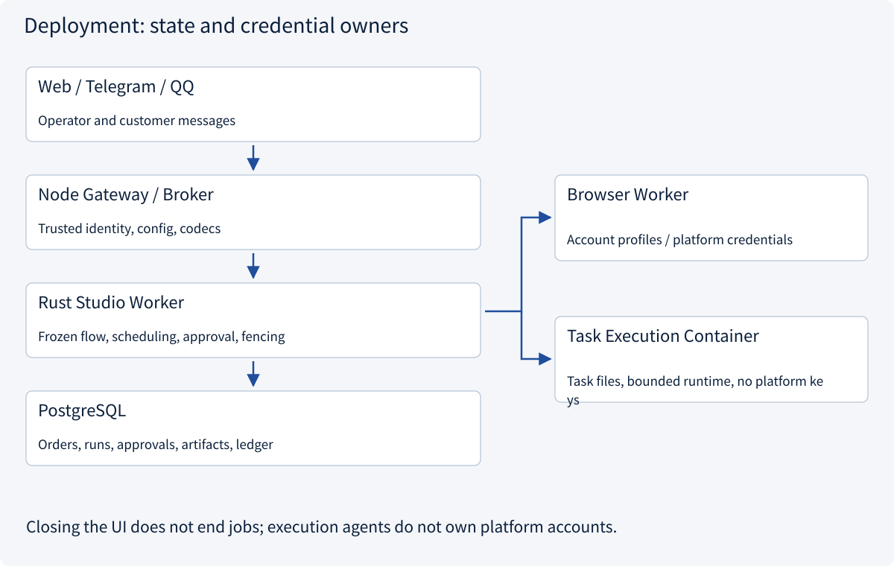
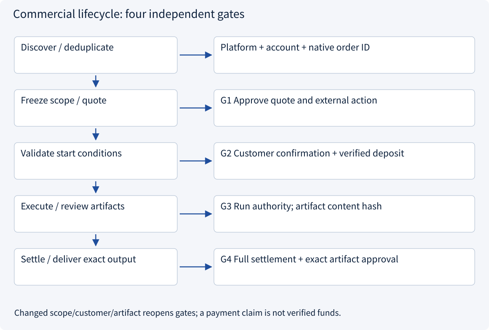
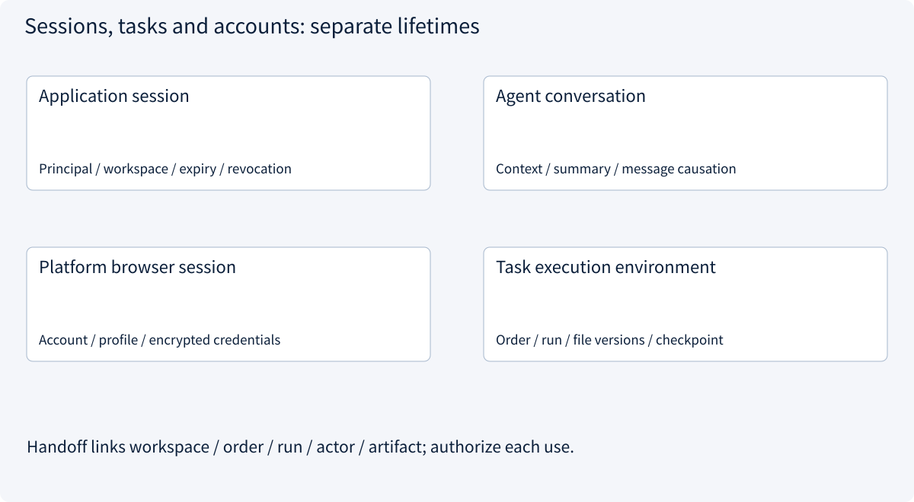
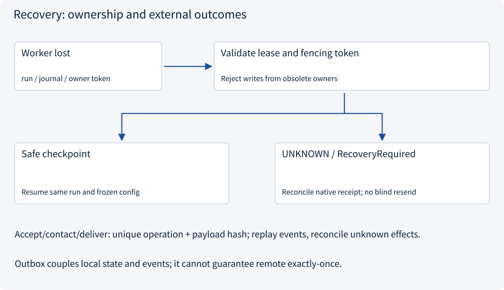

# 4.1 Personal studio: multi-Agent architecture from leads to delivery

> Visual route · Established approaches · Reference code

This teaching design derives from inspected ForgePilot workflows and runtime boundaries. Pure Python contracts are rewritten here; project mechanisms, local tests and unverified production integrations are distinguished.

## Start with the problem

A solo AI services studio must discover leads, quote, execute and deliver. Who owns each action when the UI closes, a worker crashes, terms change or a receipt is lost?



## See the mechanism

Use the order as the business spine. Agents interpret and propose; scoped workers act. Server-owned transitions, trusted approvals and verified funds control progress.



## Choose an established approach



| Approach | Mechanism | Use when | Tradeoff / boundary |
|---|---|---|---|
| Business workflow + specialist agents | State machines own gates; models handle interpretation | Clear discovery, quotation and delivery ownership | Add roles only for concrete task needs |
| Durable state + frozen handoffs | Link order versions, runs, artifacts and approvals | Long jobs, channel messages and human waits | Checkpoints do not ensure remote exactly-once |
| Isolated workers + action ledger | Separate credentials from execution; reconcile receipts | Contacting, accepting and delivering on platforms | Never blindly resend unknown effects |

## Inside the mainstream approaches

### 1 · Business workflow + specialist agents



**Concrete trace:** A 1000 CNY job requires a 300 CNY deposit: a chat claim is insufficient; verify a matching 30000-minor-unit receipt.

### 2 · Durable state + frozen handoffs



**Concrete trace:** Report v3 was approved; v4 changes an attachment and needs renewed review despite the same order ID.

### 3 · Isolated workers + action ledger



**Concrete trace:** Delivery reached the platform but its response was lost: reconcile the original action instead of resending under a new key.

## Reference code

Expand the implementation corresponding to this mechanism. Training code is provided but not executed. See the reference-code guide for dependencies and verification limits.

[Reference code and verification limits](../../docs/zh/projects/03-code-guide.md)

<details><summary>Expand code and limits</summary>

```python
"""Pure studio business gates; trusted facts come from an authorized service.

These checks do not authenticate a caller, consume an approval, send a message,
or commit a payment. The governance/outbox examples implement those boundaries.
Amounts use integer minor units. A customer chat message is never payment proof.
"""

from dataclasses import dataclass
from enum import Enum


class GateError(ValueError):
    """The proposed transition lacks matching, current business evidence."""


class ApprovalKind(str, Enum):
    RUN = "run"
    QUOTE = "quote"
    DELIVERY = "delivery"


@dataclass(frozen=True)
class Order:
    workspace: str
    order_id: str
    revision: int
    customer: str
    quote_revision: int
    currency: str
    total_minor: int
    deposit_minor: int

    def __post_init__(self) -> None:
        if not all((self.workspace, self.order_id, self.customer)):
            raise GateError("missing order identity")
        if self.revision < 1 or self.quote_revision < 1:
            raise GateError("invalid revision")
        if len(self.currency) != 3 or not self.currency.isascii():
            raise GateError("currency must be an uppercase three-letter code")
        if not self.currency.isalpha() or not self.currency.isupper():
            raise GateError("currency must be an uppercase three-letter code")
        if type(self.total_minor) is not int or type(self.deposit_minor) is not int:
            raise GateError("amounts must be integer minor units")
        if not 0 < self.deposit_minor <= self.total_minor:
            raise GateError("require 0 < deposit <= total")


@dataclass(frozen=True)
class ApprovalFact:
    """Server-loaded fact, never accepted directly as a client's assertion."""

    kind: ApprovalKind
    order: Order
    expires_at: int
    authority_epoch: int
    artifact_hash: str = ""


@dataclass(frozen=True)
class PaymentFact:
    workspace: str
    order_id: str
    quote_revision: int
    currency: str
    cumulative_minor: int
    reference: str
    verified: bool


@dataclass(frozen=True)
class CustomerConfirmation:
    order: Order
    native_message_id: str


def require_approval(
    approval: ApprovalFact,
    kind: ApprovalKind,
    order: Order,
    now: int,
    authority_epoch: int,
    artifact_hash: str = "",
) -> None:
    if approval.kind != kind or approval.order != order:
        raise GateError("approval kind or immutable snapshot mismatch")
    if approval.expires_at <= now or approval.authority_epoch != authority_epoch:
        raise GateError("expired approval or changed authority")
    if approval.artifact_hash != artifact_hash:
        raise GateError("reviewed artifact differs")


def require_payment(order: Order, payment: PaymentFact, required_minor: int) -> None:
    expected = (order.workspace, order.order_id, order.quote_revision, order.currency)
    actual = (
        payment.workspace,
        payment.order_id,
        payment.quote_revision,
        payment.currency,
    )
    if actual != expected or not payment.verified or not payment.reference:
        raise GateError("payment evidence is unverified or belongs to another quote")
    if type(payment.cumulative_minor) is not int:
        raise GateError("invalid payment amount")
    if payment.cumulative_minor < required_minor:
        raise GateError("insufficient verified funds")


def require_start(
    order: Order,
    quote_approval: ApprovalFact,
    run_approval: ApprovalFact,
    confirmation: CustomerConfirmation,
    payment: PaymentFact,
    *,
    now: int,
    authority_epoch: int,
) -> None:
    """A run approval cannot substitute for quote approval or verified funds."""
    require_approval(quote_approval, ApprovalKind.QUOTE, order, now, authority_epoch)
    require_approval(run_approval, ApprovalKind.RUN, order, now, authority_epoch)
    if confirmation.order != order or not confirmation.native_message_id:
        raise GateError("customer has not confirmed this exact order")
    require_payment(order, payment, order.deposit_minor)


def require_delivery(
    order: Order,
    approval: ApprovalFact,
    payment: PaymentFact,
    artifact_hash: str,
    *,
    now: int,
    authority_epoch: int,
) -> None:
    if not artifact_hash:
        raise GateError("missing immutable artifact hash")
    require_approval(
        approval, ApprovalKind.DELIVERY, order, now, authority_epoch, artifact_hash
    )
    require_payment(order, payment, order.total_minor)


if __name__ == "__main__":
    order = Order("studio", "order-42", 1, "customer-7", 1, "CNY", 100000, 30000)
    quote = ApprovalFact(ApprovalKind.QUOTE, order, 200, 1)
    run = ApprovalFact(ApprovalKind.RUN, order, 200, 1)
    confirmation = CustomerConfirmation(order, "native-message-9")
    deposit = PaymentFact("studio", "order-42", 1, "CNY", 30000, "receipt-8", True)
    require_start(order, quote, run, confirmation, deposit, now=100, authority_epoch=1)
    print("Start gate passed; no external action performed")
```

</details>

## Scenario, goals and evidence

This personal AI services studio discovers platform opportunities, scopes work, obtains approval for quotes, confirms funds, executes in isolation, reviews artifacts and delivers after settlement. The running example is a report costing 1000 CNY with a 300 CNY deposit. These amounts are test fixtures rather than pricing guidance.

ForgePilot local revision `13d673c` was inspected read-only, including commercial snapshots, funding checks, recovery and action authorization. Its runtime boundaries inform the deployment below. The role contracts, teaching state machine, evaluation gates and implementation phases are this course's design recommendations. ForgePilot was not modified; live customer orders, payments and paid-model long tasks were not validated.

### Define acceptance and authority first

| Question | Design choice | Reviewable evidence |
|---|---|---|
| How far does automation go? | Automate discovery, analysis and execution within scope; gate commercial commitments, funds and delivery | Each external write identifies its approver, exact payload and receipt |
| Why multiple agents? | Platform identity, interpretation and isolated execution have different permissions and lifetimes | Execution has no platform credentials; simple jobs need only one execution agent |
| Who owns truth? | Server-side orders, approvals, artifacts and operation ledger | Model text cannot overwrite business state or payment facts |
| What counts as completion? | The reviewed artifact was delivered exactly as approved, with a native receipt | Generation, send intent and platform confirmation are separate outcomes |

## Deployment: UI, control and execution



ForgePilot uses React/TypeScript for the workbench, a Node gateway for same-origin configuration, brokering and protocol adaptation, Rust Studio Worker for background control, and PostgreSQL for authoritative state. Browser workers isolate platform account sessions; task containers hold bounded execution and files without inheriting platform credentials. Closing the workbench does not terminate persisted work.

Keep routes → handlers → services → repos inside the backend: protocol parsing and trusted identity, authorization and business transactions, and persistence remain distinct responsibilities across process boundaries. A small studio can start with one control plane and a few workers, adding capacity when isolation or load requires it.

## Roles and collaboration contracts

| Role | Input → artifact | Capabilities | Stop condition |
|---|---|---|---|
| Discovery worker | Platform query → native-ID lead | Read-only search under the assigned account | Login required or account identity mismatch |
| Lead agent | Lead, requirements, history → scope, quote, work units | Retrieval, analysis, proposals | Missing acceptance criteria, changed terms, scope expansion |
| Execution agent | Frozen work unit → versioned report or code | Task files, bounded compute, read-only sources | Missing input, exhausted budget, new permission required |
| Reviewer / human | Original artifact and acceptance list → findings, review | Specified artifacts and explicit checks | Insufficient evidence, content changes, commercial judgment needed |
| Platform action worker | Authorized exact action → native receipt | Bound account, order, action and payload | Hash/version mismatch, expired authority, unknown outcome |
| Notification adapter | Committed event → channel receipt | Bound recipient notification | Invalid identity binding; notification is not customer delivery |

The lead routes each work unit to one accountable owner. Parallelize independent research only. Review findings return to the owner; commercial actions follow deterministic gates rather than group-chat votes. Handoffs carry workspace/order/task/run/sender/recipient/causation/deadline/artifact references and require explicit acceptance.

Original material references include content hash, byte count, source node/version, original run, truncation flag and receipt ID. Summaries help reasoning but cannot replace the reviewed original. Conflicting payment claims remain unresolved until checked against authoritative funds evidence; a majority vote does not establish payment.

## Four independent gates and order state



| Transition | Event | Required server-side check |
|---|---|---|
| discovered → scoped | Analysis complete | Native platform/account/order identity; versioned scope and acceptance |
| scoped → quote_review → customer_wait | Operator approves; platform worker contacts | Exact quote, recipient, action, current authority and expiry |
| customer_wait → ready | Confirmation and funds verified | Current quote confirmation; matching currency, order, receipt and deposit |
| ready → running | Run approval and worker claim | Frozen flow, scoped tools, budget and current owner token |
| running → artifact_review | Artifact committed | Durable original content, version, hash and traceable checks |
| artifact_review → settlement_wait | Review passes | Review bound to exact content; changed output returns to review |
| settlement_wait → delivery_ready | Full settlement and delivery approval | Verified cumulative funds cover total; exact artifact/account/recipient |
| delivery_ready → delivery_pending → completed | Send and verify receipt | Atomic authorization consumption, unique operation and native receipt |
| external action → reconciliation_required | Unknown outcome | Retain original operation/payload; reconcile rather than report success |

These are teaching states, not literal ForgePilot enum names. Cancellation first examines possible external effects. Local rollback cannot unsend a message. Scope, customer or authority changes invalidate related approvals. Automatic run approval does not bypass commercial gates; refund or redelivery is a new authorized action.

The contract code evaluates business prerequisites from trusted, server-loaded facts. Production services must revalidate current authority, consume approval, CAS state and create the unique operation/outbox within the appropriate transaction. A client-supplied `ApprovalFact` is not a credential. The governance and outbox references separately demonstrate these transaction constraints.

## Sessions, context and memory



Application login identifies the operator; an agent thread carries reasoning context; a browser session binds a platform account; the task environment holds files and execution checkpoints. Each expires, revokes and recovers separately. One session ID cannot imply every permission. An order may outlive a login; a returning operator must be authorized again.

Load only the order's requirements, evidence references, current state, allowed tools and recent messages. Estimation lessons and checklists may enter long-term memory. Customer records, credentials and authoritative order facts need scoped storage and retention rules; retrieval still requires object authorization. Deduplicate channel messages by account, conversation and native message ID, rebuilding from authoritative history. A payment claim creates a verification task.

## Function Calling, MCP and Skills

| Layer | Studio responsibility | Boundary |
|---|---|---|
| Function Calling | Model proposes structured search or quotation actions; Host validates and executes | A proposal neither grants account access nor proves execution |
| MCP | Discover/call reusable platform or research capabilities, retaining errors and provenance | A connected server does not approve orders, verify funds or schedule agents |
| Skills | Load versioned interview, estimation, quotation-review and delivery methods on demand | Instructions cannot expand authority, replace the live plan or authorize commitments |

Example: load quotation-review instructions → model proposes a research tool call → Host checks order scope → MCP reads evidence → agent drafts a quote → server requests human approval. Native API/browser adapters can also be called directly by the Host; internal operations need not all become MCP tools.

## Data and consistency

| Authoritative record | Constraint | Conflict handling |
|---|---|---|
| workflow_snapshot / order_revision | Run references immutable workflow; native platform/account/order identity | Updates create versions; do not mutate in-flight commercial actions |
| task / run / work_unit | One owner, fencing token, budget, deadline | Reject obsolete owner writes; wait for required dependencies |
| message / handoff | Native dedup key, causation, acceptance, original references | Late/duplicate messages cannot overwrite newer state |
| artifact / review | Content hash, size, provenance and reviewed version | Changed content requires review; never overwrite approved material silently |
| approval / payment_evidence | Current authority, exact snapshot, expiry, single consumption; funds receipt | Reject revoked authority, repricing, changed customer or currency mismatch |
| operation / outbox / receipt | Unique operation, fixed payload, atomic enqueue, native receipt | Deduplicate repeated events; reconcile unknown results under the original key |

The database owns business facts, a vector index retrieves material, and model context supports reasoning. If Temporal is adopted later, give it execution history while the business database retains orders and authority. Bridge them using idempotent commands/events rather than claiming one local transaction covers both services.

## Recovery, isolation and human takeover



ForgePilot protects execution ownership with database claiming and owner fencing, and considers persisted safe boundaries when recovering. This teaching design retains the original run, frozen configuration and committed artifacts. Automatically resume only steps known to be reentrant. In-flight model/tool calls can remain uncertain after process loss.

Platform workers own account credentials. Execution agents receive scoped files, compute limits and only necessary network access. Treat order text, web pages and skill resources as untrusted data; they cannot change server policy. Runtime enforcement must handle mounts, egress, quotas and cancellation. Prompts and workflow determinism checks do not provide OS isolation.

The takeover panel shows the blocked gate, original evidence, exact proposed action, frozen versions, last receipt and allowed recovery operations. Operators can add evidence, reject, reprice or confirm reconciliation, recording actor, reason and version. Editing a conversation must not erase the audit trail.

## Evaluation, monitoring and release gates

| Question | Test or telemetry | Acceptance requirement |
|---|---|---|
| Is collaboration worth its cost? | Paired single/multi-agent runs on identical orders, tools, budgets and model version | Report whole-task success, cost, p95 and human edits separately; invent no gains |
| Do business gates hold? | Change customer/amount/currency/version; inject payment claims and premature execution | Zero unauthorized commitments, premature starts, unsettled or wrong-artifact deliveries |
| Can workers recover? | Kill before/after commit; duplicate owners, late messages and lost receipts | State/event consistency, fenced old owners, no blind resend of unknown effects |
| Can operators locate blockers? | Trace by order/task/run/operation; separate queue, approval, execution and delivery time | Named ownership and alerts for reconciliation backlog, lease expiry, budget exhaustion, scope denial |
| Are artifacts usable? | Acceptance checks, evidence coverage, reproducible checks, sampled human review | Reviewer self-scores do not replace customer acceptance |

Use order/operation IDs for trace/log correlation rather than high-cardinality metric labels. Aggregate metrics by stage, worker class and error category. Logs retain hashes, status, duration and necessary references, excluding credentials and customer bodies. Zero-violation gates are requirements, not measured production statistics.

## Repository evidence and selection

Reviewed 2026-11-13. These are mechanism references and alternatives, not a requirement to install every framework or a claim that ForgePilot uses them.

| Primary source | Question | Decision and limit |
|---|---|---|
| ForgePilot local `13d673c` | How do discovery, quotes, deposits, execution and delivery form a business loop? | Adopt order spine, commercial gates, frozen handoffs and account/execution isolation; live commercial integration remains unverified |
| [LangGraph](https://github.com/langchain-ai/langgraph), [interrupt implementation](https://github.com/langchain-ai/langgraph/blob/main/libs/langgraph/langgraph/types.py) | How can an agent pause and resume? | Persist state and resume explicitly; nodes restart, so side effects need independent idempotency |
| [Temporal Python SDK](https://github.com/temporalio/sdk-python) | How are deterministic control and external activities separated? | Candidate for durable execution, with one execution-history owner; workflow sandbox is not a security sandbox |
| [CrewAI](https://github.com/crewAIInc/crewAI#understanding-flows-and-crews) | How can role autonomy coexist with controlled flows? | Use specialist work units inside business gates; role names do not grant authority |
| [Microsoft Agent Framework](https://github.com/microsoft/agent-framework) | How are sequential, concurrent and handoff patterns represented? | Alternative multi-language orchestration; archived [AutoGen](https://github.com/microsoft/autogen) is historical reference only |
| [MCP Python SDK](https://github.com/modelcontextprotocol/python-sdk) | How do Hosts discover and invoke capabilities? | Use discovery/call contracts with pinned SDK; business authorization remains server-owned |
| [Agent Skills](https://github.com/agentskills/agentskills) | How can methods be versioned and loaded on demand? | Metadata → instructions → resources; neither a permission token nor live task state |

Start with one durable business control plane and specialist workers. Before adopting LangGraph or Temporal, decide execution-history ownership, transaction bridging and unknown-effect handling, then validate them with fault injection.

## Delivery phases and local checks

Phase one: read-only leads, scoped proposals, frozen orders and human quotation review. Phase two: verified funds, restricted execution and artifact review. Phase three: exact delivery, receipt ledger, recovery and monitoring. Increase autonomy and concurrency after the full business loop passes acceptance.

```sh
python3 examples/studio_contracts.py
python3 -m unittest discover -s tests -p 'test_studio_contracts.py' -v
python3 -m unittest discover -s tests -p 'test_governance.py' -v
python3 -m unittest discover -s tests -p 'test_outbox_recovery.py' -v
```

These checks cover local gates, authorization transactions and fake-remote recovery. They do not deploy the complete studio or validate customer identity, bank settlement, platform sending or model collaboration gains. The reusable outbox reference below retains procurement-draft fields to demonstrate mechanics; it is not a studio platform connector.


### Transaction/recovery assembly

Reusable SQLite/fake-remote mechanics; adapting to studio actions requires new domain fields while retaining gates and idempotency.

<details><summary>Expand code and limits</summary>

```python
"""Read this assembly with the layered implementation and independent schema.

A local demonstration of atomic queueing and lost-response recovery; no queue
service, model, training, network call or real purchase is started by import.
"""

from .outbox.handlers import DraftHandler
from .outbox.repos import OutboxRepository
from .outbox.routes import enqueue_entry
from .outbox.services import DraftService


def enqueue_approved(
    connection, request: dict, trusted_tenants: frozenset[str], now: int
):
    service = DraftService(OutboxRepository(connection))
    return enqueue_entry(DraftHandler(service), request, trusted_tenants, now)


# Core transaction: validate approval → CAS approved/queued → INSERT unique Outbox → commit.
# Delivery: persist unknown → lookup/create_or_get same key → commit receipt.
# Never infer remote failure from timeout; require dedup/query or manual reconciliation.
# The full repository, service and schema are reproduced in the architecture appendix.
```

</details>

### Idempotent backend contract

Reusable SQLite/fake-remote mechanics; adapting to studio actions requires new domain fields while retaining gates and idempotency.

<details><summary>Expand code and limits</summary>

```python
from dataclasses import dataclass
from typing import Protocol


@dataclass(frozen=True)
class Operation:
    operation_id: str
    task_id: str
    tenant: str
    payload: str
    fingerprint: str
    state: str
    receipt: str | None


class IdempotentDraftBackend(Protocol):
    """Adapter MUST deduplicate key+payload and reject key reuse with changed payload."""

    def create_or_get(self, operation_id: str, payload: str) -> str: ...

    def lookup(self, operation_id: str) -> str | None: ...
```

</details>

### Approval queueing and unknown-result recovery

Reusable SQLite/fake-remote mechanics; adapting to studio actions requires new domain fields while retaining gates and idempotency.

<details><summary>Expand code and limits</summary>

```python
"""Transactional queueing and a separate idempotent effect/reconciliation boundary."""

import hashlib

from .domain import IdempotentDraftBackend
from .repos import OutboxRepository


class DraftService:
    def __init__(self, repository: OutboxRepository):
        self.repository = repository

    @staticmethod
    def validate_approval(task: dict, now: int) -> None:
        # Stored payload is canonical JSON from the trusted approval service.
        actual_hash = hashlib.sha256(task["payload"].encode()).hexdigest()
        if (
            task["approved_until"] <= now
            or task["approved_hash"] != actual_hash
            or task["fingerprint"] != actual_hash
        ):
            raise PermissionError("Approval expired or payload changed")

    def enqueue(
        self,
        tenant: str,
        task_id: str,
        operation_id: str,
        now: int,
        allowed_tenants: frozenset[str],
    ) -> None:
        if tenant not in allowed_tenants:
            raise PermissionError("Tenant outside trusted identity scope")
        with self.repository.transaction():
            task = self.repository.task(task_id, tenant)
            if task["state"] != "approved":
                raise ValueError("Expected approved task; reconcile existing operation")
            self.validate_approval(task, now)
            # CAS + unique event insert share ONE transaction. Insert failure rolls back CAS.
            self.repository.queue(task, operation_id)

    def deliver(
        self, tenant: str, operation_id: str, backend: IdempotentDraftBackend, now: int
    ) -> str:
        # Worker identity/tenant selection is supplied by trusted dispatch infrastructure.
        # This is synchronous local polling, not a deployed broker/lease implementation.
        with self.repository.transaction():
            operation = self.repository.operation(operation_id, tenant)
            if operation.state == "confirmed":
                assert operation.receipt is not None
                return operation.receipt
            self.repository.mark_unknown(operation)
        # Persist uncertainty BEFORE network I/O. A crash after a successful remote write
        # leaves 'unknown', so recovery queries the same key instead of inventing a new one.
        receipt = backend.lookup(operation_id)
        if receipt is None:
            # An expired approval does not prevent looking up an earlier effect,
            # but it must prevent starting a fresh write attempt.
            with self.repository.transaction():
                task = self.repository.task(operation.task_id, tenant)
                self.validate_approval(task, now)
                if task["payload"] != operation.payload:
                    raise PermissionError("Queued payload changed")
            receipt = backend.create_or_get(operation_id, operation.payload)
        with self.repository.transaction():
            self.repository.confirm(operation, receipt)
        return receipt
```

</details>

### CAS and Outbox in one transaction

Reusable SQLite/fake-remote mechanics; adapting to studio actions requires new domain fields while retaining gates and idempotency.

<details><summary>Expand code and limits</summary>

```python
"""SQLite persistence; services own transaction scope, repositories execute it."""

import sqlite3
from contextlib import contextmanager
from pathlib import Path

from .domain import Operation


class OutboxRepository:
    def __init__(self, connection: sqlite3.Connection):
        self.connection = connection
        self.connection.row_factory = sqlite3.Row

    def initialize(self) -> None:
        self.connection.execute("PRAGMA foreign_keys=ON")
        self.connection.executescript(
            Path(__file__).with_name("schema.sql").read_text()
        )

    @contextmanager
    def transaction(self):
        # Explicit begin also works with isolation_level=None; no network inside it.
        self.connection.execute("BEGIN IMMEDIATE")
        try:
            yield
            self.connection.commit()
        except BaseException:
            self.connection.rollback()
            raise

    def seed_approved(self, task_id, tenant, payload, fingerprint, expires_at) -> None:
        """Fixture only: real approval issuance must authenticate the approver."""
        with self.transaction():
            self.connection.execute(
                "INSERT INTO tasks VALUES (?, ?, ?, ?, ?, ?, ?, 1)",
                (
                    task_id,
                    tenant,
                    payload,
                    fingerprint,
                    fingerprint,
                    expires_at,
                    "approved",
                ),
            )

    def task(self, task_id: str, tenant: str) -> dict:
        row = self.connection.execute(
            "SELECT * FROM tasks WHERE task_id=? AND tenant=?", (task_id, tenant)
        ).fetchone()
        if row is None:
            raise LookupError("Task unavailable in tenant scope")
        return dict(row)

    def queue(self, task: dict, operation_id: str) -> None:
        changed = self.connection.execute(
            "UPDATE tasks SET state='queued',version=version+1 "
            "WHERE task_id=? AND tenant=? AND version=? AND state='approved'",
            (task["task_id"], task["tenant"], task["version"]),
        ).rowcount
        if changed != 1:
            raise RuntimeError("Stale task state/version")
        self.connection.execute(
            "INSERT INTO outbox VALUES (?, ?, ?, ?, ?, ?, NULL)",
            (
                operation_id,
                task["task_id"],
                task["tenant"],
                task["payload"],
                task["fingerprint"],
                "pending",
            ),
        )

    def operation(self, operation_id: str, tenant: str) -> Operation:
        row = self.connection.execute(
            "SELECT * FROM outbox WHERE operation_id=? AND tenant=?",
            (operation_id, tenant),
        ).fetchone()
        if row is None:
            raise LookupError("Operation unavailable in tenant scope")
        return Operation(**dict(row))

    def mark_unknown(self, operation: Operation) -> None:
        self.connection.execute(
            "UPDATE outbox SET state='unknown' WHERE operation_id=? AND state='pending'",
            (operation.operation_id,),
        )
        self.connection.execute(
            "UPDATE tasks SET state='executing',version=version+1 "
            "WHERE task_id=? AND state='queued'",
            (operation.task_id,),
        )

    def confirm(self, operation: Operation, receipt: str) -> None:
        # Repeated identical receipts are safe; contradictory receipts need investigation.
        old = self.operation(operation.operation_id, operation.tenant)
        if old.receipt is not None and old.receipt != receipt:
            raise RuntimeError("Conflicting remote receipts")
        self.connection.execute(
            "UPDATE outbox SET state='confirmed',receipt=? WHERE operation_id=?",
            (receipt, operation.operation_id),
        )
        self.connection.execute(
            "UPDATE tasks SET state='confirmed',version=version+1 "
            "WHERE task_id=? AND state!='confirmed'",
            (operation.task_id,),
        )
```

</details>

### Database constraints and states

<details><summary>Expand code and limits</summary>

```sql
CREATE TABLE tasks (
    task_id TEXT PRIMARY KEY,
    tenant TEXT NOT NULL,
    payload TEXT NOT NULL,
    fingerprint TEXT NOT NULL,
    approved_hash TEXT NOT NULL,
    approved_until INTEGER NOT NULL,
    state TEXT NOT NULL CHECK (state IN ('approved', 'queued', 'executing', 'confirmed')),
    version INTEGER NOT NULL
);
CREATE TABLE outbox (
    operation_id TEXT PRIMARY KEY,
    task_id TEXT NOT NULL UNIQUE REFERENCES tasks(task_id),
    tenant TEXT NOT NULL,
    payload TEXT NOT NULL,
    fingerprint TEXT NOT NULL,
    state TEXT NOT NULL CHECK (state IN ('pending', 'unknown', 'confirmed')),
    receipt TEXT
);
```

</details>

## Change a condition

Does automatic run approval allow repricing, trusting payment claims and delivering any later artifact version?

<details><summary>Suggested answer</summary>

No. Run authority, commercial terms, verified funds and exact artifact delivery have separate gates. Scope, quote and artifact changes require corresponding revalidation.

</details>

[Official sources and approach rationale](../../docs/zh/resources.md)
