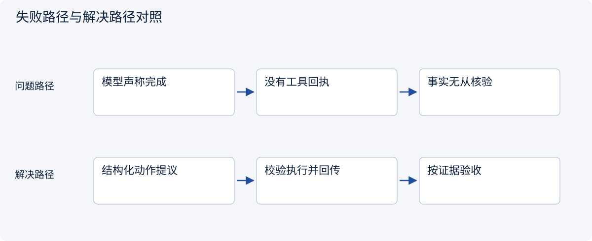
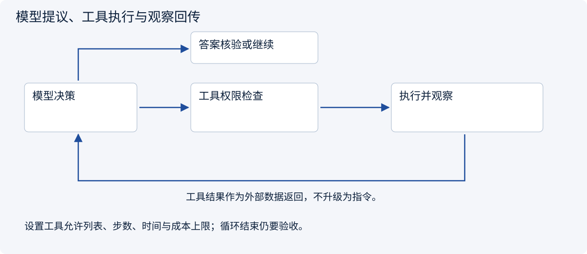
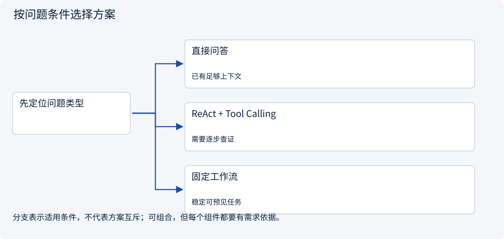
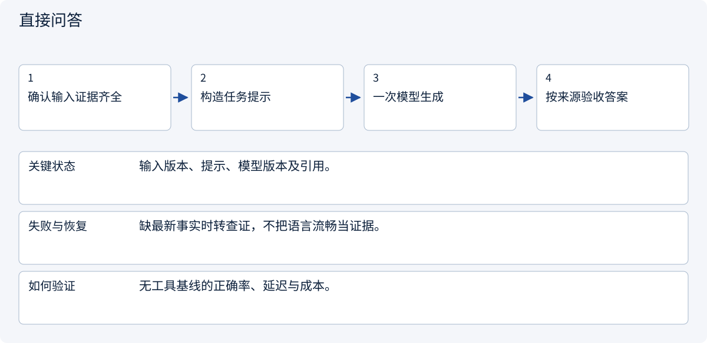
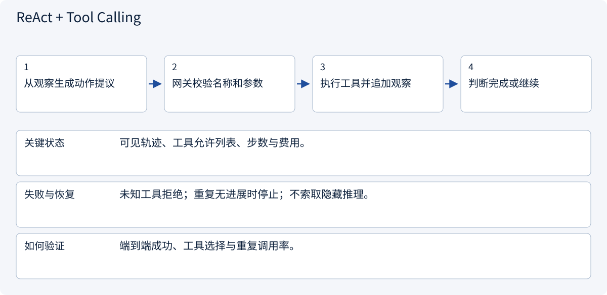
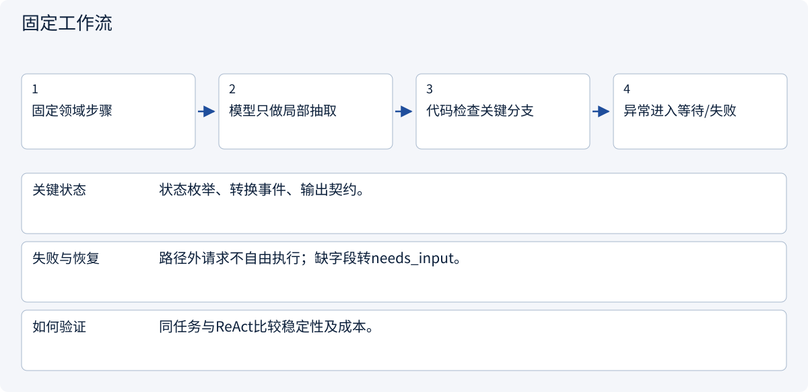

# 2.2.1 LLM 与 Agent 基础：从“会回答”到“会办事”

> 图解主线 · 对照主流方案 · 配参考代码

## 先看问题

模型说“我查到了”，并不代表真实执行了工具。如何让回答受观察结果约束？




## 图解工作原理

ReAct 式循环让模型提议动作、程序校验与执行、观察结果回到上下文；最终答案还要验收。



## 主流方案怎么选



| 方案 | 怎样解决 | 适用条件 | 代价与边界 |
|---|---|---|---|
| 直接问答 | 一次生成 | 已有足够上下文 | 不能获取新外部事实 |
| ReAct + Tool Calling | 按观察动态选动作 | 需要逐步查证 | 必须设步数和工具预算 |
| 固定工作流 | 程序决定步骤 | 稳定可预见任务 | 灵活性较低 |

## 主流方案内部怎样运行

### 1 · 直接问答



**具体推演：** 只读给定三份完整报价时，未必需要自主工具循环。

### 2 · ReAct + Tool Calling



**具体推演：** 先读A发现缺交期，再读条款，不因第一次返回200就结束。

### 3 · 固定工作流



**具体推演：** 抽取→校验→计算→审批是确定骨架，检索内部可有自主选择。

## 参考代码

展开查看与本课机制对应的实现。训练函数仅提供代码，不执行实际训练；依赖与验证范围见配套代码说明。

[配套代码说明与验证范围](../../../docs/zh/projects/03-code-guide.md)

<details><summary>展开代码与实现边界</summary>

```python
"""A bounded model/tool loop using an injected provider, never a live API on import."""

from collections.abc import Callable
from dataclasses import dataclass


@dataclass(frozen=True)
class Decision:
    tool: str | None
    argument: str
    answer: str = ""


def run(
    model: Callable[[list[dict]], Decision],
    tools: dict[str, Callable[[str], str]],
    question: str,
    max_steps: int = 5,
) -> tuple[str, list[dict]]:
    if max_steps < 1:
        raise ValueError("A positive step budget is required")
    messages = [{"role": "user", "content": question}]
    for _ in range(max_steps):
        decision = model(messages.copy())
        if decision.tool is None:
            if not decision.answer:
                raise ValueError("Empty final answer")
            return decision.answer, messages
        if decision.tool not in tools:
            raise PermissionError("Tool is outside this task's capability set")
        result = tools[decision.tool](decision.argument)
        messages.append(
            {"role": "assistant", "tool": decision.tool, "argument": decision.argument}
        )
        messages.append({"role": "tool", "content": result})
    raise TimeoutError("Step budget exhausted without a final answer")


# Tool implementations must enforce object authorization and result schemas.
```

</details>

## 改变条件，检查理解

工具返回成功后，为什么还要检查最终答案？

<details><summary>展开参考答案</summary>

工具可能只完成了局部步骤；仍须检查证据、口径与用户要求，不能把工具成功当任务成功。

</details>

<details><summary>按需展开：原理推导与边界补充</summary>

**先认清几个词**

LLM：大语言模型，擅长根据上下文生成文字。Agent：利用模型选择下一步、借助工具办事的系统。API：程序之间请求服务的接口，可理解为标准化服务窗口。Schema：规定答案必须包含哪些字段的格式清单。

**开场：小林的第一笔调研订单**

客户说：“我有 5000 元，想知道马来西亚宠物用品值不值得做。”普通聊天模型会给一篇看似完整的建议；可靠 Agent 首先发现：预算币种、经营主体、目标平台、交付形式都没有确定。它的第一步可能不是搜索，而是问：“5000 元是人民币总启动预算吗？你希望收到市场对比，还是可直接采购的清单？”

**Agent = 模型提出下一步 + 程序维护状态、执行工具并检查结果。** 模型不是操作系统，也不能仅凭文字声明“已查询”就获得数据。

**把五个概念装进同一个例子**

- **Token 与上下文窗口**：模型输入、输出都有容量限制。中文字符数不等于 token 数，真正计费用供应商 tokenizer 或 API usage。模型参数数量也不等于可用上下文大小。
- **System Prompt**：规定角色与边界，例如“事实附来源；未知不编造；报价必须审批”。它不是安全隔离，程序仍需检查权限。
- **Tool Calling**：模型返回结构化请求，如 `search({"query":"..."})`；程序验证后调用工具，再把结果放回消息流。不能把普通自然语言当成已经执行的调用。
- **ReAct / Agent Loop**：观察结果、决定下一步、执行、再观察。教学记录可保存简短决策理由和可见行动，不需要索取或存储模型隐藏思维过程。
- **结构化输出**：用 schema 约束字段、枚举和长度；合法 JSON 只代表格式正确，不代表事实正确。


**跟着一次完整对话理解过程**

第一步，客户说：“5000 元，看看马来西亚宠物用品。”Agent 发现币种和交付形式不清楚，于是先追问。此时它还没有搜索，更没有注册店铺。

第二步，客户确认：“人民币总预算，只要中文对比报告。”系统把这个回答加入当前任务，模型建议使用搜索工具。注意：建议调用搜索与真正搜索是两件事，后者要由程序执行。

第三步，工具返回两条公开资料，分别有网页地址、日期和摘要。模型读取资料，发现主体资格仍不清楚，选择继续核实，而不是为了尽快结束编造结论。

第四步，模型生成报告，区分已知事实、估算和未解决问题。系统再检查是否符合客户要求。直到通过这些检查，任务才算完成。

这好比请一位助手查资料：他说“我去查”不算查到；拿回一本书不算理解；写完文章也不代表文章正确。

**如果过程中出错呢**

搜索条件缺失时，应补充条件，而不是盲目执行。工具连续失败时，应停止并说明原因，而不是永远循环。资料太长时，应选取相关内容并保留来源，而不是把所有网页文字塞进模型。

学习时拿一张纸，画出“客户输入 → 模型建议 → 程序检查 → 工具执行 → 结果返回 → 答案检查”。分别标注谁负责每一步。能分清这些责任，比记住某个工具名称更重要。

**延伸阅读与常见坑**

从 [Microsoft AI Agents for Beginners](https://github.com/microsoft/ai-agents-for-beginners) 和 [Hugging Face Agents Course](https://github.com/huggingface/agents-course) 学习基础。新手先读课程的概念说明；有编程基础后再找工具调用示例，画出“模型输出”与“程序执行”的边界，再看框架封装。阅读时记录实际版本；本章不声称已逐行审阅其当前实现。

最常见的坑不是模型不够聪明，而是把“说会做”当成“已执行”、把 JSON 校验当事实校验、把 prompt 当权限控制。下一章会讨论哪些步骤根本不必交给 Agent。

**理解题与参考答案**

**1. 模型说“我已搜索”是否能证明完成搜索？**

参考答案：不能。需要真实工具执行及其结果；文字承诺不等于动作回执。

**2. 为什么结构化输出仍可能出错？**

参考答案：格式正确不代表事实、来源和业务判断正确。


</details>

[查看官方资料与方案依据](../../../docs/zh/resources.md)
