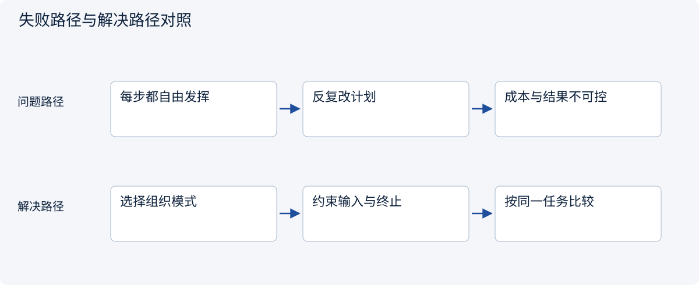
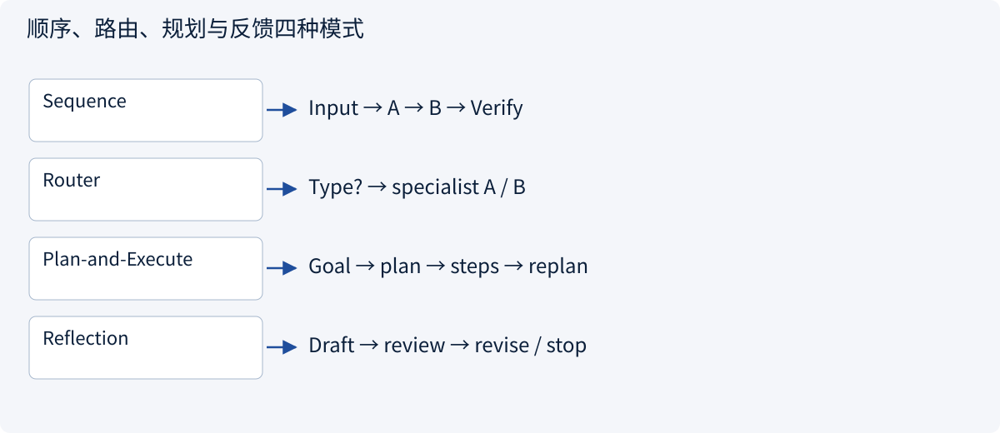
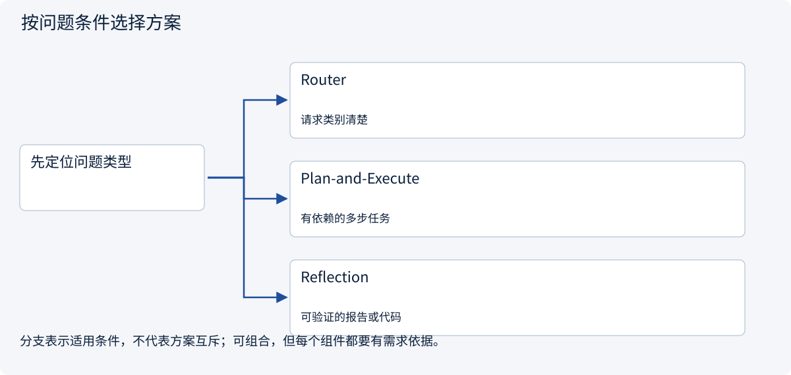
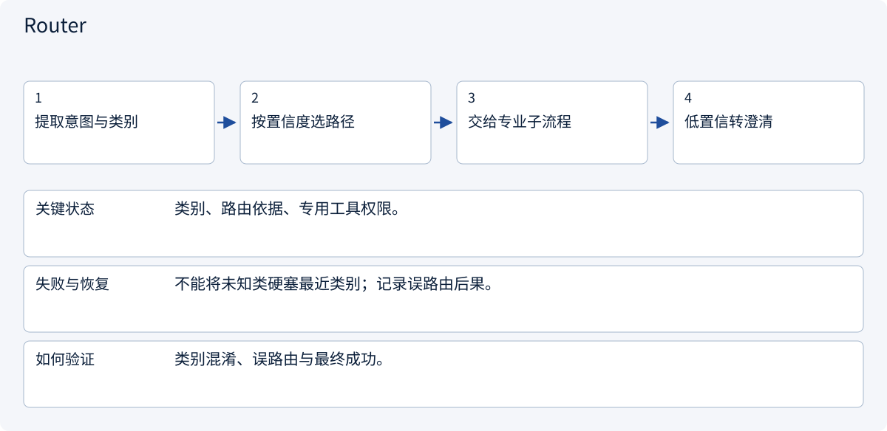
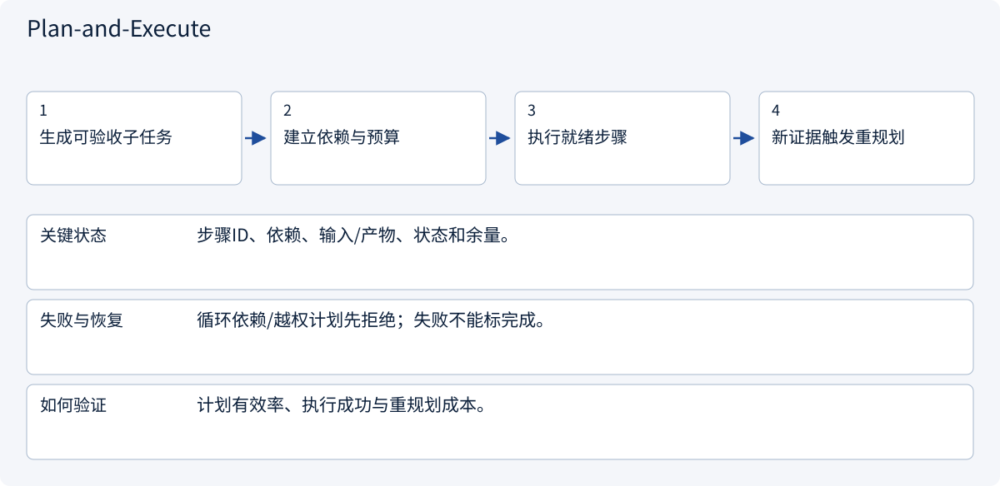
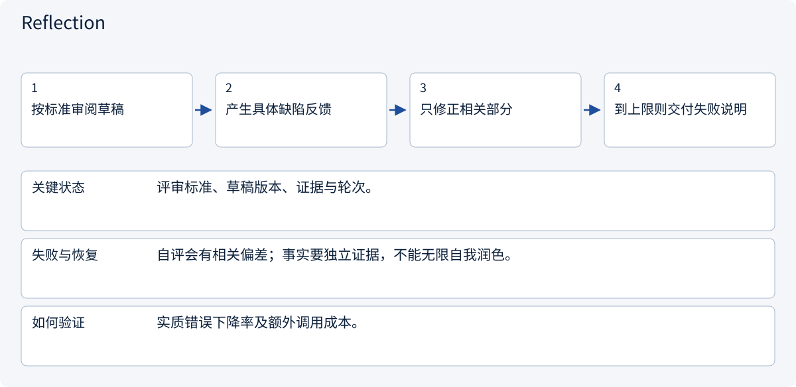

# 2.2.2 Agent控制流：固定工作流与动态循环

> 图解主线 · 对照主流方案 · 配参考代码

代码演示路由、计划校验与有限反思的控制流；生成计划的质量需另做模型对照评测。

## 先看问题

有些任务路径固定，有些要边查边改；计划和反思应该放在哪里？




## 图解工作原理

顺序流程控制稳定路径，Router 分类分流，Plan-and-Execute 分解任务，Reflection 用明确标准有限修订。



## 主流方案怎么选



| 方案 | 怎样解决 | 适用条件 | 代价与边界 |
|---|---|---|---|
| Router | 按类型选专用路径 | 请求类别清楚 | 分错会传递错误 |
| Plan-and-Execute | 先拆解再执行并可重规划 | 有依赖的多步任务 | 计划本身也要校验 |
| Reflection | 按独立标准反馈修订 | 可验证的报告或代码 | 自评不能代替外部证据 |

## 主流方案内部怎样运行

### 1 · Router



**具体推演：** 报告抽取走固定管线，开放研究走工具循环。

<details><summary>展开文字步骤、状态与失败边界</summary>

1. 提取意图与类别
2. 按置信度选路径
3. 交给专业子流程
4. 低置信转澄清

**关键状态** 类别、路由依据、专用工具权限。

**失败与恢复** 不能将未知类硬塞最近类别；记录误路由后果。

**如何验证** 类别混淆、误路由与最终成功。

</details>

### 2 · Plan-and-Execute



**具体推演：** 价格比较依赖先拿齐规格和税口径，不能反过来执行。

<details><summary>展开文字步骤、状态与失败边界</summary>

1. 生成可验收子任务
2. 建立依赖与预算
3. 执行就绪步骤
4. 新证据触发重规划

**关键状态** 步骤ID、依赖、输入/产物、状态和余量。

**失败与恢复** 循环依赖/越权计划先拒绝；失败不能标完成。

**如何验证** 计划有效率、执行成功与重规划成本。

</details>

### 3 · Reflection



**具体推演：** 反馈应是“交期无引用”，而非笼统“再写好一点”。

<details><summary>展开文字步骤、状态与失败边界</summary>

1. 按标准审阅草稿
2. 产生具体缺陷反馈
3. 只修正相关部分
4. 到上限则交付失败说明

**关键状态** 评审标准、草稿版本、证据与轮次。

**失败与恢复** 自评会有相关偏差；事实要独立证据，不能无限自我润色。

**如何验证** 实质错误下降率及额外调用成本。

</details>

## 参考代码

展开查看与本课机制对应的实现。训练函数仅提供代码，不执行实际训练；依赖与验证范围见配套代码说明。

[配套代码说明与验证范围](../projects/03-code-guide.md)

<details><summary>展开代码与实现边界</summary>

```python
"""A teaching comparison: Plan-and-Execute and bounded Reflection."""

from collections.abc import Callable


def plan_and_execute(
    question: str,
    planner: Callable[[str], list[str]],
    execute: Callable[[str], str],
    max_tasks: int = 5,
) -> list[str]:
    tasks = planner(question)
    if not tasks or len(tasks) > max_tasks:
        raise ValueError("Invalid or over-budget plan")
    return [execute(task) for task in tasks]


def reflect(
    draft: str,
    review: Callable[[str], tuple[bool, str]],
    revise: Callable[[str, str], str],
    rounds: int = 2,
) -> str:
    for _ in range(rounds):
        accepted, feedback = review(draft)
        if accepted:
            return draft
        draft = revise(draft, feedback)
    accepted, _ = review(draft)
    if not accepted:
        raise ValueError("Review budget exhausted")
    return draft


# Model-generated tasks still need authorization; a reviewer is not factual proof.
```

</details>

## 改变条件，检查理解

计划执行中发现报价缺失，应强行完成原计划吗？

<details><summary>展开参考答案</summary>

不应。转到补充证据或等待输入，更新依赖与预算；计划没有越过授权的权力。

</details>

<details><summary>按需展开：原理推导与边界补充</summary>

**先认清几个词**

工作流：预先规定的办事顺序。状态：任务目前所处阶段。事件：刚刚发生的变化。状态机：规定哪些阶段可以转到哪些阶段的一套规则。

**故事：不要雇十个 Agent 来填写一张表**

小林需要把客户需求整理成“目标市场、产品类别、预算、截止时间、交付格式”。这些字段是固定的，用一次结构化抽取加校验就能完成。只有当问题开放、下一步取决于搜索结果时，才值得引入自主循环。**工作流确定路径，Agent 决定路径；两者可以在同一个系统中组合。**

我们把订单拆成：澄清需求 → 资料调研 → 形成范围和报价 → 人工审批 → 执行 → 质量检查 → 交付。研究步骤可以探索，商业承诺步骤不能随意探索。


**四种常见模式如何选**

| 模式 | 适合的问题 | 主要代价 |
|---|---|---|
| 顺序工作流 | 字段清洗、固定报告模板 | 难以处理路径变化 |
| Router 路由 | 根据任务类型选择专业 Agent | 分类错误会传递下去 |
| Planner + Executor | 需要拆解、可分阶段验收的任务 | 计划可能不现实，需要更新 |
| Supervisor + Workers | 多市场并行研究 | 通信、费用、结果冲突增加 |

不要把 Planner 的输出视为指令最高来源。它也可能规划了未经用户授权的付款或发信。执行器应该看到的是经过验证的任务对象，而不是“请照着这段文字全部做”。

**从需求到状态机的完整例子**

客户确认只需“马来西亚和新加坡两地市场对比，中文 Markdown，不采购、不注册账号”。将这些边界写入 `TaskSpec`，并给它一个版本号。状态从 `needs_clarification` 进入 `ready_for_research`，研究完成进入 `awaiting_approval`。客户又说“增加泰国”，这不是给旧任务追加一句话，而是更新范围版本、重新估算、使旧报价失效。

建议状态至少包含：等待输入、就绪、运行中、等待审批、失败、完成、取消。事件是“发生了什么”，状态是“现在是什么”。例如 `approval_granted` 是事件，`running` 是状态。审批记录绑定需求版本及拟执行动作，不能用一个过期的“可以”批准后来扩大的范围。

**纸上推演：一个订单会经历什么**

在纸上写下“等待澄清、开始研究、等待审批、执行、完成、取消”六张卡片。客户信息不完整时停在第一张；资料齐全后进入研究；报价草稿形成后进入等待审批。

现在加入三个意外：客户扩大范围、审批消息重复到达、客户取消后研究结果才返回。逐一思考应该移动到哪张卡片。扩大范围通常需要重新估算；重复审批不能重复执行；取消后迟到的结果不能自动交付。

这就是状态机的直观含义：系统只允许从当前状态进入合理的下一状态，而不是收到一句话就随意改变行为。

**阅读与生产提醒**

可从 [LangGraph](https://github.com/langchain-ai/langgraph) 观察状态图、暂停与恢复等抽象。阅读目标是理解数据与控制流，不是立即选定开发语言或复制整个框架。生产中应先实现单任务路径，再引入并行；先验证状态机，再优化提示词。下一章解决状态已正确，但模型“看错重点”的问题。

**理解题与参考答案**

**1. 固定报表每次都需要自主 Agent 吗？**

参考答案：不需要。路径明确时，固定工作流通常更简单可控。

**2. 客户扩大需求范围后，旧审批还能直接用吗？**

参考答案：不能默认沿用，应检查原审批是否仍覆盖新的范围与承诺。


</details>

[查看官方资料与方案依据](../resources.md)
