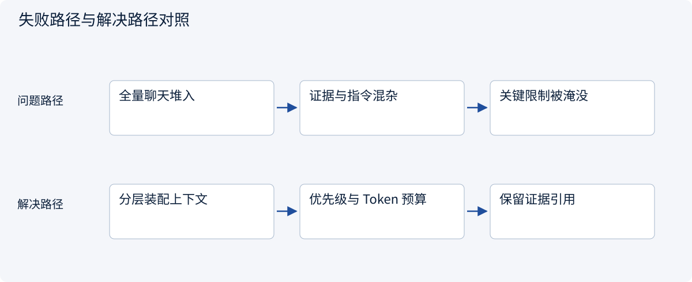
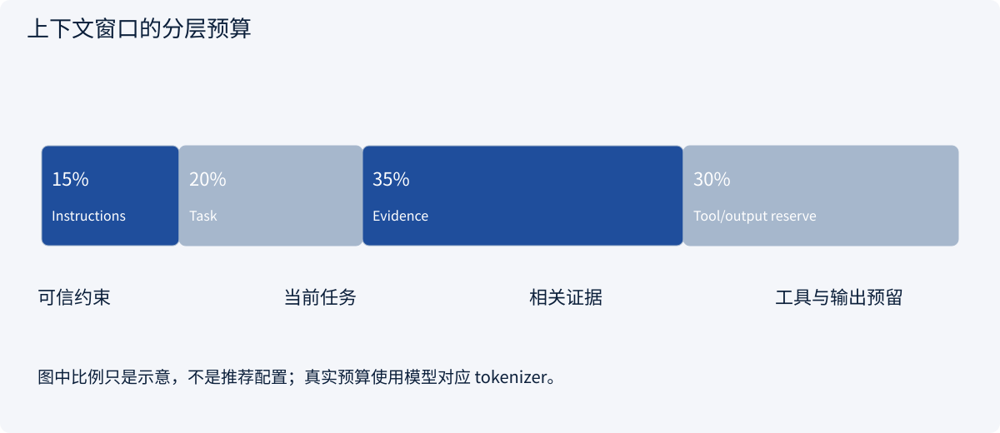
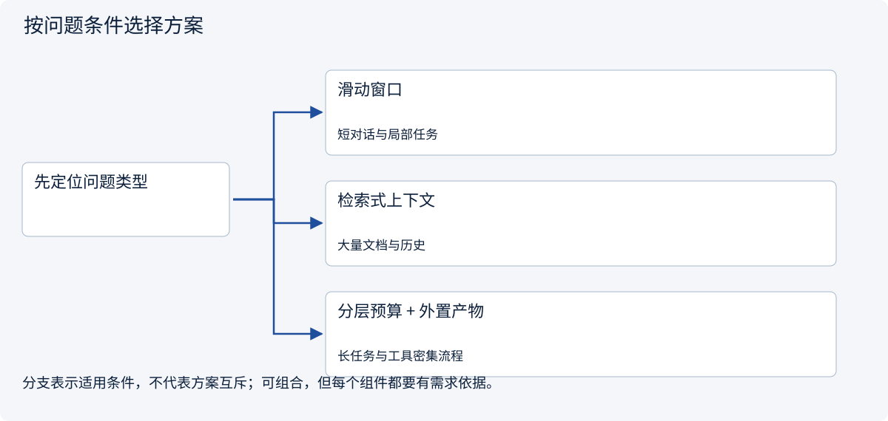
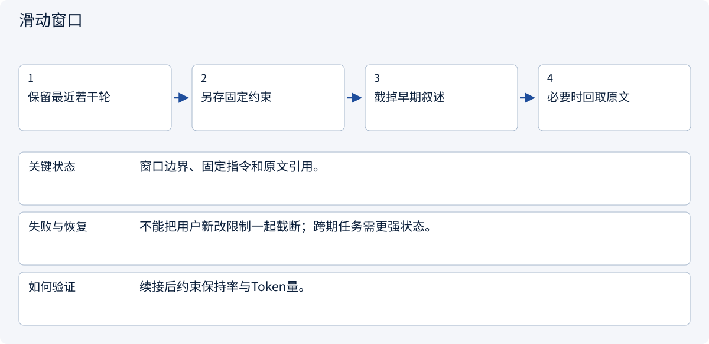
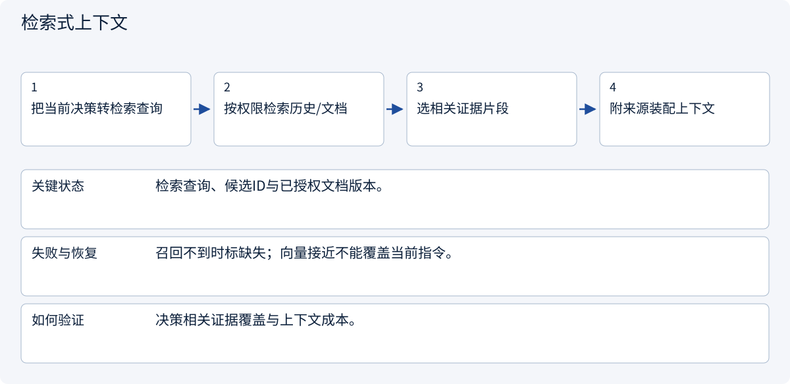
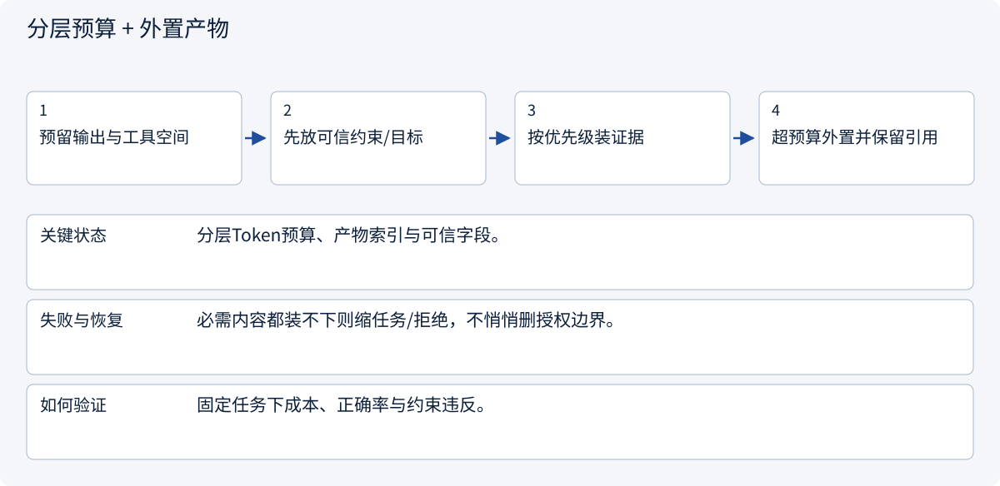

# 2.3.1 Context Engineering：给研究员准备一张干净的办公桌

> 图解主线 · 对照主流方案 · 配参考代码

## 先看问题

窗口很大仍会漏掉约束，或者被低价值历史挤满。该保留哪些上下文？



## 图解工作原理

把窗口当预算：保护系统约束与当前目标，按相关性装入证据，预留工具和输出空间。



## 主流方案怎么选



| 方案 | 怎样解决 | 适用条件 | 代价与边界 |
|---|---|---|---|
| 滑动窗口 | 保留最近消息 | 短对话与局部任务 | 会丢早期约束 |
| 检索式上下文 | 按当前问题取证据 | 大量文档与历史 | 召回失败会丢信息 |
| 分层预算 + 外置产物 | 保护指令，引用大文件 | 长任务与工具密集流程 | 需维护原文可取回性 |

## 主流方案内部怎样运行

### 1 · 滑动窗口



**具体推演：** 十轮前预算改变，应保存在任务字段而非只靠最近聊天。

### 2 · 检索式上下文



**具体推演：** 当前问交期只取交期与数量限制，不把所有附件原文塞进来。

### 3 · 分层预算 + 外置产物



**具体推演：** 任务状态存数据库，长搜索结果存产物，模型只看相关摘录。

## 参考代码

展开查看与本课机制对应的实现。训练函数仅提供代码，不执行实际训练；依赖与验证范围见配套代码说明。

[配套代码说明与验证范围](../../../docs/zh/projects/03-code-guide.md)

<details><summary>展开代码与实现边界</summary>

```python
"""Pack context using the target tokenizer's count, not a character estimate."""

from collections.abc import Callable
from dataclasses import dataclass


@dataclass(frozen=True)
class ContextPart:
    text: str
    priority: int
    required: bool = False


def pack(
    parts: list[ContextPart],
    window: int,
    output_reserve: int,
    count_tokens: Callable[[str], int],
) -> list[str]:
    budget = window - output_reserve
    if output_reserve < 0 or budget < 0:
        raise ValueError("Invalid context budget")
    selected = [part.text for part in parts if part.required]
    # The counter must include actual separators/chat-template overhead.
    if count_tokens("\n".join(selected)) > budget:
        raise ValueError(
            "Required instructions do not fit; stop instead of deleting them"
        )
    for part in sorted((p for p in parts if not p.required), key=lambda p: -p.priority):
        proposal = selected + [part.text]
        if count_tokens("\n".join(proposal)) <= budget:
            selected = proposal
    return selected
```

</details>

## 改变条件，检查理解

装不下可信约束时，应该悄悄删掉一条吗？

<details><summary>展开参考答案</summary>

不应。停止装配并调整任务或预算，不能为了塞入窗口删掉用户的重要限制。

</details>

<details><summary>按需展开：原理推导与边界补充</summary>

**先认清几个词**

上下文：模型本轮能看到的信息。Token：模型处理文字的小单位，不一定等于一个字。检索：从已有资料中寻找相关内容。缓存：保留可复用结果以减少重复工作。

**故事：模型不是忘了，而是桌面太乱**

小林已经确认“不注册店铺，只做调研”。搜索工具却返回一万行网页，其中夹着“点击立即开店”的营销文案。若把所有历史、网页、工具日志一股脑交给模型，最重要的边界可能淹没在噪声里。上下文工程不是写更长 prompt，而是**决定本轮模型应该看到什么、按什么顺序看到、每部分可信到什么程度**。

区分三层：持久化任务状态保存事实；检索系统寻找候选资料；上下文构造器决定本轮输入。没放进模型窗口的数据不等于删除，放进去的数据也不等于可信指令。


**一份预算账本**

假设某模型可用上下文总量为 32,000 tokens，计划预留 4,000 输出和 2,000 安全余量，则输入目标不超过 26,000。进一步分配：稳定规则 2,000、当前任务 2,000、工作摘要 3,000、最近消息 5,000、证据片段 10,000、工具定义 4,000。各区分配是上限而非必须填满；实际模型对输入输出合计的规则需要查提供商文档。

```text
输入预算 = 上下文总量 - 输出预留 - 安全余量
候选资料价值 = 相关性 + 证据质量 + 新鲜度 - 冗余 - 长度成本
```

第二个表达式是设计直觉，不是可跨项目直接使用的统一评分公式。先给候选条目记录来源、时间、主题、权限标签，再通过小评测集调权重。

**逐步案例：把“乱桌子”收拾成一轮请求**

输入有五类内容：客户确认、旧报价、最近一次搜索、旧网页、工具报错。按下面顺序处理：

1. 从任务状态读取最新范围版本，而不是从聊天里猜最新承诺。保留币种 CNY、总预算 5000、两地对比、禁止采购、交付 Markdown。
2. 发现旧报价属于范围 v1，而当前为 v2，排除旧报价或明显标记为失效。不能让检索排序把旧事实“复活”。
3. 最近消息按完整工具交互单元保留。工具调用和工具结果有配对 ID，不能只留一个孤立结果，具体消息约束以供应商协议为准。
4. 网页只选回答当前问题的段落，每段保留 URL、抓取时间、原文定位。网页中的指令按资料处理，不提升为系统规则。
5. 对临时 429 错误保留错误类别、重试次数和等待时间即可，不必重复塞入完整栈日志。
6. 调用真实 tokenizer 估算预算；超预算时先删冗余证据，再压缩旧对话，最后请求缩小任务，而不是静默丢掉禁止项。

输出应能解释每个片段为什么被选中。把“选中/排除理由、token 数、任务版本”记录到调试日志，注意日志脱敏。

**缓存和隔离不是同一件事**

稳定 system 前缀、工具 schema 有利于提供商的 prompt caching，但缓存命中条件、价格和保留方式因提供商而异，不能承诺通用收益。动态时间戳放在稳定前缀之前可能降低命中。不同客户与任务必须先做权限隔离，再做缓存复用；不可为了缓存命中，把 A 客户私密需求放进 B 客户上下文。

多个 Agent 也不应共享一个无限增长的聊天数组。研究员看到其子任务、必要公共边界和证据；质检员看到交付物与验收条件；审批者看到具体拟执行动作。隔离减少噪声，也缩小数据暴露面。

**纸上比较：更短一定更好吗**

准备两份资料包。甲包保留最后十条聊天，却漏掉最早的“不联系供应商”；乙包保留最新目标、禁止项和三条相关证据。即使甲包更短，也可能导致更严重的错误。上下文整理应同时关注信息量、关键约束、来源和隐私，而不是只追求少字。

自检时观察：最新需求是否仍在？旧报价是否清楚标为失效？不同客户的资料是否混在一起？每个结论是否能找到原文？长度不足时是否会明确告知，而不是默默删掉重要限制？

未来有技术基础后，可用多组相同任务比较策略，记录任务正确率、过时事实采用率和输入 token。但本章不要求运行实验，也不提供未测量的效果数字。


阅读 [LangGraph](https://github.com/langchain-ai/langgraph) 的状态组织和 [Deep Agents](https://github.com/langchain-ai/deepagents) 的上下文处理思路。先定位概念和测试，再记录当前版本路径；不要假设某项目宣称支持的策略等于你的任务已验证。下一章专门处理历史确实太长时的压缩。

**理解题与参考答案**

**1. 上下文越长越好吗？**

参考答案：不是。重复、过时和无关内容会增加成本并干扰判断，关键是相关、可信与最新。

**2. 重要约束与相关性很低的旧消息应如何处理？**

参考答案：重要约束应进入权威任务状态，不能仅因检索分低就丢掉。


</details>

[查看官方资料与方案依据](../../../docs/zh/resources.md)
