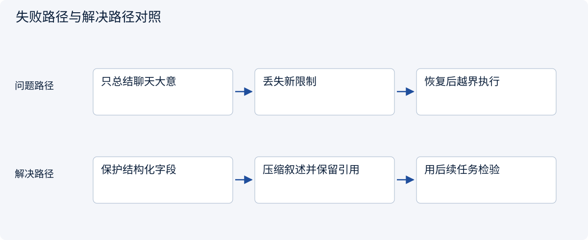
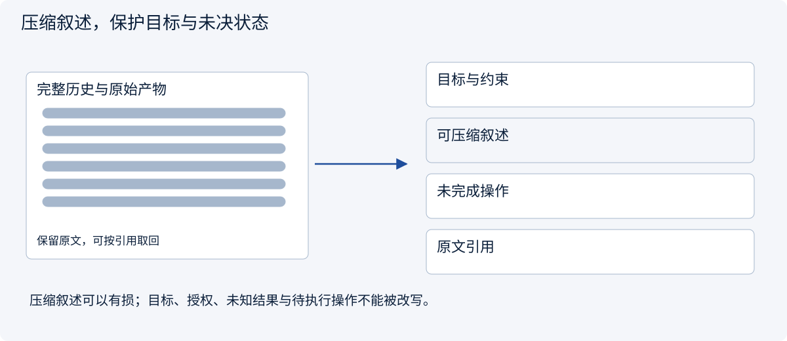
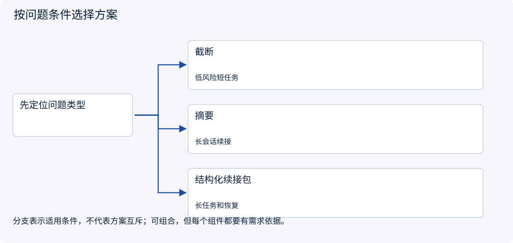
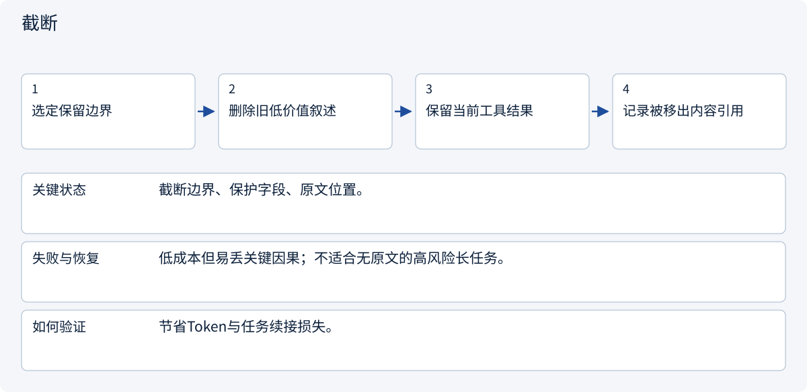
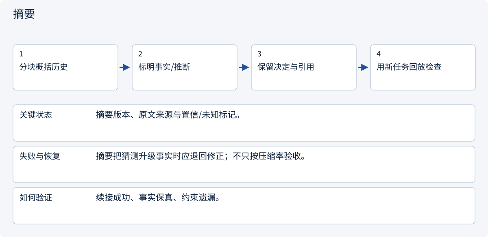
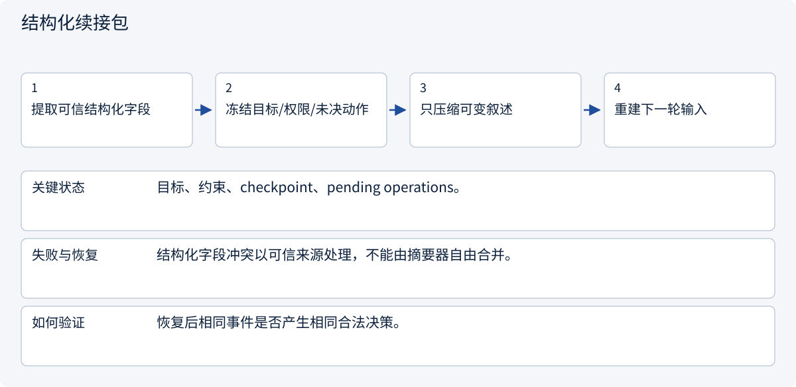

# 2.3.2 Context Compaction：不是删聊天，而是打包行李

> 图解主线 · 对照主流方案 · 配参考代码

## 先看问题

历史压缩后短了，但用户改过的预算、未完成操作和证据丢了。



## 图解工作原理

把压缩分成不可改写的可信字段与可压缩叙述；保留来源与未决状态，再用继续任务验证质量。



## 主流方案怎么选



| 方案 | 怎样解决 | 适用条件 | 代价与边界 |
|---|---|---|---|
| 截断 | 直接移除旧消息 | 低风险短任务 | 信息不可逆丢失 |
| 摘要 | 压缩过程叙述 | 长会话续接 | 可能混淆事实与推断 |
| 结构化续接包 | 保护目标、约束、待办与引用 | 长任务和恢复 | 仍需原文与质量检查 |

## 主流方案内部怎样运行

### 1 · 截断



**具体推演：** 旧闲聊可移出，未决创建操作不能一起丢。

### 2 · 摘要



**具体推演：** 把“运费未知”压成“包邮”应直接判压缩失败。

### 3 · 结构化续接包



**具体推演：** 保留operation_id及UNKNOWN，避免重启后重复创建。

## 参考代码

展开查看与本课机制对应的实现。训练函数仅提供代码，不执行实际训练；依赖与验证范围见配套代码说明。

[配套代码说明与验证范围](../../../docs/zh/projects/03-code-guide.md)

<details><summary>展开代码与实现边界</summary>

```python
"""Protected task facts survive a lossy history summary."""

from dataclasses import dataclass


@dataclass(frozen=True)
class Continuation:
    goal: str
    constraints: tuple[str, ...]
    verified_sources: tuple[str, ...]
    pending_operations: tuple[str, ...]
    summary: str


def compact(previous: Continuation, candidate_summary: str) -> Continuation:
    # A summarizer can compress narrative, but cannot rewrite trusted fields.
    return Continuation(
        previous.goal,
        previous.constraints,
        previous.verified_sources,
        previous.pending_operations,
        candidate_summary,
    )


# Keep original artifacts elsewhere. This packet does not grant tool permission.
```

</details>

## 改变条件，检查理解

摘要把“结果未知”写成“未执行”，有什么风险？

<details><summary>展开参考答案</summary>

恢复时可能重复执行已成功的外部动作；不确定性必须显式保留。

</details>

<details><summary>按需展开：原理推导与边界补充</summary>

**先认清几个词**

压缩：在限制长度的同时保留继续任务所需信息。分层摘要：先总结小段，再总结较大范围。原子保存：要么完整保存，要么不切换到不完整结果。

**故事：旅途继续，行李箱却满了**

两小时调研后，小林的 Agent 已读了几十个页面。客户最初要求“不联系供应商”，后来又把交付从 PDF 改成 Markdown。把历史截成最后十条，会同时丢掉这两个关键决定；生成一段“我们正在做市场调研”的摘要也不够。压缩要保留**继续工作所需的状态、承诺、未解决问题和证据定位**，而不是保留对话的文学梗概。

先区分三种动作：trimming 删除不再需要的片段；summarization 把文字变短；compaction 是包含摘要、状态提取、原文卸载和恢复校验的整体过程。任何有损压缩都可能出错，不能把摘要当唯一原始记录。


**四种策略的取舍**

| 策略 | 好处 | 失效方式 | 适合放在哪 |
|---|---|---|---|
| 滑动窗口 | 实现简单、便宜 | 早期约束消失 | 最近消息区 |
| 分层摘要 | 长任务可逐层归纳 | 多次摘要累计失真 | 工作摘要区 |
| 相关性选择 | 只取当前需要的证据 | 暂时无关但重要的约束被漏掉 | 证据区，不替代规则 |
| 工具结果外置 | 大文件不占满窗口 | 引用失效、恢复读不到 | 原文与构建日志 |

推荐组合而不是选一个万能方案：权威状态单独保存；最新交互窗口保留；旧历史结构化摘要；原始证据可按引用重新读取。

**一份可以继续工作的压缩包**

| 压缩包内容 | 本例应该保留什么 |
|---|---|
| 目标 | 马来西亚与新加坡宠物用品对比 |
| 限制 | 总预算 5000 CNY，不采购，不联系供应商 |
| 最新决定 | 中文 Markdown，不再是旧版 PDF |
| 已完成 | 已收集两地平台费用资料 |
| 待办 | 核实主体要求与物流区间 |
| 未知 | 运费尚未取得实际报价 |
| 来源位置 | 能重新打开原始费用资料的位置 |
| 下一步 | 阅读主体准入的官方资料 |

原文的位置必须真实可访问。摘要还要保留失败尝试，例如“某页面需要登录，因此未读取”，避免恢复后不断重复同一个失败动作。


**一步一步理解压缩过程**

1. 选择触发点，例如预计下一轮请求会超过输入预算 80%。80% 是示例参数，不是行业标准。不要等 API 拒绝才开始处理。
2. 暂停追加同一会话的消息，或记录明确的事件边界。压缩期间到达的新消息进入下一批，防止漏消息。
3. 从权威状态复制预算、审批、任务版本和禁止项；这些字段不交给摘要模型自由改写。
4. 对旧历史生成结构化摘要，保留证据 ID、未完成步骤、阻塞原因、用户纠正。禁止把推测提升成事实。
5. 校验必需字段与旧状态一致、所有引用可读、没有秘密凭证进入摘要。失败时不得覆盖旧快照。
6. 原子保存压缩包和处理到的事件序号，再切换运行上下文。恢复时根据序号重放尚未处理的事件。

**纸上推演：离开后还能回来吗**

构造一个中断点：Agent 正要核实马来西亚主体要求时压缩并重启。恢复后应继续核实，而不是宣称所有调研完成。将“不得联系供应商”只放在最早事件，检查恢复后是否仍受约束。再加入客户在压缩期间修改格式的事件，验证最终采用最新版本。

评测表至少有：压缩前后 token、压缩本身费用与时延、硬约束保留率、证据引用有效率、恢复后的任务成功率、重复动作数。压缩率可定义为 `1 - 压缩后输入 token / 压缩前输入 token`，但必须连同质量指标报告。仅展示一个漂亮百分比会掩盖关键信息丢失。

检查目标：禁止项全部保留；摘要矛盾能触发回退；中断恢复不重复有副作用动作；原文引用可定位；小样本结果标注样本数而不是泛化为生产结论。

**延伸阅读与常见坑**

对照 [Deep Agents](https://github.com/langchain-ai/deepagents) 与 [Codex](https://github.com/openai/codex) 理解长任务状态维护，记录阅读 commit 和实际文件位置。借鉴边界、测试与恢复思路，不依赖 Codex CLI 代替自己的运行时。生产中最危险的是“摘要已经写成功，所以可以删除原文”；这还取决于审计、恢复、隐私保留策略，不应自动推导。

**理解题与参考答案**

**1. 把聊天总结成一句话就是可靠压缩吗？**

参考答案：不是。还需保存约束、决定、未完成事项、来源和可恢复状态。

**2. 压缩后更省 token 是否足以证明更好？**

参考答案：不足。必须检查关键事实、限制和任务质量是否保留。


</details>

[查看官方资料与方案依据](../../../docs/zh/resources.md)
