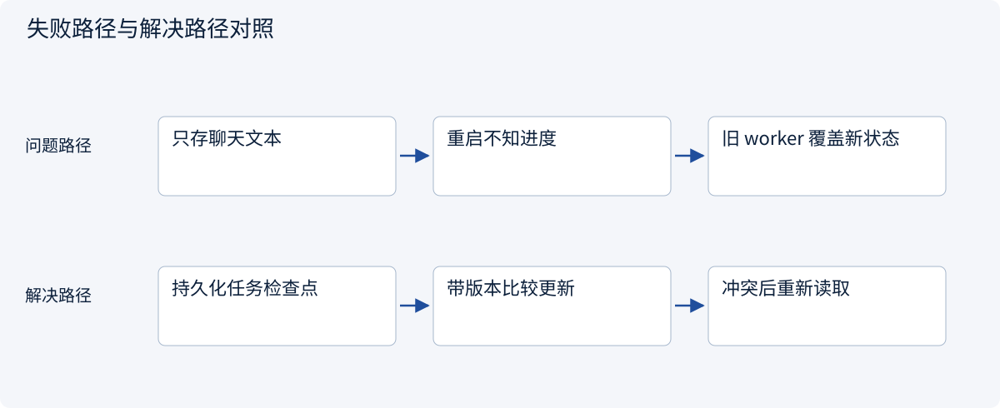
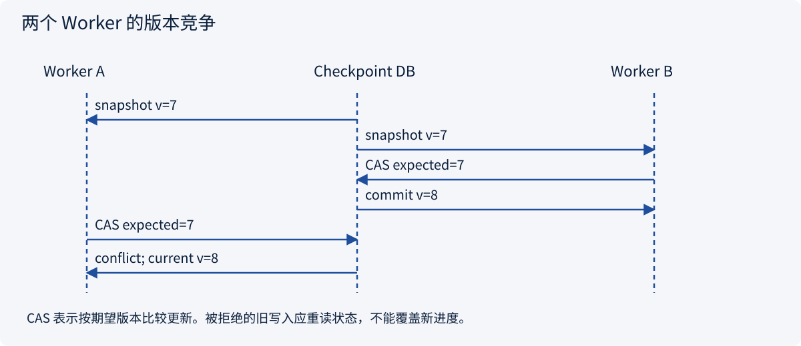
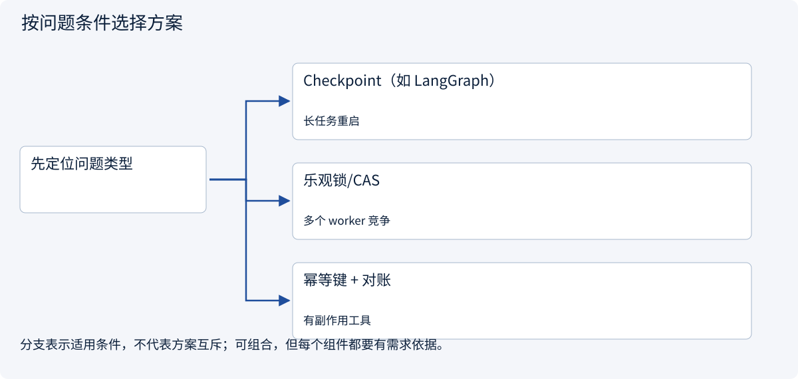
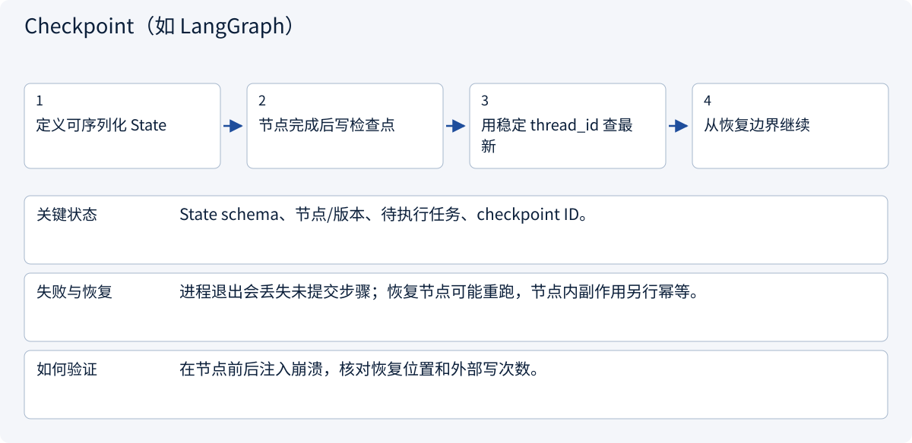
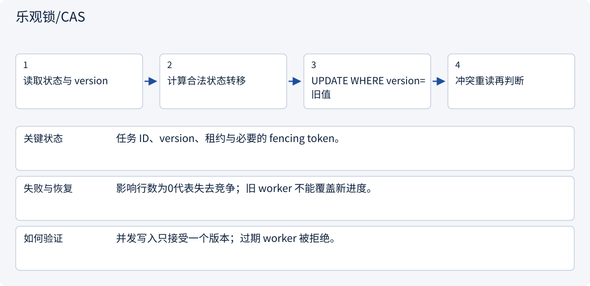
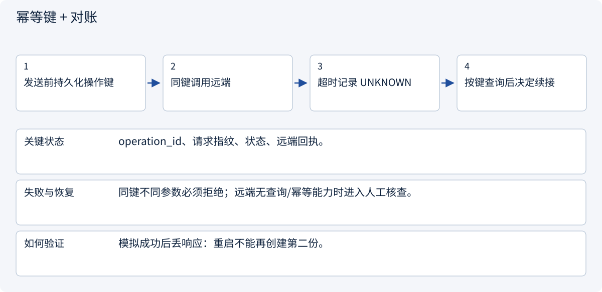

# 2.7.1 短期记忆：断电以后，订单不能失忆

> 图解主线 · 对照主流方案 · 配参考代码

## 先看问题

服务重启或两个 worker 同时更新时，任务怎样恢复而不覆盖进度？




## 图解工作原理

按任务与租户保存版本化检查点；乐观锁拒绝旧版本覆盖。外部动作是否完成仍需独立查询。



## 主流方案怎么选



| 方案 | 怎样解决 | 适用条件 | 代价与边界 |
|---|---|---|---|
| Checkpoint（如 LangGraph） | 记录可续接状态 | 长任务重启 | 不证明外部副作用 |
| 乐观锁/CAS | 按期望版本更新 | 多个 worker 竞争 | 需处理重读与重试 |
| 幂等键 + 对账 | 识别同一外部操作 | 有副作用工具 | 依赖远端能力 |

## 主流方案内部怎样运行

### 1 · Checkpoint（如 LangGraph）



**具体推演：** 报价已保存但比较节点未完成：恢复时重算比较，不重复整段调研。

### 2 · 乐观锁/CAS



**具体推演：** 两个 worker 都读 v7，只有一个能更新到 v8；另一个必须重读。

### 3 · 幂等键 + 对账



**具体推演：** 创建草稿响应丢失时查原键，查到 draft-42 后回填回执。

## 参考代码

展开查看与本课机制对应的实现。训练函数仅提供代码，不执行实际训练；依赖与验证范围见配套代码说明。

[配套代码说明与验证范围](../../../docs/zh/projects/03-code-guide.md)

<details><summary>展开代码与实现边界</summary>

```python
"""Versioned checkpoint repository. Caller supplies an initialized connection."""

import json
import sqlite3
from pathlib import Path


def initialize(connection: sqlite3.Connection) -> None:
    connection.executescript(Path(__file__).with_suffix(".sql").read_text())


def save(
    connection: sqlite3.Connection,
    tenant: str,
    task: str,
    expected_version: int,
    payload: dict,
) -> int:
    encoded = json.dumps(payload, sort_keys=True)
    with connection:
        if expected_version == 0:
            connection.execute(
                "INSERT INTO checkpoints VALUES (?, ?, 1, ?)", (tenant, task, encoded)
            )
        else:
            changed = connection.execute(
                "UPDATE checkpoints SET version=version+1,payload=? WHERE tenant=? AND task=? AND version=?",
                (encoded, tenant, task, expected_version),
            ).rowcount
            if changed != 1:
                raise RuntimeError("Checkpoint version conflict")
    return expected_version + 1


# Saving state does not prove an external operation did or did not execute.
```

</details>

## 改变条件，检查理解

保存了 Checkpoint 能否保证邮件只发一次？

<details><summary>展开参考答案</summary>

不能。还需要外部幂等或查询能力；回执丢失时保留 UNKNOWN 并核查。

</details>

<details><summary>按需展开：原理推导与边界补充</summary>

**先认清几个词**

持久化：进程结束后资料仍能保留。回执：外部服务返回的处理证明。幂等：同一操作重复请求时，避免产生额外重复效果。租户：使用同一服务的不同客户或组织。

**故事：最后一步发生了什么？**

小林的系统刚把报价草稿交给审批者，服务就重启了。若全部状态只在进程内存里，系统不知道客户是谁、是否批准、下一步该做什么。更糟的是，它可能把“提交发送请求”误认为“客户已收到”。短期记忆的核心不是“把聊天存到数据库”，而是**为正在进行的任务保留可恢复、可审计的工作状态**。

- `Session` 表示某次会话及其生命周期。
- `Thread` 表示一条消息序列或讨论分支。
- `Working Memory` 是当前任务的临时计算材料。
- `Checkpoint` 是恢复执行所需的一致状态快照。

这些名字在框架里定义可能不同，先在本项目写清语义。客户会话可以对应多个订单，订单也可能跨多次会话，不能用一个聊天 ID 兼任所有业务主键。


**一张“工作进度照片”应该拍到什么**

Checkpoint 可理解为工作进度的照片。照片里至少应包括：是哪位客户的哪项任务、最新需求版本、现在在哪一步、是否正在等待审批、哪些动作已尝试、哪些已有回执、资料存放在哪里，以及客户是否要求取消。

不要把它理解成单纯聊天截图。截图可能记录“我准备发送”，却没有记录到底发成功了没有。也不要把密码等秘密放进普通进度记录。

事件日志像连续日记，回答“发生过什么”；快照像阶段照片，回答“现在到哪里”。恢复时通常先看最近的照片，再补读之后发生的日记。两者一起帮助系统避免失忆与重复做事。


**三个崩溃时刻的演练**

**时刻 A：执行工具前崩溃。** 已保存 intent，但未见 receipt。对于只读搜索可以安全重做，仍需考虑费用。对于发送报价，应查询外部消息回执或幂等记录。

**时刻 B：外部执行成功，保存结果前崩溃。** 这是最危险的窗口。恢复后不能看到本地无结果就再发一次。若外部服务支持幂等键，用相同键查询或重试；不支持且无法查询时，状态设为 `outcome_unknown`，需要人工核实。

**时刻 C：结果已保存，下一步未开始。** 从快照或事件序号恢复到下一步，不重跑已完成步骤。重复到达的 receipt 根据事件 ID 去重。

因此，“exactly once”不是加一个数据库字段就有了。通常先接受至少一次投递，再通过幂等、去重、查询和人工处理不确定结果保障业务语义。

**纸上推演：两位助手同时改进度**

假设甲和乙都看到“报告等待审批”。甲收到客户取消，乙收到稍早发送的审批同意。如果乙直接覆盖甲的记录，就可能把取消任务重新启动。系统需要识别记录的先后版本，发现冲突时重新核对最新状态，而不是谁最后写入就听谁的。

再想象重启发生在发送报价后的瞬间。真正重要的问题不是“能否读回保存的数据”，而是“是否知道外部动作的结果”。若不知道，就应标注不确定并核实，不能假装成功，也不能直接再发。


**会话隔离、取消与生命周期**

所有查询带 `tenant_id`、`task_id`，权限检查在检索前完成。取消不是删除任务：记录取消请求，停止新动作，尝试取消可中止的工具，保留已发生的结果。客户撤销后到达的研究结果可以归档，但不能自动发送。

给临时工作材料设过期时间；任务完成后按明确策略归档或删除。长久保留一切既增加检索噪声，也扩大隐私风险。短期记忆中出现的偏好不自动升级成长期事实，下一章专门处理这一步。

**学习检查与延伸阅读**

你应能解释：为什么保存聊天不等于保存任务；为什么重试可能造成重复动作；为什么未知结果要单独处理；为什么取消不是简单删除记录；为什么不同客户的任务必须隔离。


阅读 [LangGraph](https://github.com/langchain-ai/langgraph) 的 checkpoint 概念和相关测试，重点问“保存了什么、何时提交、如何处理中断”，而不是只看一个 `resume` 函数名。真实源代码路径与版本在阅读时记录。

**理解题与参考答案**

**1. 发送请求后崩溃，本地没有回执，可以直接重发吗？**

参考答案：不一定。外部可能已发送成功，应先查询或使用幂等机制；无法判断则明确标为不确定。

**2. 取消任务为什么不等于删除记录？**

参考答案：已经发生的动作仍需核实和审计，而且迟到结果必须被正确处理。


</details>

[查看官方资料与方案依据](../../../docs/zh/resources.md)
