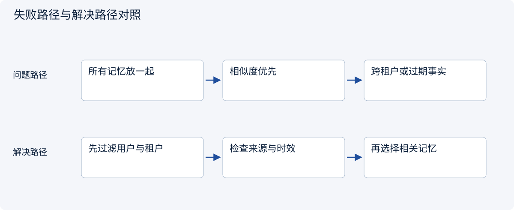
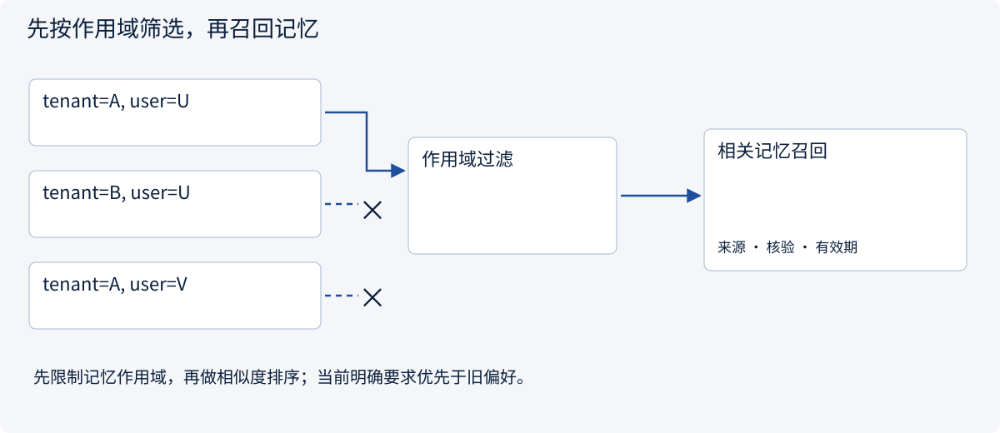
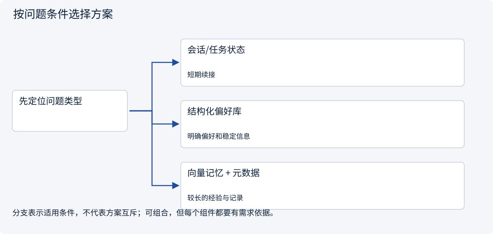
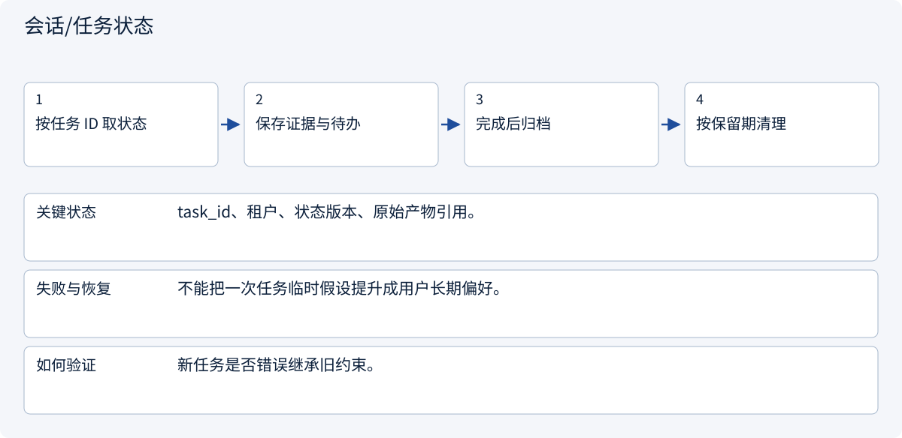
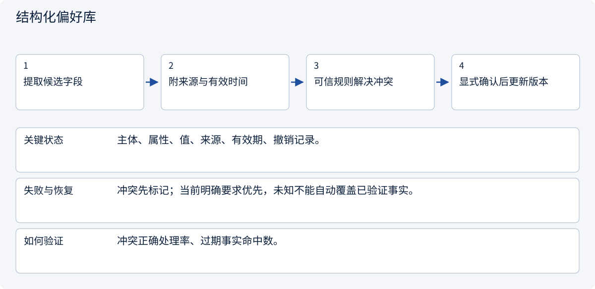
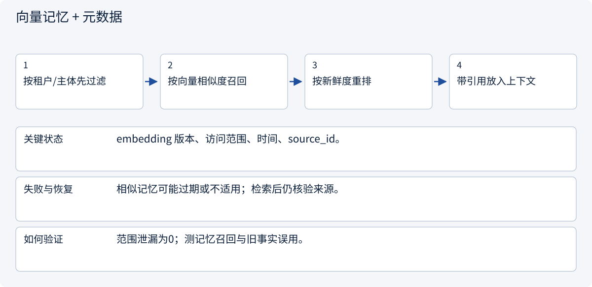

# 2.7.2 长期记忆：记住客户，不要替客户编历史

> 图解主线 · 对照主流方案 · 配参考代码

## 先看问题

系统记住了过去偏好，却把猜测当事实，或者把别人的记忆取给当前用户。




## 图解工作原理

长期记忆必须携带作用域、来源、核验状态与有效期；先权限过滤，再检索与排序。



## 主流方案怎么选



| 方案 | 怎样解决 | 适用条件 | 代价与边界 |
|---|---|---|---|
| 会话/任务状态 | 保存本任务进度 | 短期续接 | 不适合作永久偏好 |
| 结构化偏好库 | 事实字段与来源版本 | 明确偏好和稳定信息 | 冲突需合并或废止 |
| 向量记忆 + 元数据 | 语义召回及范围过滤 | 较长的经验与记录 | 相似不等于当前事实 |

## 主流方案内部怎样运行

### 1 · 会话/任务状态



**具体推演：** 本次预算1000元，不等于用户以后永远只接受1000元。

### 2 · 结构化偏好库



**具体推演：** 用户把发票抬头改为乙：保留甲为历史，当前只返回乙。

### 3 · 向量记忆 + 元数据



**具体推演：** 先排除其他客户记录，再检索当前客户采购约定。

## 参考代码

展开查看与本课机制对应的实现。训练函数仅提供代码，不执行实际训练；依赖与验证范围见配套代码说明。

[配套代码说明与验证范围](../../../docs/zh/projects/03-code-guide.md)

<details><summary>展开代码与实现边界</summary>

```python
"""Explicit scope and provenance before ranking any stored preference."""

from dataclasses import dataclass


@dataclass(frozen=True)
class Memory:
    tenant: str
    user: str
    claim: str
    source: str
    verified: bool
    expires_at: int


def recall(records: list[Memory], tenant: str, user: str, now: int) -> list[Memory]:
    return [
        record
        for record in records
        if record.tenant == tenant
        and record.user == user
        and record.verified
        and record.expires_at > now
    ]


# A remembered fact remains evidence, not an instruction overriding the current user.
```

</details>

## 改变条件，检查理解

用户今天的明确要求与旧偏好冲突，该听谁的？

<details><summary>展开参考答案</summary>

遵循当前明确要求，把旧记录标为需更新或已被替代，不能让回忆覆盖新授权。

</details>

<details><summary>按需展开：原理推导与边界补充</summary>

**先认清几个词**

向量：把内容表示成一组数字，便于比较语义相近程度。Embedding：生成这种表示的过程。重排：对初步找到的资料再次排序。缓存：暂存已处理结果的副本。

**故事：“上次便宜”不等于“永远只要便宜”**

客户上次说：“这次预算紧，优先便宜。”如果系统永久记成“客户只关心价格”，下次遇到高质量项目就会误导决策。长期记忆必须带来源、适用范围、时间和可信度，不能把一句临时话变成永久人格标签。

三类记忆帮助我们拆开问题：**语义记忆**保存稳定事实或偏好；**情景记忆**保存某次订单发生了什么；**程序记忆**保存可复用的方法。研究报告原文是知识库资料，不必每一段都包装成“关于用户的记忆”。


**一条记忆应该长什么样**

| 字段 | 合成例子 |
|---|---|
| 记住的内容 | 客户偏好中文 Markdown 报告 |
| 对谁适用 | 这位客户，不是全部客户 |
| 什么情况下适用 | 市场调研报告 |
| 来源 | 客户明确确认格式的那条消息 |
| 时间 | 何时确认，是否仍有效 |
| 状态 | 当前有效，或已被新决定替代 |

对“本次预算 5000 CNY”应记为这一订单的情景，而不是跨订单默认预算。模型猜测不能和用户明确表达享有相同权威。记忆有用的关键不是存得多，而是保留适用范围和证据。


**逐步案例：提取、合并、冲突与遗忘**

给提取器四条输入：客户明确偏好 Markdown；客户这次预算有限；模型猜测客户不喜欢 PDF；客户后来改说这个订单需要 PDF。理想结果是保留稳定偏好及其范围，把这次 PDF 写成订单级覆盖，丢弃没有依据的猜测。不要直接把两个句子“合并”为一个自相矛盾的字符串。

去重可先规范化实体与范围，再做语义相似度比较。高相似不等于相同：“不联系供应商”和“可以联系供应商”非常相近但意义相反。对否定、数字、币种和时间单独检查。新事实取代旧事实时保留 `supersedes` 和来源链，而不是无痕改写。

遗忘也不是只从向量索引删除一条 embedding。原始记录、倒排索引、缓存、副本和派生摘要都可能保留内容。设计删除流程时给这些存储建立传播路径和审计回执，备份中的删除策略单独说明。

**检索：先权限，再相似度**

假设当前问题是“给客户生成本次报告”。先按租户、任务范围、状态和有效期过滤；再做关键词与向量召回；然后重排。关键词擅长精确产品名、订单号；向量检索擅长语义相似；reranker 可以提高排序质量，但增加成本和延迟。

返回的不只是 `claim`，还应附来源、时间与适用范围。最新且直接的用户指令优先于旧记忆。若两个来源冲突且无法判定，明确提示冲突或提问，不让模型自行挑一个“最像”的答案。

**纸上推演与学习检查**

准备四张记忆卡：A 客户偏好中文；B 客户偏好英文；A 客户上个月预算有限；A 客户今天明确表示本次要 PDF。现在回答“给 A 客户做本次报告”：不能借用 B 的语言偏好，不能把上个月预算自动套用，也不能让旧的默认格式压过今天的新指令。

再把一张卡标成“用户要求忘记”，检查它是否仍出现在搜索结果或缓存里。删除不只是界面上看不见，还涉及派生记录和保留政策。

学习目标：能区分语义、情景与程序记忆；能说明关键词与语义检索各自适合什么；能处理新旧信息冲突；能解释为什么检索之前先查权限。未来评估系统时，还要同时看找得准不准、是否引用旧信息、是否泄露其他客户资料，而不是只看响应速度。


**阅读路线与常见坑**

比较 [Mem0](https://github.com/mem0ai/mem0) 和 [Letta](https://github.com/letta-ai/letta) 的记忆抽象，观察提取、检索、更新和上下文管理分别在哪一层。不要因为项目叫“Memory”就认为它解决了权限、遗忘和事实验证。复制实现之前先确认所读版本的许可证与依赖许可。

最重要的工程习惯：**先问这条信息为什么值得记、对谁可见、何时过期，再问用哪个向量数据库。**

**理解题与参考答案**

**1. 客户说“这次便宜优先”，能保存成永久偏好吗？**

参考答案：不能。应保留“这次”的范围，避免把临时决定泛化。

**2. 先做相似度检索，再检查资料权限可以吗？**

参考答案：更稳妥的是先限制到有权访问的数据，避免未授权资料进入后续处理。


</details>

[查看官方资料与方案依据](../../../docs/zh/resources.md)
