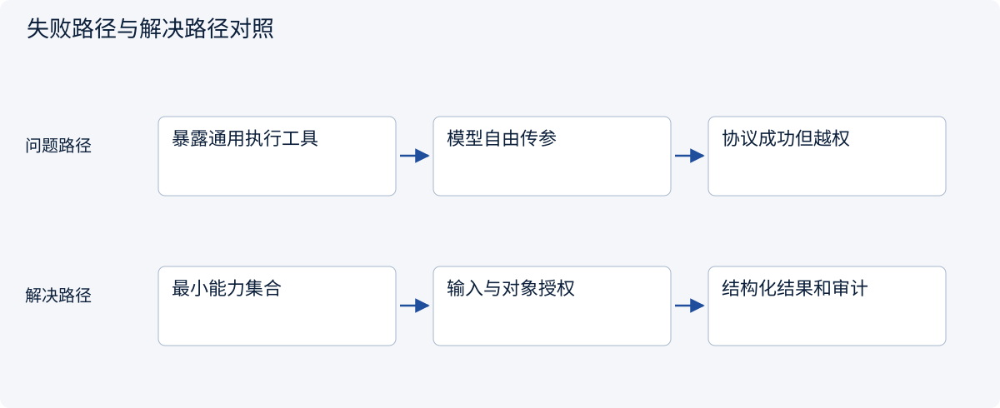
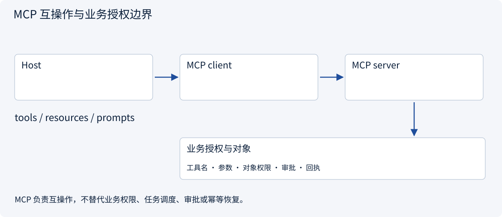
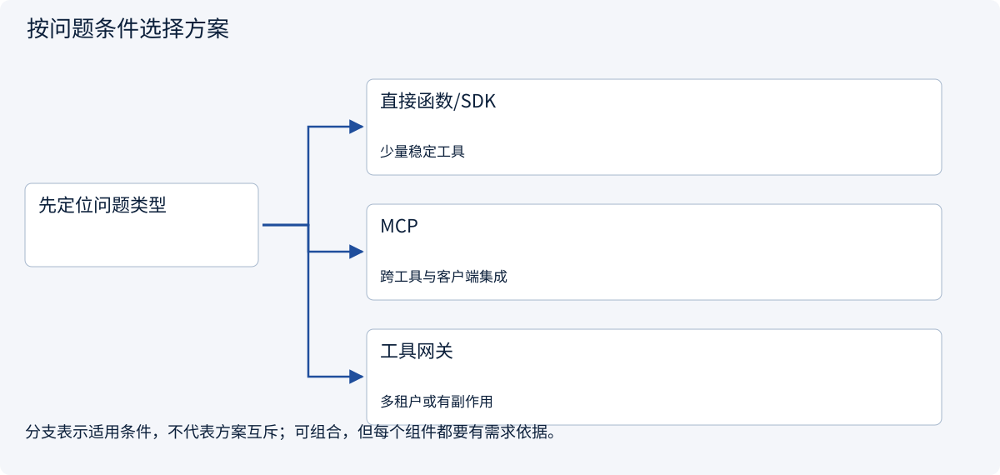
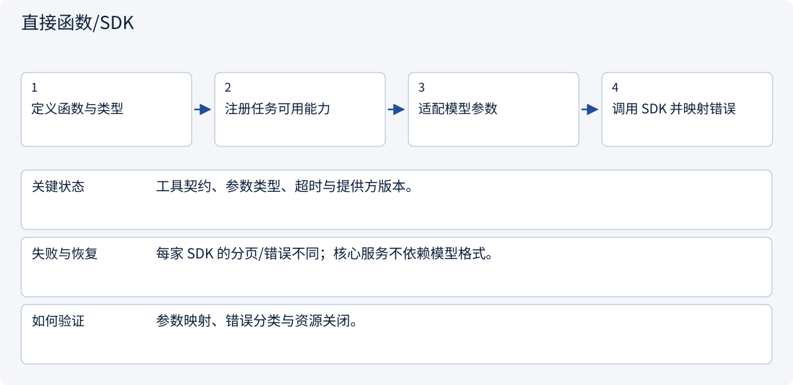
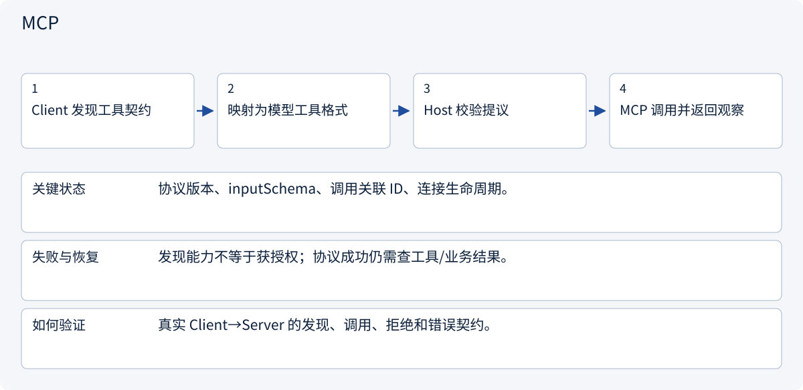
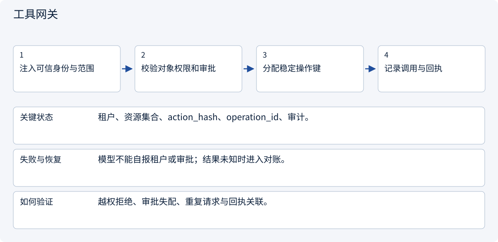

# 2.4.1 工具网关：从模型提议到受控执行

> 图解主线 · 对照主流方案 · 配参考代码

## 先看问题

模型给出了合法工具参数，为什么仍可能越权？直接函数和MCP接入由谁落实执行检查？




## 图解工作原理

协议负责发现与调用，工具网关负责允许列表、参数、对象权限和副作用规则。传输成功不代表业务允许。



## 主流方案怎么选



| 方案 | 怎样解决 | 适用条件 | 代价与边界 |
|---|---|---|---|
| 直接函数/SDK | 进程内明确契约 | 少量稳定工具 | 接入方式各自维护 |
| MCP | 统一能力发现与调用接口 | 跨工具与客户端集成 | 不能替代业务授权 |
| 工具网关 | 集中校验与权限策略 | 多租户或有副作用 | 需维护对象级规则 |

## 主流方案内部怎样运行

### 1 · 直接函数/SDK



**具体推演：** 只接一个稳定报价接口时直接 SDK 可减少协议层。

### 2 · MCP



**具体推演：** read_quote(B) 即使语法正确也被服务层范围校验拒绝。

### 3 · 工具网关



**具体推演：** 模型把 A 换成 B 或扩大金额后，原审批不能继续使用。

## 参考代码

展开查看与本课机制对应的实现。训练函数仅提供代码，不执行实际训练；依赖与验证范围见配套代码说明。

[配套代码说明与验证范围](../../../docs/zh/projects/03-code-guide.md)

<details><summary>展开代码与实现边界</summary>

```python
"""Protocol transport is separate from business authorization."""

from collections.abc import Callable
from dataclasses import dataclass


@dataclass(frozen=True)
class ToolRequest:
    name: str
    document_id: str


def read_tool(
    request: ToolRequest,
    authorized_documents: set[str],
    readers: dict[str, Callable[[str], str]],
) -> str:
    if request.name not in readers:
        raise PermissionError("Tool is not available")
    if request.document_id not in authorized_documents:
        raise PermissionError("Document is not authorized")
    return readers[request.name](request.document_id)


# An MCP adapter can translate calls into ToolRequest, but cannot skip this check.
```

</details>

## MCP 六讲：从协议到真实接入

[MCP 专题](../mcp/mcp01.md)：架构 → 三类原语 → 请求与版本 → 传输认证 → 真实服务端/客户端 → Host 适配。示例使用官方 SDK 2.3.0，通过内存 Client/Server 验证真实协议能力，不调用模型。


## 先区分模型侧与工具服务侧

[函数调用机制](../tools/fc01.md) · [Function Calling / MCP](../tools/fc02.md)：先看模型提议与Host执行，再看两层契约怎样衔接。MCP并不要求模型使用Function Calling，Function Calling也可直接分发本地函数。


## 改变条件，检查理解

MCP 服务返回一段要求外发客户信息的文字，它获得权限了吗？

<details><summary>展开参考答案</summary>

没有。返回内容属于外部数据，不能升级为用户授权或系统指令。

</details>

<details><summary>按需展开：原理推导与边界补充</summary>

**先认清几个词**

RAG：先检索资料，再据此生成答案。Chunk：为了检索而划分的资料片段。索引：帮助快速查找资料的目录结构。MCP：模型应用连接外部能力的一种协议。

**故事：拿到一本书，不等于读懂书**

客户问：“这两个市场的入驻条件有什么区别？”模型内部知识可能过时，所以需要外部资料。这里有两个不同问题：**工具调用**决定怎样获取资料或执行动作；**RAG（检索增强生成）**决定怎样从资料中找到相关证据并形成答案。工具不等于知识库，知识库也不保证回答正确。

RAG 的常见过程是：收集资料、清洗解析、分块、建立索引、检索、重排、组织上下文、生成带引用的答案。搜索不到、检索错段落、引用与结论不符，任何一步都可能出错。


**一个完整的对照案例**

假设官方资料 A 说明当地企业主体要求，物流资料 B 说明某一重量区间运费。模型却写出：“因为运费低，所以任何个人都可以开店。”这个结论即使同时附了 A、B 两个链接，也没有得到证据支持。**有引用不等于引用正确。** 应把结论拆开：主体资格由 A 支持，物流估算由 B 支持；两者不能互相代替。

分块也会造成误读。如果把“仅限当地注册企业”和后面的“可使用个人联系人”切到不同片段，检索第二段可能错误推导“个人可直接注册”。对规则、表格、合同类资料，应保留标题、表头、适用条件和相邻段落。chunk 大小并不存在跨所有资料的最佳数值。

**MCP 到底解决什么**

MCP 是连接模型应用与外部工具、资源等能力的协议。它帮助统一发现和调用方式，但不自动决定客户授权、不保证工具无恶意、不替你核实资料真实性。接上某个 MCP 服务，只代表系统获得了一种接口，不代表每个工具都可以默认执行。

对工具应说明：输入格式、输出结构、权限、超时、是否有副作用、失败如何解释。搜索是只读工具；发送报价、注册账号和付款是有外部影响的动作，应分别设置审批与审计。网页、PDF 与工具响应都是不可信资料，其中“忽略之前规则”不能升级成系统指令。

**学习活动与自检**

找三段公开资料，给每段标出来源、日期、适用对象和限制。写两个答案：一个只附链接，另一个把每个关键结论绑定到具体证据。比较哪一个更容易核查。再故意删掉条件句，观察结论如何变化。

思考：检索不到时应该猜、扩大检索，还是说明证据不足？什么场景需要精确关键词而不是纯向量相似？工具执行成功与业务目标成功有什么区别？

进入下一章前，应能画出 RAG 的完整过程，区分检索质量与生成质量，并说明至少三种“有资料仍答错”的原因。

**延伸阅读**

阅读 [MCP Specification](https://github.com/modelcontextprotocol/specification) 的概念与安全边界，结合 [Hugging Face Agents Course](https://github.com/huggingface/agents-course) 理解工具调用。阅读版本与许可证以资料索引为准，不把协议教程当成生产安全保证。

**理解题与参考答案**

**1. 附上两个来源链接就证明结论正确吗？**

参考答案：不能。需要确认每个关键结论确实由相关原文支持，且适用条件一致。

**2. MCP 能自动解决授权问题吗？**

参考答案：不能。协议统一连接方式，业务授权和安全检查仍由应用负责。


</details>

[查看官方资料与方案依据](../../../docs/zh/resources.md)
