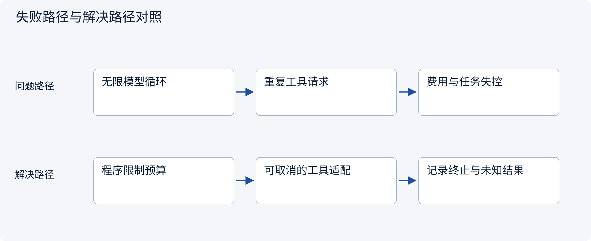
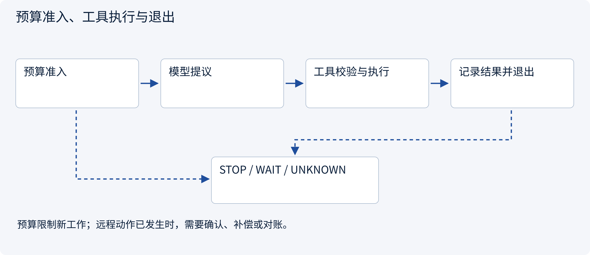
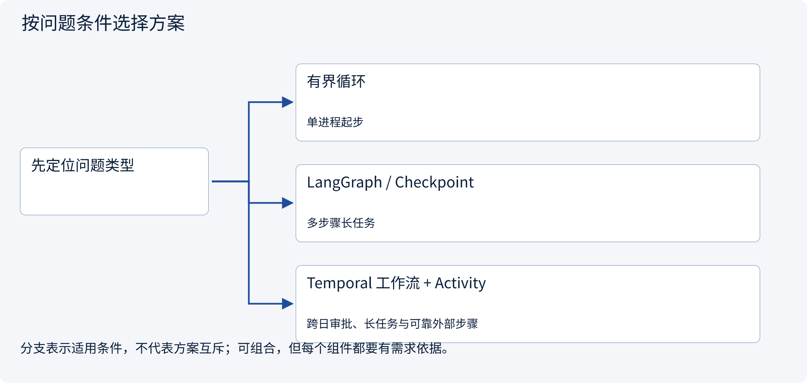
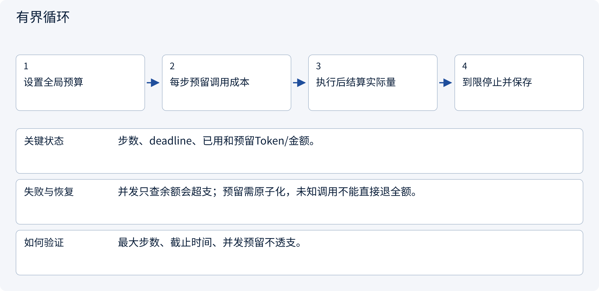
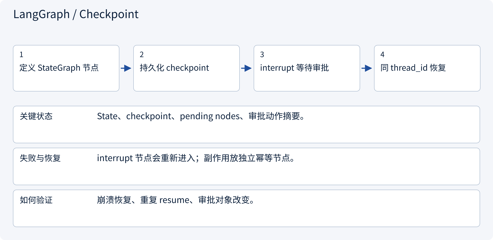
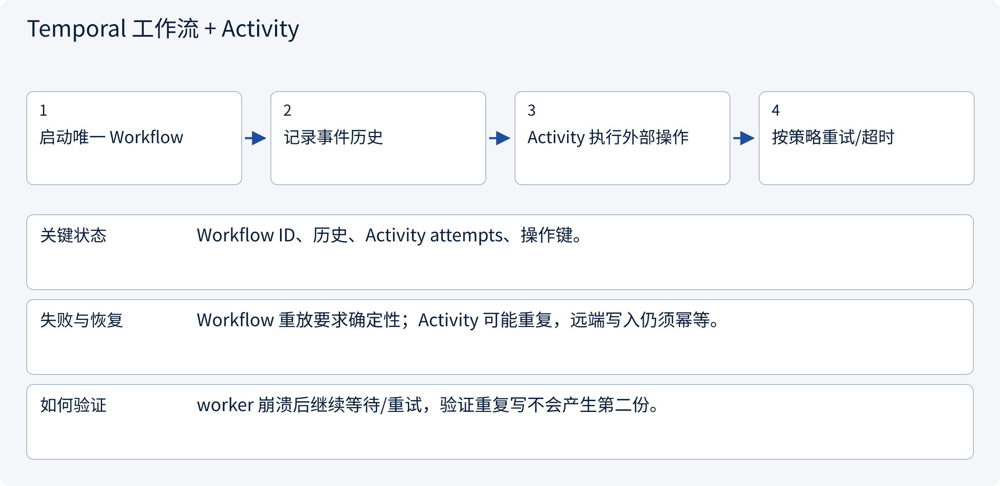
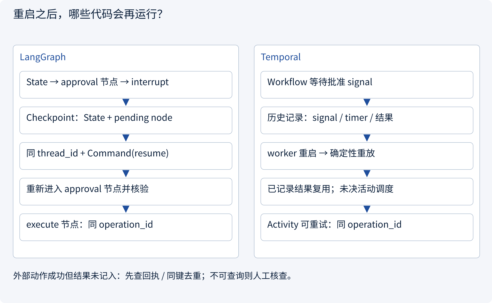

# 3.7.1 Runtime 与 Harness：模型负责建议，系统负责兑现

> 图解主线 · 对照主流方案 · 配参考代码

主代码检查本地步数与期限预算；框架和 Outbox 配套示例各自标注恢复范围，截止检查不保证已发出的外部调用已取消。

## 先看问题

模型陷入重复调用，费用超限，取消任务后远程工具还在执行。




## 图解工作原理

Runtime 用程序维护步数、时间、费用和状态；调用前预留预算，调用后核对回执，未知结果进入恢复路径。



## 主流方案怎么选



| 方案 | 怎样解决 | 适用条件 | 代价与边界 |
|---|---|---|---|
| 有界循环 | 限制步数、时长与费用 | 单进程起步 | 需自己管理恢复 |
| LangGraph / Checkpoint | 图状态与中断恢复 | 多步骤长任务 | 状态迁移与版本管理 |
| Temporal 工作流 + Activity | 事件历史恢复编排，Activity 执行与重试 | 跨日审批、长任务与可靠外部步骤 | 需运维服务、确定性重放与外部幂等 |

## 主流方案内部怎样运行

### 1 · 有界循环



**具体推演：** 余额只够一次调用时，两个 worker 不能都通过检查。

<details><summary>展开文字步骤、状态与失败边界</summary>

1. 设置全局预算
2. 每步预留调用成本
3. 执行后结算实际量
4. 到限停止并保存

**关键状态** 步数、deadline、已用和预留Token/金额。

**失败与恢复** 并发只查余额会超支；预留需原子化，未知调用不能直接退全额。

**如何验证** 最大步数、截止时间、并发预留不透支。

</details>

### 2 · LangGraph / Checkpoint



**具体推演：** 审批节点重跑时不创建草稿；执行节点用稳定 operation_id。

<details><summary>展开文字步骤、状态与失败边界</summary>

1. 定义 StateGraph 节点
2. 持久化 checkpoint
3. interrupt 等待审批
4. 同 thread_id 恢复

**关键状态** State、checkpoint、pending nodes、审批动作摘要。

**失败与恢复** interrupt 节点会重新进入；副作用放独立幂等节点。

**如何验证** 崩溃恢复、重复 resume、审批对象改变。

</details>

### 3 · Temporal 工作流 + Activity



**具体推演：** 人工次日审批后续跑；不把24小时等待当 HTTP 请求挂住。

<details><summary>展开文字步骤、状态与失败边界</summary>

1. 启动唯一 Workflow
2. 记录事件历史
3. Activity 执行外部操作
4. 按策略重试/超时

**关键状态** Workflow ID、历史、Activity attempts、操作键。

**失败与恢复** Workflow 重放要求确定性；Activity 可能重复，远端写入仍须幂等。

**如何验证** worker 崩溃后继续等待/重试，验证重复写不会产生第二份。

</details>

## 用具体数据推演边界



## 参考代码

展开查看与本课机制对应的实现。训练函数仅提供代码，不执行实际训练；依赖与验证范围见配套代码说明。

[配套代码说明与验证范围](../projects/03-code-guide.md)

<details><summary>展开代码与实现边界</summary>

```python
"""Admission checks stop new work; they cannot retroactively undo a remote call."""

from dataclasses import dataclass
from time import monotonic


@dataclass
class Budget:
    remaining_steps: int
    remaining_units: int
    deadline: float

    def reserve(self, upper_bound_units: int) -> None:
        if upper_bound_units < 0:
            raise ValueError("Reservation cannot be negative")
        if monotonic() >= self.deadline or self.remaining_steps <= 0:
            raise TimeoutError("Runtime budget exhausted")
        if upper_bound_units > self.remaining_units:
            raise ValueError("Cost reservation exceeds budget")
        self.remaining_steps -= 1
        self.remaining_units -= upper_bound_units


# Use a conservative call bound, then reconcile usage. Deadline checks need cancellable adapters.
```

</details>

## 同一个崩溃问题，三种恢复机制

**场景：** 调研已完成，审批要等一天；审批后远端创建草稿成功，响应在网络中丢失。重启后既要续接，也不能重复创建。

| 维度 | LangGraph + 持久化 Checkpointer | Temporal Workflow + Activity | 数据库 + Outbox + 队列 |
|---|---|---|---|
| 持久化什么 | 图状态、检查点、待执行节点/任务 | Workflow 事件历史与 Activity 结果/重试信息 | 自定义任务、审批、操作记录、Outbox、租约 |
| 怎样恢复 | 同一 thread_id 加载检查点，继续待执行工作 | SDK 重放历史重建 Workflow，再调度未完成工作 | worker 读取待处理记录，按版本领取并执行 |
| 会重跑什么 | 未完成节点；interrupt 所在节点恢复时会重新进入 | Workflow 代码会确定性重放；未确认 Activity 可重试 | 未确认消息会重复投递；领取/执行逻辑可能重跑 |
| 审批等待 | interrupt 保存位置，由可信入口发起 resume | signal/update 由可信入口发送，等待条件持久化 | approved 状态及事件由数据库事务维护 |
| 谁管外部幂等 | 业务适配器与远端；检查点不替它完成 | 业务适配器与远端；Activity 可执行多次 | 业务适配器与远端；消费去重不能替代远端去重 |
| 并发所有权 | 按选定存储/部署的并发契约设计，不能假设 thread_id 是锁 | 服务调度 Workflow/Activity 任务；外部系统仍须防重复效果 | 自建 CAS、租约、fencing；租约过期不等于旧 worker 停止 |
| 更适合 | 图式 Agent、模型/工具循环、人工中断 | 跨日流程、可靠活动调度、明确重试/超时 | 已有队列/数据库体系且愿意自行维护状态机 |

### 关键故障窗口：远端成功，本地还没记回执

1. 本地先持久化 `operation_id=op-42` 与请求指纹，再发请求。
2. 远端创建 `draft-42`，但网络响应丢失。本地只能记为 **UNKNOWN**，不能判断为“未创建”。
3. 恢复时按 `op-42` 查远端；查到后回填回执。支持幂等的远端也可用**同键、同载荷**取回同一结果。
4. 远端既不支持幂等也不可查询时，进入人工核查。重新分配 `op-43` 盲重试可能创建第二份。

`request_id` 只关联一次 RPC 的请求与响应；`operation_id` 标识一次业务动作，跨重启保持稳定。工作流引擎解决“编排怎么恢复”，不能凭空获得远端的恰好一次写入能力。

### LangGraph 中断为什么要分开节点

`interrupt()` 不是把 Python 调用栈永久冻结。恢复时节点会重新进入，因此中断之前的代码可能再执行。审批节点只计算/核验动作摘要；创建草稿放在独立节点，并使用稳定操作键。`InMemorySaver` 只适合测试，不能演示跨进程持久恢复。真实部署还需选定持久化 Checkpointer、状态迁移和并发写入策略。

### Temporal 为什么分 Workflow 与 Activity

Workflow 的条件、计时器、活动结果通过历史恢复；Workflow 代码须满足确定性重放要求。网络请求、数据库写入和随机外部结果放到 Activity。`start_to_close_timeout` 限制单次尝试，`schedule_to_close_timeout` 限制整个调度/重试窗口；重试策略不能把权限错误当瞬时网络错误。长活动还应设计 heartbeat 与取消响应；下方短调用参考没有实现长活动。

框架依据：[LangGraph 持久化](https://docs.langchain.com/oss/python/langgraph/persistence)、[中断恢复](https://docs.langchain.com/oss/python/langgraph/interrupts)、[Temporal Python 错误与重试](https://docs.temporal.io/develop/python/best-practices/error-handling)。


### LangGraph：审批中断与独立执行节点

框架参考代码；可用内存检查点检查中断语义，生产跨进程恢复必须注入持久化存储。

<details><summary>展开代码与实现边界</summary>

```python
"""LangGraph reference: separate proposal, approval and side-effect nodes.

Supply a durable checkpointer and an idempotent domain adapter in production.
This file is supplied as reference code; no model call or graph starts on import.
"""

from typing import TypedDict

from .approval import action_hash


class TaskState(TypedDict):
    operation_id: str
    proposal: dict
    approved: bool
    receipt: str


def build_graph(checkpointer, create_draft):
    from langgraph.graph import END, START, StateGraph
    from langgraph.types import interrupt

    def approval(state: TaskState) -> dict:
        fingerprint = action_hash(state["proposal"])
        reply = interrupt({"action_hash": fingerprint, "proposal": state["proposal"]})
        # A trusted API must authorize the approver before it issues Command(resume=...).
        if (
            not isinstance(reply, dict)
            or reply.get("action_hash") != fingerprint
            or not reply.get("approved")
        ):
            raise PermissionError("Approval is absent or applies to a different action")
        return {"approved": True}

    def execute(state: TaskState) -> dict:
        if not state.get("approved"):
            raise PermissionError("No approved action")
        receipt = create_draft(state["operation_id"], state["proposal"])
        # The external adapter must deduplicate/query this operation_id.
        # Do not wrap arbitrary side effects in the approval node: it may restart.
        return {"receipt": receipt}

    graph = StateGraph(TaskState)
    graph.add_node("approval", approval)
    graph.add_node("execute", execute)
    graph.add_edge(START, "approval")
    graph.add_edge("approval", "execute")
    graph.add_edge("execute", END)
    return graph.compile(checkpointer=checkpointer)


# Invoke using a stable thread_id; resume with Command(resume=...) on that thread.
# InMemorySaver is for process-local examples, not cross-process crash recovery.
```

</details>

### Temporal：持久等待与 Activity 重试

框架参考代码；未启动 Temporal 服务或 Worker，未执行远程 Activity。

<details><summary>展开代码与实现边界</summary>

```python
"""Temporal reference: durable approval wait and retried activity.

Reference only; no worker is started. Boundary authorization belongs in the API.
The activity backend must enforce idempotency for a stable operation_id.
"""

from dataclasses import dataclass
from datetime import timedelta

from temporalio import activity, workflow
from temporalio.common import RetryPolicy


@dataclass(frozen=True)
class DraftRequest:
    operation_id: str
    action_hash: str
    proposal_json: str


class DraftActivities:
    def __init__(self, backend):
        self.backend = backend

    @activity.defn(name="create_draft")
    async def create_draft(self, request: DraftRequest) -> str:
        return await self.backend.create_or_get(
            request.operation_id, request.proposal_json
        )


@workflow.defn
class ApprovedDraftWorkflow:
    def __init__(self):
        self.approved_hash = ""

    @workflow.signal
    def approve(self, action_hash: str) -> None:
        # Only a trusted, authenticated application should send approval signals.
        self.approved_hash = action_hash

    @workflow.run
    async def run(self, request: DraftRequest) -> str:
        await workflow.wait_condition(
            lambda: self.approved_hash == request.action_hash, timeout=timedelta(days=1)
        )
        return await workflow.execute_activity(
            "create_draft",
            request,
            start_to_close_timeout=timedelta(seconds=30),
            schedule_to_close_timeout=timedelta(minutes=5),
            retry_policy=RetryPolicy(
                maximum_attempts=5,
                non_retryable_error_types=["PermissionError", "ValueError"],
            ),
        )


# Replayed workflow history is not a guarantee of exactly-once remote writes.
# Register ApprovedDraftWorkflow and DraftActivities(backend).create_draft on a Worker.
```

</details>

## 改变条件，检查理解

超时检查是否能证明远端动作已被撤销？

<details><summary>展开参考答案</summary>

不能。截止时间只限制新工作；已提交动作可能需要查询、补偿或人工核查。

</details>

<details><summary>按需展开：原理推导与边界补充</summary>

**先认清几个词**

Runtime：负责实际运行任务的机制。Harness：围绕模型的执行与控制设施，具体边界因项目而异。沙箱：限制程序可接触资源的隔离环境。适配：把不同服务的差异转换成上层可使用的形式。

**故事：一位聪明研究员为什么还需要工作制度？**

模型能够建议“接下来搜索主体要求”，但它不会天然管理重试、工具权限、费用、取消、审批和服务重启。Runtime 负责运行时行为；Harness 通常指围绕模型建立的执行环境与控制机制，包括上下文、工具、状态、评测等。不同项目对名称边界可能不同，重要的是清楚谁承担责任。

可以把模型想象成研究员：它提出行动；工作制度检查这一步是否合法、是否超预算、是否需要客户批准；执行完成后留下回执。没有这层制度，再聪明的模型也可能无限重试或错误承诺。


**一轮循环究竟发生什么**

以“比较两地平台费用”为例：首先从任务状态读取范围与禁止项，然后装配上下文。模型提出搜索请求，系统检查工具名、字段与权限，再执行。工具返回资料后，系统记录来源和时间；模型判断是否还需要补充来源。最终答案产生后，仍要检查引用和交付要求，而不是仅因模型说“完成”就结束。

这段过程里有三个不同的成功：API 请求成功、工具执行成功、业务任务成功。HTTP 200 只能证明服务给了响应；搜索返回结果不能证明问题已回答；生成了 Markdown 不能证明结论可用。

**多模型适配：统一接口不等于统一能力**

为不同 Agent 选择 OpenAI、Claude、Gemini 或 Grok 等模型时，需要考虑工具调用格式、结构化输出、上下文长度、流式事件、错误码与用量统计。可以统一上层动作概念，但不要抹平供应商差异。

例如某模型支持并行工具调用，另一模型只适合顺序调用；某接口能约束 JSON schema，另一接口需要额外校验。能力不足时应拒绝不支持的配置或使用明确降级策略，而不是让调用方以为所有模型完全可互换。

更换模型后也要重新评测。相同提示词不保证相同工具选择、费用或可靠性。模型适配层应报告实际使用的提供商与模型版本，避免排错时连运行的是什么都不知道。

**权限、审批与沙箱**

审批绑定的是具体动作及其范围，例如“向这位客户发送这一版报价”，不是对整个 Agent 永久放权。客户修改范围或金额后，旧审批可能不再有效。等待审批时暂停相关动作，但独立的只读工作可按授权继续。

沙箱限制执行环境能接触的文件、网络和系统资源，但不等于理解业务授权。一个被允许联网的程序仍可能发送不该发送的数据。权限控制、输入校验、秘密管理、审批和沙箱是互补措施。

工具输出里可能包含恶意指令。Runtime 必须把它视作外部资料，不能允许网页要求直接变成更高权限的操作。尤其不能让模型生成任意 shell 命令就无条件执行。

**故障恢复与可观察性**

设计时逐一回答：超时前动作是否可能已经执行？重试会重复扣费或发信吗？服务重启后从哪里恢复？取消信号如何传到工具？达到成本上限后如何退出？无法判断外部动作结果时，应进入明确的不确定状态而不是伪装成功。

记录可见行动、状态变化、耗时、费用和错误类别；不需要收集模型隐藏推理。日志要脱敏，并为每个任务建立关联 ID，以便把模型请求、工具结果与最终交付串起来。

**学习活动与设计检查表**

把一次调研过程拆成十张事件卡，抽走其中一张模拟故障。判断系统是否知道下一步，并说明哪些动作可以重试、哪些需要查询回执、哪些需要人工核实。再给同一任务换一个模型，列出可能受影响的行为。

设计检查表：模型与工具是否解耦？是否有明确停止条件？审批是否绑定动作版本？外部副作用是否可查询或去重？上下文是否可重建？费用是否由程序控制？错误是否能被用户理解？

阅读 [Codex](https://github.com/openai/codex)、[Deep Agents](https://github.com/langchain-ai/deepagents) 与 [LangGraph](https://github.com/langchain-ai/langgraph) 时，围绕这些问题寻找实现和测试，而不是照抄目录。学会解释边界，比记住某个框架类名更重要。

**理解题与参考答案**

**1. 模型适配统一后，各模型能力就相同吗？**

参考答案：不是。上下文、工具调用、格式约束、价格和错误行为仍有差异。

**2. 工具成功等于任务成功吗？**

参考答案：不是。必须继续检查结果是否满足真实目标和验收条件。


</details>

[查看官方资料与方案依据](../resources.md)
