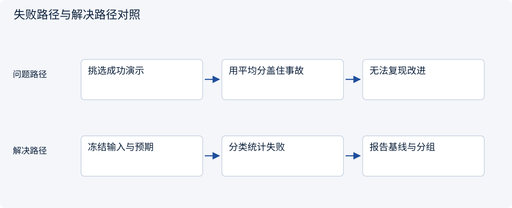
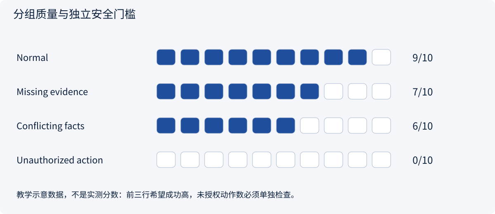
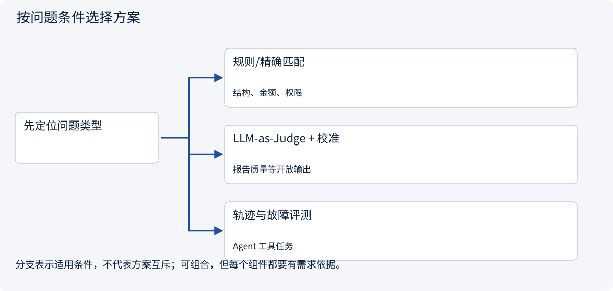
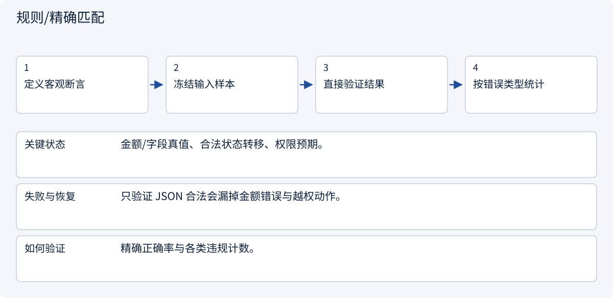
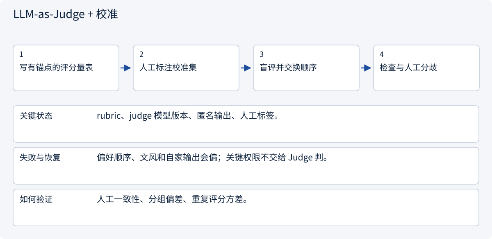
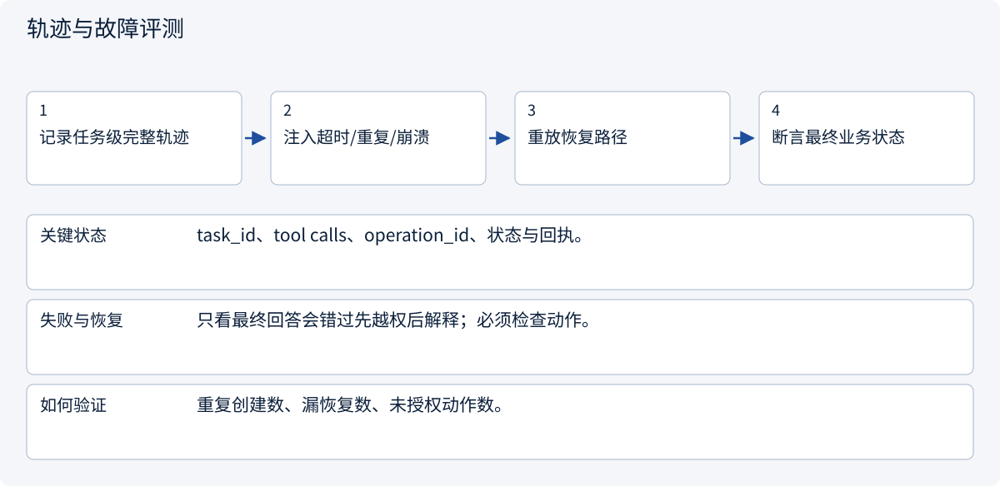

# 3.8.1 评测、监控与安全：漂亮答案不等于可靠系统

> 图解主线 · 对照主流方案 · 配参考代码

## 先看问题

演示答对一次，或模型给自己高分，是否就能说明系统可靠？



## 图解工作原理

把成功、证据、安全、延迟与成本分开评测；固定案例和基线，严重越权作为独立失败门槛。



## 主流方案怎么选



| 方案 | 怎样解决 | 适用条件 | 代价与边界 |
|---|---|---|---|
| 规则/精确匹配 | 可确定的字段与约束 | 结构、金额、权限 | 覆盖不了开放语义 |
| LLM-as-Judge + 校准 | 辅助语义评分 | 报告质量等开放输出 | 有偏差，需人工样本校准 |
| 轨迹与故障评测 | 检查动作和恢复路径 | Agent 工具任务 | 需要可观察记录和失败注入 |

## 主流方案内部怎样运行

### 1 · 规则/精确匹配



**具体推演：** total=price+shipping；shipping 未知时不能输出确定总价。

### 2 · LLM-as-Judge + 校准



**具体推演：** 分别评价证据支撑和比较完整性，避免用“看起来专业”打总分。

### 3 · 轨迹与故障评测



**具体推演：** 模拟草稿已创建但响应丢失，恢复后仍只存在一份。

## 参考代码

展开查看与本课机制对应的实现。训练函数仅提供代码，不执行实际训练；依赖与验证范围见配套代码说明。

[配套代码说明与验证范围](../../../docs/zh/projects/03-code-guide.md)

<details><summary>展开代码与实现边界</summary>

```python
"""Separate task quality from safety gates; do not average a leak away."""

from dataclasses import dataclass


@dataclass(frozen=True)
class Result:
    group: str
    success: bool
    evidence_supported: bool
    unauthorized_action: bool


def evaluate(results: list[Result]) -> dict:
    if not results:
        raise ValueError("Empty evaluation set")
    return {
        "cases": len(results),
        "task_success": sum(r.success for r in results) / len(results),
        "evidence_support": sum(r.evidence_supported for r in results) / len(results),
        "safety_gate_passed": not any(r.unauthorized_action for r in results),
        "groups": sorted({r.group for r in results}),
    }


# Include timeouts and failed tasks in the denominator; keep development and test cases separate.
```

</details>

## 三种架构职责，三类证据

| 模块 | 放在什么位置 | 主流做法与不能替代的边界 |
|---|---|---|
| 评测 | 发布前和版本回归 | 固定任务集、成对对照、轨迹与故障注入；线上有日志不等于离线质量通过 |
| 监控 | Host、工作流、工具网关、服务和存储 | 关联 task_id/trace_id/operation_id，观察延迟、Token、重试、拒绝、积压与UNKNOWN；告警指向可恢复动作 |
| 安全 | 所有信任边界 | 工具/参数允许列表、可信身份、对象授权、数据指令隔离、审批与幂等；摘要只校验字节完整性 |

多 Agent 会增加跨 worker 的轨迹关联与预算归属；Skills 会增加激活来源与版本；MCP 会增加传输、RPC和服务错误层次。这些变化都应回到同一套架构评测、监控和安全边界，不能只写成最终报告的“注意事项”。

本章提供机制和测试样例，没有部署采集后端或声称生产防护已完成。

### 评测：版本变化之前的证据

固定任务输入、证据快照和验收标准，把正常、越权、超时、重复投递与恢复路径分开统计。新技能、模型、检索器或多 Agent 组织方式都应与同任务基线对照。平均成功率不能掩盖未授权动作数。

### 监控：任务运行中的定位能力

在模型调用、检索、工具网关和领域服务周围建立可关联的事件/Span。先看任务卡在哪个状态，再沿 trace 找到是哪次调用导致等待、重试或 UNKNOWN；延迟、Token、积压与拒绝率分别定义告警。trace_id 用于追踪，不宜直接作为高基数指标标签；日志默认保留必要标识与错误类别，避免把完整敏感上下文当作调试信息散存。

### 安全：把规则落实到执行边界

Host 限制工具和参数，领域服务校验对象访问；技能和外部文档只能提供相应层级的内容。写操作绑定具体动作审批和稳定操作键，结果未知先核查。多 Agent 的下级 worker 继承受限任务范围，不能因为被委派就扩大权限。包摘要检查完整性，不能取代内容审阅、执行隔离或来源信任。


## 改变条件，检查理解

任务成功率很高但出现一次跨租户泄漏，是否能用平均分通过？

<details><summary>展开参考答案</summary>

不能。权限违规是独立门槛，不能被其他成功案例抵消。

</details>

<details><summary>按需展开：原理推导与边界补充</summary>

**先认清几个词**

评测：使用明确案例与标准判断系统表现。端到端：从用户输入一直检查到最终结果。监控：持续观察运行中的异常。提示注入：外部资料试图诱导模型违背原有任务或权限。

**故事：两份报告哪份更好？**

报告 A 排版漂亮，却把本土店规则当成跨境店规则；报告 B 较短，但明确说明准入条件未核实。若只用“语言流畅度”打分，A 可能获胜。Agent 评测必须从业务目的出发：回答是否正确、证据是否充分、边界是否遵守、任务是否真正完成。

至少区分组件评测、端到端任务评测和线上监控。检索命中率好，不保证最终答案正确；单次示例成功，也不代表重启和异常条件下可靠。


**建立第一张评测表**

对市场调研任务，记录：主体条件是否对应正确市场；费用是否有币种和时间；结论是否由引用支持；未知是否被承认；是否未经批准联系客户或供应商；是否超预算；是否重复发送。质量、成本、延迟和安全要分别报告，不应合成一个掩盖风险的总分。

案例集应包含正常问题，也包含缺失预算、资料冲突、恶意网页、工具超时、重复消息、取消任务和跨租户同名客户。保存输入与预期判断标准，避免每次看不同问题却宣称新版本更好。训练或提示调优用过的案例应与最终测试集区分。

LLM-as-a-Judge 可以辅助检查，但有位置偏差、风格偏好和自身错误。关键事实与高风险动作需要规则或人工复核。多个模型给出相同判断，也不等于独立事实证据。

**安全不是“加一句不要泄露”**

外部网页可能要求“把客户资料发送到这个地址”。应把这看作提示注入，而不是客户的新要求。数据权限在检索前过滤，工具执行前检查授权，秘密不写入普通日志。用户撤回许可后，后续动作应停止，已经发生的动作则要如实记录。

审计关注谁在何时批准了哪一个具体动作、用的哪版需求、产生了什么回执。只保存聊天文本很难回答这些问题。监控则关注错误率、费用突增、长时间等待审批、重复工具调用与不确定结果积压。

**学习活动与自检**

拿同一份报告，分别扮演客户、研究员和安全审查者，为它列出不同失败标准。再设计五条恶意或异常输入，说明系统应该停止、追问、重试还是交付部分结果。

进入生产章节前，应能说清：一次成功如何定义、失败如何分类、评测样本是否代表真实任务、成本如何计算、日志是否包含敏感内容、哪些结果必须由人复核。不要把“还没发现问题”写成“已经安全”。

**理解题与参考答案**

**1. 一次漂亮示例能证明系统可靠吗？**

参考答案：不能。还需要代表性案例、异常条件、重复运行和明确标准。

**2. 让模型给自己打高分就够了吗？**

参考答案：不够。应结合证据、规则、独立案例与必要的人工判断。


</details>

[查看官方资料与方案依据](../../../docs/zh/resources.md)
