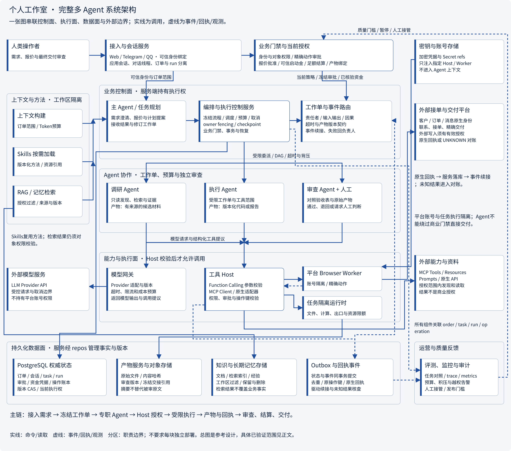
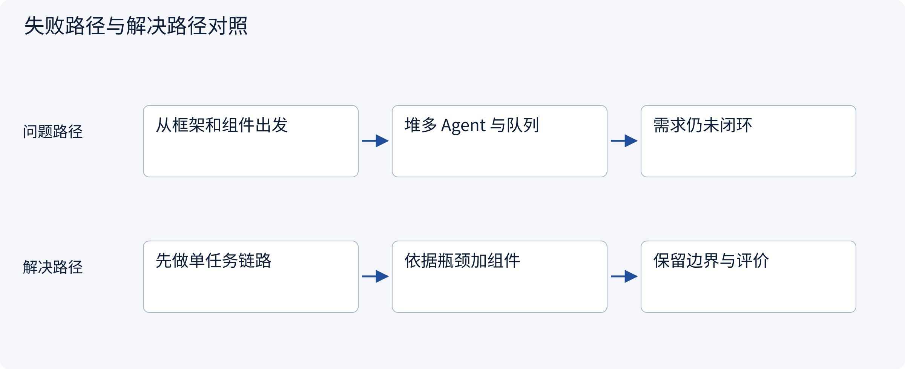
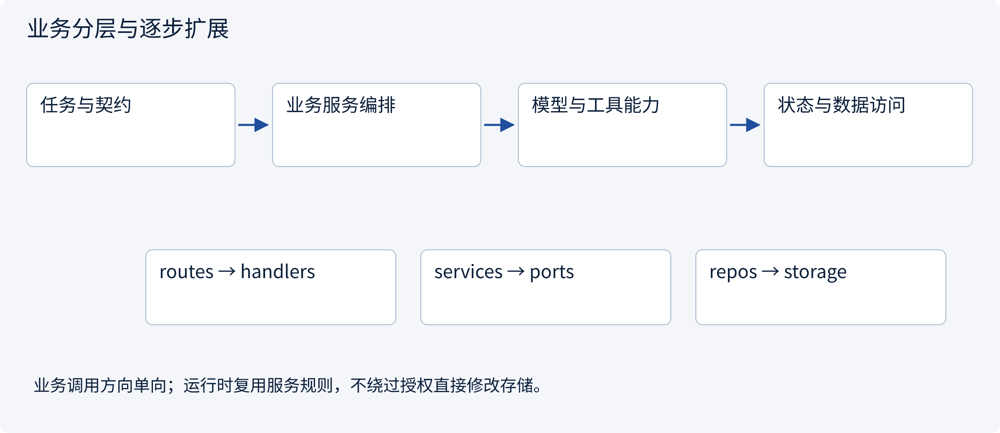
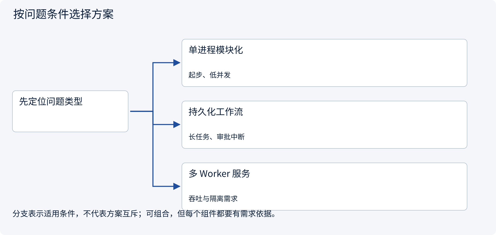
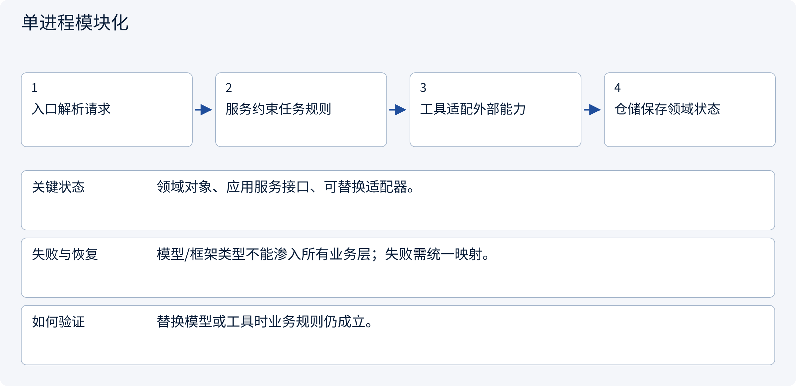
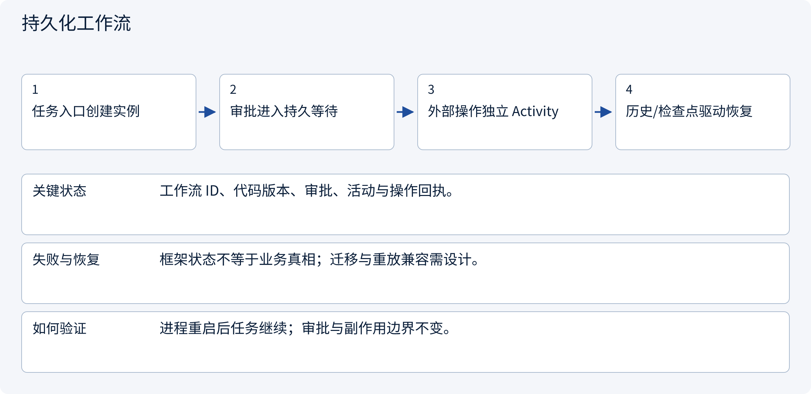
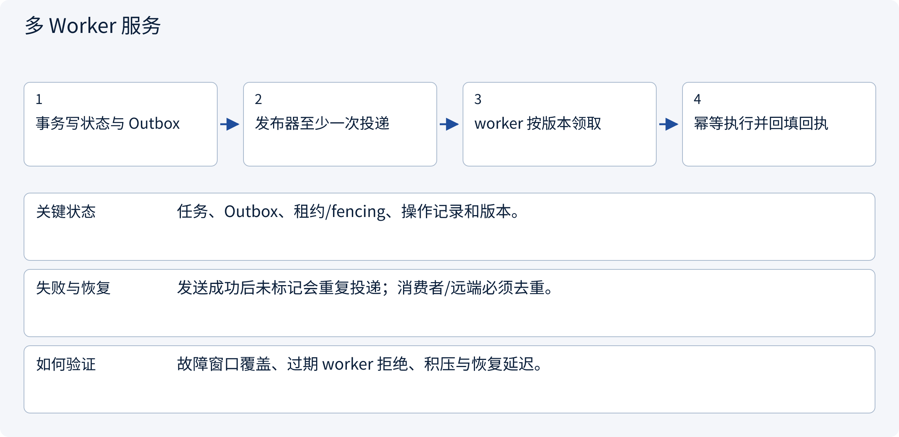

# 3.9.2 架构分层装配与集成验收

> 图解主线 · 对照主流方案 · 配参考代码

## 完整系统架构：从入口到交付与运营反馈



完整参考架构（3600像素宽，可点击放大）。先沿需求→编排→Agent→Host→Worker/外部系统→产物回执→审查交付的主链阅读，再看权限审批、上下文、状态记忆与运营支撑。各框表示职责，不要求全部拆成微服务，也不表示ForgePilot已部署图中每项设施。

## 先看问题

怎样从一个可用助手走向高级架构，又避免一开始堆出难维护的平台？




## 图解工作原理

从窄任务出发，依据状态、工具、恢复与并发需求增加组件；每层都有清楚责任和可验证输入输出。



## 主流方案怎么选



| 方案 | 怎样解决 | 适用条件 | 代价与边界 |
|---|---|---|---|
| 单进程模块化 | 分离业务、能力与存储 | 起步、低并发 | 故障域较集中 |
| 持久化工作流 | 任务状态与恢复语义 | 长任务、审批中断 | 迁移和重放需设计 |
| 多 Worker 服务 | 队列、租约与幂等 | 吞吐与隔离需求 | 运维和一致性成本 |

## 主流方案内部怎样运行

### 1 · 单进程模块化



**具体推演：** 换 MCP Client 或直接 SDK，报价权限规则不变。

### 2 · 持久化工作流



**具体推演：** 从当天调研恢复到次日审批，不重做已验证证据。

### 3 · 多 Worker 服务



**具体推演：** 发布器崩溃重发事件时，操作键仍指向同一份草稿。

## 参考代码

展开查看与本课机制对应的实现。训练函数仅提供代码，不执行实际训练；依赖与验证范围见配套代码说明。

[配套代码说明与验证范围](../../../docs/zh/projects/03-code-guide.md)

<details><summary>展开代码与实现边界</summary>

```python
"""Compose one-way layers. No server is started; no purchase is performed."""

from .architecture.domain import Identity, Task
from .architecture.handlers import ReportHandler, Request
from .architecture.repos import TaskRepository
from .architecture.routes import dispatch
from .architecture.services import ReportService


def example_request(tenant: str = "A") -> dict:
    repository = TaskRepository([Task("task-1", "A", 1000, 180)])
    service = ReportService(repository)
    handler = ReportHandler(service)
    request = Request(Identity("user-1", frozenset({"A"})), tenant, "task-1")
    return dispatch("GET", "/reports/subtotal", request, handler)


# Protocol router only calls the handler. Handler maps errors; service owns
# authorization/calculation; repository owns scoped data access.
# The response is a subtotal, not a total including unknown tax or shipping.
```

</details>

## 改变条件，检查理解

什么时候引入消息队列比再写一个 Agent 更合理？

<details><summary>展开参考答案</summary>

当瓶颈在异步领取、并发隔离或长任务恢复时。组件必须解决已证明的问题，不能只增加角色。

</details>

<details><summary>按需展开：原理推导与边界补充</summary>

**先认清几个词**

生产环境：真实用户与真实后果所在的运行环境。配额：每个用户或任务可用资源的限制。回滚：有问题时恢复到先前版本。闭环：从需求到结果再到检查反馈的一条完整路径。

**故事：第一位真实客户比十张平台图更重要**

小林想一次做出聊天、竞标、报价、支付、执行、交付的全自动平台。问题是每一步都有不同权限与失败成本。更稳妥的起点是：只接收一种调研需求，只输出草稿，人工确认后交付。通过这个窄闭环学习真实失败，再逐步扩大自动化范围。

学习 AI 的目标不只是会调用模型，而是能判断哪些工作适合自动化、需要哪些证据、失败后如何恢复，以及为什么某一步必须交给人。


**从需求反推设计，而不是从技术栈正推**

先写一句产品目标：“为接单员生成有来源的两地市场对比草稿，未经批准不对外承诺。”再列用户、输入、输出、边界和成功标准。只有这些明确以后，才讨论模型供应商、存储方式、任务队列或部署语言。

一份 Agent 设计说明至少回答六组问题：

1. **任务**：做什么，不做什么，何时算完成？
2. **决策**：哪些路径固定，哪些由模型选择，哪些必须审批？
3. **信息**：上下文从哪里来，记忆保存什么，来源怎样验证？
4. **执行**：工具如何授权，动作如何记录，失败如何恢复？
5. **协作**：为什么需要多个 Agent，如何委派、合并与处理冲突？
6. **运行**：费用、延迟、隐私、监控和升级如何控制？

**生产环境带来的新问题**

并发任务会争抢模型限额和工具资源，需要配额、队列和公平性。版本升级可能改变提示词、模型行为和快照格式，需要版本记录和回滚策略。多客户环境要求身份、租户隔离、访问控制和数据保留策略，而不是仅给每个客户建一个不同聊天框。

外部服务可能限流、超时或改变接口。将错误分为可重试、需要输入、权限不足、结果不确定和永久失败，有助于选择正确处理。盲目重试不仅浪费费用，还可能造成重复发送或重复交易。

**四个渐进阶段**

**阶段一：理解。** 能用自己的话解释模型训练、推理、上下文和工具调用，并识别幻觉。

**阶段二：分析。** 能拆解上下文、记忆、RAG 和恢复问题，完成本手册中的概念推演。

**阶段三：设计。** 为一个窄业务编写任务流程、审批规则、信息生命周期和评测计划，说明每个选择的代价。

**阶段四：验证与扩展。** 在授权和可控范围内验证方案，先证明单 Agent 闭环，再按真实瓶颈引入 Multi-Agent 与生产设施。

**个人工作室的架构审查**

综合实践用一个接单到交付的个人工作室串联上述维度。逐项审查角色与交接、独立会话、精确审批、资金证据、产物版本、未知回执恢复及评测监控；配套代码验证局部门禁与事务，不要求训练模型。

**理解题与参考答案**

**1. 初学者应先选一整套技术栈吗？**

参考答案：不应。先明确目标、边界和成功标准，再选实现工具。

**2. 什么时候值得增加 Multi-Agent？**

参考答案：当单 Agent 出现明确分工、并行、专业隔离或独立检查需求时，而不是为了显得先进。


</details>

[查看官方资料与方案依据](../../../docs/zh/resources.md)
