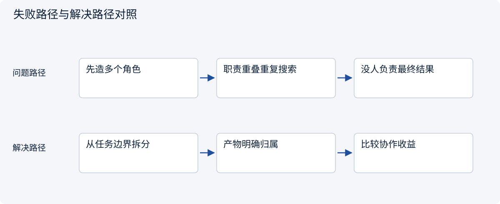
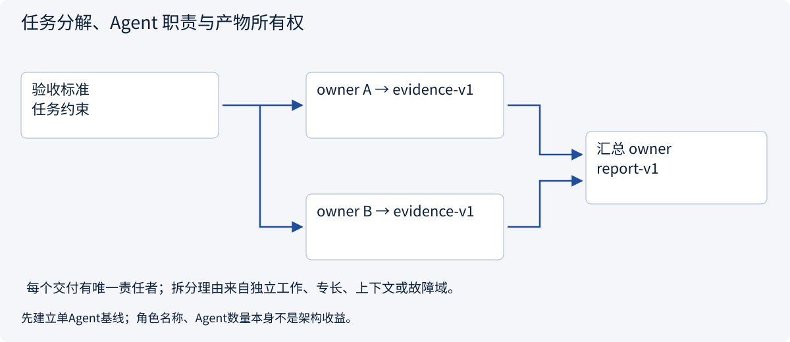
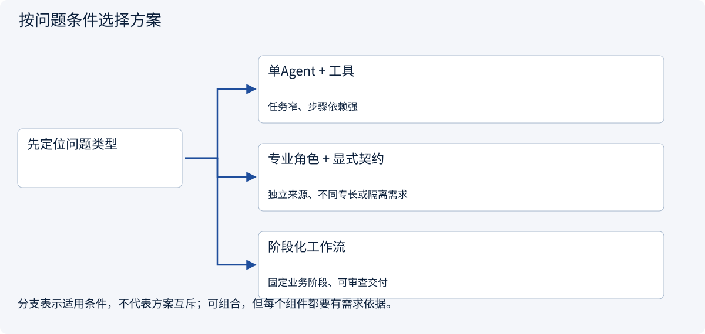
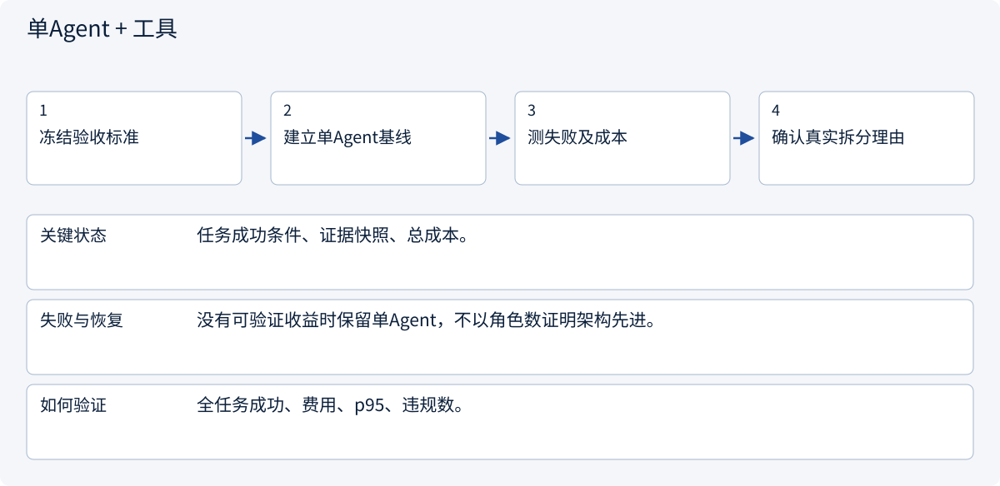
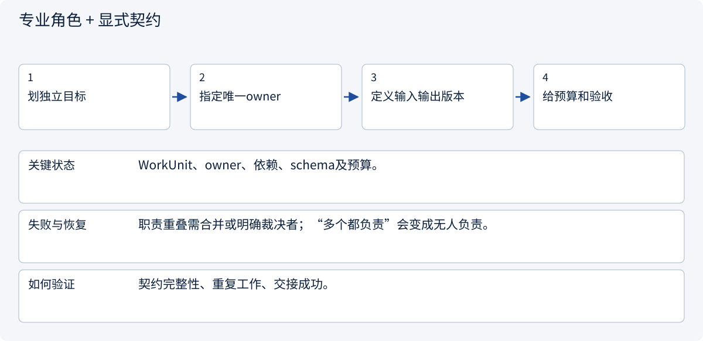
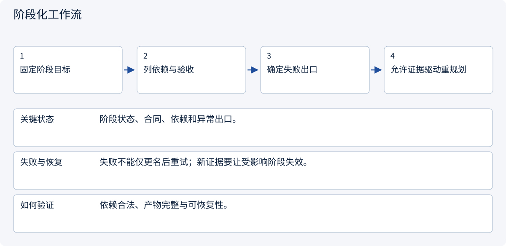

# 3.1.1 任务分解、Agent 职责与产物所有权

> 图解主线 · 对照主流方案 · 配参考代码

设计参考与局部契约代码；不训练模型，不把示意或局部测试当作实测协作收益。

## 先看问题

一个Agent已经能完成任务，为什么要拆成多个？按“研究员、经理、作家”起名字就算完成架构设计吗？



## 图解工作原理

先固定任务验收与单Agent基线，按可独立工作、专门能力、上下文隔离或故障域划职责。每个子任务有唯一责任者、输入输出契约和预算。



## 主流方案怎么选



| 方案 | 怎样解决 | 适用条件 | 代价与边界 |
|---|---|---|---|
| 单Agent + 工具 | 单上下文承担任务并调用能力 | 任务窄、步骤依赖强 | 串行延迟和上下文压力 |
| 专业角色 + 显式契约 | 按能力/输入边界划分责任 | 独立来源、不同专长或隔离需求 | 交接与汇总增加成本 |
| 阶段化工作流 | 按阶段验收组织方法与工具 | 固定业务阶段、可审查交付 | 开放推理不能全部固定分支 |

## 主流方案内部怎样运行

### 1 · 单Agent + 工具



**具体推演：** 只有一份短报价，直接工具+计算比三角色讨论更合适。

### 2 · 专业角色 + 显式契约



**具体推演：** 地区A/B研究分别交付证据，比较者负责统一口径。

### 3 · 阶段化工作流



**具体推演：** 调研→比较→审批→草稿，各阶段完成条件各不相同。

## 参考代码

展开查看与本课机制对应的实现。训练函数仅提供代码，不执行实际训练；依赖与验证范围见配套代码说明。

[配套代码说明与验证范围](../../../docs/zh/projects/03-code-guide.md)

<details><summary>展开代码与实现边界</summary>

```python
"""Validate explicit work ownership and contracts before choosing a topology."""

from dataclasses import dataclass


@dataclass(frozen=True)
class WorkUnit:
    key: str
    owner: str
    input_contract: str
    output_contract: str
    depends_on: tuple[str, ...]
    budget: int


def validate_work(units: list[WorkUnit]) -> list[str]:
    by_key = {unit.key: unit for unit in units}
    if len(by_key) != len(units):
        raise ValueError("Duplicate work unit")
    for unit in units:
        if (
            not all((unit.key, unit.owner, unit.input_contract, unit.output_contract))
            or unit.budget <= 0
        ):
            raise ValueError("Missing ownership, contract or budget")
        if not set(unit.depends_on) <= by_key.keys():
            raise ValueError("Unknown dependency")
    pending, ordered = set(by_key), []
    while pending:
        ready = sorted(
            key for key in pending if set(by_key[key].depends_on) <= set(ordered)
        )
        if not ready:
            raise ValueError("Cyclic work graph")
        ordered.extend(ready)
        pending.difference_update(ready)
    return ordered


# One WorkUnit owner is accountable for an artifact; multiple reviewers do not erase ownership.
# A useful split needs independent evidence/work, not merely more role names in prompts.
```

</details>

## 本节应交付的设计产物

任务分解图；每个节点的owner、输入输出schema、预算和验收；为何不用单Agent。

参考代码只证明本节契约的局部性质。设计应将本节产物与会话、权限、审批、Runtime、状态与评测章节对齐；它不是额外创建一个“总控Agent”就自动解决全部边界。没有调用模型、真实消息broker或生产工具，不报告协作提升百分比。

依据：[Official 1](https://www.anthropic.com/research/multi-agent-research-system).


## 改变条件，检查理解

拆分之前至少应说明哪三件事？

<details><summary>展开参考答案</summary>

为什么需要多个Agent、每个Agent对什么产物负责、相对单Agent如何验证收益。

</details>

[查看官方资料与方案依据](../../../docs/zh/resources.md)
