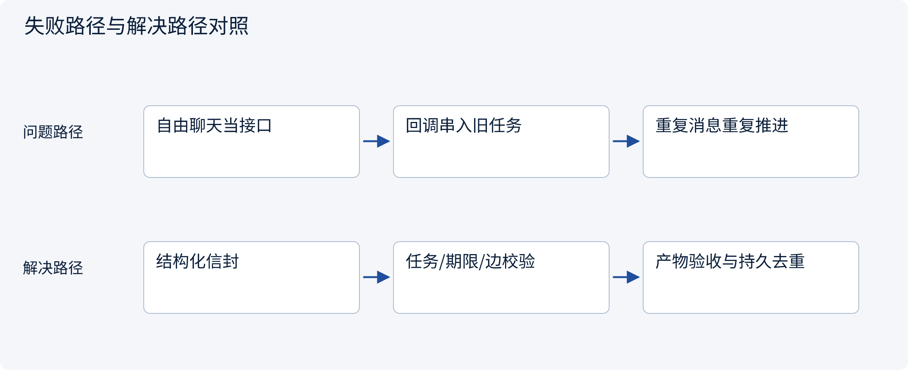
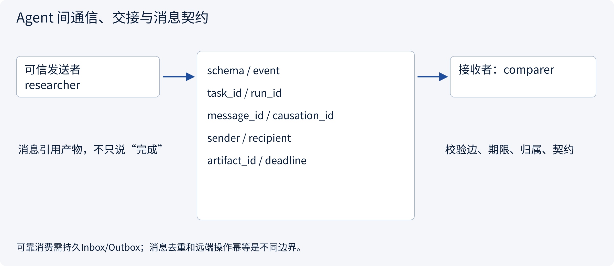
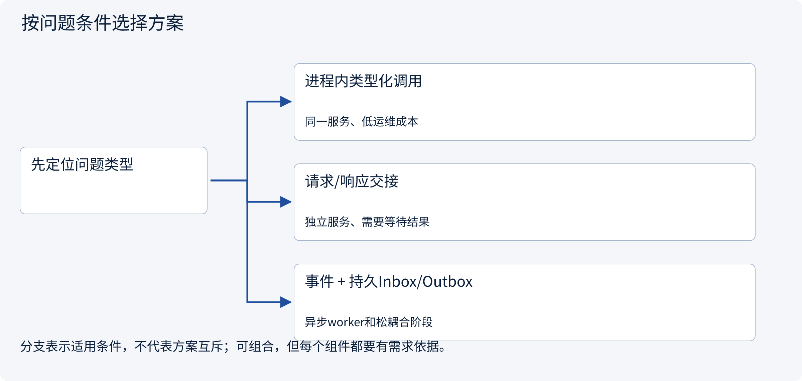
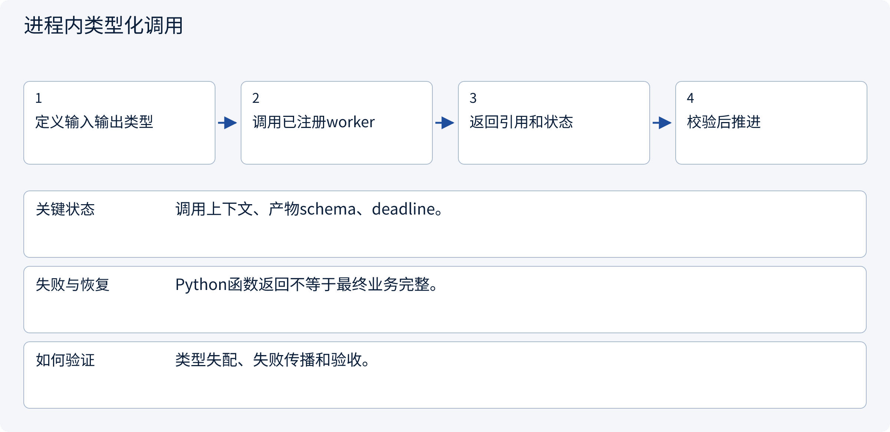
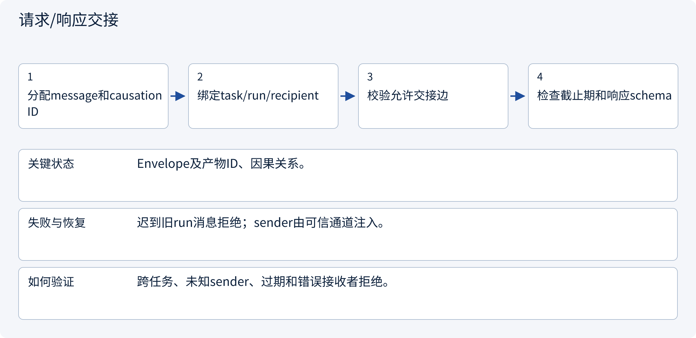
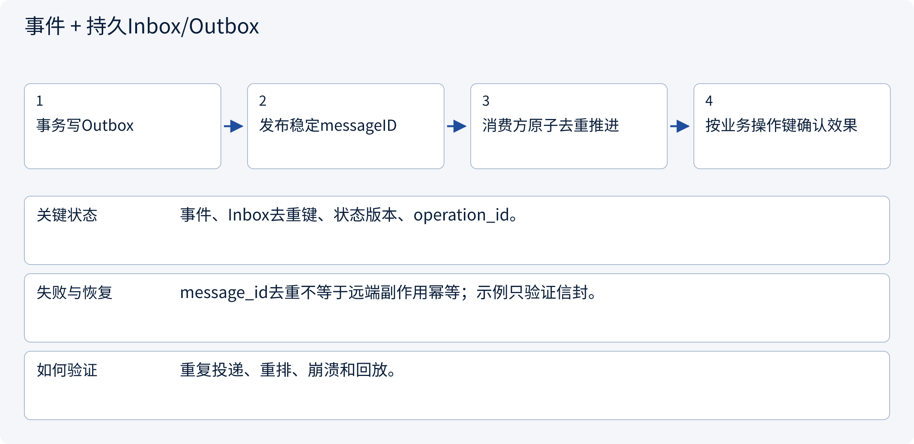

# 3.2.2 Agent 间通信、交接与消息契约

> 图解主线 · 对照主流方案 · 配参考代码

设计参考与局部契约代码；不训练模型，不把示意或局部测试当作实测协作收益。

## 先看问题

worker说“完成了”，汇总Agent怎样知道是哪次任务、哪个版本、有没有重复或晚到？




## 图解工作原理

消息以任务、run、发送接收者、schema、因果ID、截止期和产物引用为边界；传输可靠性与业务幂等分开处理，不能用自然语言假装稳定接口。



## 主流方案怎么选



| 方案 | 怎样解决 | 适用条件 | 代价与边界 |
|---|---|---|---|
| 进程内类型化调用 | 受控函数传递结构化产物 | 同一服务、低运维成本 | 进程故障域集中 |
| 请求/响应交接 | 明确接收者和响应关联 | 独立服务、需要等待结果 | 超时和重试要区分未知结果 |
| 事件 + 持久Inbox/Outbox | 至少一次投递加原子消费去重 | 异步worker和松耦合阶段 | 需幂等、顺序和积压治理 |

## 主流方案内部怎样运行

### 1 · 进程内类型化调用



**具体推演：** 研究函数返回证据对象，不只回一句“完成”。

### 2 · 请求/响应交接



**具体推演：** task-a/run-2不会接受run-1晚到的比较结果。

### 3 · 事件 + 持久Inbox/Outbox



**具体推演：** 重复artifact-ready事件不能重复触发写动作。

## 参考代码

展开查看与本课机制对应的实现。训练函数仅提供代码，不执行实际训练；依赖与验证范围见配套代码说明。

[配套代码说明与验证范围](../../../docs/zh/projects/03-code-guide.md)

<details><summary>展开代码与实现边界</summary>

```python
"""A typed envelope for Host-controlled collaboration, independent of MCP RPC IDs."""

from dataclasses import dataclass


@dataclass(frozen=True)
class Envelope:
    schema: str
    task_id: str
    run_id: str
    message_id: str
    causation_id: str | None
    sender: str
    recipient: str
    artifact_id: str
    deadline: int


def validate_delivery(
    message: Envelope,
    task_id: str,
    run_id: str,
    receiver: str,
    edges: frozenset[tuple[str, str]],
    now: int,
) -> None:
    if (
        message.schema != "artifact-ready-v1"
        or not message.message_id
        or not message.artifact_id
    ):
        raise ValueError("Invalid envelope or artifact contract")
    if (
        message.task_id != task_id
        or message.run_id != run_id
        or message.recipient != receiver
    ):
        raise PermissionError("Message belongs to another task/run/recipient")
    if (message.sender, message.recipient) not in edges:
        raise PermissionError("Undeclared handoff edge")
    if message.deadline <= now:
        raise TimeoutError("Stale handoff")


# The transport injects authenticated sender identity; a model cannot self-assert it.
# A durable inbox must enforce message_id uniqueness together with its state transition.
# message_id, provider call_id, MCP RPC id and business operation_id have different purposes.
```

</details>

## 本节应交付的设计产物

允许交接边、消息信封、产物schema、错误/超时、去重键与因果关联。

参考代码只证明本节契约的局部性质。设计应将本节产物与会话、权限、审批、Runtime、状态与评测章节对齐；它不是额外创建一个“总控Agent”就自动解决全部边界。没有调用模型、真实消息broker或生产工具，不报告协作提升百分比。

依据：[Official 1](https://docs.langchain.com/oss/python/langgraph/workflows-agents).


## 改变条件，检查理解

MCP tools/call可以直接替代所有Agent间消息协议吗？

<details><summary>展开参考答案</summary>

不能。MCP提供能力接口；任务交接的责任者、因果、产物契约和执行状态仍由应用编排定义。

</details>

[查看官方资料与方案依据](../../../docs/zh/resources.md)
