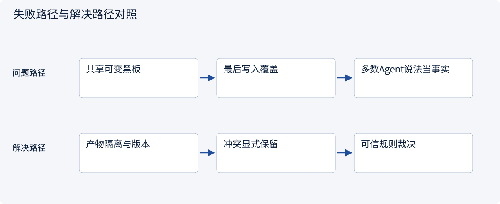
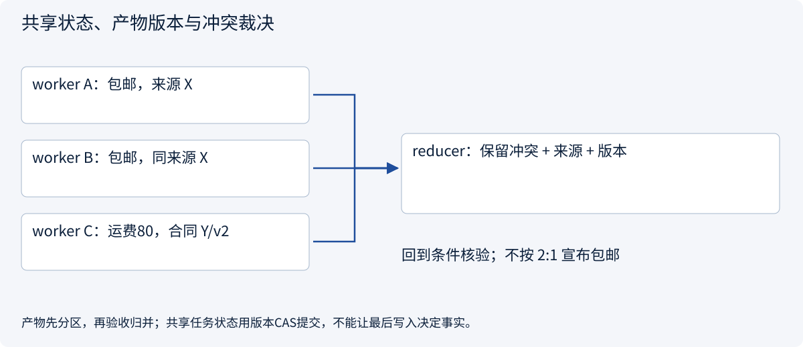
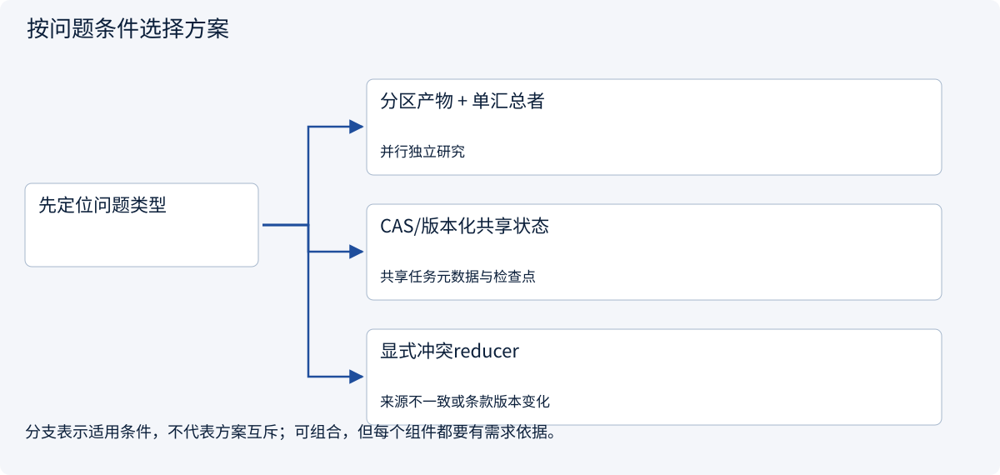
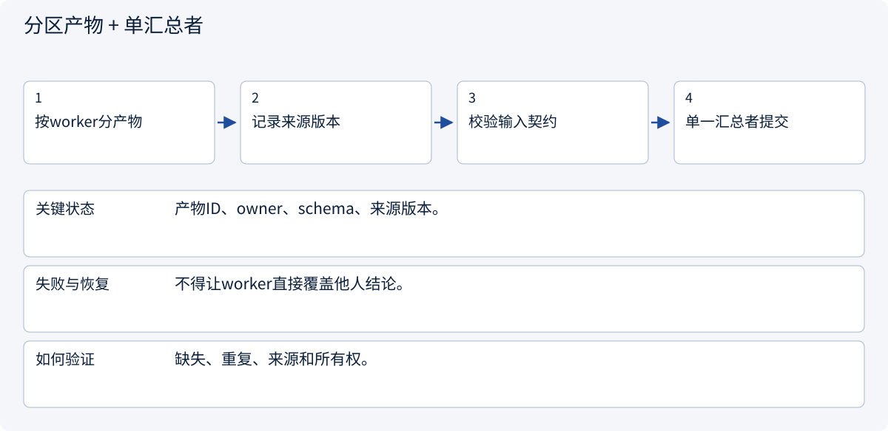
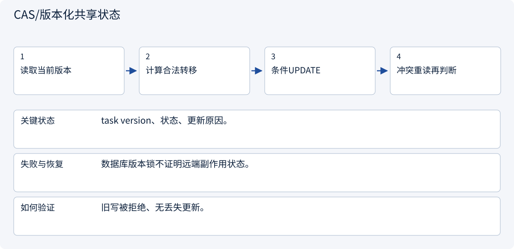
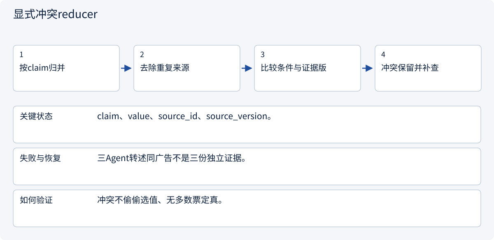

# 3.4.1 共享状态、产物版本与冲突裁决

> 图解主线 · 对照主流方案 · 配参考代码

设计参考与局部契约代码；不训练模型，不把示意或局部测试当作实测协作收益。

## 先看问题

多个worker同时改同一份任务状态，为什么会覆盖彼此？两个Agent引用同一来源重复赞成，能算独立证据吗？



## 图解工作原理

每个worker拥有独立产物，汇总阶段通过显式reducer验收；共享任务状态用版本条件提交。事实冲突回到来源和适用条件，不以多数票定真。



## 主流方案怎么选



| 方案 | 怎样解决 | 适用条件 | 代价与边界 |
|---|---|---|---|
| 分区产物 + 单汇总者 | 各worker写自己的结果 | 并行独立研究 | 汇总者可能成为瓶颈 |
| CAS/版本化共享状态 | 只有期望版本可更新 | 共享任务元数据与检查点 | 冲突要重读，不是无限盲重试 |
| 显式冲突reducer | 保留证据差异和未知 | 来源不一致或条款版本变化 | 可能需要人工或补查 |

## 主流方案内部怎样运行

### 1 · 分区产物 + 单汇总者



**具体推演：** 两个市场各存一份报告，由比较者做单位换算。

### 2 · CAS/版本化共享状态



**具体推演：** 两个worker都读v7，仅一个能提交v8。

### 3 · 显式冲突reducer



**具体推演：** 广告说包邮而合同写80分时先核对适用条件。

## 参考代码

展开查看与本课机制对应的实现。训练函数仅提供代码，不执行实际训练；依赖与验证范围见配套代码说明。

[配套代码说明与验证范围](../../../docs/zh/projects/03-code-guide.md)

<details><summary>展开代码与实现边界</summary>

```python
"""Evidence conflicts are explicit; no last-writer-wins or agent-majority truth."""

from dataclasses import dataclass


@dataclass(frozen=True)
class Observation:
    claim: str
    value: str
    source_id: str
    source_version: int
    worker: str


def reconcile(observations: list[Observation]) -> dict:
    claims = {}
    for item in observations:
        if not item.source_id or item.source_version <= 0:
            raise ValueError("Missing provenance")
        claims.setdefault(item.claim, []).append(item)
    accepted, conflicts = {}, {}
    for key, items in claims.items():
        values = {item.value for item in items}
        if len(values) == 1:
            accepted[key] = {
                "value": items[0].value,
                "sources": sorted({x.source_id for x in items}),
            }
        else:
            conflicts[key] = [
                {"value": x.value, "source": x.source_id, "version": x.source_version}
                for x in items
            ]
    return {"accepted": accepted, "conflicts": conflicts, "complete": not conflicts}


# Different versions are not automatically comparable; trusted freshness rules belong in the service.
# Persist worker artifacts separately, then commit the validated reducer result with CAS.
```

</details>

## 本节应交付的设计产物

谁可写哪些状态；worker产物命名、版本/reducer规则、冲突人工出口。

参考代码只证明本节契约的局部性质。设计应将本节产物与会话、权限、审批、Runtime、状态与评测章节对齐；它不是额外创建一个“总控Agent”就自动解决全部边界。没有调用模型、真实消息broker或生产工具，不报告协作提升百分比。

依据：[Official 1](https://docs.langchain.com/oss/python/langgraph/persistence).


### 版本条件持久化

局部架构参考实现，不产生真实外部副作用。

<details><summary>展开代码与实现边界</summary>

```python
"""Versioned checkpoint repository. Caller supplies an initialized connection."""

import json
import sqlite3
from pathlib import Path


def initialize(connection: sqlite3.Connection) -> None:
    connection.executescript(Path(__file__).with_suffix(".sql").read_text())


def save(
    connection: sqlite3.Connection,
    tenant: str,
    task: str,
    expected_version: int,
    payload: dict,
) -> int:
    encoded = json.dumps(payload, sort_keys=True)
    with connection:
        if expected_version == 0:
            connection.execute(
                "INSERT INTO checkpoints VALUES (?, ?, 1, ?)", (tenant, task, encoded)
            )
        else:
            changed = connection.execute(
                "UPDATE checkpoints SET version=version+1,payload=? WHERE tenant=? AND task=? AND version=?",
                (encoded, tenant, task, expected_version),
            ).rowcount
            if changed != 1:
                raise RuntimeError("Checkpoint version conflict")
    return expected_version + 1


# Saving state does not prove an external operation did or did not execute.
```

</details>

## 改变条件，检查理解

能否用最后一条worker结果覆盖同名字段？

<details><summary>展开参考答案</summary>

只能在明确可覆盖的状态语义下采用；证据事实与审批相关字段不能靠最后写入自动裁决。

</details>

[查看官方资料与方案依据](../../../docs/zh/resources.md)
