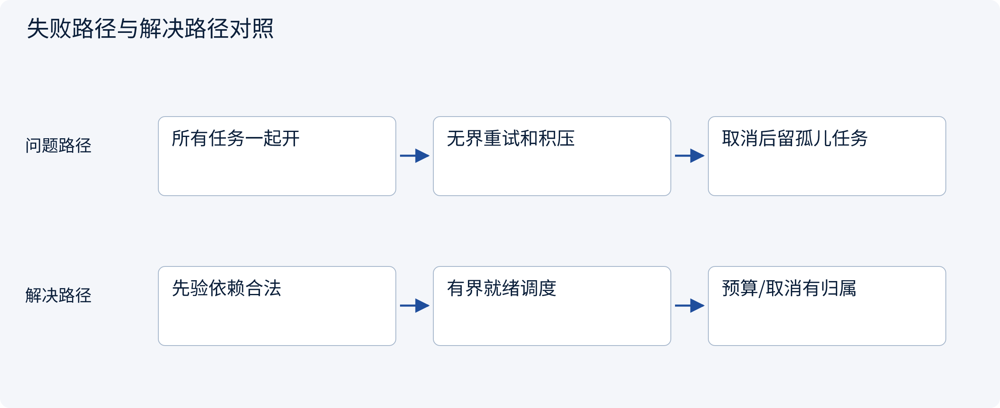
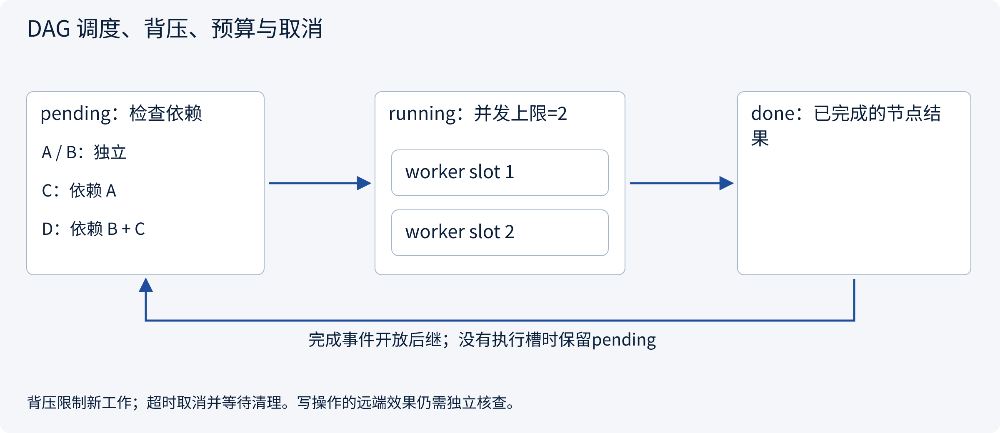
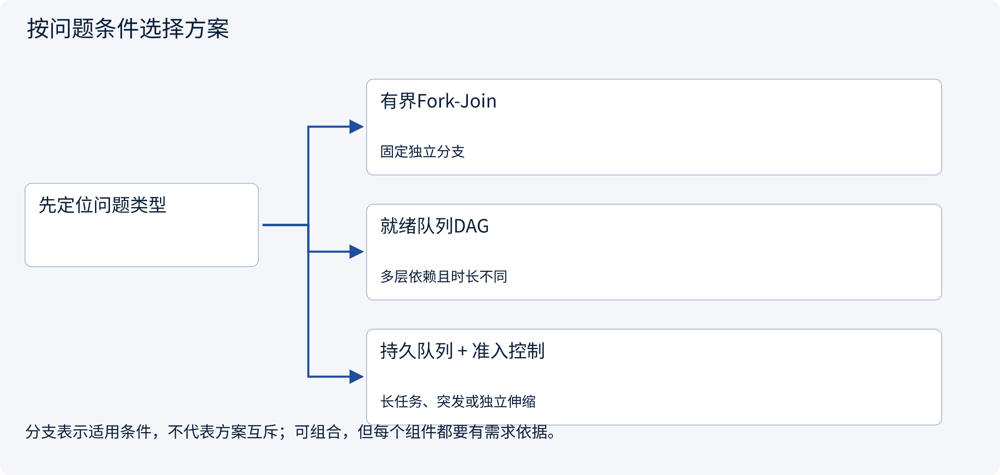
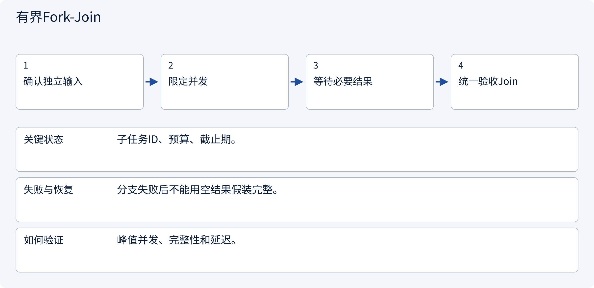
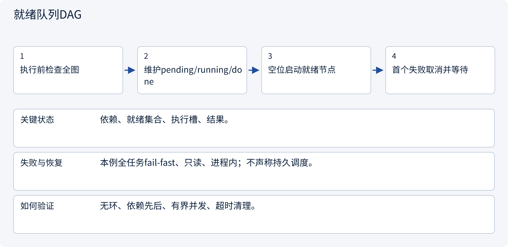
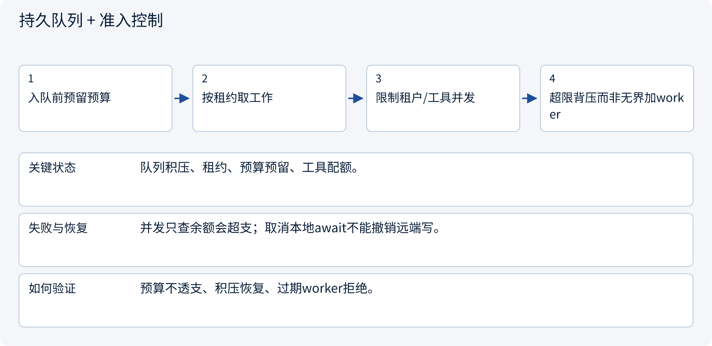

# 3.7.2 DAG 调度、背压、预算与取消

> 图解主线 · 对照主流方案 · 配参考代码

设计参考与局部契约代码；不训练模型，不把示意或局部测试当作实测协作收益。

## 先看问题

worker越多为什么反而更慢、更贵？依赖未满足、队列堆积或任务取消后还在调用怎么办？




## 图解工作原理

按依赖就绪调度，有界并发和全任务预算共同限制扇出；背压限制新工作，取消要等待资源收尾。远端写动作取消仍需核查，不等于回滚。



## 主流方案怎么选



| 方案 | 怎样解决 | 适用条件 | 代价与边界 |
|---|---|---|---|
| 有界Fork-Join | 少量独立工作并行后汇总 | 固定独立分支 | 等待慢分支，必要失败要定义 |
| 就绪队列DAG | 父节点成功后立即开放后继 | 多层依赖且时长不同 | 需失败传播和死锁检测 |
| 持久队列 + 准入控制 | 消息缓冲、租约和资源预留 | 长任务、突发或独立伸缩 | 运维、重复投递和租约fencing |

## 主流方案内部怎样运行

### 1 · 有界Fork-Join



**具体推演：** A/B查询可并行，比较必须等必要报价。

<details><summary>展开文字步骤、状态与失败边界</summary>

1. 确认独立输入
2. 限定并发
3. 等待必要结果
4. 统一验收Join

**关键状态** 子任务ID、预算、截止期。

**失败与恢复** 分支失败后不能用空结果假装完整。

**如何验证** 峰值并发、完整性和延迟。

</details>

### 2 · 就绪队列DAG



**具体推演：** 独立分支完成即可启动其后继，无需等不相关慢分支。

<details><summary>展开文字步骤、状态与失败边界</summary>

1. 执行前检查全图
2. 维护pending/running/done
3. 空位启动就绪节点
4. 首个失败取消并等待

**关键状态** 依赖、就绪集合、执行槽、结果。

**失败与恢复** 本例全任务fail-fast、只读、进程内；不声称持久调度。

**如何验证** 无环、依赖先后、有界并发、超时清理。

</details>

### 3 · 持久队列 + 准入控制



**具体推演：** 工具QPS已满时增加worker不能解决吞吐瓶颈。

<details><summary>展开文字步骤、状态与失败边界</summary>

1. 入队前预留预算
2. 按租约取工作
3. 限制租户/工具并发
4. 超限背压而非无界加worker

**关键状态** 队列积压、租约、预算预留、工具配额。

**失败与恢复** 并发只查余额会超支；取消本地await不能撤销远端写。

**如何验证** 预算不透支、积压恢复、过期worker拒绝。

</details>

## 参考代码

展开查看与本课机制对应的实现。训练函数仅提供代码，不执行实际训练；依赖与验证范围见配套代码说明。

[配套代码说明与验证范围](../projects/03-code-guide.md)

<details><summary>展开代码与实现边界</summary>

```python
"""Bounded read-only DAG runner; first failure cancels and awaits all in-flight work."""

import asyncio
from collections.abc import Awaitable, Callable


async def schedule(
    jobs: dict[str, Callable[[], Awaitable[object]]],
    dependencies: dict[str, set[str]],
    concurrency: int,
    timeout: float,
) -> dict:
    if concurrency <= 0 or timeout <= 0 or set(jobs) != set(dependencies):
        raise ValueError("Invalid runner limits/keys")
    if any(not parents <= jobs.keys() for parents in dependencies.values()):
        raise ValueError("Unknown dependency")
    # Validate the whole DAG before any tool runs, including cycles beside a valid branch.
    visited = set()
    while len(visited) < len(jobs):
        ready = {
            key for key in jobs if key not in visited and dependencies[key] <= visited
        }
        if not ready:
            raise ValueError("Cyclic graph")
        visited.update(ready)
    pending, active, results = set(jobs), {}, {}
    try:
        async with asyncio.timeout(timeout):
            while pending or active:
                ready = sorted(
                    key for key in pending if dependencies[key] <= results.keys()
                )
                for key in ready[: concurrency - len(active)]:
                    task = asyncio.create_task(jobs[key]())
                    active[task] = key
                    pending.remove(key)
                done, _ = await asyncio.wait(
                    active, return_when=asyncio.FIRST_COMPLETED
                )
                for task in done:
                    key = active.pop(task)
                    results[key] = task.result()
    finally:
        # Read each completed exception too; cancellation must not leave orphan tasks.
        for task in active:
            task.cancel()
        await asyncio.gather(*active, return_exceptions=True)
    return results


# This process-local runner is not durable and uses fail-fast whole-task policy.
# Cancelling an await does not undo a remote write; mutating tools require operation reconciliation.
```

</details>

## 本节应交付的设计产物

依赖DAG、并发槽、任务总预算、外部配额、背压与取消清理策略。

参考代码只证明本节契约的局部性质。设计应将本节产物与会话、权限、审批、Runtime、状态与评测章节对齐；它不是额外创建一个“总控Agent”就自动解决全部边界。没有调用模型、真实消息broker或生产工具，不报告协作提升百分比。

依据：[LangGraph Workflows and Agents](https://docs.langchain.com/oss/python/langgraph/workflows-agents).


## 改变条件，检查理解

给每个Agent单独预算，是否就能保证全任务不超预算？

<details><summary>展开参考答案</summary>

不能。子预算、重试、汇总和并发预留必须汇入任务级账本，避免重复承诺余额。

</details>

[查看官方资料与方案依据](../resources.md)
