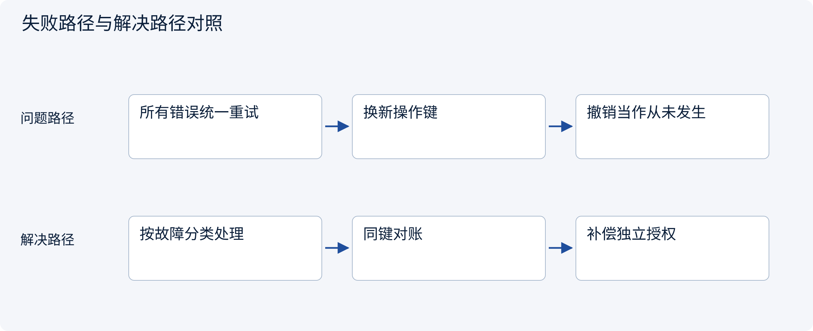
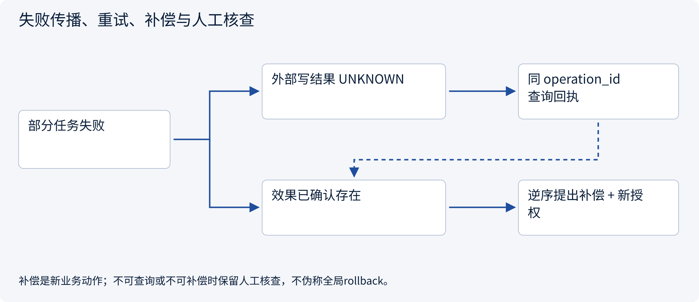
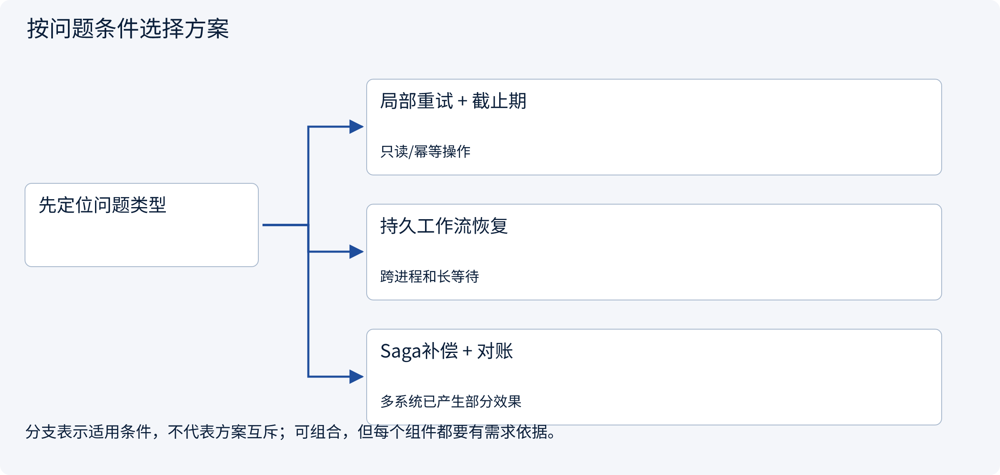
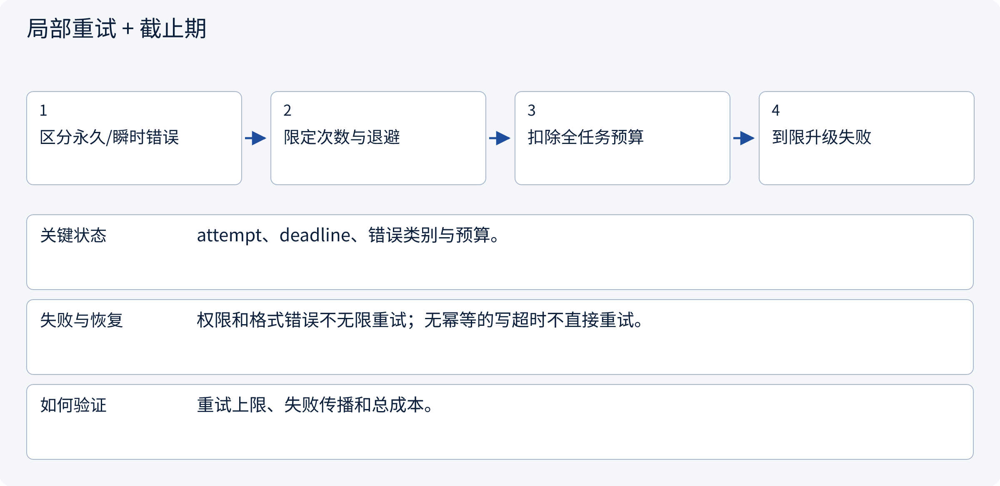
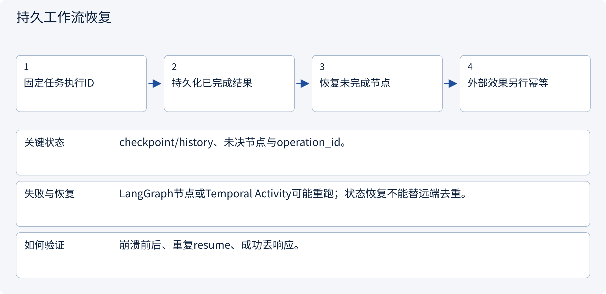
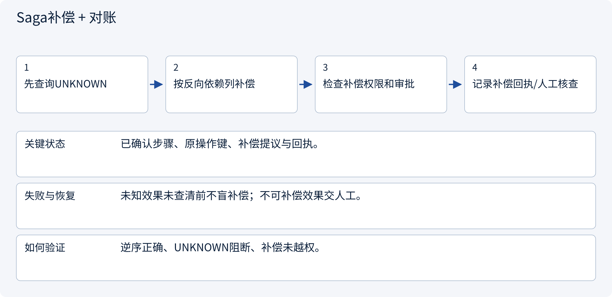

# 3.7.3 失败传播、重试、补偿与人工核查

> 图解主线 · 对照主流方案 · 配参考代码

设计参考与局部契约代码；不训练模型，不把示意或局部测试当作实测协作收益。

## 先看问题

一个worker失败后，哪些工作要取消？已成功的外部步骤能否直接数据库rollback？




## 图解工作原理

先区分可重算计算、可重试读取和结果未知写入。工作流恢复编排，业务操作用稳定ID；补偿是新的受权动作，不能把Saga当跨系统回滚魔法。



## 主流方案怎么选



| 方案 | 怎样解决 | 适用条件 | 代价与边界 |
|---|---|---|---|
| 局部重试 + 截止期 | 只重试瞬时且安全的步骤 | 只读/幂等操作 | 放大流量和预算 |
| 持久工作流恢复 | 检查点或历史复原编排 | 跨进程和长等待 | 重放语义与版本迁移 |
| Saga补偿 + 对账 | 对已确认效果提出逆向业务动作 | 多系统已产生部分效果 | 补偿可能失败且需新审批 |

## 主流方案内部怎样运行

### 1 · 局部重试 + 截止期



**具体推演：** 429可受控退避，跨租户deny不靠重试解决。

<details><summary>展开文字步骤、状态与失败边界</summary>

1. 区分永久/瞬时错误
2. 限定次数与退避
3. 扣除全任务预算
4. 到限升级失败

**关键状态** attempt、deadline、错误类别与预算。

**失败与恢复** 权限和格式错误不无限重试；无幂等的写超时不直接重试。

**如何验证** 重试上限、失败传播和总成本。

</details>

### 2 · 持久工作流恢复



**具体推演：** 框架继续执行时仍沿用原业务操作键。

<details><summary>展开文字步骤、状态与失败边界</summary>

1. 固定任务执行ID
2. 持久化已完成结果
3. 恢复未完成节点
4. 外部效果另行幂等

**关键状态** checkpoint/history、未决节点与operation_id。

**失败与恢复** LangGraph节点或Temporal Activity可能重跑；状态恢复不能替远端去重。

**如何验证** 崩溃前后、重复resume、成功丢响应。

</details>

### 3 · Saga补偿 + 对账



**具体推演：** 预留已成功可提出释放；草稿结果未知先查是否存在。

<details><summary>展开文字步骤、状态与失败边界</summary>

1. 先查询UNKNOWN
2. 按反向依赖列补偿
3. 检查补偿权限和审批
4. 记录补偿回执/人工核查

**关键状态** 已确认步骤、原操作键、补偿提议与回执。

**失败与恢复** 未知效果未查清前不盲补偿；不可补偿效果交人工。

**如何验证** 逆序正确、UNKNOWN阻断、补偿未越权。

</details>

## 参考代码

展开查看与本课机制对应的实现。训练函数仅提供代码，不执行实际训练；依赖与验证范围见配套代码说明。

[配套代码说明与验证范围](../projects/03-code-guide.md)

<details><summary>展开代码与实现边界</summary>

```python
"""Plan recovery from observed receipts; compensation is a NEW authorized action."""

from dataclasses import dataclass


@dataclass(frozen=True)
class StepReceipt:
    step: str
    operation_id: str
    outcome: str  # confirmed, failed or unknown
    compensation: str | None


def recovery_plan(receipts: list[StepReceipt]) -> dict:
    if len({x.operation_id for x in receipts}) != len(receipts):
        raise ValueError("Duplicate operation identity")
    if any(x.outcome not in {"confirmed", "failed", "unknown"} for x in receipts):
        raise ValueError("Invalid outcome")
    unknown = [x.operation_id for x in receipts if x.outcome == "unknown"]
    if unknown:
        return {
            "phase": "reconcile_first",
            "query_operations": unknown,
            "proposals": [],
        }
    proposals = []
    for receipt in reversed(receipts):
        if receipt.outcome != "confirmed":
            continue
        if receipt.compensation is None:
            return {
                "phase": "manual_review",
                "blocked_at": receipt.operation_id,
                "proposals": [],
            }
        proposals.append(
            {"compensates": receipt.operation_id, "action": receipt.compensation}
        )
    return {"phase": "authorize_compensation", "proposals": proposals}


# Proposals are not executed here. Recheck identity, scope and approval for each compensation.
# A Saga coordinates business recovery; it is not a rollback of arbitrary distributed history.
```

</details>

## 本节应交付的设计产物

故障分类表、可安全重试规则、检查点、幂等键、补偿与人工核查出口。

参考代码只证明本节契约的局部性质。设计应将本节产物与会话、权限、审批、Runtime、状态与评测章节对齐；它不是额外创建一个“总控Agent”就自动解决全部边界。没有调用模型、真实消息broker或生产工具，不报告协作提升百分比。

依据：[AWS Saga Orchestration](https://docs.aws.amazon.com/prescriptive-guidance/latest/cloud-design-patterns/saga-orchestration.html).


## 改变条件，检查理解

一个补偿函数叫rollback，就能跳过审批吗？

<details><summary>展开参考答案</summary>

不能。它是新的外部业务动作，必须在当前身份、资源范围和审批规则下执行。

</details>

[查看官方资料与方案依据](../resources.md)
