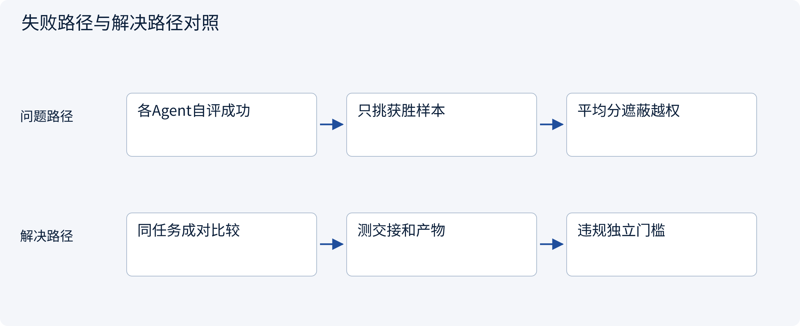
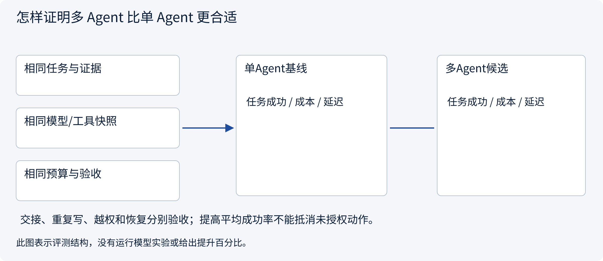
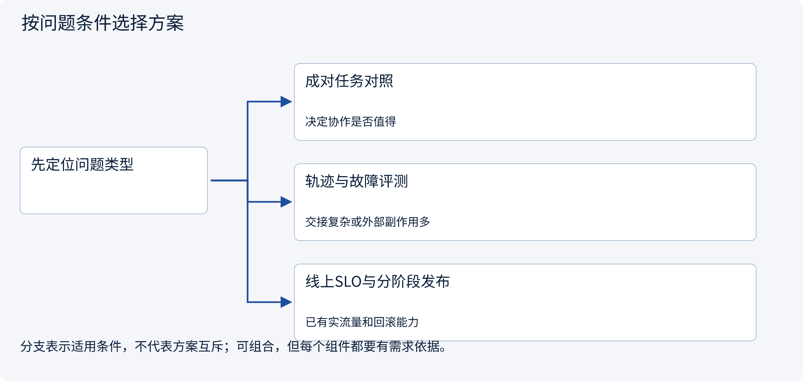
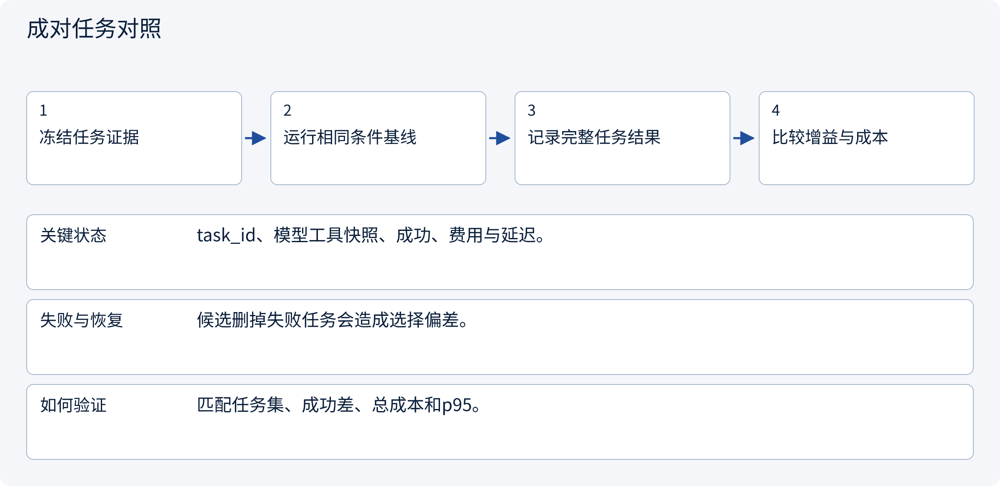
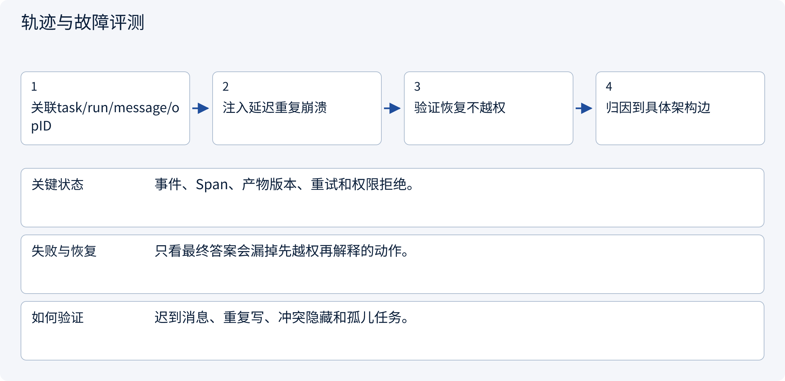
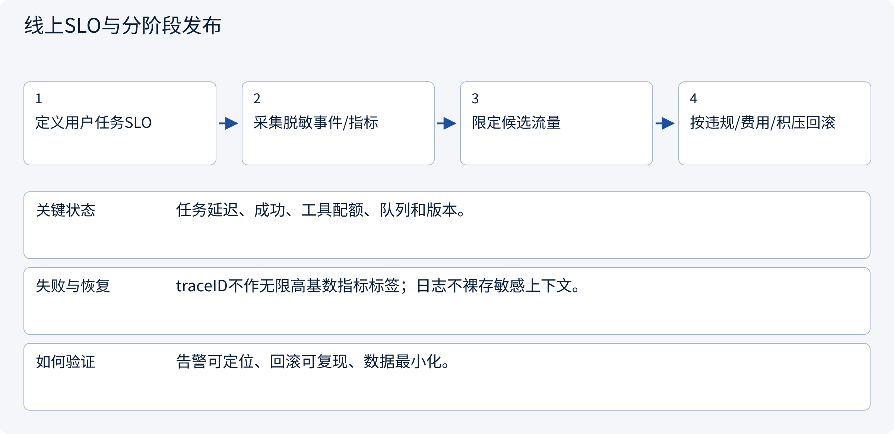

# 3.8.2 怎样证明多 Agent 比单 Agent 更合适

> 图解主线 · 对照主流方案 · 配参考代码

设计参考与局部契约代码；不训练模型，不把示意或局部测试当作实测协作收益。

## 先看问题

多个Agent都“完成”，为什么用户任务仍失败？漂亮答案和更高单Agent分数能证明协作设计有效吗？




## 图解工作原理

以完整任务比较相同模型、工具、证据和预算下的单/多Agent；分别评产物、交接、外部动作和成本。线上轨迹定位瓶颈，安全违规独立作为门槛。



## 主流方案怎么选



| 方案 | 怎样解决 | 适用条件 | 代价与边界 |
|---|---|---|---|
| 成对任务对照 | 固定样本比较单/多Agent | 决定协作是否值得 | 样本量、随机性和预算需披露 |
| 轨迹与故障评测 | 检查handoff、共享状态和恢复 | 交接复杂或外部副作用多 | 需要可回放的事件及断言 |
| 线上SLO与分阶段发布 | 从链路和队列观测实际运行 | 已有实流量和回滚能力 | 不等于完整离线质量证明 |

## 主流方案内部怎样运行

### 1 · 成对任务对照



**具体推演：** 多Agent成功率提高但费用/违规增加，不能只汇报好的一项。

<details><summary>展开文字步骤、状态与失败边界</summary>

1. 冻结任务证据
2. 运行相同条件基线
3. 记录完整任务结果
4. 比较增益与成本

**关键状态** task_id、模型工具快照、成功、费用与延迟。

**失败与恢复** 候选删掉失败任务会造成选择偏差。

**如何验证** 匹配任务集、成功差、总成本和p95。

</details>

### 2 · 轨迹与故障评测



**具体推演：** 模型报告完成，但必要worker缺证据，应判全任务失败。

<details><summary>展开文字步骤、状态与失败边界</summary>

1. 关联task/run/message/opID
2. 注入延迟重复崩溃
3. 验证恢复不越权
4. 归因到具体架构边

**关键状态** 事件、Span、产物版本、重试和权限拒绝。

**失败与恢复** 只看最终答案会漏掉先越权再解释的动作。

**如何验证** 迟到消息、重复写、冲突隐藏和孤儿任务。

</details>

### 3 · 线上SLO与分阶段发布



**具体推演：** 工具网关饱和与汇总模型太慢应给出不同修复动作。

<details><summary>展开文字步骤、状态与失败边界</summary>

1. 定义用户任务SLO
2. 采集脱敏事件/指标
3. 限定候选流量
4. 按违规/费用/积压回滚

**关键状态** 任务延迟、成功、工具配额、队列和版本。

**失败与恢复** traceID不作无限高基数指标标签；日志不裸存敏感上下文。

**如何验证** 告警可定位、回滚可复现、数据最小化。

</details>

## 参考代码

展开查看与本课机制对应的实现。训练函数仅提供代码，不执行实际训练；依赖与验证范围见配套代码说明。

[配套代码说明与验证范围](../projects/03-code-guide.md)

<details><summary>展开代码与实现边界</summary>

```python
"""Compare matched task-level trials; operational violations are separate release gates."""

from dataclasses import dataclass
from math import ceil, isfinite


@dataclass(frozen=True)
class Trial:
    task_id: str
    success: bool
    cost: float
    latency: float
    unauthorized_actions: int


def compare(baseline: list[Trial], candidate: list[Trial]) -> dict:
    def index(rows):
        result = {x.task_id: x for x in rows}
        if not rows or len(result) != len(rows):
            raise ValueError("Missing/duplicate trials")
        if any(
            not isfinite(x.cost)
            or not isfinite(x.latency)
            or x.cost < 0
            or x.latency < 0
            or x.unauthorized_actions < 0
            for x in rows
        ):
            raise ValueError("Invalid metrics")
        return result

    old, new = index(baseline), index(candidate)
    if old.keys() != new.keys():
        raise ValueError("Compare identical tasks, not cherry-picked subsets")
    n = len(old)
    latencies = sorted(x.latency for x in candidate)
    return {
        "paired_success_delta": sum(
            int(new[k].success) - int(old[k].success) for k in old
        )
        / n,
        "added_cost": sum(new[k].cost - old[k].cost for k in old),
        "candidate_p95_latency": latencies[ceil(0.95 * n) - 1],
        "unauthorized_actions": sum(x.unauthorized_actions for x in candidate),
        "policy_gate_passed": all(x.unauthorized_actions == 0 for x in candidate),
    }


# Fix model/tool/evidence snapshots, track cost/latency per whole task and report sample size.
# This computes metrics on supplied records; no model experiment or production uplift is claimed.
```

</details>

## 本节应交付的设计产物

同任务基线与候选对照、轨迹断言、故障注入集、脱敏观测与独立违规门槛。

参考代码只证明本节契约的局部性质。设计应将本节产物与会话、权限、审批、Runtime、状态与评测章节对齐；它不是额外创建一个“总控Agent”就自动解决全部边界。没有调用模型、真实消息broker或生产工具，不报告协作提升百分比。

依据：[OpenTelemetry Traces](https://opentelemetry.io/docs/concepts/signals/traces/), [Anthropic Multi-Agent Research System](https://www.anthropic.com/research/multi-agent-research-system).


## 改变条件，检查理解

单个worker准确率提高，是否代表整个多Agent系统变好？

<details><summary>展开参考答案</summary>

不代表。还要检查交接损失、证据合并、预算、延迟和最终业务验收，违规数独立检查。

</details>

[查看官方资料与方案依据](../resources.md)
