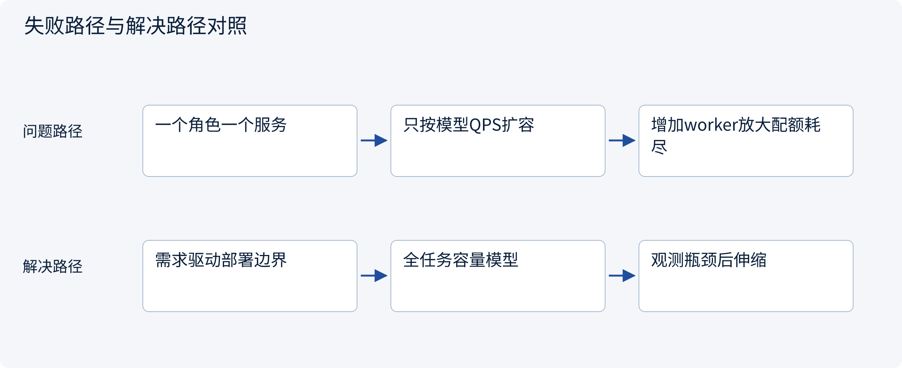
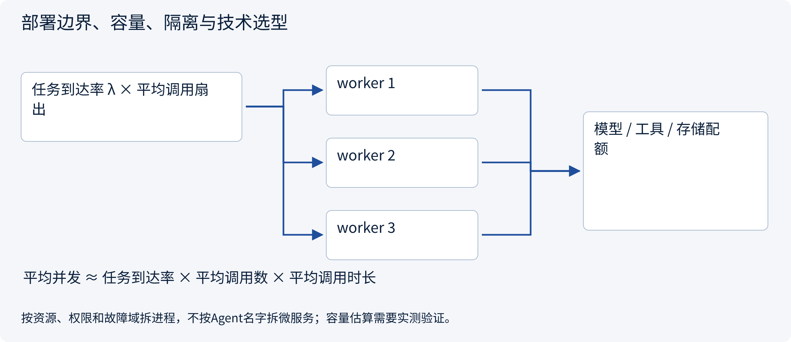
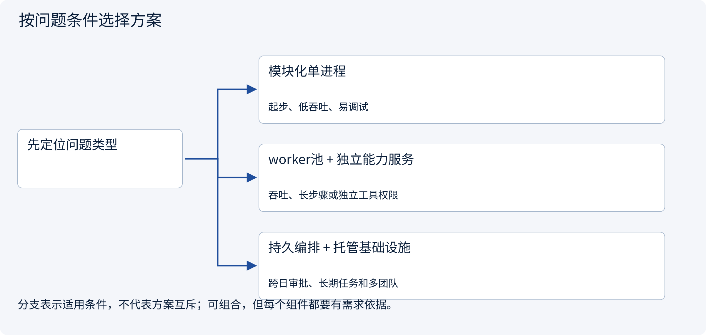

# 3.9.1 部署边界、容量、隔离与技术选型

> 图解主线 · 对照主流方案 · 配参考代码

设计参考与局部契约代码；不训练模型，不把示意或局部测试当作实测协作收益。

## 先看问题

每个Agent都要一个微服务吗？如何判断伸缩瓶颈在模型、工具、队列、存储还是汇总者？




## 图解工作原理

按故障域、权限、资源需求和独立伸缩划进程边界，不按角色名切微服务。先估算任务到达率、扇出、服务时间和外部配额，再用实测与故障演练修正。



## 主流方案怎么选



| 方案 | 怎样解决 | 适用条件 | 代价与边界 |
|---|---|---|---|
| 模块化单进程 | 类型边界和注入式适配器 | 起步、低吞吐、易调试 | 故障域集中，不能独立扩容 |
| worker池 + 独立能力服务 | 按资源和权限隔离执行 | 吞吐、长步骤或独立工具权限 | 队列、租约、重投和一致性运维 |
| 持久编排 + 托管基础设施 | 工作流服务管理长等待和恢复 | 跨日审批、长期任务和多团队 | 平台依赖、历史版本与成本治理 |

## 主流方案内部怎样运行

### 1 · 模块化单进程


**具体推演：** 研究与写报告可先在同一进程的不同工作单元运行。

<details><summary>展开文字步骤、状态与失败边界</summary>

1. 分领域职责
2. 限制并发和工具
3. 记录任务轨迹
4. 有证据再拆服务

**关键状态** 模块契约、共享资源和失败边界。

**失败与恢复** 逻辑多Agent不等于多个操作系统进程。

**如何验证** 资源峰值、故障域和业务规则一致。

</details>

### 2 · worker池 + 独立能力服务


**具体推演：** CPU解析池与远程模型调用池可用不同并发和伸缩策略。

<details><summary>展开文字步骤、状态与失败边界</summary>

1. 按负载建worker池
2. 隔离能力服务权限
3. 按队列/配额准入
4. 观测后独立扩容

**关键状态** worker槽、积压、工具配额、内存和租户限制。

**失败与恢复** 外部模型或工具QPS已满时加worker不提升吞吐。

**如何验证** 背压、积压恢复、跨租户隔离和成本。

</details>

### 3 · 持久编排 + 托管基础设施


**具体推演：** 用平均调用时长估算并发，再分别测p95和突发队列。

<details><summary>展开文字步骤、状态与失败边界</summary>

1. 选定恢复语义
2. 部署工作流与worker
3. 治理凭据和状态存储
4. 压测故障及回放

**关键状态** 工作流历史、worker版本、状态库与可用性目标。

**失败与恢复** 平台接入不能替代业务权限、幂等和容量规划。

**如何验证** 服务失联、版本迁移、恢复时间和单位任务成本。

</details>

## 参考代码

展开查看与本课机制对应的实现。训练函数仅提供代码，不执行实际训练；依赖与验证范围见配套代码说明。

[配套代码说明与验证范围](../projects/03-code-guide.md)

<details><summary>展开代码与实现边界</summary>

```python
"""A capacity estimate from measured means, not a benchmark or deployment automation."""

from math import ceil, isfinite


def worker_estimate(
    task_rate: float,
    mean_calls_per_task: float,
    mean_call_seconds: float,
    slots_per_worker: int,
    target_utilization: float,
) -> dict:
    values = (task_rate, mean_calls_per_task, mean_call_seconds, target_utilization)
    if (
        any(not isfinite(x) for x in values)
        or min(values[:3]) <= 0
        or type(slots_per_worker) is not int
        or slots_per_worker <= 0
        or not 0 < target_utilization < 1
    ):
        raise ValueError("Invalid capacity inputs")
    mean_concurrency = task_rate * mean_calls_per_task * mean_call_seconds
    workers = ceil(mean_concurrency / (slots_per_worker * target_utilization))
    return {"mean_inflight_calls": mean_concurrency, "estimated_workers": workers}


# Use measured MEAN service time in Little's-law-style estimates, not p95 as if it were a mean.
# Include retries/fanout in calls_per_task; external quotas, burst backlog and memory can dominate.
# Select process/service boundaries from isolation, scaling and ownership requirements.
```

</details>

## 本节应交付的设计产物

部署与信任边界图、每类资源容量与配额、伸缩信号、版本发布与故障恢复演练。

参考代码只证明本节契约的局部性质。设计应将本节产物与会话、权限、审批、Runtime、状态与评测章节对齐；它不是额外创建一个“总控Agent”就自动解决全部边界。没有调用模型、真实消息broker或生产工具，不报告协作提升百分比。

依据：[Anthropic Multi-Agent Research System](https://www.anthropic.com/research/multi-agent-research-system).


## 改变条件，检查理解

用p95调用时长代替平均时长套入Little定律是否严格成立？

<details><summary>展开参考答案</summary>

不成立。均值关系要用均值并满足适用假设；p95用于尾延迟目标与额外压测，容量估算不能当实测承诺。

</details>

[查看官方资料与方案依据](../resources.md)
