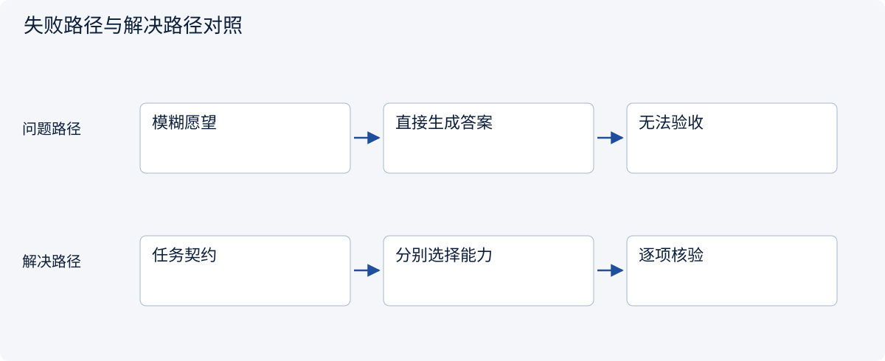
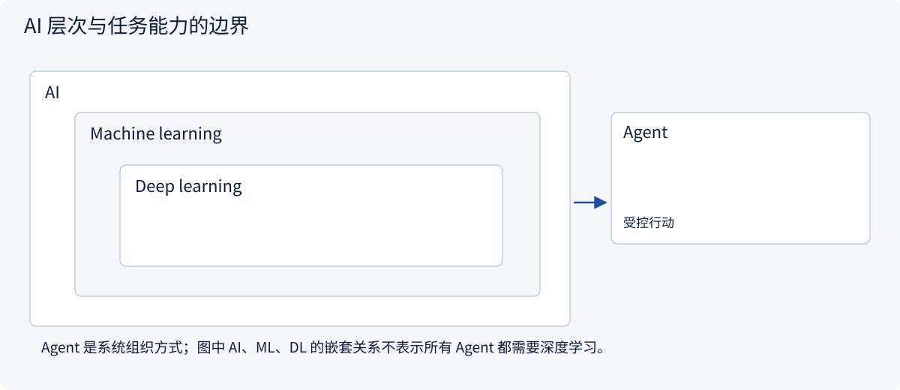
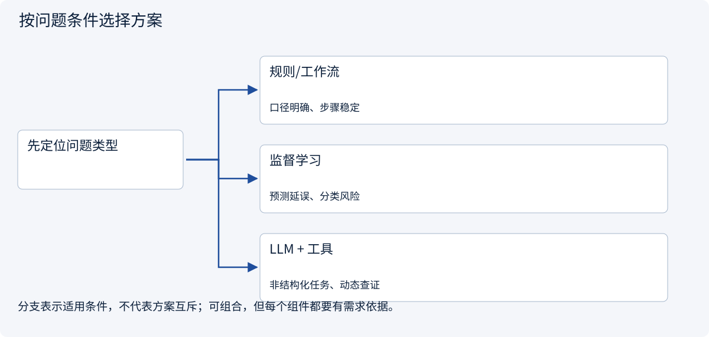
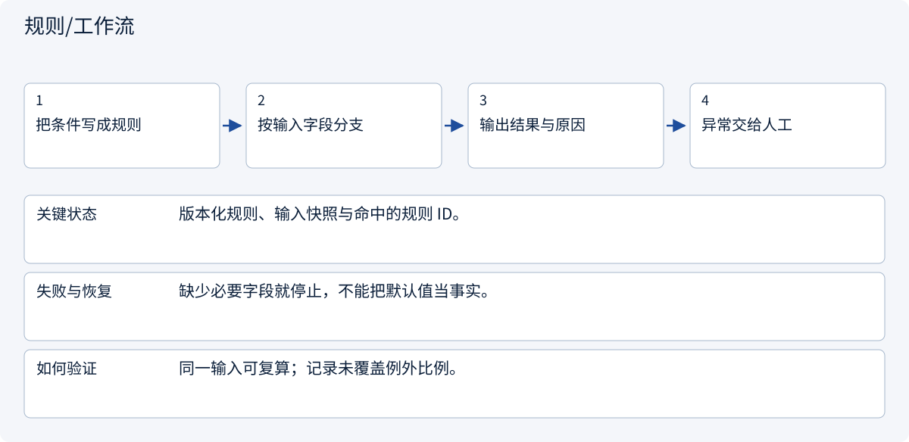
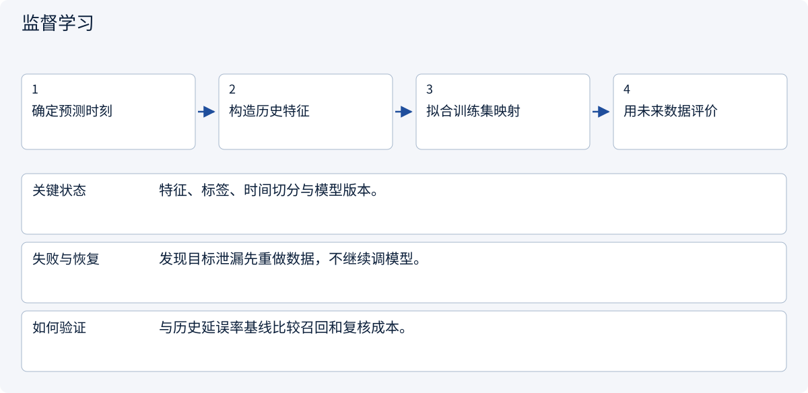
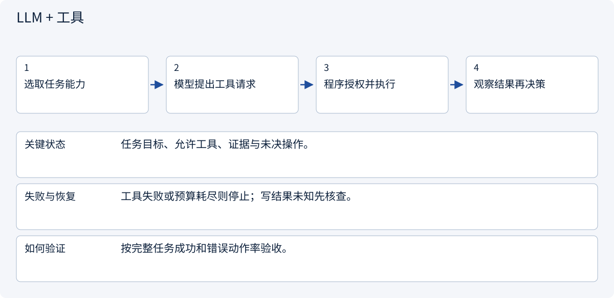

# 1.1 从一个预测问题认识 AI

> 图解主线 · 对照主流方案 · 配参考代码

代码验证任务约束与整数费用预算；任务成功标准、审批和模型训练需由各自模块实现。

## 先看问题

“帮我采购”同时包含预测、读文档与外部动作，能否都交给一个模型？




## 图解工作原理

先定义输入、输出和权限，再按问题类型选规则、学习或 Agent。模型分数与执行授权是两种对象。



## 主流方案怎么选



| 方案 | 怎样解决 | 适用条件 | 代价与边界 |
|---|---|---|---|
| 规则/工作流 | 确定条件与分支 | 口径明确、步骤稳定 | 例外需要显式维护 |
| 监督学习 | 用带标签数据拟合映射 | 预测延误、分类风险 | 需要可用标签与独立评价 |
| LLM + 工具 | 解释文本并提议动作 | 非结构化任务、动态查证 | 需要运行时授权和停止条件 |

## 主流方案内部怎样运行

### 1 · 规则/工作流



**具体推演：** 数量与预算固定时由程序比较总价，缺运费时返回未知。

<details><summary>展开文字步骤、状态与失败边界</summary>

1. 把条件写成规则
2. 按输入字段分支
3. 输出结果与原因
4. 异常交给人工

**关键状态** 版本化规则、输入快照与命中的规则 ID。

**失败与恢复** 缺少必要字段就停止，不能把默认值当事实。

**如何验证** 同一输入可复算；记录未覆盖例外比例。

</details>

### 2 · 监督学习



**具体推演：** 只能用下单前已有记录预测延误，不能用最终发货日。

<details><summary>展开文字步骤、状态与失败边界</summary>

1. 确定预测时刻
2. 构造历史特征
3. 拟合训练集映射
4. 用未来数据评价

**关键状态** 特征、标签、时间切分与模型版本。

**失败与恢复** 发现目标泄漏先重做数据，不继续调模型。

**如何验证** 与历史延误率基线比较召回和复核成本。

</details>

### 3 · LLM + 工具



**具体推演：** LLM 读报价文字，代码比较金额，创建订单另行审批。

<details><summary>展开文字步骤、状态与失败边界</summary>

1. 选取任务能力
2. 模型提出工具请求
3. 程序授权并执行
4. 观察结果再决策

**关键状态** 任务目标、允许工具、证据与未决操作。

**失败与恢复** 工具失败或预算耗尽则停止；写结果未知先核查。

**如何验证** 按完整任务成功和错误动作率验收。

</details>

## 参考代码

展开查看与本课机制对应的实现。训练函数仅提供代码，不执行实际训练；依赖与验证范围见配套代码说明。

[配套代码说明与验证范围](../projects/03-code-guide.md)

<details><summary>展开代码与实现边界</summary>

```python
"""A task contract keeps predictions separate from external actions."""

from dataclasses import dataclass


@dataclass(frozen=True)
class ResearchTask:
    quantity: int
    budget_cents: int
    evidence_ids: tuple[str, ...]
    may_create_draft: bool = False

    def validate(self) -> None:
        if self.quantity <= 0 or self.budget_cents <= 0:
            raise ValueError("Quantity and budget must be positive")
        if not self.evidence_ids:
            raise ValueError("Evidence is required before comparing quotations")


def affordable(unit_cents: int, shipping_cents: int, task: ResearchTask) -> bool:
    task.validate()
    if unit_cents < 0 or shipping_cents < 0:
        raise ValueError("Missing costs must not be silently replaced with zero")
    return unit_cents * task.quantity + shipping_cents <= task.budget_cents
```

</details>

## 改变条件，检查理解

为什么判断报价便宜与创建订单不能使用同一个验收条件？

<details><summary>展开参考答案</summary>

前者需要统一口径与证据；后者还需要具体对象授权、审批和副作用回执。

</details>

<details><summary>按需展开：原理推导与边界补充</summary>

**先问系统究竟要产出什么**

小林想让系统“帮忙采购”。这句话至少包含四种任务：预测供应商延误风险、阅读合同、比较报价、发出订单。它们分别需要数据建模、语言理解、证据整理和受控执行。只有先分清任务，才知道该学习哪种技术。

人工智能是研究感知、推理、学习、规划与行动的领域。机器学习是其中从数据改进模型的一条路线；深度学习使用多层神经网络学习表示。生成式 AI 描述产出文本、图像等内容的任务类型；Agent 描述与环境交互、按观察继续行动的系统组织方式。这些概念不在同一个分类维度。


图中的箭头表示本课程的先修关系，不是技术替代关系。学习 Agent 仍要知道模型何时不可信，学习模型则不要求先搭建 Agent 平台。

**四种学习信号**

| 方式 | 学习信号来自哪里 | 采购场景 | 容易误解的地方 |
|---|---|---|---|
| 监督学习 | 人工或业务过程给出的标签 | 历史订单是否延误 | 标签可能记录错误或事后泄漏 |
| 无监督学习 | 数据自身的结构 | 给供应商分组 | 分组不自动等于风险等级 |
| 自监督学习 | 从数据构造预测目标 | 用前文预测后文 | 没有人工逐条标注，不等于没有监督信号 |
| 强化学习 | 动作后的回报 | 在模拟器中优化库存策略 | 设计不好的奖励可能鼓励钻空子 |

LLM 接工具循环通常是推理期编排，并不自动产生强化学习训练，也不意味着模型每次聊天都会更新参数。

**把愿望改写成实验**

“判断供应商是否靠谱”太模糊。改成：“在下单前，使用当时可见的交货记录，预测这次订单是否超过承诺交期；人工复核风险最高的 10%。”输入的时间边界、标签定义、使用者和行动阈值都明确了。

第一条基线可以是“过去十单延误率”。如果复杂模型没有比这条规则更好，先检查数据和评价方法。不要把技术复杂度当进步。

对于合同问答，成功不再是分类准确率，而是答案有没有证据、是否漏掉例外条款、缺失时能否拒答。对于下订单，还必须检查对象、金额、授权和重复执行。**任务的评价标准决定系统的设计。**

**练习：画出边界**

将“请帮我买便宜且按时到货的零件”拆成输入、输出、禁止动作、验收条件。再标出哪些步骤用规则就能完成。

<details><summary>参考答案与解释</summary>

输入包括物料规格、数量、预算、到货日期和可核验报价；输出是带证据的候选表。禁止在未授权时下单或联系供应商。验收条件包括规格一致、总价口径一致、交期有来源、缺失项标未知。币种换算和预算过滤可以由确定性程序完成；从非结构化报价提取条件可使用模型。模型建议的供应商仍需规则与人工审核。

</details>

**进入下一章之前**

能解释“训练改变参数、上下文改变本次输入、工具改变外部环境”，再进入数学基础。暂时不必选择模型厂商或框架。


</details>

[查看官方资料与方案依据](../resources.md)
