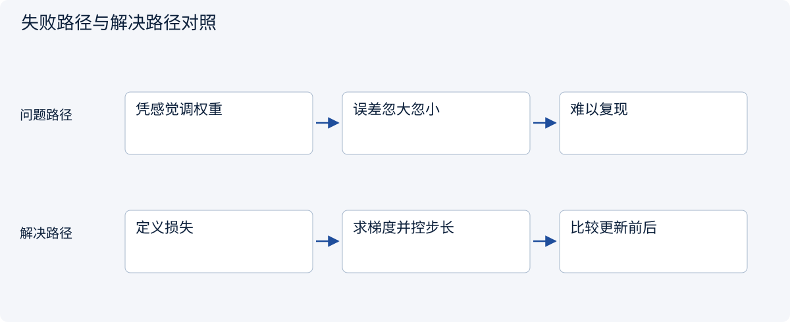
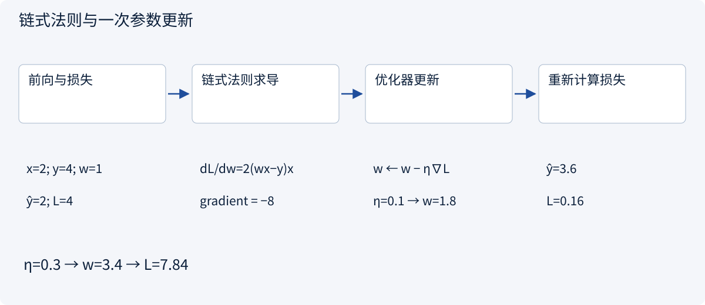
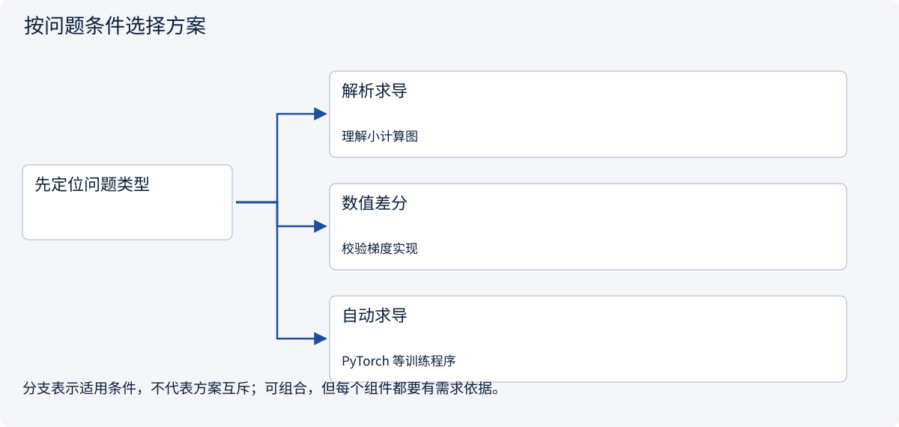
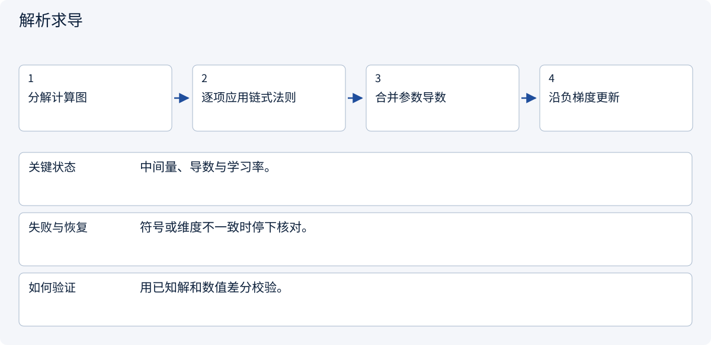
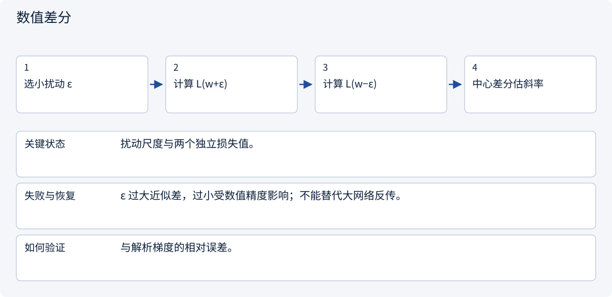
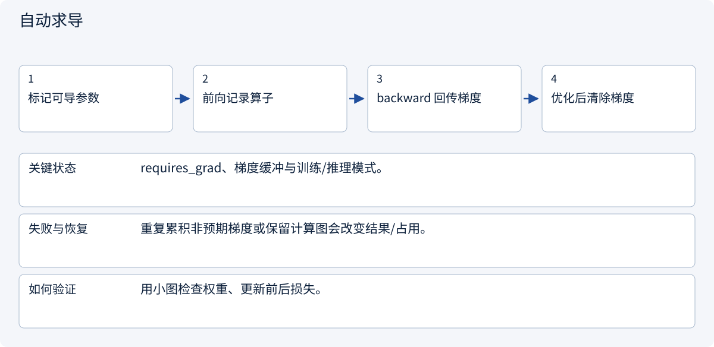

# 1.2 只学现在用得上的数学

> 图解主线 · 对照主流方案 · 配参考代码

## 先看问题

知道预测错了，却不知道该把哪个参数往哪边调整。



## 图解工作原理

链式法则计算参数对损失的局部影响；优化器沿负梯度更新。自动求导替你计算导数，不替你选择数据与步长。



## 主流方案怎么选



| 方案 | 怎样解决 | 适用条件 | 代价与边界 |
|---|---|---|---|
| 解析求导 | 手写链式法则 | 理解小计算图 | 复杂网络易漏项 |
| 数值差分 | 扰动参数估计斜率 | 校验梯度实现 | 计算昂贵且有误差 |
| 自动求导 | 沿计算图回传导数 | PyTorch 等训练程序 | 需管理梯度累积与图生命周期 |

## 主流方案内部怎样运行

### 1 · 解析求导



**具体推演：** x=2,y=4,w=1 时导数 -8，步长 0.1 得 w=1.8。

### 2 · 数值差分



**具体推演：** 比较 [L(w+ε)−L(w−ε)]/(2ε) 与 -8。

### 3 · 自动求导



**具体推演：** 返回 w=1.8、更新前损失4、更新后损失0.16；这里只提供代码。

## 参考代码

展开查看与本课机制对应的实现。训练函数仅提供代码，不执行实际训练；依赖与验证范围见配套代码说明。

[配套代码说明与验证范围](../../../docs/zh/projects/03-code-guide.md)

<details><summary>展开代码与实现边界</summary>

```python
"""Reference training step; not executed during documentation checks."""


def gradient_step() -> dict[str, float]:
    import torch

    weight = torch.tensor(1.0, requires_grad=True)
    prediction = weight * 2
    loss = (prediction - 4).square()
    loss.backward()  # derivative: -8
    with torch.no_grad():
        weight -= 0.1 * weight.grad  # reference result: 1.8
        updated_loss = (weight * 2 - 4).square()
    weight.grad = None  # do not carry a stale gradient
    return {
        "weight": weight.detach().item(),
        "loss_before": loss.detach().item(),
        "loss_after": updated_loss.item(),
    }
```

</details>

## 改变条件，检查理解

为什么学习率从 0.1 改成 0.3 后损失反而可能上升？

<details><summary>展开参考答案</summary>

梯度只给局部方向，步长过大会跨过低损失区域。本例新损失从 0.16 变为 7.84。

</details>

<details><summary>按需展开：原理推导与边界补充</summary>

**向量保存特征，矩阵组织计算**

把一张订单表示为 `x = [数量, 距离]`，模型的权重是 `w = [0.2, 0.01]`，偏置是 `b = 2`。若数量按百件、距离按百公里计，`x = [3, 5]` 时线性预测为：

```text
ŷ = x · w + b = 3×0.2 + 5×0.01 + 2 = 2.65 天
```

点积是对应元素相乘再求和。权重的大小必须结合单位解释；把公里改成米，权重就会改变。把特征标准化常能改善优化的数值条件，但均值和方差必须只用训练集估计，再应用到验证和测试集。

矩阵是一批向量。`X` 为 `(批大小 B, 特征数 D)`，`W` 为 `(D, 输出数 H)`，则 `XW` 为 `(B, H)`。每一步写形状，可以发现把样本轴和特征轴混淆的错误。后面注意力里的 `QKᵀ` 也是同一类矩阵乘法。


**概率表示不确定性**

“下雨时延误概率 0.4”是条件概率 `P(延误 | 下雨)`，不是 `P(下雨 | 延误)`。假设 100 单中有 20 单雨天订单，其中 8 单延误；另外 80 单有 8 单延误。前一个概率是 `8/20=0.4`，后一个概率是 `8/16=0.5`。

模型的分数也不一定是可靠概率。若它预测 0.8 的订单实际上只有 0.5 延误，就需要检查校准。评价模型不能只看“排序不错”，还要看把概率用于预算决策时是否可信。

Softmax 把一组实数分数变成和为 1 的正数。对分数 `[1, 2]`，概率约为 `[0.269, 0.731]`。数值实现先减去最大值，再取指数；这样概率不变，同时减少溢出风险。

**导数告诉你往哪边改**

用最小例子理解梯度。设模型 `ŷ = wx`，只有一个样本 `x=2, y=4`，损失 `L=(ŷ-y)²`。当 `w=1`，预测 2，损失 4。链式法则给出：

```text
dL/dw = 2(wx-y) × x = 2×(2-4)×2 = -8
w_new = w - 学习率 × 梯度
学习率 0.1：w_new = 1 - 0.1×(-8) = 1.8
新预测 = 3.6，新损失 = 0.16
```

梯度为负，说明局部增大权重会降低损失，所以更新方向与梯度相反。多参数的偏导数组成梯度向量。反向传播高效计算梯度，优化器根据梯度更新参数；这两个步骤职责不同。

学习率并不是越大越快。同一个例子用学习率 0.3，权重变成 3.4，损失变成 7.84，反而比原来更差。真实损失曲面更复杂，一步下降不保证之后都下降，也不保证得到全局最优。

**练习：不要省略中间量**

1. `X` 是 `(8,3)`，`W` 是 `(3,2)`，预测形状是什么？
2. 上例使用学习率 0.25 会得到什么？能据此断言所有模型都应使用 0.25 吗？
3. 为什么不能把测试集一起算入标准化均值？

<details><summary>参考答案</summary>

1. `(8,2)`，每个样本两个输出。
2. 权重恰好变成 3，预测 6，损失仍为 4。不能把一个样本的特殊几何性质推广到其他模型。
3. 测试分布的信息进入训练预处理，会使最后的独立评价不再干净。真实部署中也拿不到未来全体订单的均值。

</details>

**深入方向**

后面按需要补矩阵转置与范数、对数与交叉熵、链式法则、随机变量与期望。现在先做到能说清每个符号代表什么，以及输入输出的单位和形状。


</details>

[查看官方资料与方案依据](../../../docs/zh/resources.md)
