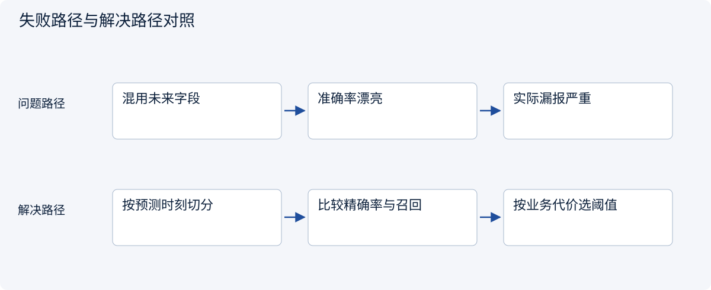
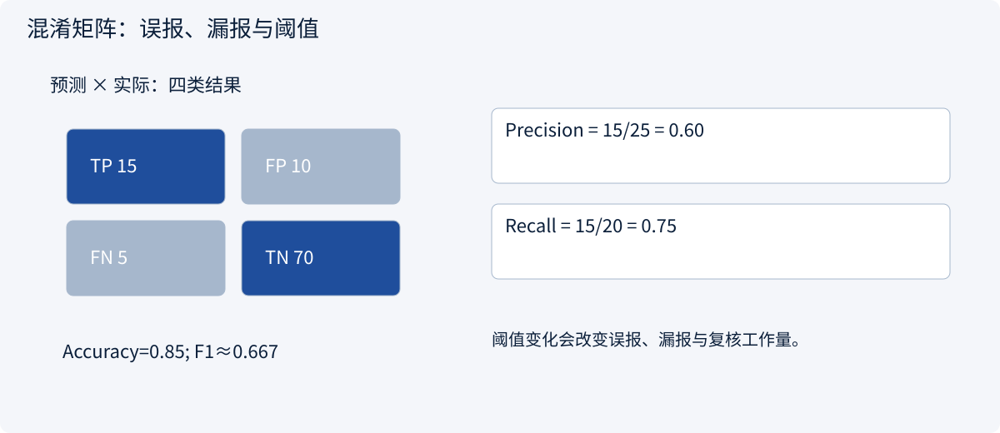
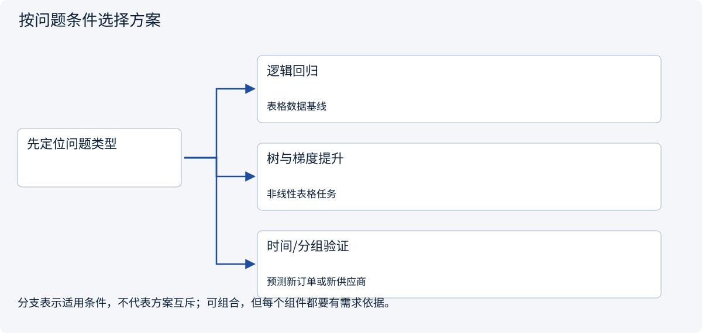
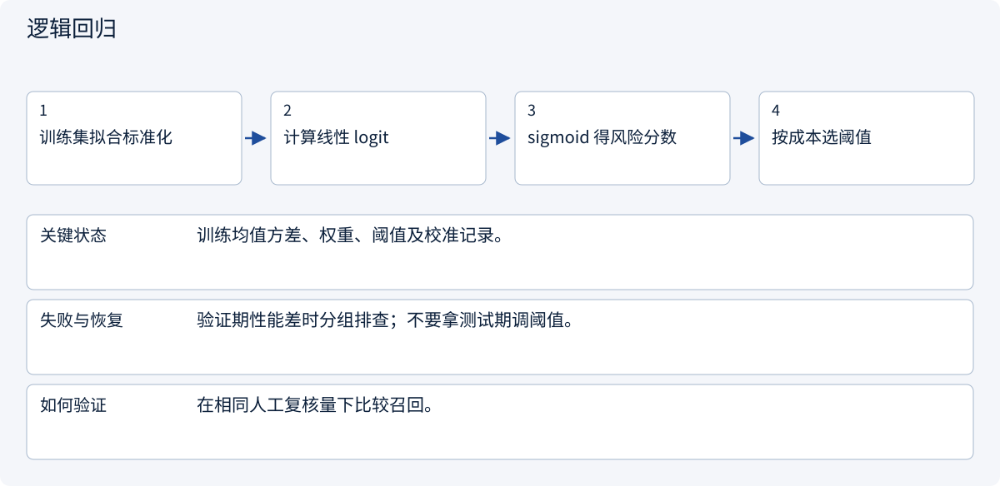
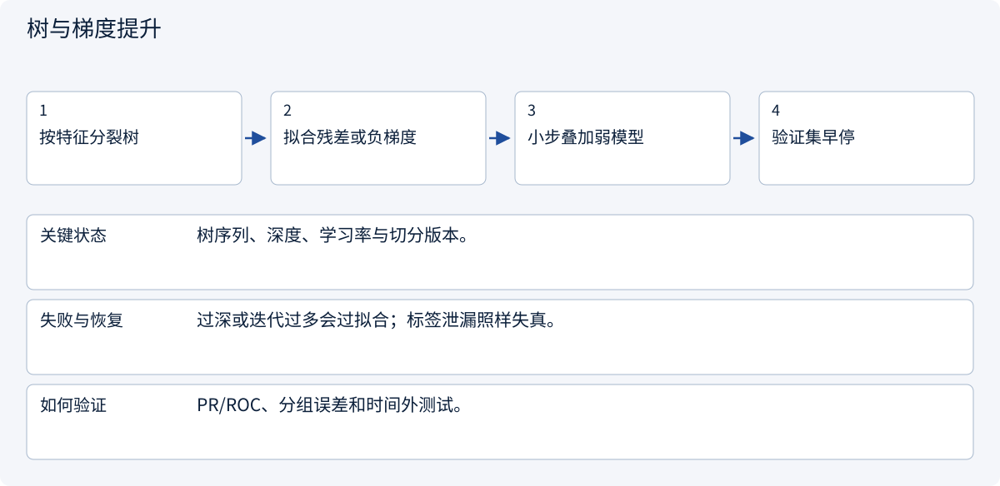
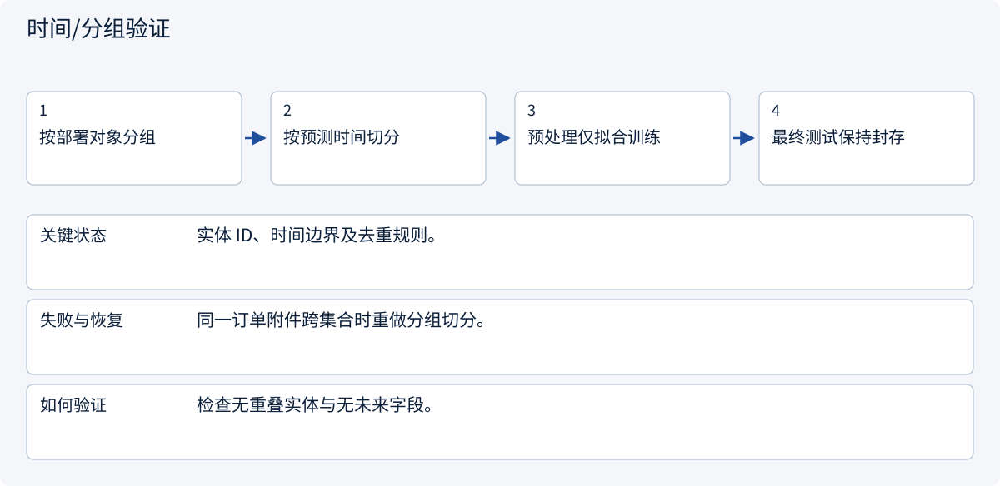

# 1.3 从数据到可信的机器学习实验

> 图解主线 · 对照主流方案 · 配参考代码

## 先看问题

准确率很高，上线仍漏掉多数延误；测试集还可能偷看了未来。




## 图解工作原理

先约束数据时间与分组，再建立基线；分类阈值要服从误报、漏报与复核预算。



## 主流方案怎么选



| 方案 | 怎样解决 | 适用条件 | 代价与边界 |
|---|---|---|---|
| 逻辑回归 | 线性分数与概率映射 | 表格数据基线 | 非线性交互表达有限 |
| 树与梯度提升 | 特征分支及集成 | 非线性表格任务 | 需防泄漏与过拟合 |
| 时间/分组验证 | 隔离未来或同主体样本 | 预测新订单或新供应商 | 必须匹配真实部署分布 |

## 主流方案内部怎样运行

### 1 · 逻辑回归



**具体推演：** 每天只能复核 10 单时比较两模型最高风险的 10 单。

### 2 · 树与梯度提升



**具体推演：** 交期同时受数量和地区影响时，树可表达交互。

### 3 · 时间/分组验证



**具体推演：** 要泛化到新供应商，就把一部分供应商整体留出。

## 参考代码

展开查看与本课机制对应的实现。训练函数仅提供代码，不执行实际训练；依赖与验证范围见配套代码说明。

[配套代码说明与验证范围](../../../docs/zh/projects/03-code-guide.md)

<details><summary>展开代码与实现边界</summary>

```python
"""Time-ordered model selection. Reference only: no training on import."""


def fit_time_split(features, labels, split: int):
    from sklearn.linear_model import LogisticRegression
    from sklearn.metrics import precision_score, recall_score
    from sklearn.pipeline import make_pipeline
    from sklearn.preprocessing import StandardScaler

    if not 0 < split < len(features):
        raise ValueError("Nonempty past and future partitions required")
    # features and labels must already be ordered by prediction time.
    model = make_pipeline(StandardScaler(), LogisticRegression(max_iter=500))
    model.fit(features[:split], labels[:split])
    predictions = model.predict(features[split:])
    return model, {
        "precision": precision_score(labels[split:], predictions, zero_division=0),
        "recall": recall_score(labels[split:], predictions, zero_division=0),
    }


# The future partition is validation here. Reserve a third, untouched test period.
```

</details>

## 改变条件，检查理解

TP=15、FP=10、FN=5、TN=70 时，准确率能否代替召回率？

<details><summary>展开参考答案</summary>

不能。准确率 85%，召回率 75%，精确率 60%；指标回答不同问题。

</details>

<details><summary>按需展开：原理推导与边界补充</summary>

**标签要站在预测发生的时刻定义**

我们预测订单是否延误。可使用下单时的供应商历史记录，不能使用这单最终发货日期作为特征。后者在预测时不存在，属于目标泄漏。即使代码里严格划分了训练集和测试集，时间上的泄漏仍能把成绩做得很好看。

同一订单的多份附件不能随机分散到训练和测试中，否则模型可能认出订单而不是学会新规律。按主体分组、按时间切分，取决于未来真实使用方式。若要评价面对新供应商的泛化，就需要让一部分供应商整体留出。


图中的测试集没有回到调参步骤的箭头。测试结果用于最后评价；反复根据测试错误选提示词、阈值或模型，也会消耗这份独立性。

**回归与分类各学什么**

回归预测连续值，例如延误天数。均方误差对大误差惩罚更重；平均绝对误差更容易按“平均相差几天”解释。分类预测类别或风险分数。逻辑回归对线性分数使用 sigmoid，得到 0 到 1 的值；阈值再把分数变成行动。

树模型按特征阈值分支，可以处理非线性规则与特征交互；集成方法组合多个弱模型。对中小规模表格数据，逻辑回归、树与梯度提升是值得比较的基线。模型容量更大，并不能修复错误标签或预测时刻不一致。

**手算一张混淆矩阵**

假设 100 单里有 20 单真正延误。模型预警 25 单，其中 15 单真的延误：

| | 实际延误 | 实际准时 |
|---|---:|---:|
| 预测延误 | TP=15 | FP=10 |
| 预测准时 | FN=5 | TN=70 |

Precision=`15/25=60%`，Recall=`15/20=75%`，Accuracy=`85/100=85%`，F1 约为 `66.7%`。永远预测准时也有 80% 准确率，但召回率为 0。

把预警阈值调低，通常会提高召回，同时增加误报。选择阈值需要知道漏报造成的延误代价、复核人力以及每天最多能处理多少条。AUC 衡量跨阈值的排序表现，不会替你选择行动阈值；极不平衡时还应看 PR 曲线与实际工作量。

**诊断误差，再改模型**

训练和验证都差，可能是特征无信息、模型容量不足、训练没收敛或标签噪声。训练很好而验证差，可能是过拟合、分布变化或切分方式不合理。先画学习曲线、看分组错误，再决定增加数据、正则化、降低复杂度或修改特征。

比较时固定切分和预算，并记录数据版本、特征、随机种子、超参数与指标。一个随机种子的微小提升可能只是波动；重要结果用多个种子或置信区间报告。测试集只代表与它相近的分布，不是所有未来订单的可靠保证。

**练习：设计一个有用的基线**

当前系统按“最近十单延误率大于 30%”预警。新模型准确率从 85% 提到 87%。你是否上线？请给出还需要的三项证据。

<details><summary>参考答案</summary>

至少比较相同复核预算下的召回、不同供应商与新旧订单的分组表现、按真实时间留出的测试结果。还要检查误报与漏报的业务成本、泄漏和运行延迟。两个百分点本身不足以证明上线收益。若新模型每天预警数量翻倍，表面提高可能只是花了更多人力。

</details>


</details>

[查看官方资料与方案依据](../../../docs/zh/resources.md)
