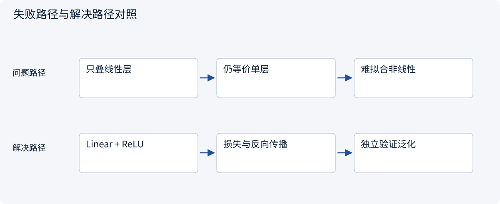
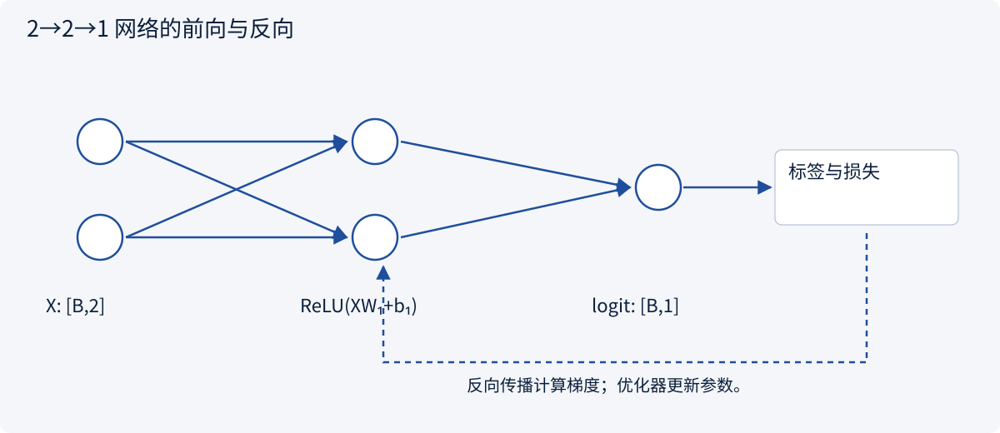
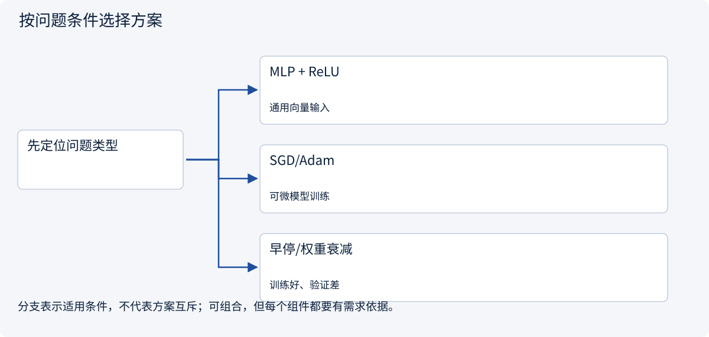
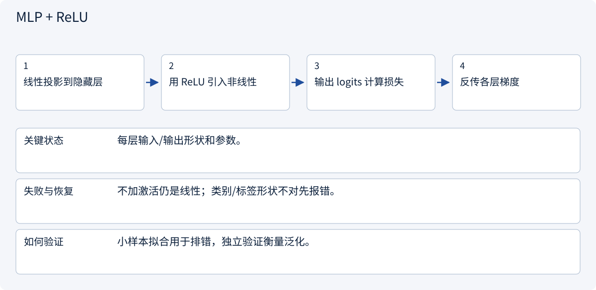
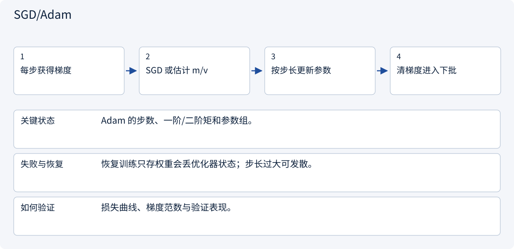
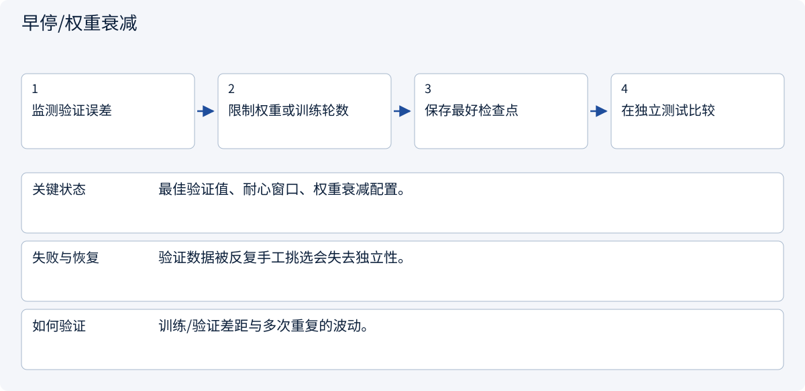

# 1.4 神经网络为什么能学习非线性规则

> 图解主线 · 对照主流方案 · 配参考代码

## 先看问题

线性模型表达不了复杂关系，叠很多线性层也没有改善。



## 图解工作原理

线性层之间加入非线性激活，再用损失、反向传播与优化器学习。图与代码统一为 2→2→1。



## 主流方案怎么选



| 方案 | 怎样解决 | 适用条件 | 代价与边界 |
|---|---|---|---|
| MLP + ReLU | 非线性特征组合 | 通用向量输入 | 参数量与过拟合风险 |
| SGD/Adam | 利用梯度更新 | 可微模型训练 | 学习率仍需选择 |
| 早停/权重衰减 | 限制拟合复杂度 | 训练好、验证差 | 不能修复错误标签 |

## 主流方案内部怎样运行

### 1 · MLP + ReLU



**具体推演：** 图和代码都用2→2→1，而不是不对应的网络尺寸。

### 2 · SGD/Adam



**具体推演：** Adam 平滑方向和尺度，但不会纠正错误标签。

### 3 · 早停/权重衰减



**具体推演：** 训练损失继续下降、验证反升时，不选最后一轮。

## 参考代码

展开查看与本课机制对应的实现。训练函数仅提供代码，不执行实际训练；依赖与验证范围见配套代码说明。

[配套代码说明与验证范围](../../../docs/zh/projects/03-code-guide.md)

<details><summary>展开代码与实现边界</summary>

```python
"""2 -> 2 -> 1 MLP: this shape also appears in the lesson diagram."""


def build_model():
    from torch import nn

    return nn.Sequential(nn.Linear(2, 2), nn.ReLU(), nn.Linear(2, 1))


def train_batch(model, optimizer, inputs, labels):
    from torch.nn import functional as F

    model.train()
    optimizer.zero_grad(set_to_none=True)
    logits = model(inputs).squeeze(-1)
    loss = F.binary_cross_entropy_with_logits(logits, labels.float())
    loss.backward()
    optimizer.step()
    return loss.detach()


# Supply inputs [batch,2], labels [batch]. This function is reference code only.
```

</details>

## 改变条件，检查理解

为什么两层 Linear 中间没有激活时仍是线性映射？

<details><summary>展开参考答案</summary>

矩阵乘法可合并，偏置也可合并；增加层数没有增加非线性。

</details>

<details><summary>按需展开：原理推导与边界补充</summary>

**线性层叠加仍然是线性**

一个线性层是 `h = XW+b`。若第二层仍只做线性变换，`hV+c = X(WV)+(bV+c)`，整体仍是线性。神经网络通过激活函数引入非线性，才能表达更复杂的关系。

ReLU 为 `max(0,z)`，负输入输出 0，正输入保持原值。它便于优化，但可能出现某些单元长期处于负区间、不再有效更新的情况。GELU 等其他激活有不同平滑特性，不能只凭名字决定哪种更好。


图中前向箭头传的是数值表示，反向箭头传的是损失对中间量的导数。反向传播没有把“正确答案句子”原封不动塞回每个神经元。

**一个样本如何经过网络**

用标准化后的两个特征 `x=[1,2]`，令第一层权重为单位矩阵、偏置为零，激活后仍是 `[1,2]`。第二层权重 `[1,-1]`，得到分数 `z=-1`。sigmoid 给出约 `0.269` 的延误预测。

若真实标签为 1，二分类交叉熵为 `-log(0.269)≈1.313`；若真实标签为 0，则为 `-log(1-0.269)≈0.313`。同一预测对不同真实标签产生不同惩罚。

交叉熵衡量模型给真实事件分配的概率。把错误答案预测得非常确定，惩罚会很大；这比只记录对错提供了更细的学习信号。实现时常直接使用 logits 与稳定的交叉熵函数，不手动先 softmax 再取对数。

**一个批次的训练协议**

1. 从训练集取出一个批次，建立本轮计算图。
2. 清除上一轮梯度，前向计算预测和损失。
3. 反向传播，得到本轮梯度。
4. 优化器更新参数，再处理下一个批次。
5. 定期在验证集推理，记录指标并选择检查点。

梯度默认可能累积，因此“不清梯度”必须是有意进行梯度累积。验证时关闭训练专属行为并停止梯度记录；例如 Dropout 在训练时随机丢弃部分激活，在评价时关闭，不能拿两种模式的结果直接比较。

SGD 沿当前梯度更新；动量平滑更新方向；Adam 使用梯度的一阶、二阶矩估计调整步幅。优化器改善数值优化过程，不负责判断数据有没有偏见。学习率调度、梯度裁剪、权重衰减各解决不同问题，需要通过验证比较。

**模型规模并不是学习质量**

扩大隐藏层能提高表达能力，也增加计算和过拟合风险。先尝试让模型拟合一个很小的干净训练集；连这都做不到，优先检查标签、形状、梯度和学习率。能够拟合小样本只是排错手段，不是泛化能力证明。

**练习：计算参数量**

输入 3 维，隐藏层 4 维，输出 2 维；两层都带偏置。共有多少可训练参数？如果移除激活函数，还能保留两层网络的非线性能力吗？

<details><summary>参考答案</summary>

第一层 `3×4+4=16`，第二层 `4×2+2=10`，共 26 个。移除激活后，两层可合并为一层线性变换，因此失去这种非线性表达能力。参数更多本身没有改变这个结论。

</details>


</details>

[查看官方资料与方案依据](../../../docs/zh/resources.md)
