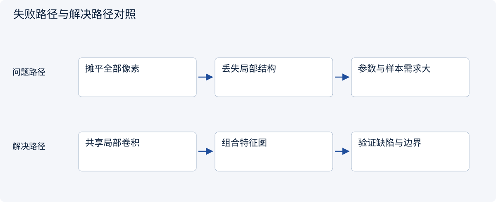
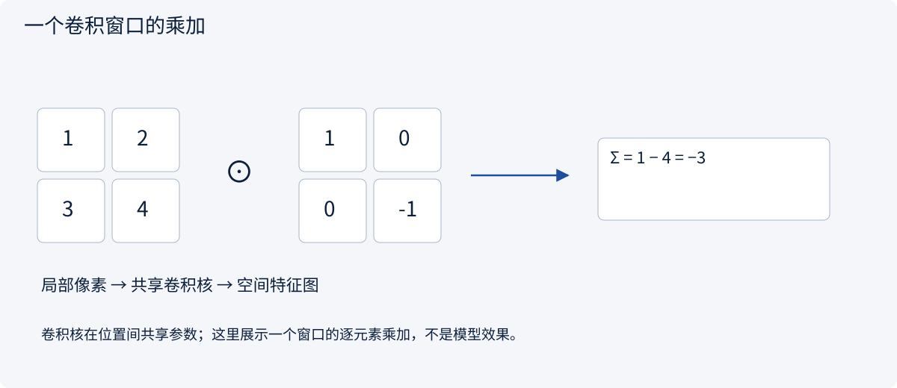
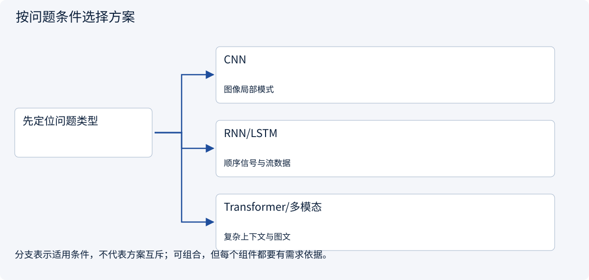
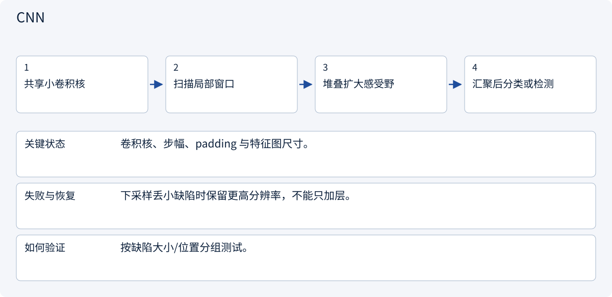
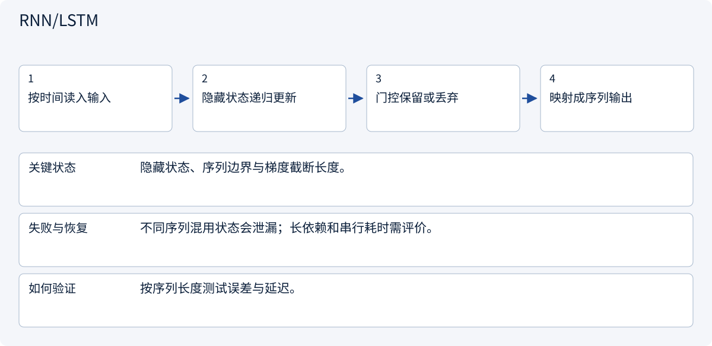
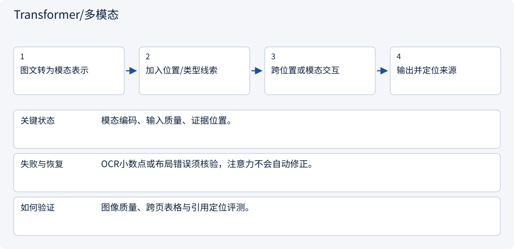

# 1.5 图像、序列与生成模型：选择合适的归纳偏置

> 图解主线 · 对照主流方案 · 配参考代码

## 先看问题

图片、时间序列和文本结构不同，为什么不能全用同一种输入处理方式？



## 图解工作原理

利用数据的结构选择归纳偏置：卷积利用局部性，递归利用顺序状态，注意力利用位置间交互。



## 主流方案怎么选



| 方案 | 怎样解决 | 适用条件 | 代价与边界 |
|---|---|---|---|
| CNN | 共享局部卷积核 | 图像局部模式 | 下采样可能丢细节 |
| RNN/LSTM | 递归传递隐藏状态 | 顺序信号与流数据 | 串行依赖、长程困难 |
| Transformer/多模态 | 跨位置交互并结合模态表示 | 复杂上下文与图文 | 位置、输入质量和算力约束 |

## 主流方案内部怎样运行

### 1 · CNN



**具体推演：** 2×2窗口逐项乘加得到-3；真实效果还需要训练数据。

### 2 · RNN/LSTM



**具体推演：** 连续传感器信号可增量维护状态，不必每次重读全部。

### 3 · Transformer/多模态



**具体推演：** 报价图识别1.80后仍需对照原图和货币单位。

## 参考代码

展开查看与本课机制对应的实现。训练函数仅提供代码，不执行实际训练；依赖与验证范围见配套代码说明。

[配套代码说明与验证范围](../../../docs/zh/projects/03-code-guide.md)

<details><summary>展开代码与实现边界</summary>

```python
"""A CNN inference block. No datasets, training or downloads are started."""


def build_classifier():
    from torch import nn

    return nn.Sequential(
        nn.Conv2d(1, 8, kernel_size=3, padding=1),
        nn.ReLU(),
        nn.AdaptiveAvgPool2d(1),
        nn.Flatten(),
        nn.Linear(8, 2),
    )


# Input [batch,1,height,width] -> feature map -> [batch,8] -> two logits.
# Randomly initialized weights demonstrate shapes, not useful predictions.
```

</details>

## 改变条件，检查理解

报价图片的小数点读错，应该只增加模型参数吗？

<details><summary>展开参考答案</summary>

先检查图像与提取结果，保留原文位置并核验金额；参数规模不能替代输入质量检查。

</details>

<details><summary>按需展开：原理推导与边界补充</summary>

**为什么不把所有输入直接摊平**

一张彩色图像的形状可写为 `(高度, 宽度, 3)`。相邻像素有局部关系，物体在图中移动后通常仍是同一种物体。卷积用同一组小核扫描不同位置，复用参数、提取局部模式。这就是归纳偏置：提前把问题结构放进模型，让学习更有效率。

例如灰度区域 `[[1,2],[3,4]]` 与核 `[[1,0],[0,-1]]` 做逐元素乘积求和，结果是 `-3`。核滑动得到特征图；多层组合后感受野扩大。池化或步幅可以降低空间分辨率，也可能丢失小物体的细节。实际框架常把这一操作实现为互相关，入门时需注意术语差异。


**序列的顺序是信息**

“供应商批准客户”和“客户批准供应商”用词相同，关系相反。RNN 用隐藏状态把前一步信息传到下一步；LSTM、GRU 通过门控调节信息保留。长距离依赖会给梯度传播带来困难，且时间步之间有串行依赖。

Transformer 使用注意力在位置间交换信息，并额外提供位置线索。训练时能并行计算多个已知位置，不表示自回归生成时所有未知 token 能直接同时确定。架构的训练并行性和生成依赖必须分开理解。

**生成图像的另一条路线**

扩散模型训练时给图像或潜在表示逐步加噪，模型学习噪声预测、分数或其他等价目标的某种参数化；生成时从噪声逐步去噪。文本条件可引导结果，但不保证严格遵守数目、文字和几何约束。

理解这个过程能解释为什么教材配图要人工检查：视觉上可信的箭头未必对应正确的状态流。精确公式、矩阵、流程分支用可审阅的矢量图表达；概念插画帮助建立直觉。

多模态系统把图像、声音、文本转成可结合的表示。它读到扫描合同后，仍可能误认小数点和表格对应关系。输入质量、OCR、布局与引用定位都是误差来源，不能将“支持图片”理解为“保证读准图片”。

**一个完整选择例子**

采购项目里，检测零件表面缺陷需要视觉模型与图像标注；预测交期可先用表格基线；从报价邮件提取结构用语言模型；金额比较用确定性计算。再由工作流组合这些能力。每个子任务都使用自己的验证集，最后还要评价组合系统，因为上游误差会传播到下游。

**练习：解释模型之外的失败**

系统把图片报价中的 `1.80` 读成 `180`，随后生成了格式正确的比价表。应该只修改提示词吗？

<details><summary>参考答案</summary>

先核验原图质量、OCR 或多模态提取结果、单位和金额约束。对金额保留原文定位并进行范围校验；有疑义时进入人工复核。提示词可能改善提取，但不能替代独立验证。评测集应包含模糊扫描、不同小数格式和跨页表格。

</details>


</details>

[查看官方资料与方案依据](../../../docs/zh/resources.md)
