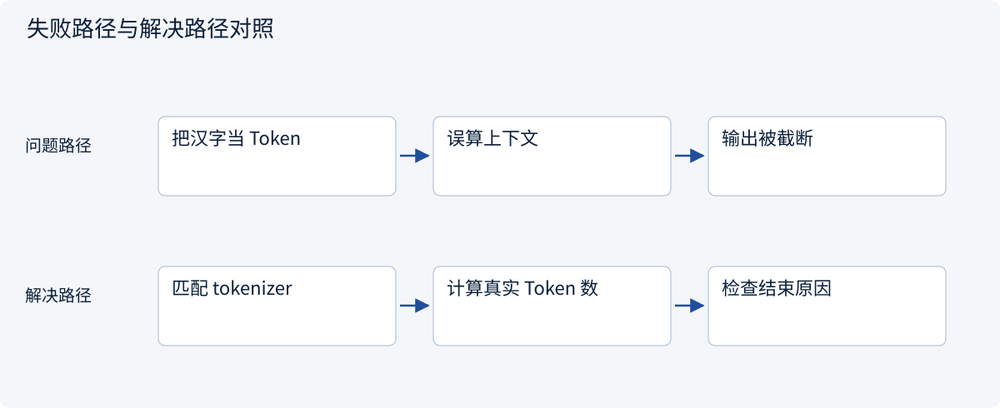
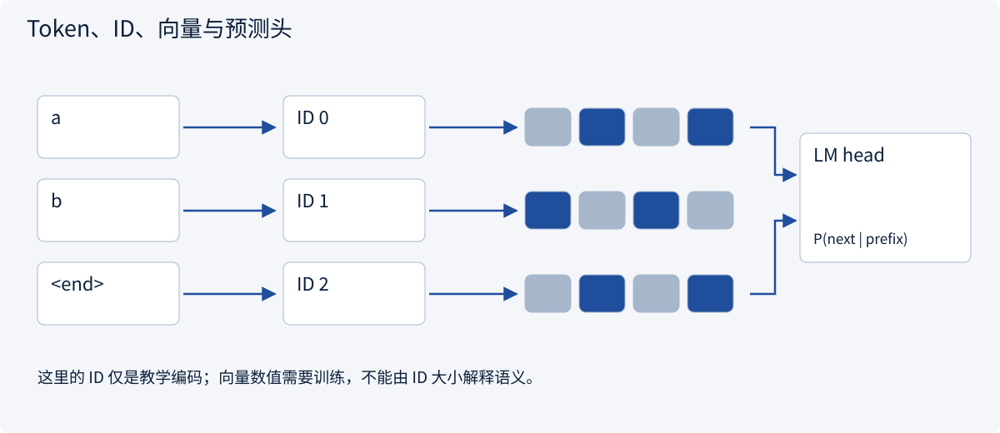
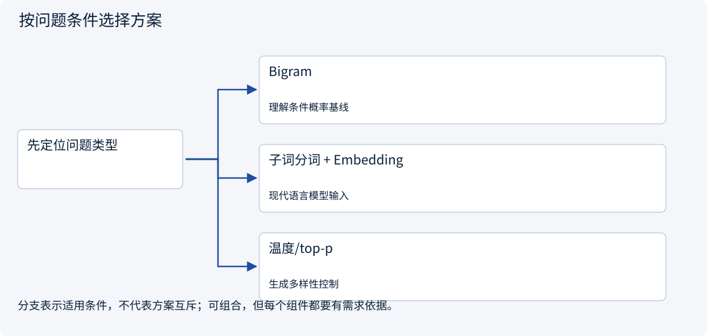
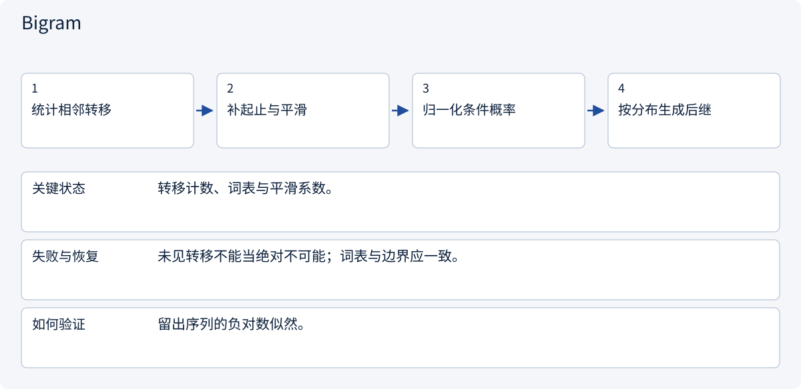
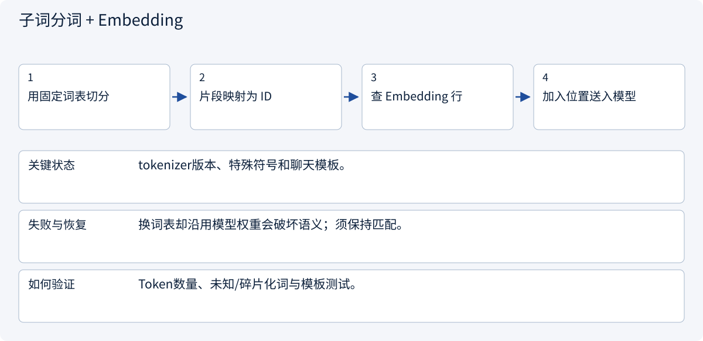
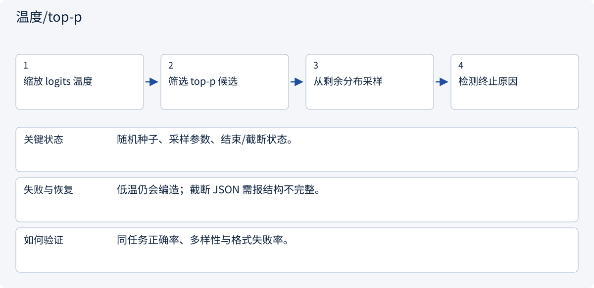

# 1.6 从字符计数走到语言模型

> 图解主线 · 对照主流方案 · 配参考代码

## 先看问题

语言模型怎样把一句话变成下一 Token 的概率？为什么生成流畅仍会出错？




## 图解工作原理

编码把片段变成 ID，Embedding 把 ID 变成向量；模型根据前缀预测下一 Token，再追加前缀。



## 主流方案怎么选



| 方案 | 怎样解决 | 适用条件 | 代价与边界 |
|---|---|---|---|
| Bigram | 统计相邻转移 | 理解条件概率基线 | 只看前一个符号 |
| 子词分词 + Embedding | 词表 ID 与可训练向量 | 现代语言模型输入 | 词表与模板必须匹配 |
| 温度/top-p | 调整选择分布 | 生成多样性控制 | 不能保证事实正确 |

## 主流方案内部怎样运行

### 1 · Bigram



**具体推演：** aba/abb 的统计随是否加入句界和平滑而变化，代码明确加句界。

### 2 · 子词分词 + Embedding



**具体推演：** ID大小不表示语义远近，向量关系来自学习。

### 3 · 温度/top-p



**具体推演：** 输出达到长度上限时，不能把半个对象当完整答案。

## 参考代码

展开查看与本课机制对应的实现。训练函数仅提供代码，不执行实际训练；依赖与验证范围见配套代码说明。

[配套代码说明与验证范围](../../../docs/zh/projects/03-code-guide.md)

<details><summary>展开代码与实现边界</summary>

```python
"""Count a character bigram with explicit sentence boundaries and smoothing."""

from collections import Counter, defaultdict
from itertools import pairwise


def transition_probabilities(words: list[str], alpha: float = 1.0):
    if alpha <= 0:
        raise ValueError("Positive smoothing required")
    counts = defaultdict(Counter)
    for word in words:
        sequence = ["<start>", *word, "<end>"]
        for left, right in pairwise(sequence):
            counts[left][right] += 1
    vocabulary = sorted({token for row in counts.values() for token in row})
    return {
        left: {
            right: (row[right] + alpha) / (sum(row.values()) + alpha * len(vocabulary))
            for right in vocabulary
        }
        for left, row in counts.items()
    }
```

</details>

## 改变条件，检查理解

输入一份新报价后，模型参数会因此永久更新吗？

<details><summary>展开参考答案</summary>

普通推理不会。报价进入本次上下文；训练更新参数是另一条路径。

</details>

<details><summary>按需展开：原理推导与边界补充</summary>

**先做一个只有计数的语言模型**

用两个极短训练序列：`aba`、`abb`。只观察字符后继关系：`a→b` 出现 2 次，`b→a` 出现 1 次，`b→b` 出现 1 次。忽略句子边界时，`P(b|a)=1`，`P(a|b)=P(b|b)=0.5`。

这就是二元模型的一部分。它只能看到前一个字符，无法区分更长上下文。没有观察过的转移概率为零，会使整个序列概率为零；加平滑可以缓解，但不能让它突然理解复杂语义。


**Token 不等于词，也不等于汉字**

实际 tokenizer 常把高频子串合并成 token，罕见内容可能拆成多个片段。词表把片段映射到整数 ID；embedding 矩阵按 ID 取出可训练向量。ID 的数值大小本身没有语义，向量的含义来自训练。

同一句话换一个 tokenizer，token 数会变。中英文、代码和罕见名称的拆分效率也不同。因此上下文长度和计费不能按“一个字一个 token”估算。训练和推理使用的 tokenizer、特殊 token 与聊天模板必须匹配，否则输入语义边界会变化。

**从条件概率到训练目标**

自回归模型把序列概率分解为：

```text
P(t1,...,tn) = P(t1) × P(t2|t1) × ... × P(tn|t1,...,t[n-1])
L = -(1/N) × Σ log P(真实的下一 token | 已知前缀)
```

训练时通常把真实前缀给模型，同时计算多个位置的预测损失，称为 teacher forcing。生成时前缀包含模型自己之前的输出，错误会积累。训练损失下降表示更擅长预测训练分布中的 token，不直接等于更会遵守采购限制。

若平均负对数似然是 `ln(2)`，困惑度是 `exp(ln(2))=2`。比较困惑度时必须保持 tokenizer、数据和损失掩码一致，否则指标不是同一把尺。

**模型怎样选出下一个 token**

Greedy 每步选当前最高分 token；采样按概率抽取；temperature 对 logits 做缩放，top-p 保留累计概率达到阈值的一组候选。低温更集中，但不能把错误事实变正确，也不能保证跨硬件、版本和服务实现完全确定。

当模型输出 token 后，它被加入前缀，再预测下一个 token，直到终止条件。停止可能来自结束 token、长度上限或外部取消。长度被截断时，JSON 和句子都可能不完整，应用层必须检测终止原因。

**练习：概率与知识的边界**

1. 只用前述计数，给定 `b`，下一个字符概率是什么？
2. 把最新报价贴进输入后，embedding 参数会自动永久更新吗？
3. 为什么不应比较不同 tokenizer 模型的裸困惑度？

<details><summary>参考答案</summary>

1. `a`、`b` 各 0.5。本例未建模句子结束，不能拿来生成可靠的完整句子。
2. 普通推理不会；报价只成为这次请求的上下文。
3. 概率的基本单位改变了，平均每 token 的难度和数量不同，指标不能直接横比。

</details>


</details>

[查看官方资料与方案依据](../../../docs/zh/resources.md)
