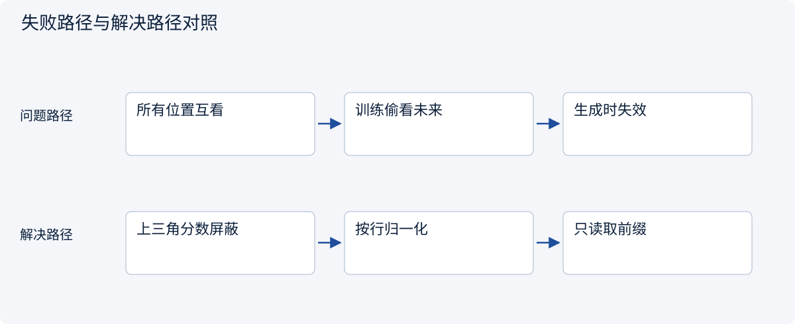
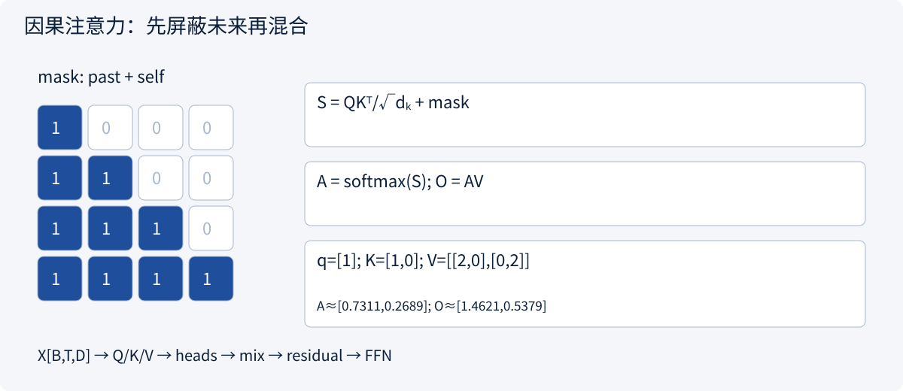
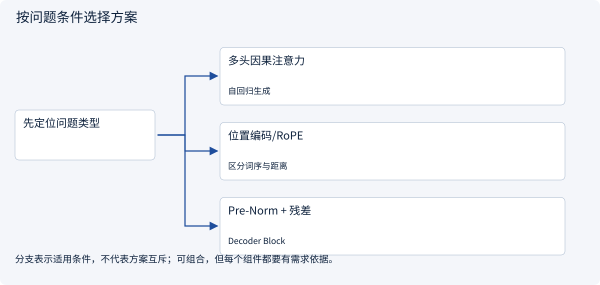
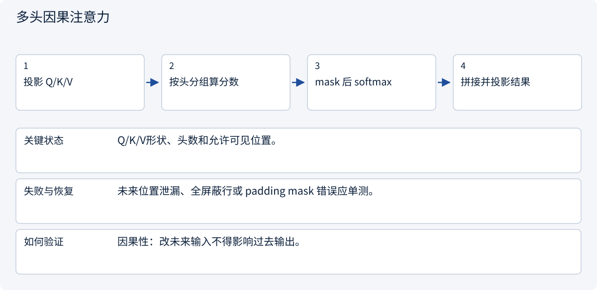
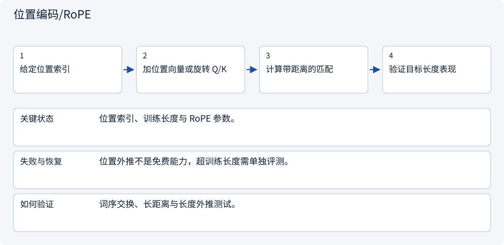
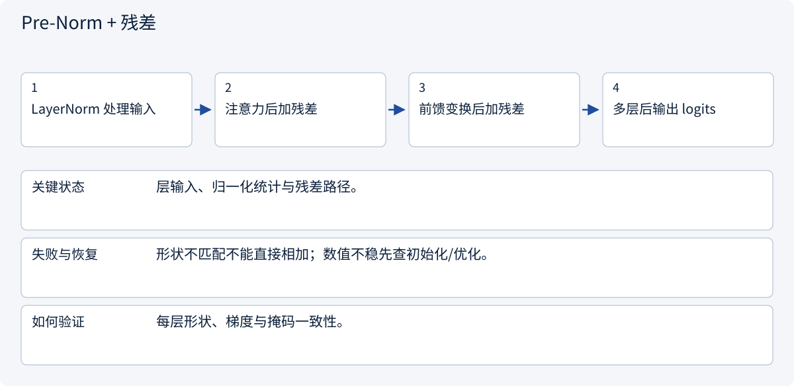
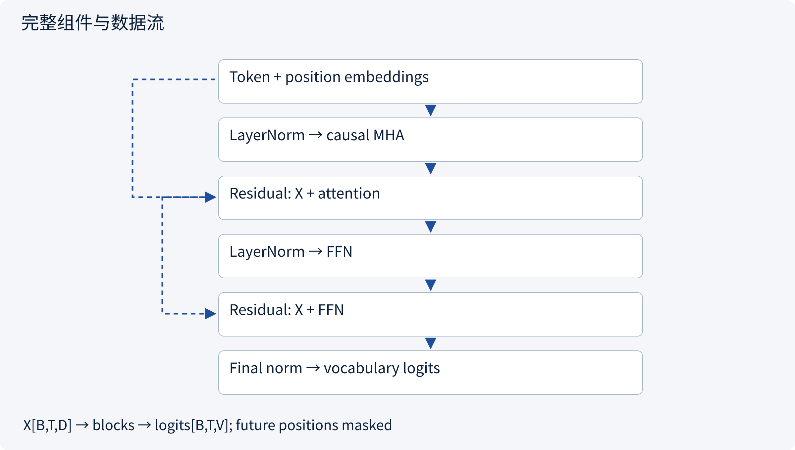
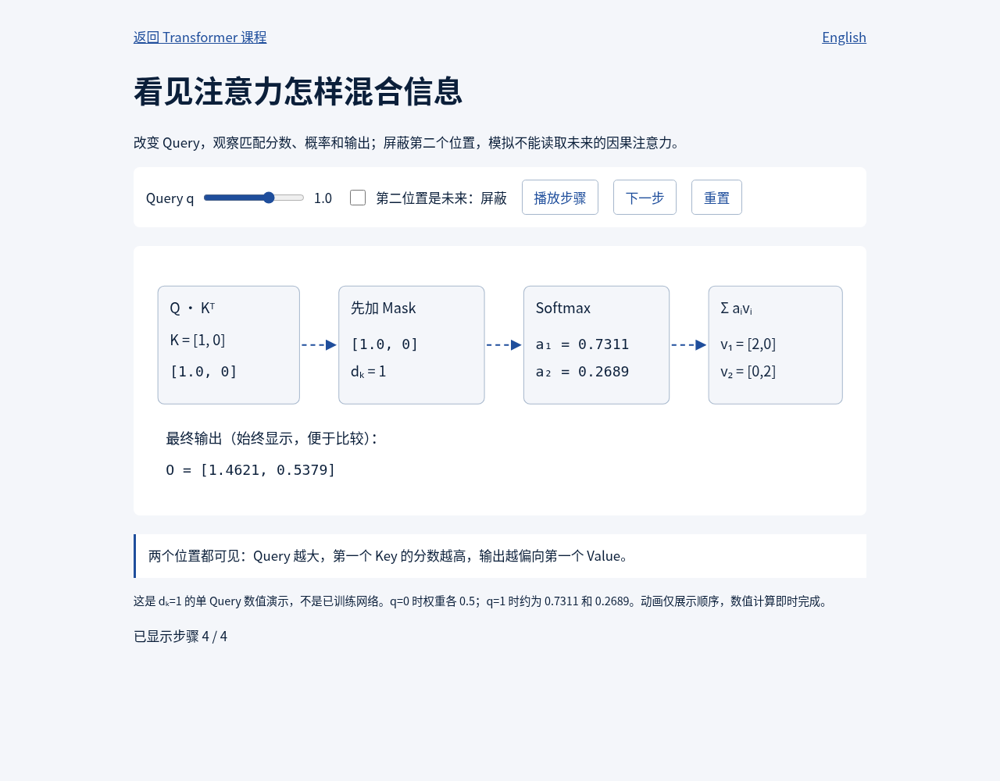

# 1.7 手算注意力，再看 Transformer

> 图解主线 · 对照主流方案 · 配参考代码

## 先看问题

同一个词在不同上下文含义不同；模型怎样交换信息，又不偷看未来？




## 图解工作原理

Q/K 计算匹配，mask 屏蔽未来，softmax 归一化后混合 V；多头、残差和前馈层组成完整 Block。



## 主流方案怎么选



| 方案 | 怎样解决 | 适用条件 | 代价与边界 |
|---|---|---|---|
| 多头因果注意力 | 多个子空间混合过去信息 | 自回归生成 | 需正确 mask 与张量形状 |
| 位置编码/RoPE | 向表示注入顺序 | 区分词序与距离 | 长度外推需要验证 |
| Pre-Norm + 残差 | 保留信息并稳定深层优化 | Decoder Block | 不替代正确初始化与学习率 |

## 主流方案内部怎样运行

### 1 · 多头因果注意力



**具体推演：** d_k=1 的两位置例子得到权重0.731/0.269；屏蔽后为1/0。

### 2 · 位置编码/RoPE



**具体推演：** 同词不同顺序不能只靠一个无位置信息的词袋表示。

### 3 · Pre-Norm + 残差



**具体推演：** 完整Block参考代码保持[B,T,D]形状，词表头在Block外。

## 把模块连成完整架构



## 参考代码

展开查看与本课机制对应的实现。训练函数仅提供代码，不执行实际训练；依赖与验证范围见配套代码说明。

[配套代码说明与验证范围](../../../docs/zh/projects/03-code-guide.md)

<details><summary>展开代码与实现边界</summary>

```python
"""Complete causal block; forward reference, no training on import."""


def build_decoder_block(width: int = 64, heads: int = 4):
    import torch
    from torch import nn

    if width % heads:
        raise ValueError("width must be divisible by heads")

    class DecoderBlock(nn.Module):
        def __init__(self):
            super().__init__()
            self.norm1 = nn.LayerNorm(width)
            self.attention = nn.MultiheadAttention(
                width, heads, dropout=0, batch_first=True
            )
            self.norm2 = nn.LayerNorm(width)
            self.ffn = nn.Sequential(
                nn.Linear(width, 4 * width), nn.GELU(), nn.Linear(4 * width, width)
            )

        def forward(self, x):
            length = x.shape[1]  # x: [batch,time,width]
            mask = torch.ones(length, length, device=x.device, dtype=torch.bool).triu(1)
            normalized = self.norm1(x)
            mixed, _ = self.attention(
                normalized, normalized, normalized, attn_mask=mask, need_weights=False
            )
            x = x + mixed
            return x + self.ffn(self.norm2(x))

    return DecoderBlock()


# Add token+position embeddings before this block and a vocabulary head after it.
# This is a block, not a pretrained language model or a KV-cached decoder.
```

</details>

[打开可调 Query 与因果掩码的互动演示](../../../site/demos/attention.html)

## 从界面观察计算结果



本地互动演示的真实截图：重置后逐步展开四个阶段，输出为[1.4621, 0.5379]。这是固定数值机制演示，不是训练效果；可进入互动页改变Query和Mask对照。

## 改变条件，检查理解

为什么先 softmax 再把未来概率清零并不等价？

<details><summary>展开参考答案</summary>

未来分数已参与分母，清零后整行可能不再归一化；应先 mask 分数再 softmax。

</details>

<details><summary>按需展开：原理推导与边界补充</summary>

**注意力做的是有条件的信息混合**

句子中的同一个词在不同上下文里含义不同。自注意力从当前表示 `X` 投影出 Query、Key、Value：Query 决定当前位置找什么，Key 决定各位置如何被匹配，Value 提供实际混合的内容。这是计算上的类比，不表示每个维度都对应可命名的人类概念。

```text
X: (T, d_model)
Q=XWq, K=XWk: (T, d_k)；V=XWv: (T, d_v)
S=QKᵀ/√d_k: (T,T)
A=softmax(S + mask)，按每行归一化
O=AV: (T,d_v)
```


缩放除以 `√d_k` 有助于避免点积分数随维度增长而过大、使 softmax 过于饱和。因果 mask 把未来位置的分数设为负无穷，使其概率为零；训练输入虽同时包含整段文本，当前位置仍不能偷看未来答案。

**真正算一次加权和**

为方便手算，取 `d_k=1`，一个 query 是 `[1]`，两个 key 是 `[1]`、`[0]`，value 是 `[2,0]`、`[0,2]`。分数为 `[1,0]`，softmax 权重约 `[0.731,0.269]`，结果是：

```text
0.731×[2,0] + 0.269×[0,2] = [1.462, 0.538]
```

若第二个位置是未来 token，mask 后权重变成 `[1,0]`，结果为 `[2,0]`。注意力权重之和为 1，不表示输出的各维之和也必须为 1；Value 可以包含任意实数。

文档站中可[打开注意力互动演示](../../../site/demos/attention.html)，改变 Query 或屏蔽第二个位置，对照四个计算步骤。演示不需要网络模型请求。

**一个 Decoder block 还包含什么**

多头注意力让不同投影子空间并行混合信息，拼接后再投影。前馈网络逐位置变换特征，常先扩展维度再缩回；它与注意力的跨位置交换相互补充。

残差连接把变换前的信息加回，帮助优化深层网络；LayerNorm 调整数值分布。常见现代实现采用 Pre-Norm，原始 Transformer 使用的组织形式有所不同，阅读实现时应识别具体变体。

若没有位置信息，基础自注意力对输入排列具有置换等变性。绝对位置编码、旋转位置编码等提供顺序线索；它们并不自动保证模型在任意长文本上泛化。位置方法、训练长度与部署长度需要一起验证。

**Encoder、Decoder 与 Encoder–Decoder**

Encoder 常允许双向注意力，适合表示学习与分类；因果 Decoder 根据前缀生成后续 token；Encoder–Decoder 先编码输入，再由 Decoder 通过交叉注意力读取编码结果。原始 Transformer 是 Encoder–Decoder；不能把所有 Transformer 都称为 GPT 式模型。

标准全注意力的分数矩阵随序列长度平方增长。优化内核可以减少显存读写和中间存储，但不等于所有注意力算法都变成线性复杂度。长文本还存在信息选择、位置外推与证据定位问题。

**练习：找出未来信息泄漏**

某训练实现先 softmax，再把未来位置的概率清零，但不重新归一化。这与在 softmax 前加 mask 是否等价？

<details><summary>参考答案</summary>

不等价。先 softmax 时未来位置参与了分母，清零后整行权重之和通常小于 1，输出尺度也改变。正确做法是先屏蔽分数再归一化，或使用数学等价且处理边界正确的实现。还要检查一行全部被屏蔽时会不会产生 NaN。

</details>


</details>

[查看官方资料与方案依据](../../../docs/zh/resources.md)
