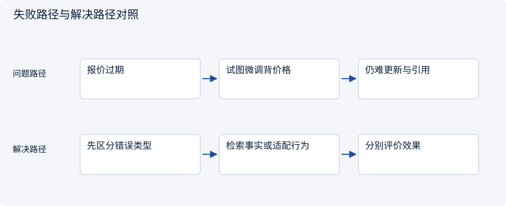
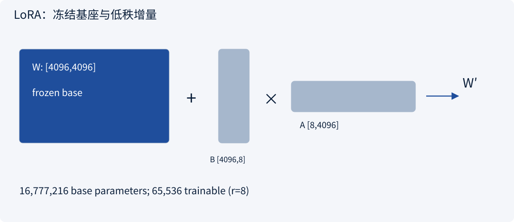
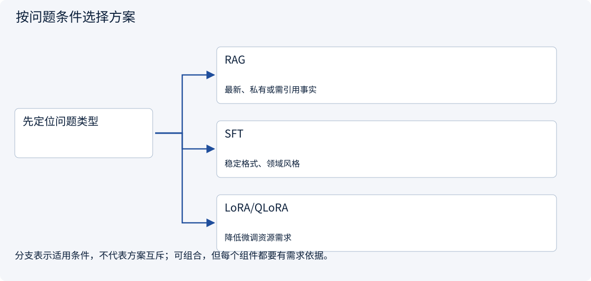
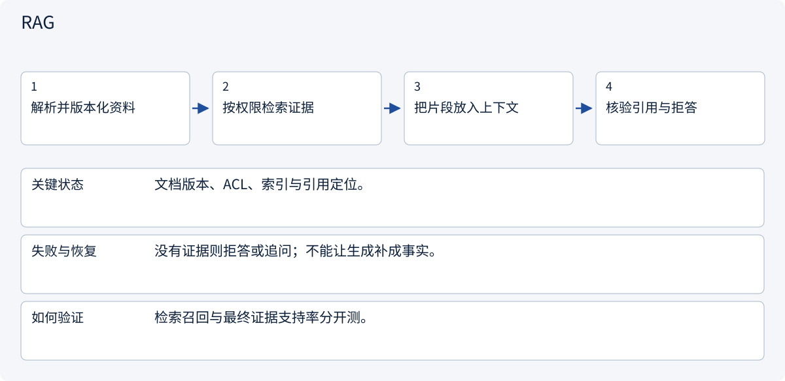
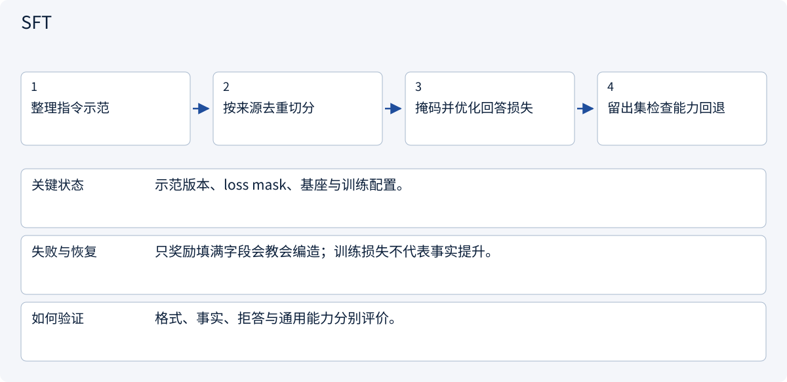
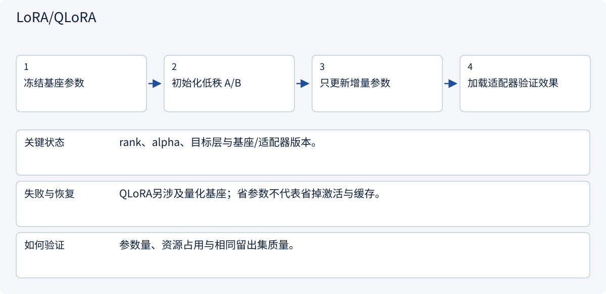

# 1.8 预训练、SFT、偏好优化与 LoRA

> 图解主线 · 对照主流方案 · 配参考代码

代码实现冻结基座的单层 LoRA；SFT、QLoRA、RLHF 和 DPO 是机制与选型说明，未提供端到端训练管线。

## 先看问题

怎样选择提示、RAG、SFT 或 LoRA？减少训练参数又会失去什么？




## 图解工作原理

先定位错误：新事实用检索，稳定行为用示范适配。LoRA 固定 W，训练低秩增量 BA；它是更新方法，不是独立任务目标。



## 主流方案怎么选



| 方案 | 怎样解决 | 适用条件 | 代价与边界 |
|---|---|---|---|
| RAG | 请求时注入证据 | 最新、私有或需引用事实 | 依赖检索与权限 |
| SFT | 按指令示范学习行为 | 稳定格式、领域风格 | 数据偏差与能力回退 |
| LoRA/QLoRA | 低秩适配，后者结合量化基座 | 降低微调资源需求 | 激活与基座仍占内存 |

## 主流方案内部怎样运行

### 1 · RAG



**具体推演：** 当天价格变动应更新索引，而非反复微调背价格。

<details><summary>展开文字步骤、状态与失败边界</summary>

1. 解析并版本化资料
2. 按权限检索证据
3. 把片段放入上下文
4. 核验引用与拒答

**关键状态** 文档版本、ACL、索引与引用定位。

**失败与恢复** 没有证据则拒答或追问；不能让生成补成事实。

**如何验证** 检索召回与最终证据支持率分开测。

</details>

### 2 · SFT



**具体推演：** 对固定报价抽取格式提供含null/冲突的示范，而非只有完美样本。

<details><summary>展开文字步骤、状态与失败边界</summary>

1. 整理指令示范
2. 按来源去重切分
3. 掩码并优化回答损失
4. 留出集检查能力回退

**关键状态** 示范版本、loss mask、基座与训练配置。

**失败与恢复** 只奖励填满字段会教会编造；训练损失不代表事实提升。

**如何验证** 格式、事实、拒答与通用能力分别评价。

</details>

### 3 · LoRA/QLoRA



**具体推演：** 4096矩阵r=8有65536个增量参数，W′=W+缩放后的BA。

<details><summary>展开文字步骤、状态与失败边界</summary>

1. 冻结基座参数
2. 初始化低秩 A/B
3. 只更新增量参数
4. 加载适配器验证效果

**关键状态** rank、alpha、目标层与基座/适配器版本。

**失败与恢复** QLoRA另涉及量化基座；省参数不代表省掉激活与缓存。

**如何验证** 参数量、资源占用与相同留出集质量。

</details>

## 参考代码

展开查看与本课机制对应的实现。训练函数仅提供代码，不执行实际训练；依赖与验证范围见配套代码说明。

[配套代码说明与验证范围](../projects/03-code-guide.md)

<details><summary>展开代码与实现边界</summary>

```python
"""LoRA reference layer with the base frozen. No weights are downloaded."""


def attach_lora(base, rank: int = 8, alpha: float = 16):
    import torch
    from torch import nn

    if rank < 1:
        raise ValueError("rank must be positive")

    class LoRALinear(nn.Module):
        def __init__(self):
            super().__init__()
            self.base = base.requires_grad_(False)
            self.a = nn.Parameter(
                torch.empty(
                    rank,
                    base.in_features,
                    device=base.weight.device,
                    dtype=base.weight.dtype,
                )
            )
            self.b = nn.Parameter(
                torch.zeros(
                    base.out_features,
                    rank,
                    device=base.weight.device,
                    dtype=base.weight.dtype,
                )
            )
            nn.init.kaiming_uniform_(self.a, a=5**0.5)
            self.scale = alpha / rank

        def forward(self, x):
            return self.base(x) + (x @ self.a.T @ self.b.T) * self.scale

    return LoRALinear()


# B starts at zero, so the initial adapted output equals the base output.
```

</details>

## 改变条件，检查理解

LoRA 比 SFT 更高级，所以应二选一吗？

<details><summary>展开参考答案</summary>

不是同一分类。SFT 是训练任务，LoRA 是参数适配方式，可以用 LoRA 做 SFT。

</details>

<details><summary>按需展开：原理推导与边界补充</summary>

**不同阶段改变不同的行为**

预训练以大规模数据学习通用表示和预测能力。对因果语言模型，常见目标是下一 token 预测。SFT 使用指令与示范回答，让模型学习特定输出形式和任务行为。二者都通过损失和梯度更新参数，数据来源、分布和目标不同。

指令微调训练时通常会选择只对回答部分计算损失，也存在其他掩码策略。必须明确哪些 token 参与学习，避免把 padding 当成需要预测的答案，或误把整个回答全部 mask 掉。

偏好优化使用回答之间的比较信号。RLHF 的一种路径是先拟合奖励模型，再进行带约束的策略优化；DPO 通过偏好对构建直接优化目标。它们不等同于“人工把所有正确答案写出来”，也不保证偏好更高就事实更准确。


**LoRA 节省的究竟是什么**

对权重 `W`，LoRA 固定基座，训练低秩增量 `ΔW = BA`。若 `W` 形状为 `(d_out,d_in)`，则 `A` 为 `(r,d_in)`、`B` 为 `(d_out,r)`，可训练参数为 `r(d_in+d_out)`，而非 `d_out×d_in`。

例如 `4096×4096` 的矩阵约 1678 万参数，`r=8` 时两个低秩矩阵共 65536 参数。实际常带缩放因子，也可以只适配部分层。参数少不代表显存为零：基座权重、激活、梯度和优化器状态仍占内存。

量化用更低位宽存储或计算数值；LoRA 限制训练更新的参数子空间。两者能组合，但解决的不是同一个问题。量化也可能影响质量与算子支持，需要在目标硬件、长度和批量下测量。

**哪些问题值得微调**

若模型反复不遵守稳定格式、领域术语或工作风格，可以先比较提示词与 SFT。若问题是最新库存和报价，应先接检索或业务查询。微调可能学到事实，但不适合替代具有更新时间与权限边界的事实存储。

一个可审阅实验应依次完成：定义错误类型 → 建立提示词基线 → 整理高质量样本 → 按文档/客户/时间去重切分 → 训练少量候选 → 在留出集比较 → 检查通用能力回退 → 保存数据与适配器版本。不要把训练损失最低的模型直接视为最好。

**算一笔部署前的内存账**

仅考虑权重，7B 参数使用每参数 2 字节约需 14 GB（十进制）。这不含 KV cache、激活、运行时和碎片，更不代表 14 GB 显卡就能完整训练。Adam 类全参数训练还需要梯度、矩状态，某些设置另有主权重副本。不同精度、分片和卸载策略差异很大，不应把一个“每参数字节数”当硬件承诺。

**练习：识别失败归因**

微调后 JSON 通过率从 80% 升至 98%，但关键报价事实正确率下降。如何判断是否采用？

<details><summary>参考答案</summary>

分别检查格式、事实、拒答与通用能力，不把它们合成一个好看的平均分。先排查训练样本是否奖励编造完整字段、是否把未知填成具体值，再比较结构化约束与检索能否解决问题。若事实下降触及任务底线，不能因格式提高而上线。还应报告留出集规模与分组结果。

</details>


</details>

[查看官方资料与方案依据](../resources.md)
