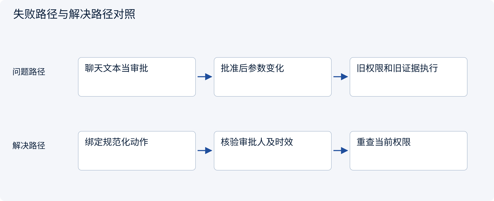
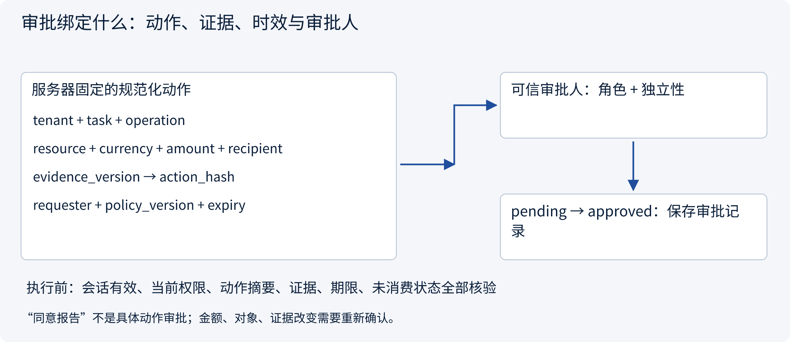
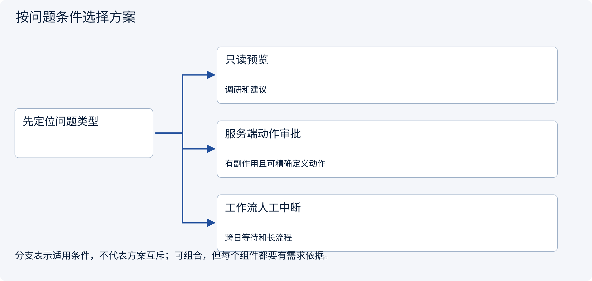
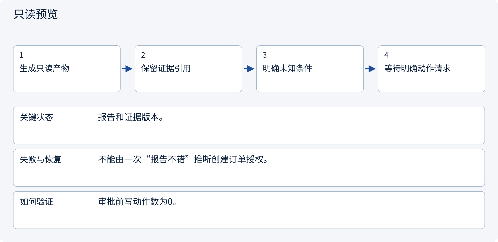
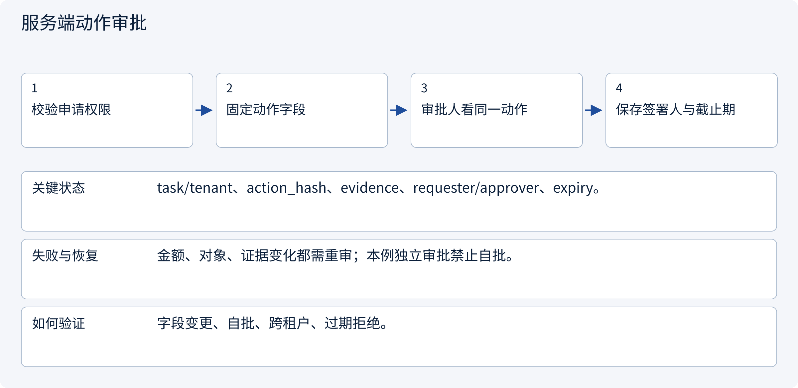
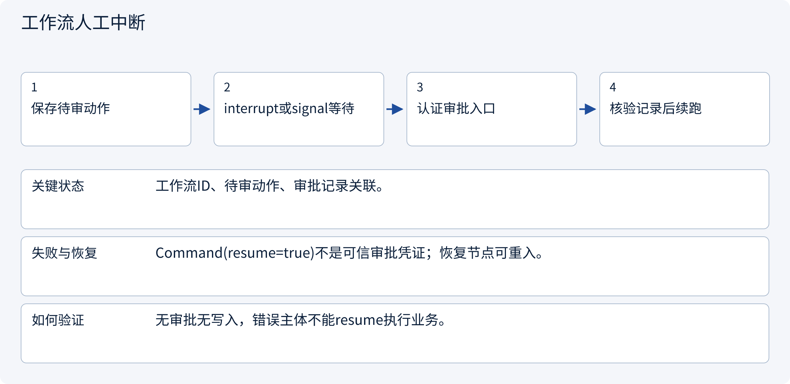

# 3.6.1 审批绑定什么：动作、证据、时效与审批人

> 图解主线 · 对照主流方案 · 配参考代码

局部架构参考：身份由可信入口提供，SQLite 演示事务，不部署登录系统或实际外部写入。

## 先看问题

聊天里说“同意”以后，模型修改了金额或收款对象，原审批为什么不能继续用？




## 图解工作原理

审批是一条服务端业务记录，绑定规范化动作、证据版本、租户、任务、申请人、审批人、有效期与策略版本。不是模型输出的approved=true。



## 主流方案怎么选



| 方案 | 怎样解决 | 适用条件 | 代价与边界 |
|---|---|---|---|
| 只读预览 | 展示报告而不产生写动作 | 调研和建议 | 预览确认不能冒称实际动作审批 |
| 服务端动作审批 | 固定动作摘要和审批记录 | 有副作用且可精确定义动作 | 需规范化、独立审批和有效期 |
| 工作流人工中断 | 持久化等待并由可信入口resume | 跨日等待和长流程 | 暂停机制本身不校验审批人 |

## 主流方案内部怎样运行

### 1 · 只读预览



**具体推演：** 用户认可比较报告，不等于认可某个金额和收款人。

<details><summary>展开文字步骤、状态与失败边界</summary>

1. 生成只读产物
2. 保留证据引用
3. 明确未知条件
4. 等待明确动作请求

**关键状态** 报告和证据版本。

**失败与恢复** 不能由一次“报告不错”推断创建订单授权。

**如何验证** 审批前写动作数为0。

</details>

### 2 · 服务端动作审批



**具体推演：** 25000分给supplier-a的草稿，不能换成24000分给supplier-b。

<details><summary>展开文字步骤、状态与失败边界</summary>

1. 校验申请权限
2. 固定动作字段
3. 审批人看同一动作
4. 保存签署人与截止期

**关键状态** task/tenant、action_hash、evidence、requester/approver、expiry。

**失败与恢复** 金额、对象、证据变化都需重审；本例独立审批禁止自批。

**如何验证** 字段变更、自批、跨租户、过期拒绝。

</details>

### 3 · 工作流人工中断



**具体推演：** LangGraph/Temporal负责等待恢复，业务service决定审批是否有效。

<details><summary>展开文字步骤、状态与失败边界</summary>

1. 保存待审动作
2. interrupt或signal等待
3. 认证审批入口
4. 核验记录后续跑

**关键状态** 工作流ID、待审动作、审批记录关联。

**失败与恢复** Command(resume=true)不是可信审批凭证；恢复节点可重入。

**如何验证** 无审批无写入，错误主体不能resume执行业务。

</details>

## 参考代码

展开查看与本课机制对应的实现。训练函数仅提供代码，不执行实际训练；依赖与验证范围见配套代码说明。

[配套代码说明与验证范围](../projects/03-code-guide.md)

<details><summary>展开代码与实现边界</summary>

```python
"""Prepare an approved action through routes → handler → service → repository."""

from .governance.approvals import ApprovalService
from .governance.handlers import ApprovalHandler
from .governance.repos import GovernanceRepository
from .governance.routes import claim_entry


def claim_approved(
    connection, request: dict, identity, session_id: str, now: int
) -> dict:
    service = ApprovalService(GovernanceRepository(connection))
    return claim_entry(ApprovalHandler(service), request, identity, session_id, now)


# Never trust approved=true in a model message. Approval rows are server-side records.
# The action hash includes tenant/task, operation, object, amount, recipient and evidence version.
# Claiming prepares work; it does not prove a remote action occurred exactly once.
```

</details>

## 本节应交付的设计产物

动作规范化字段、审批人资格、独立性规则、有效期与何种变更使审批失效。

代码实现的是应用会话与受控草稿准备：认证主体由可信入口注入，不含OIDC、Cookie或登录凭据签发。策略是局部RBAC+ABAC示例，不假装部署了OPA/Cedar/OpenFGA。所有成员关系变化递增全局policy epoch，保守地使旧审批失效；生产可按策略/资源事实做更细粒度版本。

审批只被原子消费为本地pending操作，没有执行网络写入。执行worker在新副作用前仍须复核撤销/权限，已有UNKNOWN先查原回执。会话失效不抹除业务任务或已经产生的外部效果。

依据：[OWASP Transaction Authorization](https://cheatsheetseries.owasp.org/cheatsheets/Transaction_Authorization_Cheat_Sheet.html), [LangGraph Interrupts](https://docs.langchain.com/oss/python/langgraph/interrupts).


### 服务端审批与消费服务

局部架构参考实现，不产生真实外部副作用。

<details><summary>展开代码与实现边界</summary>

```python
import json

from .domain import Action, Principal
from .policies import ROLE_ACTIONS, PolicyService
from .repos import GovernanceRepository
from .sessions import SessionService


class ApprovalService:
    def __init__(self, repository: GovernanceRepository):
        self.repository = repository
        self.sessions = SessionService(repository)
        self.policy = PolicyService(repository)

    def request(
        self,
        identity: Principal,
        session_id: str,
        action: Action,
        approval_id: str,
        now: int,
        lifetime: int = 300,
    ) -> None:
        if lifetime <= 0:
            raise ValueError("Invalid approval lifetime")
        with self.repository.transaction():
            context = self.sessions.context(identity, session_id, now)
            decision = self.policy.decide(context, action)
            if not decision.allowed:
                raise PermissionError(decision.reason)
            self.repository.request_approval(
                approval_id, context, action, now + lifetime, decision.policy_version
            )

    def current_approval(self, approval_id: str, tenant: str, now: int) -> dict:
        row = self.repository.get("approvals", "approval_id", approval_id)
        if (
            row["tenant"] != tenant
            or row["expires_at"] <= now
            or row["policy_version"] != self.repository.policy_version()
        ):
            raise PermissionError("Approval scope, expiry or policy version changed")
        action = Action(**json.loads(row["action_json"]))
        if action.fingerprint() != row["action_hash"]:
            raise PermissionError("Approval payload changed")
        return row

    def approve(
        self, identity: Principal, session_id: str, approval_id: str, now: int
    ) -> None:
        with self.repository.transaction():
            context = self.sessions.context(identity, session_id, now)
            member = self.repository.member(context.subject, context.tenant)
            if "approve_draft" not in ROLE_ACTIONS.get(member["role"], set()):
                raise PermissionError("No reviewer role")
            row = self.current_approval(approval_id, context.tenant, now)
            if row["requester"] == context.subject:
                raise PermissionError("Independent approver required")
            self.repository.approve(approval_id, context.subject)

    def claim(
        self,
        identity: Principal,
        session_id: str,
        approval_id: str,
        action: Action,
        operation_id: str,
        now: int,
    ) -> None:
        with self.repository.transaction():
            context = self.sessions.context(identity, session_id, now)
            row = self.current_approval(approval_id, context.tenant, now)
            decision = self.policy.decide(context, action)
            if (
                row["requester"] != context.subject
                or not decision.allowed
                or action.fingerprint() != row["action_hash"]
            ):
                raise PermissionError(
                    "Requester, current permission or exact action mismatch"
                )
            # Consumption and pending operation are atomic; uniqueness rejects replay.
            self.repository.claim(row, action, operation_id)
        # This only prepares a durable pending operation. Workers must check revocation/
        # execution policy again before a NEW remote effect; unknown effects need lookup.

    def revoke(
        self, identity: Principal, session_id: str, approval_id: str, now: int
    ) -> None:
        with self.repository.transaction():
            context = self.sessions.context(identity, session_id, now)
            row = self.repository.get("approvals", "approval_id", approval_id)
            if row["tenant"] != context.tenant or context.subject not in {
                row["requester"],
                row["approver"],
            }:
                raise PermissionError("Cannot revoke this approval")
            self.repository.revoke_approval(approval_id)

    def operation(
        self, identity: Principal, session_id: str, operation_id: str, now: int
    ) -> dict:
        with self.repository.transaction():
            context = self.sessions.context(identity, session_id, now)
            row = self.repository.get("operations", "operation_id", operation_id)
            self.sessions.task(context, row["task_id"])
            return {
                "operation_id": operation_id,
                "state": row["state"],
                "action_hash": row["action_hash"],
            }
```

</details>

### 动作请求边界

局部架构参考实现，不产生真实外部副作用。

<details><summary>展开代码与实现边界</summary>

```python
from .approvals import ApprovalService
from .domain import Action, Principal


class ApprovalHandler:
    def __init__(self, service: ApprovalService):
        self.service = service

    def claim(
        self, request: dict, identity: Principal, session_id: str, now: int
    ) -> dict:
        if set(request) != {"approval_id", "operation_id", "action"}:
            raise ValueError("Invalid claim envelope")
        if any(
            not isinstance(request[key], str) or not request[key]
            for key in ["approval_id", "operation_id"]
        ):
            raise ValueError("Expected nonempty identifiers")
        if not isinstance(request["action"], dict):
            raise TypeError("Expected an action object")
        action = Action(**request["action"])
        self.service.claim(
            identity,
            session_id,
            request["approval_id"],
            action,
            request["operation_id"],
            now,
        )
        return {"operation_id": request["operation_id"], "state": "pending"}
```

</details>

### 可信入口装配

局部架构参考实现，不产生真实外部副作用。

<details><summary>展开代码与实现边界</summary>

```python
from .domain import Principal
from .handlers import ApprovalHandler


def claim_entry(
    handler: ApprovalHandler,
    request: dict,
    identity: Principal,
    session_id: str,
    now: int,
) -> dict:
    """Trusted middleware injects identity/session/time; a model supplies only proposal data."""
    return handler.claim(request, identity, session_id, now)
```

</details>

## 改变条件，检查理解

批准记录必须绑定昨天的浏览器session_id吗？

<details><summary>展开参考答案</summary>

不必。通常绑定主体、租户、任务和动作；新会话可在重新认证授权后续接。旧会话失效不应让动作摘要检查失效。

</details>

[查看官方资料与方案依据](../resources.md)
