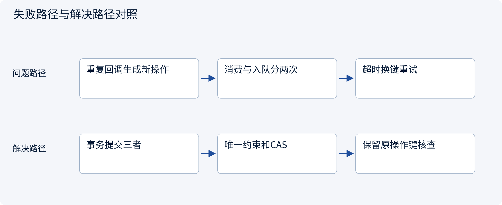
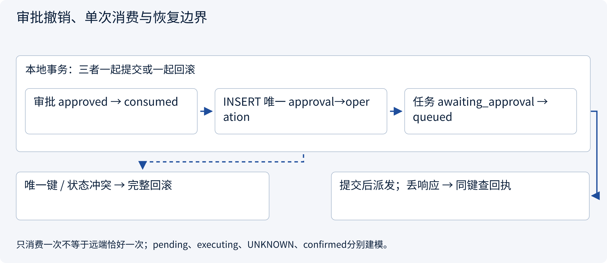
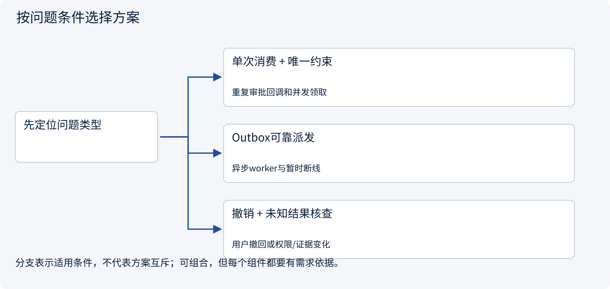
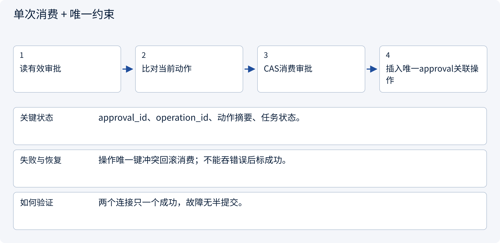
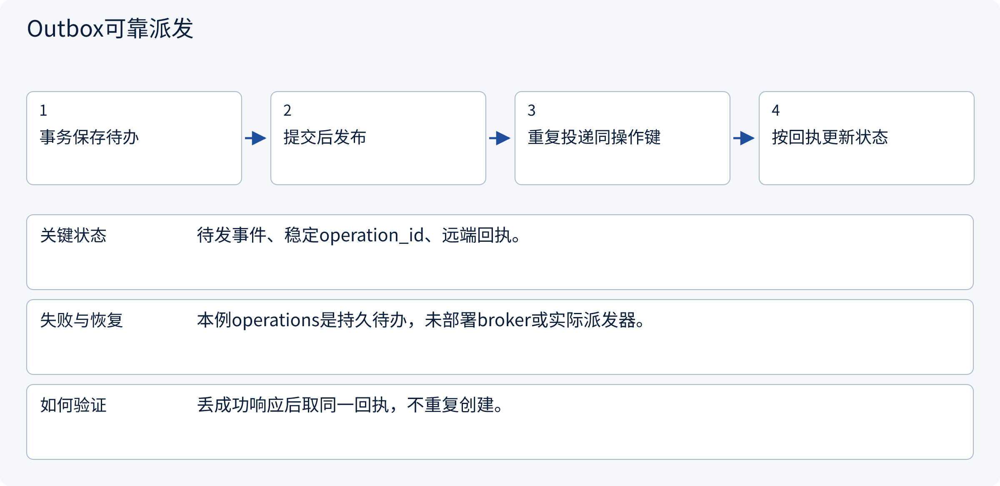
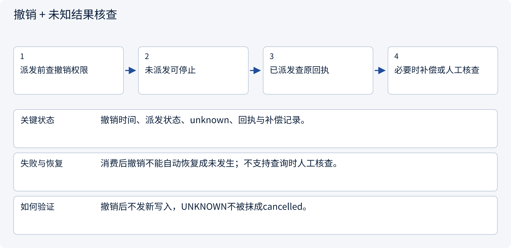

# 3.6.2 审批撤销、单次消费与恢复边界

> 图解主线 · 对照主流方案 · 配参考代码

局部架构参考：身份由可信入口提供，SQLite 演示事务，不部署登录系统或实际外部写入。

## 先看问题

两个审批回调同时到达，或服务在审批消费后崩溃，怎样避免重复动作和“已批准却没入队”？




## 图解工作原理

审批消费、任务转移与待执行操作在一个事务中提交；唯一约束阻止同审批生成多操作。入队、远端执行、回执确认分别建模，结果未知先对账。



## 主流方案怎么选



| 方案 | 怎样解决 | 适用条件 | 代价与边界 |
|---|---|---|---|
| 单次消费 + 唯一约束 | approved→consumed与操作插入同事务 | 重复审批回调和并发领取 | 唯一消费不等于远端恰好一次 |
| Outbox可靠派发 | 状态和待发事件同事务，至少一次发布 | 异步worker与暂时断线 | 重复消息需要消费/远端去重 |
| 撤销 + 未知结果核查 | 阻止新动作并区分已派发结果 | 用户撤回或权限/证据变化 | 无法用撤销倒退远端已发生效果 |

## 主流方案内部怎样运行

### 1 · 单次消费 + 唯一约束



**具体推演：** 两个worker抢approval-a，仅一个可创建待执行op。

### 2 · Outbox可靠派发



**具体推演：** 入队pending只说明本地保存，不能回复用户草稿已创建。

### 3 · 撤销 + 未知结果核查



**具体推演：** 远端已创建但响应丢失，先找原op，不能以撤销成功声称没发生。

## 参考代码

展开查看与本课机制对应的实现。训练函数仅提供代码，不执行实际训练；依赖与验证范围见配套代码说明。

[配套代码说明与验证范围](../../../docs/zh/projects/03-code-guide.md)

<details><summary>展开代码与实现边界</summary>

```python
"""A repeated callback reads the existing operation; it does not mint a new write."""

from .governance.approvals import ApprovalService
from .governance.domain import Principal
from .governance.repos import GovernanceRepository


def inspect_operation(
    connection, actor: Principal, session_id: str, operation_id: str, now: int
) -> dict:
    return ApprovalService(GovernanceRepository(connection)).operation(
        actor, session_id, operation_id, now
    )


# pending means durable work was prepared, not that the remote effect happened.
# Resume adapters query uncertain remote outcomes by the SAME operation_id.
# Revocation after dispatch cannot retroactively undo a remote effect.
```

</details>

## 本节应交付的设计产物

审批消费与待执行操作的事务边界、重复回调路径、撤销和UNKNOWN核查路径。

代码实现的是应用会话与受控草稿准备：认证主体由可信入口注入，不含OIDC、Cookie或登录凭据签发。策略是局部RBAC+ABAC示例，不假装部署了OPA/Cedar/OpenFGA。所有成员关系变化递增全局policy epoch，保守地使旧审批失效；生产可按策略/资源事实做更细粒度版本。

审批只被原子消费为本地pending操作，没有执行网络写入。执行worker在新副作用前仍须复核撤销/权限，已有UNKNOWN先查原回执。会话失效不抹除业务任务或已经产生的外部效果。

依据：[Official 1](https://docs.aws.amazon.com/prescriptive-guidance/latest/cloud-design-patterns/transactional-outbox.html).


### 事务、CAS与唯一约束的数据访问

局部架构参考实现，不产生真实外部副作用。

<details><summary>展开代码与实现边界</summary>

```python
"""Explicit transaction and narrow persistence operations; no network in transactions."""

import sqlite3
from contextlib import contextmanager
from pathlib import Path


class GovernanceRepository:
    def __init__(self, connection: sqlite3.Connection):
        self.connection = connection
        connection.row_factory = sqlite3.Row
        connection.execute("PRAGMA foreign_keys=ON")

    def initialize(self) -> None:
        self.connection.executescript(
            Path(__file__).with_name("schema.sql").read_text()
        )

    @contextmanager
    def transaction(self):
        self.connection.execute("BEGIN IMMEDIATE")
        try:
            yield
            self.connection.commit()
        except BaseException:
            self.connection.rollback()
            raise

    def get(self, table: str, key: str, value: str) -> dict:
        # Identifiers are a closed internal set, never caller-supplied SQL fragments.
        if (table, key) not in {
            ("sessions", "session_id"),
            ("tasks", "task_id"),
            ("approvals", "approval_id"),
            ("operations", "operation_id"),
        }:
            raise ValueError("Unsupported lookup")
        row = self.connection.execute(
            f"SELECT * FROM {table} WHERE {key}=?", (value,)
        ).fetchone()
        if row is None:
            raise LookupError("Record not found")
        return dict(row)

    def member(self, subject: str, tenant: str) -> dict | None:
        row = self.connection.execute(
            "SELECT * FROM members WHERE subject=? AND tenant=?", (subject, tenant)
        ).fetchone()
        return dict(row) if row else None

    def policy_version(self) -> int:
        return self.connection.execute(
            "SELECT version FROM policy_epoch WHERE singleton=1"
        ).fetchone()[0]

    def set_member(self, subject: str, tenant: str, role: str, limit: int) -> None:
        with self.transaction():
            self.connection.execute(
                "INSERT INTO members VALUES(?,?,?,?) ON CONFLICT(subject,tenant) DO UPDATE SET role=excluded.role,limit_cents=excluded.limit_cents",
                (subject, tenant, role, limit),
            )
            self.connection.execute(
                "UPDATE policy_epoch SET version=version+1 WHERE singleton=1"
            )

    def create_session(
        self, session_id: str, subject: str, tenant: str, expires: int
    ) -> None:
        self.connection.execute(
            "INSERT INTO sessions(session_id,subject,tenant,expires_at) VALUES(?,?,?,?)",
            (session_id, subject, tenant, expires),
        )

    def revoke_session(self, session_id: str) -> None:
        self.connection.execute(
            "UPDATE sessions SET revoked=1 WHERE session_id=?", (session_id,)
        )

    def create_task(
        self, task_id: str, tenant: str, owner: str, conversation: str, resource: str
    ) -> None:
        self.connection.execute(
            "INSERT INTO tasks(task_id,tenant,owner,conversation_id,resource_id,state) VALUES(?,?,?,?,?,'paused')",
            (task_id, tenant, owner, conversation, resource),
        )

    def resume(
        self, task: dict, session_id: str, run_id: str, expected_version: int
    ) -> None:
        changed = self.connection.execute(
            "UPDATE tasks SET state='running',version=version+1 WHERE task_id=? AND version=? AND state='paused'",
            (task["task_id"], expected_version),
        ).rowcount
        if changed != 1:
            raise RuntimeError("Task already claimed or stale version")
        self.connection.execute(
            "INSERT INTO runs VALUES(?,?,?,?)",
            (run_id, task["task_id"], session_id, expected_version + 1),
        )

    def request_approval(
        self, approval_id: str, context, action, expires: int, epoch: int
    ) -> None:
        changed = self.connection.execute(
            "UPDATE tasks SET state='awaiting_approval',version=version+1 WHERE task_id=? AND state='paused'",
            (action.task_id,),
        ).rowcount
        if changed != 1:
            raise RuntimeError("Task not ready for approval")
        self.connection.execute(
            "INSERT INTO approvals VALUES(?,?,?,?,NULL,?,?,?,?,'pending')",
            (
                approval_id,
                action.task_id,
                context.tenant,
                context.subject,
                action.payload(),
                action.fingerprint(),
                epoch,
                expires,
            ),
        )

    def approve(self, approval_id: str, approver: str) -> None:
        changed = self.connection.execute(
            "UPDATE approvals SET status='approved',approver=? WHERE approval_id=? AND status='pending'",
            (approver, approval_id),
        ).rowcount
        if changed != 1:
            raise RuntimeError("Approval is no longer pending")

    def revoke_approval(self, approval_id: str) -> None:
        changed = self.connection.execute(
            "UPDATE approvals SET status='revoked' WHERE approval_id=? AND status IN ('pending','approved')",
            (approval_id,),
        ).rowcount
        if changed != 1:
            raise RuntimeError(
                "Approval already consumed or revoked; inspect operation"
            )
        self.connection.execute(
            "UPDATE tasks SET state='paused',version=version+1 WHERE task_id=(SELECT task_id FROM approvals WHERE approval_id=?) AND state='awaiting_approval'",
            (approval_id,),
        )

    def claim(self, approval: dict, action, operation_id: str) -> None:
        changed = self.connection.execute(
            "UPDATE approvals SET status='consumed' WHERE approval_id=? AND status='approved'",
            (approval["approval_id"],),
        ).rowcount
        if changed != 1:
            raise RuntimeError("Approval already consumed or not approved")
        self.connection.execute(
            "INSERT INTO operations(operation_id,approval_id,task_id,tenant,action_json,action_hash) VALUES(?,?,?,?,?,?)",
            (
                operation_id,
                approval["approval_id"],
                action.task_id,
                action.tenant,
                action.payload(),
                action.fingerprint(),
            ),
        )
        changed = self.connection.execute(
            "UPDATE tasks SET state='queued',version=version+1 WHERE task_id=? AND state='awaiting_approval'",
            (action.task_id,),
        ).rowcount
        if changed != 1:
            raise RuntimeError("Task state no longer permits execution")
```

</details>

### 持久化约束

<details><summary>展开代码与实现边界</summary>

```sql
PRAGMA foreign_keys=ON;
CREATE TABLE policy_epoch (singleton INTEGER PRIMARY KEY CHECK(singleton=1), version INTEGER NOT NULL);
INSERT INTO policy_epoch VALUES(1,1);
CREATE TABLE members (
    subject TEXT NOT NULL, tenant TEXT NOT NULL, role TEXT NOT NULL, limit_cents INTEGER NOT NULL,
    PRIMARY KEY(subject,tenant)
);
CREATE TABLE sessions (
    session_id TEXT PRIMARY KEY, subject TEXT NOT NULL, tenant TEXT NOT NULL,
    expires_at INTEGER NOT NULL, revoked INTEGER NOT NULL DEFAULT 0
);
CREATE TABLE tasks (
    task_id TEXT PRIMARY KEY, tenant TEXT NOT NULL, owner TEXT NOT NULL,
    conversation_id TEXT NOT NULL, resource_id TEXT NOT NULL, evidence_version INTEGER NOT NULL DEFAULT 1,
    state TEXT NOT NULL CHECK(state IN ('paused','running','awaiting_approval','queued')),
    version INTEGER NOT NULL DEFAULT 1
);
CREATE TABLE runs (
    run_id TEXT PRIMARY KEY, task_id TEXT NOT NULL REFERENCES tasks(task_id),
    session_id TEXT NOT NULL REFERENCES sessions(session_id), task_version INTEGER NOT NULL
);
CREATE TABLE approvals (
    approval_id TEXT PRIMARY KEY, task_id TEXT NOT NULL REFERENCES tasks(task_id),
    tenant TEXT NOT NULL, requester TEXT NOT NULL, approver TEXT,
    action_json TEXT NOT NULL, action_hash TEXT NOT NULL, policy_version INTEGER NOT NULL,
    expires_at INTEGER NOT NULL,
    status TEXT NOT NULL CHECK(status IN ('pending','approved','consumed','revoked'))
);
CREATE TABLE operations (
    operation_id TEXT PRIMARY KEY, approval_id TEXT NOT NULL UNIQUE REFERENCES approvals(approval_id),
    task_id TEXT NOT NULL REFERENCES tasks(task_id), tenant TEXT NOT NULL,
    action_json TEXT NOT NULL, action_hash TEXT NOT NULL, state TEXT NOT NULL DEFAULT 'pending'
);
```

</details>

## 改变条件，检查理解

本地唯一约束保证审批只消费一次，是否也保证远端恰好执行一次？

<details><summary>展开参考答案</summary>

不保证。网络丢响应、重复投递与worker崩溃仍需稳定操作键、远端幂等或对账；框架检查点不能替代。

</details>

[查看官方资料与方案依据](../../../docs/zh/resources.md)
