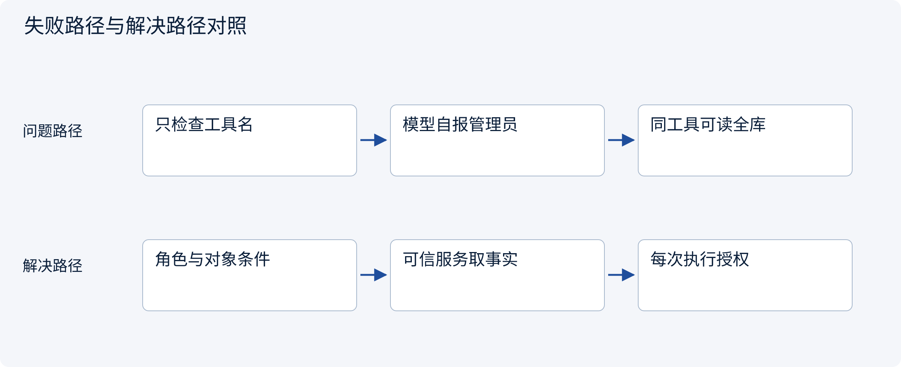
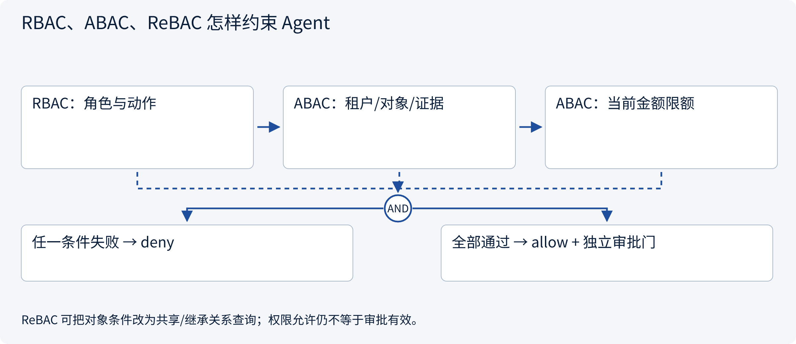
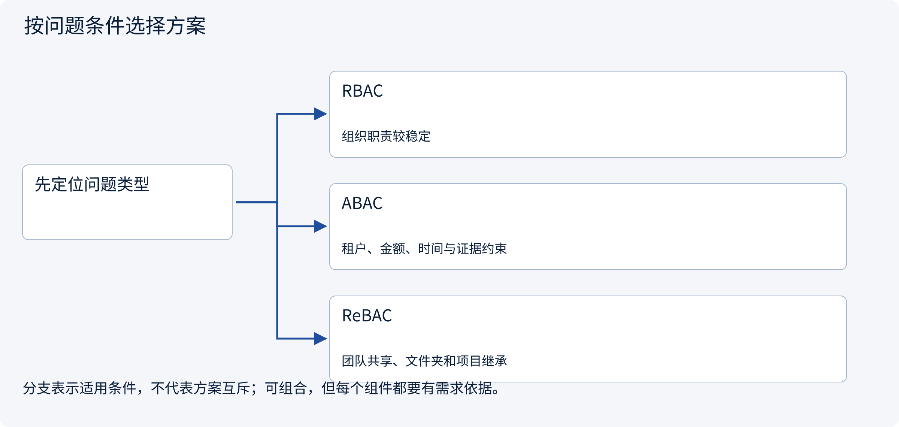
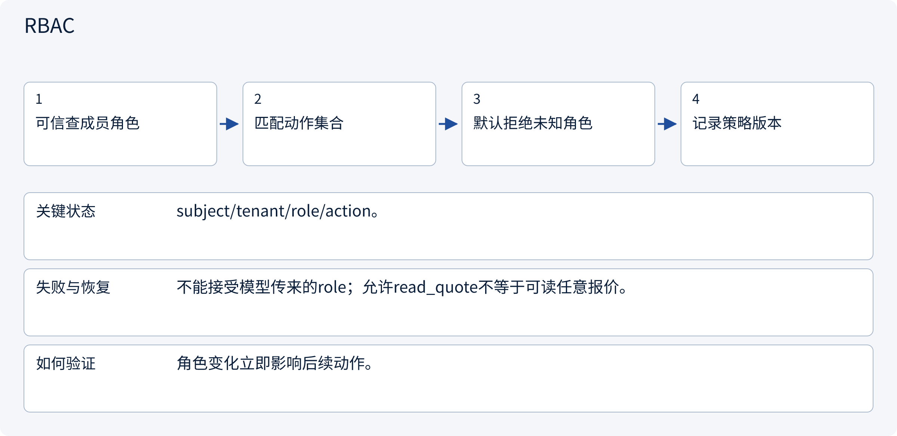
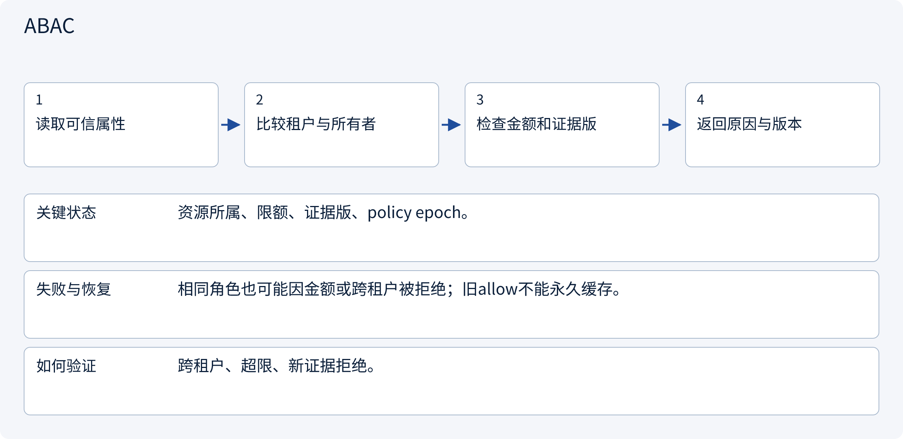
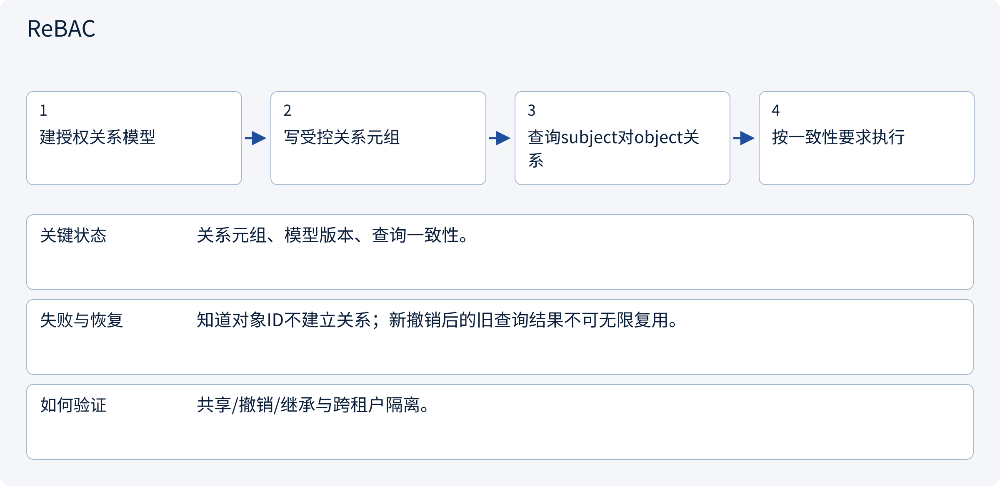

# 3.5.1 RBAC、ABAC、ReBAC 怎样约束 Agent

> 图解主线 · 对照主流方案 · 配参考代码

局部架构参考：身份由可信入口提供，SQLite 演示事务，不部署登录系统或实际外部写入。

## 先看问题

工具在允许列表中，为什么仍可能读取别人数据？“已登录”和“可执行这次动作”差在哪里？




## 图解工作原理

权限决策使用可信主体、动作、资源和上下文。RBAC控制角色动作，ABAC加入租户/金额/证据等条件，ReBAC描述资源关系；默认拒绝，模型不自报权限。



## 主流方案怎么选



| 方案 | 怎样解决 | 适用条件 | 代价与边界 |
|---|---|---|---|
| RBAC | 角色映射到动作集合 | 组织职责较稳定 | 角色爆炸、对象粒度仍需补充 |
| ABAC | 把对象与环境条件纳入判断 | 租户、金额、时间与证据约束 | 属性来源和新鲜度要保证 |
| ReBAC | 通过用户/团队/资源关系授予访问 | 团队共享、文件夹和项目继承 | 关系一致性、撤销与图建模 |

## 主流方案内部怎样运行

### 1 · RBAC



**具体推演：** operator可提出草稿，reviewer可审批，但不是同一职责。

### 2 · ABAC



**具体推演：** Alice有create_draft角色，但金额超出其限额仍拒绝。

### 3 · ReBAC



**具体推演：** 用OpenFGA建项目成员到报价的viewer关系；不是在Prompt中写“同团队”。

## 参考代码

展开查看与本课机制对应的实现。训练函数仅提供代码，不执行实际训练；依赖与验证范围见配套代码说明。

[配套代码说明与验证范围](../../../docs/zh/projects/03-code-guide.md)

<details><summary>展开代码与实现边界</summary>

```python
"""Current policy evaluation and non-amplifying worker delegation."""

from .governance.policies import PolicyService


def narrow_worker(
    parent: frozenset[tuple[str, str]], requested: frozenset[tuple[str, str]]
):
    return PolicyService.delegated_scope(parent, requested)


# Evaluate subject + action + resource + trusted context; retain the policy version/reason.
# This is a small local reference; it does not install or benchmark OPA/Cedar/OpenFGA.
```

</details>

## 本节应交付的设计产物

主体/动作/对象/属性或关系模型、默认拒绝规则、可信属性来源和策略版本。

代码实现的是应用会话与受控草稿准备：认证主体由可信入口注入，不含OIDC、Cookie或登录凭据签发。策略是局部RBAC+ABAC示例，不假装部署了OPA/Cedar/OpenFGA。所有成员关系变化递增全局policy epoch，保守地使旧审批失效；生产可按策略/资源事实做更细粒度版本。

审批只被原子消费为本地pending操作，没有执行网络写入。执行worker在新副作用前仍须复核撤销/权限，已有UNKNOWN先查原回执。会话失效不抹除业务任务或已经产生的外部效果。

依据：[Official 1](https://docs.cedarpolicy.com/authorization/overview.html), [Official 2](https://openfga.dev/docs/authorization-concepts).


### 局部角色与属性策略

局部架构参考实现，不产生真实外部副作用。

<details><summary>展开代码与实现边界</summary>

```python
"""A small RBAC+ABAC example, not a reimplementation of Cedar/OPA/OpenFGA."""

from .domain import Action, Context, Decision
from .repos import GovernanceRepository

ROLE_ACTIONS = {
    "viewer": {"read_quote"},
    "operator": {"read_quote", "create_draft"},
    "reviewer": {"read_quote", "approve_draft"},
    "lead": {"read_quote", "create_draft", "approve_draft"},
}


class PolicyService:
    def __init__(self, repository: GovernanceRepository):
        self.repository = repository

    def decide(self, context: Context, action: Action) -> Decision:
        action.validate()
        epoch = self.repository.policy_version()
        member = self.repository.member(context.subject, context.tenant)
        task = self.repository.get("tasks", "task_id", action.task_id)
        if member is None or action.operation not in ROLE_ACTIONS.get(
            member["role"], set()
        ):
            return Decision(False, False, "role_denied", epoch)
        if (
            action.tenant != context.tenant
            or task["tenant"] != context.tenant
            or task["owner"] != context.subject
        ):
            return Decision(False, False, "object_scope_denied", epoch)
        if (
            action.resource_id != task["resource_id"]
            or action.evidence_version != task["evidence_version"]
        ):
            return Decision(False, False, "resource_or_evidence_changed", epoch)
        if action.amount_cents > member["limit_cents"]:
            return Decision(False, False, "amount_limit_exceeded", epoch)
        return Decision(True, True, "write_requires_approval", epoch)

    @staticmethod
    def delegated_scope(
        parent: frozenset[tuple[str, str]], requested: frozenset[tuple[str, str]]
    ) -> frozenset[tuple[str, str]]:
        if not requested <= parent:
            raise PermissionError("Delegation cannot amplify authority")
        return requested


# Policy decisions expire with their policy/resource facts. Never cache by subject alone.
```

</details>

## 改变条件，检查理解

RBAC、ABAC、ReBAC必须三选一吗？

<details><summary>展开参考答案</summary>

不必。常用角色粗筛，再校验对象属性或关系；选型依据权限模型和一致性要求，不按工具名字堆框架。

</details>

[查看官方资料与方案依据](../../../docs/zh/resources.md)
