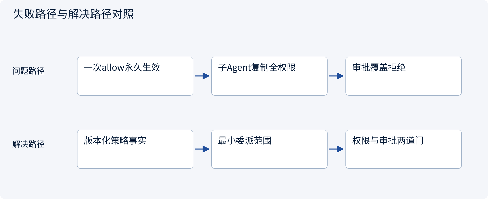
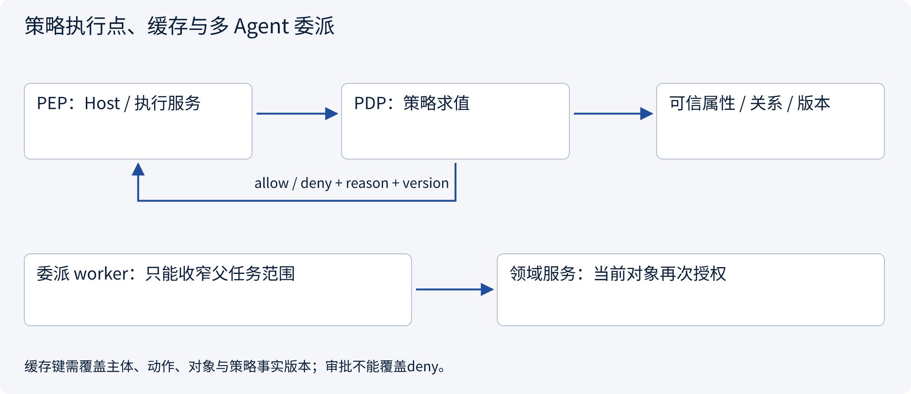
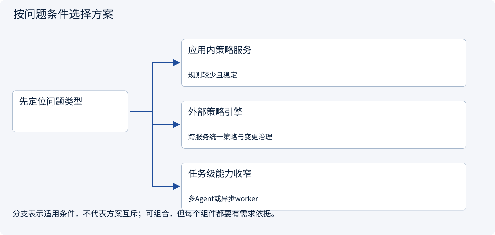
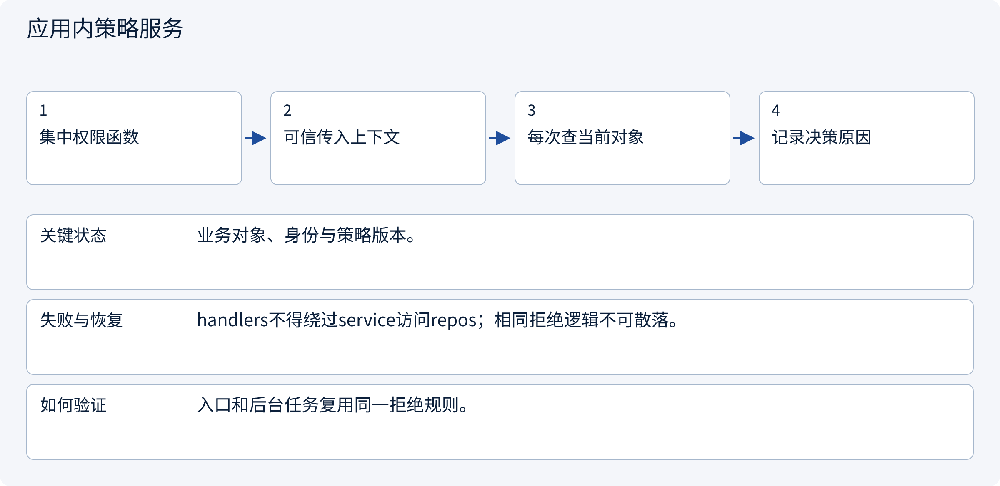
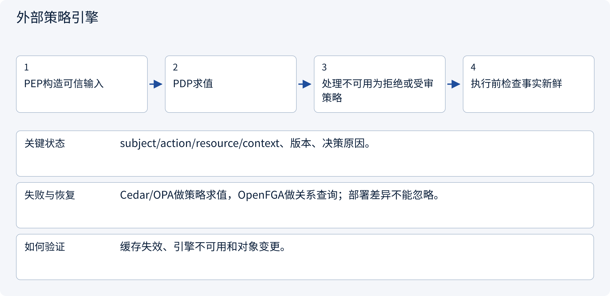
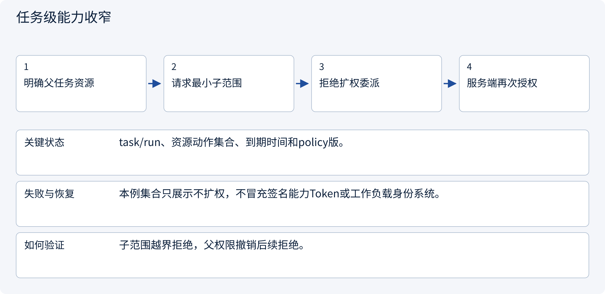

# 3.5.2 策略执行点、缓存与多 Agent 委派

> 图解主线 · 对照主流方案 · 配参考代码

局部架构参考：身份由可信入口提供，SQLite 演示事务，不部署登录系统或实际外部写入。

## 先看问题

网关说allow之后，服务能否永远信任？委派worker时，是否直接复制主Agent全部凭据？




## 图解工作原理

在执行点基于当前事实落实策略；缓存键覆盖主体/动作/对象/策略事实版本。委派权限是父任务范围的子集，审批不能把deny变成allow。



## 主流方案怎么选



| 方案 | 怎样解决 | 适用条件 | 代价与边界 |
|---|---|---|---|
| 应用内策略服务 | 业务服务内判角色和属性 | 规则较少且稳定 | 策略分散时难审计 |
| 外部策略引擎 | PDP集中决策，PEP在应用执行 | 跨服务统一策略与变更治理 | 网络、缓存、属性一致性与降级 |
| 任务级能力收窄 | 父范围与请求范围求交/校验子集 | 多Agent或异步worker | 需受众、时效、撤销与审计 |

## 主流方案内部怎样运行

### 1 · 应用内策略服务



**具体推演：** 同一session中的角色降级立即阻止新run。

### 2 · 外部策略引擎



**具体推演：** 不能只按user_id缓存allow并复用于另一个对象。

### 3 · 任务级能力收窄



**具体推演：** 只读quote-a的worker不能请求create_draft或quote-b。

## 参考代码

展开查看与本课机制对应的实现。训练函数仅提供代码，不执行实际训练；依赖与验证范围见配套代码说明。

[配套代码说明与验证范围](../../../docs/zh/projects/03-code-guide.md)

<details><summary>展开代码与实现边界</summary>

```python
"""Evaluate current facts, not a model-supplied role or cached allow flag."""

from .governance.domain import Action, Principal
from .governance.policies import PolicyService
from .governance.repos import GovernanceRepository
from .governance.sessions import SessionService


def decide_action(
    connection, actor: Principal, session_id: str, action: Action, now: int
):
    repository = GovernanceRepository(connection)
    with repository.transaction():
        context = SessionService(repository).context(actor, session_id, now)
        return PolicyService(repository).decide(context, action)


# allowed=true only answers the current policy check. needs_approval remains a separate gate.
```

</details>

## 本节应交付的设计产物

PEP/PDP位置、缓存失效键、不可用处理、委派范围与审计关联。

代码实现的是应用会话与受控草稿准备：认证主体由可信入口注入，不含OIDC、Cookie或登录凭据签发。策略是局部RBAC+ABAC示例，不假装部署了OPA/Cedar/OpenFGA。所有成员关系变化递增全局policy epoch，保守地使旧审批失效；生产可按策略/资源事实做更细粒度版本。

审批只被原子消费为本地pending操作，没有执行网络写入。执行worker在新副作用前仍须复核撤销/权限，已有UNKNOWN先查原回执。会话失效不抹除业务任务或已经产生的外部效果。

依据：[Official 1](https://www.openpolicyagent.org/docs/policy-language), [Official 2](https://openfga.dev/docs/authorization-concepts).


## 改变条件，检查理解

权限策略返回deny，但用户审批了该操作，能否执行？

<details><summary>展开参考答案</summary>

不能。审批只补充已获权限动作所需的人类决定，不能覆盖租户、对象、额度或平台硬限制。

</details>

[查看官方资料与方案依据](../../../docs/zh/resources.md)
