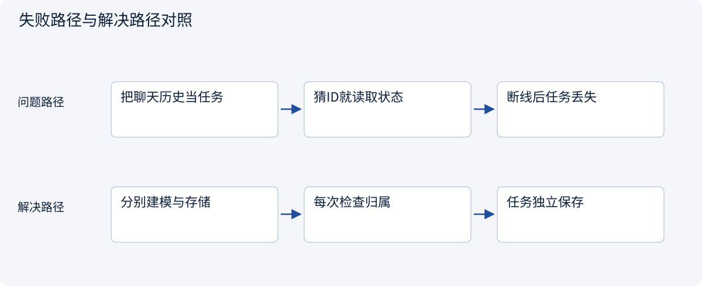
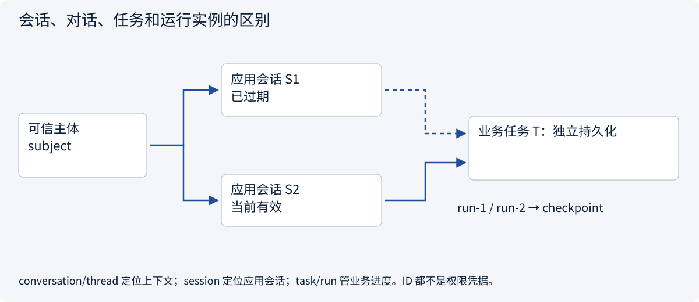
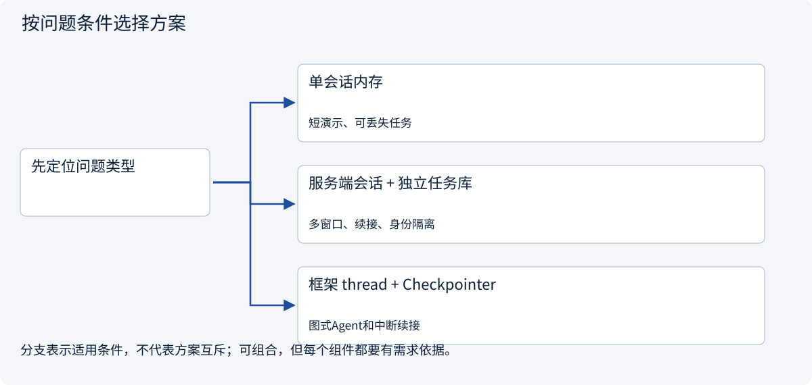
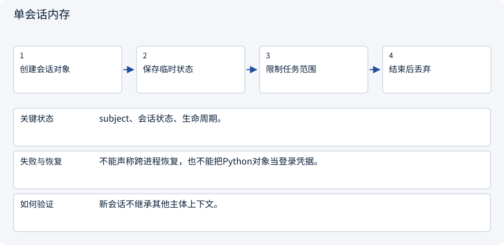
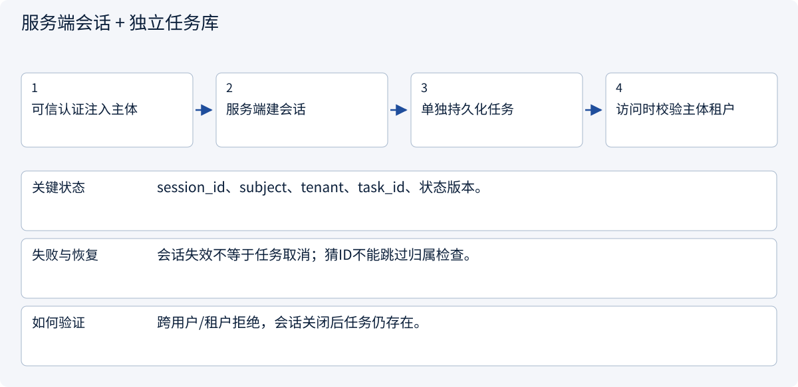
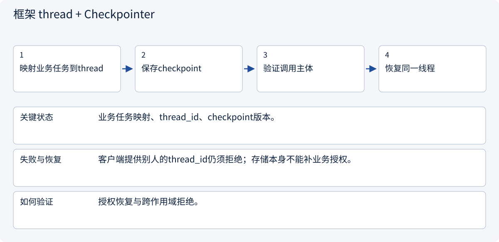

# 3.3.1 会话、对话、任务和运行实例的区别

> 图解主线 · 对照主流方案 · 配参考代码

局部架构参考：身份由可信入口提供，SQLite 演示事务，不部署登录系统或实际外部写入。

## 先看问题

刷新页面、会话到期或打开新窗口之后，为什么任务不该凭空消失？知道 thread_id 就能读任务吗？



## 图解工作原理

认证身份、应用会话、逻辑对话、业务任务和单次 run 有不同生命周期。定位符不授予访问权；恢复必须从可信身份重新关联并授权。



## 主流方案怎么选



| 方案 | 怎样解决 | 适用条件 | 代价与边界 |
|---|---|---|---|
| 单会话内存 | 进程内保存当前消息和状态 | 短演示、可丢失任务 | 进程退出无法恢复 |
| 服务端会话 + 独立任务库 | 会话定位可信主体，任务独立落库 | 多窗口、续接、身份隔离 | 需定义过期、撤销和任务授权 |
| 框架 thread + Checkpointer | 按稳定thread定位执行状态 | 图式Agent和中断续接 | thread_id不是授权凭据 |

## 主流方案内部怎样运行

### 1 · 单会话内存



**具体推演：** Skills加载器的Session只是上下文容器，不是完整登录会话。

### 2 · 服务端会话 + 独立任务库



**具体推演：** Alice用新会话继续原任务，Bob知道task_id仍不能读取。

### 3 · 框架 thread + Checkpointer



**具体推演：** LangGraph thread只定位图状态，业务层先判断谁可以恢复它。

## 参考代码

展开查看与本课机制对应的实现。训练函数仅提供代码，不执行实际训练；依赖与验证范围见配套代码说明。

[配套代码说明与验证范围](../../../docs/zh/projects/03-code-guide.md)

<details><summary>展开代码与实现边界</summary>

```python
"""Application session, task and run are distinct identifiers and lifetimes."""

from .governance.repos import GovernanceRepository
from .governance.sessions import SessionService


def session_service(connection) -> SessionService:
    return SessionService(GovernanceRepository(connection))


# Identity comes from real authentication middleware in deployment; no login server is built.
# A conversation/thread ID locates context; it is never an access credential.
# resume() rechecks current session/membership and uses task-version CAS in one transaction.
```

</details>

## 本节应交付的设计产物

身份/应用会话/逻辑对话/业务任务/run的ID和生命周期表；每种定位符对应的访问检查。

代码实现的是应用会话与受控草稿准备：认证主体由可信入口注入，不含OIDC、Cookie或登录凭据签发。策略是局部RBAC+ABAC示例，不假装部署了OPA/Cedar/OpenFGA。所有成员关系变化递增全局policy epoch，保守地使旧审批失效；生产可按策略/资源事实做更细粒度版本。

审批只被原子消费为本地pending操作，没有执行网络写入。执行worker在新副作用前仍须复核撤销/权限，已有UNKNOWN先查原回执。会话失效不抹除业务任务或已经产生的外部效果。

依据：[Official 1](https://cheatsheetseries.owasp.org/cheatsheets/Session_Management_Cheat_Sheet.html), [Official 2](https://docs.langchain.com/oss/python/langgraph/persistence).


### 身份、上下文与动作契约

局部架构参考实现，不产生真实外部副作用。

<details><summary>展开代码与实现边界</summary>

```python
import hashlib
import json
from dataclasses import asdict, dataclass


@dataclass(frozen=True)
class Principal:
    subject: (
        str  # Supplied by trusted authentication middleware, never by model arguments.
    )


@dataclass(frozen=True)
class Context:
    subject: str
    tenant: str
    session_id: str


@dataclass(frozen=True)
class Action:
    tenant: str
    task_id: str
    operation: str
    resource_id: str
    amount_cents: int
    recipient: str
    evidence_version: int
    currency: str = "CNY"

    def validate(self) -> None:
        if self.operation != "create_draft" or any(
            not isinstance(value, str) or not value
            for value in (self.tenant, self.task_id, self.resource_id, self.recipient)
        ):
            raise ValueError("Unsupported or incomplete action")
        if self.currency != "CNY":
            raise ValueError("This reference supports only canonical CNY amounts")
        if (
            type(self.amount_cents) is not int
            or self.amount_cents <= 0
            or type(self.evidence_version) is not int
            or self.evidence_version <= 0
        ):
            raise ValueError("Invalid amount or evidence version")

    def payload(self) -> str:
        self.validate()
        return json.dumps(
            asdict(self), sort_keys=True, separators=(",", ":"), allow_nan=False
        )

    def fingerprint(self) -> str:
        return hashlib.sha256(self.payload().encode()).hexdigest()


@dataclass(frozen=True)
class Decision:
    allowed: bool
    needs_approval: bool
    reason: str
    policy_version: int
```

</details>

### 会话与任务生命周期服务

局部架构参考实现，不产生真实外部副作用。

<details><summary>展开代码与实现边界</summary>

```python
"""Application-session service; authentication and browser cookies are separate concerns."""

from uuid import uuid4

from .domain import Context, Principal
from .repos import GovernanceRepository


class SessionService:
    def __init__(self, repository: GovernanceRepository):
        self.repository = repository

    def open(
        self, identity: Principal, tenant: str, now: int, lifetime: int = 3600
    ) -> str:
        if lifetime <= 0:
            raise ValueError("Invalid lifetime")
        with self.repository.transaction():
            if self.repository.member(identity.subject, tenant) is None:
                raise PermissionError("No tenant membership")
            key = uuid4().hex
            self.repository.create_session(
                key, identity.subject, tenant, now + lifetime
            )
        return key

    def context(self, identity: Principal, session_id: str, now: int) -> Context:
        row = self.repository.get("sessions", "session_id", session_id)
        if (
            row["subject"] != identity.subject
            or row["revoked"]
            or row["expires_at"] <= now
        ):
            raise PermissionError("Session unavailable or expired")
        if self.repository.member(identity.subject, row["tenant"]) is None:
            raise PermissionError("Tenant membership revoked")
        return Context(identity.subject, row["tenant"], session_id)

    def close(self, identity: Principal, session_id: str, now: int) -> None:
        with self.repository.transaction():
            self.context(identity, session_id, now)
            self.repository.revoke_session(session_id)
        # Closing a session neither deletes task state nor proves an external action was cancelled.

    def task(self, context: Context, task_id: str) -> dict:
        row = self.repository.get("tasks", "task_id", task_id)
        if row["tenant"] != context.tenant or row["owner"] != context.subject:
            raise PermissionError("Task outside actor scope")
        return row

    def create_task(
        self,
        identity: Principal,
        session_id: str,
        task_id: str,
        conversation_id: str,
        resource: str,
        now: int,
    ) -> None:
        with self.repository.transaction():
            context = self.context(identity, session_id, now)
            self.repository.create_task(
                task_id, context.tenant, context.subject, conversation_id, resource
            )

    def resume(
        self,
        identity: Principal,
        session_id: str,
        task_id: str,
        run_id: str,
        expected_version: int,
        now: int,
    ) -> None:
        with self.repository.transaction():
            context = self.context(identity, session_id, now)
            task = self.task(context, task_id)
            member = self.repository.member(context.subject, context.tenant)
            if member["role"] not in {"operator", "lead"}:
                raise PermissionError("Current role cannot resume work")
            self.repository.resume(task, session_id, run_id, expected_version)
```

</details>

## 改变条件，检查理解

退出应用会话，是否自动撤销已发出的远端写操作？

<details><summary>展开参考答案</summary>

不会。必须分别处理会话失效、任务取消和外部操作核查；已发出的写入可能需要对账。

</details>

[查看官方资料与方案依据](../../../docs/zh/resources.md)
