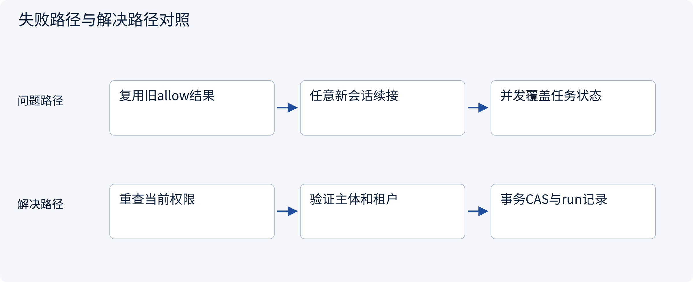
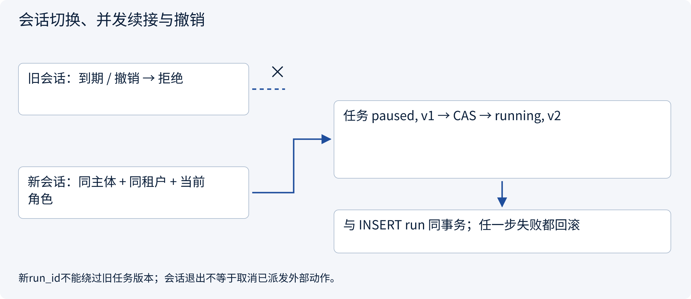
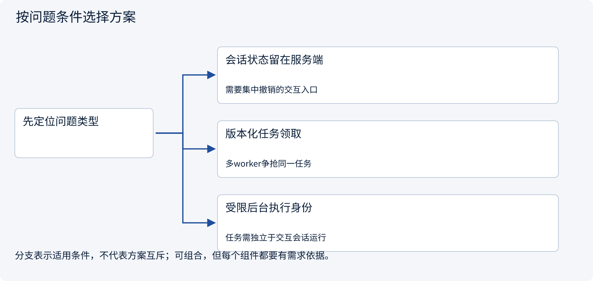
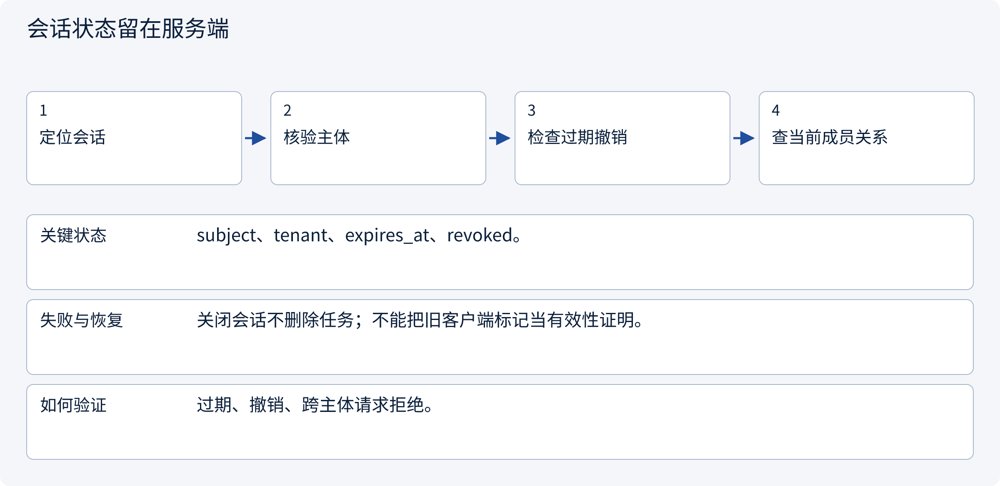
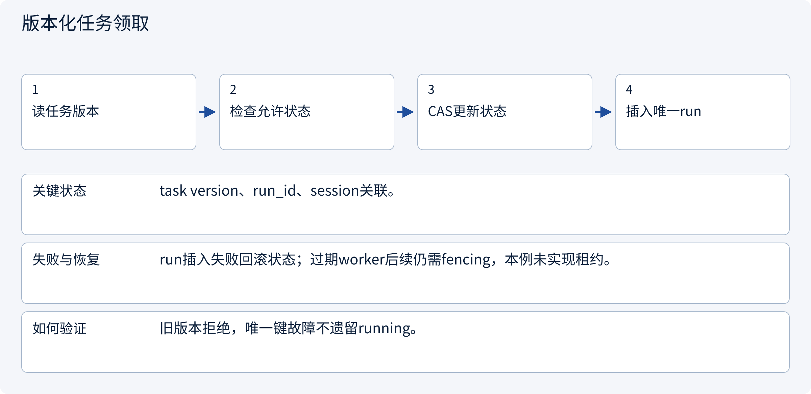
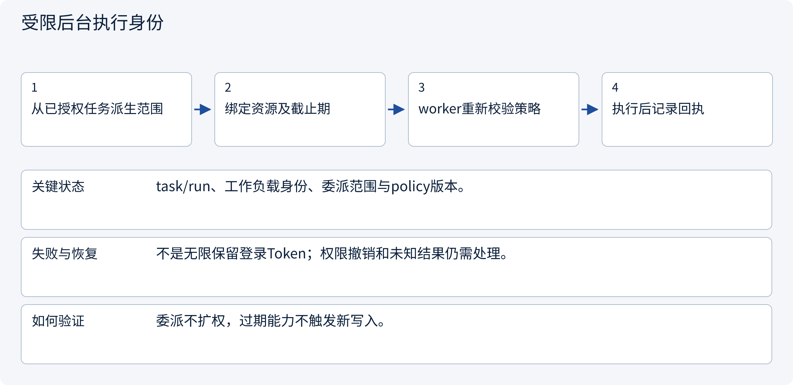

# 3.3.2 会话切换、并发续接与撤销

> 图解主线 · 对照主流方案 · 配参考代码

局部架构参考：身份由可信入口提供，SQLite 演示事务，不部署登录系统或实际外部写入。

## 先看问题

新会话接管旧任务时，如何避免跨租户续接、旧权限复活或两个worker同时推进？




## 图解工作原理

恢复时检查当前会话和当前权限，按任务期望版本领取run。会话、任务、运行实例的状态变化分别记录，不能靠聊天里的“继续”决定所有权。



## 主流方案怎么选



| 方案 | 怎样解决 | 适用条件 | 代价与边界 |
|---|---|---|---|
| 会话状态留在服务端 | 过期/撤销即时查询 | 需要集中撤销的交互入口 | 存储可用性与读取成本 |
| 版本化任务领取 | CAS与run插入同一事务 | 多worker争抢同一任务 | 需定义租约、fencing和运行超时 |
| 受限后台执行身份 | 单独授予任务级短期能力 | 任务需独立于交互会话运行 | 需要工作负载身份与撤销机制 |

## 主流方案内部怎样运行

### 1 · 会话状态留在服务端



**具体推演：** 过期session不能恢复，但同主体的新有效session可以。

### 2 · 版本化任务领取



**具体推演：** 两个恢复请求读v1，只有一个可以把任务推进到v2。

### 3 · 受限后台执行身份



**具体推演：** 人工次日审批后由受控worker续跑，不依赖昨天的浏览器Cookie。

## 参考代码

展开查看与本课机制对应的实现。训练函数仅提供代码，不执行实际训练；依赖与验证范围见配套代码说明。

[配套代码说明与验证范围](../../../docs/zh/projects/03-code-guide.md)

<details><summary>展开代码与实现边界</summary>

```python
"""Resume the same task from a new authorized session; use a fresh run ID."""

from .governance.domain import Principal
from .session_lifecycle import session_service


def resume_task(
    connection,
    actor: Principal,
    session_id: str,
    task_id: str,
    run_id: str,
    expected_version: int,
    now: int,
) -> None:
    session_service(connection).resume(
        actor, session_id, task_id, run_id, expected_version, now
    )


# The CAS and run insert are one transaction. Reusing an old task version is rejected.
# A new session is allowed only for the same authorized subject and tenant.
```

</details>

## 本节应交付的设计产物

会话过期和撤销路径、任务领取状态机、CAS失败出口、新会话恢复与后台身份策略。

代码实现的是应用会话与受控草稿准备：认证主体由可信入口注入，不含OIDC、Cookie或登录凭据签发。策略是局部RBAC+ABAC示例，不假装部署了OPA/Cedar/OpenFGA。所有成员关系变化递增全局policy epoch，保守地使旧审批失效；生产可按策略/资源事实做更细粒度版本。

审批只被原子消费为本地pending操作，没有执行网络写入。执行worker在新副作用前仍须复核撤销/权限，已有UNKNOWN先查原回执。会话失效不抹除业务任务或已经产生的外部效果。

依据：[Official 1](https://cheatsheetseries.owasp.org/cheatsheets/Session_Management_Cheat_Sheet.html).


### 持久化约束

<details><summary>展开代码与实现边界</summary>

```sql
PRAGMA foreign_keys=ON;
CREATE TABLE policy_epoch (singleton INTEGER PRIMARY KEY CHECK(singleton=1), version INTEGER NOT NULL);
INSERT INTO policy_epoch VALUES(1,1);
CREATE TABLE members (
    subject TEXT NOT NULL, tenant TEXT NOT NULL, role TEXT NOT NULL, limit_cents INTEGER NOT NULL,
    PRIMARY KEY(subject,tenant)
);
CREATE TABLE sessions (
    session_id TEXT PRIMARY KEY, subject TEXT NOT NULL, tenant TEXT NOT NULL,
    expires_at INTEGER NOT NULL, revoked INTEGER NOT NULL DEFAULT 0
);
CREATE TABLE tasks (
    task_id TEXT PRIMARY KEY, tenant TEXT NOT NULL, owner TEXT NOT NULL,
    conversation_id TEXT NOT NULL, resource_id TEXT NOT NULL, evidence_version INTEGER NOT NULL DEFAULT 1,
    state TEXT NOT NULL CHECK(state IN ('paused','running','awaiting_approval','queued')),
    version INTEGER NOT NULL DEFAULT 1
);
CREATE TABLE runs (
    run_id TEXT PRIMARY KEY, task_id TEXT NOT NULL REFERENCES tasks(task_id),
    session_id TEXT NOT NULL REFERENCES sessions(session_id), task_version INTEGER NOT NULL
);
CREATE TABLE approvals (
    approval_id TEXT PRIMARY KEY, task_id TEXT NOT NULL REFERENCES tasks(task_id),
    tenant TEXT NOT NULL, requester TEXT NOT NULL, approver TEXT,
    action_json TEXT NOT NULL, action_hash TEXT NOT NULL, policy_version INTEGER NOT NULL,
    expires_at INTEGER NOT NULL,
    status TEXT NOT NULL CHECK(status IN ('pending','approved','consumed','revoked'))
);
CREATE TABLE operations (
    operation_id TEXT PRIMARY KEY, approval_id TEXT NOT NULL UNIQUE REFERENCES approvals(approval_id),
    task_id TEXT NOT NULL REFERENCES tasks(task_id), tenant TEXT NOT NULL,
    action_json TEXT NOT NULL, action_hash TEXT NOT NULL, state TEXT NOT NULL DEFAULT 'pending'
);
```

</details>

## 改变条件，检查理解

一个新run_id能否绕过任务旧版本冲突？

<details><summary>展开参考答案</summary>

不能。run_id只标识尝试，状态CAS判断任务是否仍可领取；租约和fencing是后续运行所有权问题。

</details>

[查看官方资料与方案依据](../../../docs/zh/resources.md)
