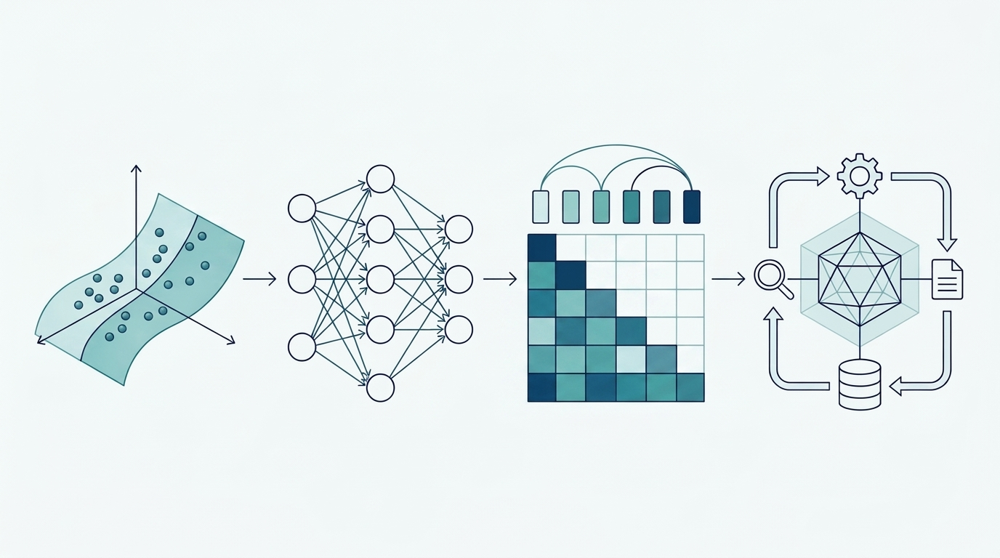

# 学习地图：从入门到多 Agent 架构设计

先理解机制，再按任务边界、协作契约、状态、权限和恢复等具体问题完成架构设计。训练仅提供代码，不实际训练。

## 学习阶段

- **1 入门 · 模型原理** · [1.1 从一个预测问题认识 AI](foundations/01-map.md)

- **2 进阶 · Agent 原理与应用** · [2.1.1 提示、结构化输出与工具契约](llm/01-prompting.md)

- **3 高级 · Agent 架构设计** · [3.1.1 任务分解、Agent 职责与产物所有权](architecture/ma01.md)

- **4 综合实践与资料** · [4.1 个人工作室：AI 接单到交付的多 Agent 架构](projects/personal-studio.md)

## 从哪些方面设计多 Agent

| 模块 | 该做出的设计 |

|---|---|

| [3.1.1 任务分解、Agent 职责与产物所有权](architecture/ma01.md) | 任务验收、拆分理由、唯一责任者和产物契约 |

| [3.2.1 协作拓扑：顺序、Supervisor 与 DAG](agent/08.md) | 控制拓扑、路由、消息信封、因果与交接条件 |

| [3.3.1 会话、对话、任务和运行实例的区别](governance/session01.md) | 身份/会话/任务/run的生命周期与续接 |

| [3.4.1 共享状态、产物版本与冲突裁决](architecture/ma03.md) | 产物版本、状态所有权、CAS和冲突处理 |

| [3.5.1 RBAC、ABAC、ReBAC 怎样约束 Agent](governance/auth01.md) | 主体、动作、对象、策略事实和受限委派 |

| [3.6.1 审批绑定什么：动作、证据、时效与审批人](governance/approval01.md) | 具体动作审批、失效、单次消费和回执 |

| [3.7.1 Runtime 与 Harness：模型负责建议，系统负责兑现](agent/09.md) | DAG、并发/预算、背压、失败恢复与补偿 |

| [3.8.1 评测、监控与安全：漂亮答案不等于可靠系统](agent/11.md) | 完整任务对照、轨迹、告警、安全与发布门槛 |

| [3.9.1 部署边界、容量、隔离与技术选型](architecture/ma07.md) | 进程/服务隔离、容量、伸缩及完整装配 |

## 进阶机制与高级设计怎样衔接

Agent基础、上下文、函数调用、MCP、Skills、状态记忆都属于进阶；高级设计复用这些能力来回答系统组合问题。Function Calling表达模型提议，MCP连接能力，Skills复用方法，三者可以在同一条链中组合。

[2.4.3 与 MCP 的区别及完整衔接](tools/fc02.md) · [2.6.1 方法、Prompt、工具与工作流各管什么？](skills/skill01.md) · [4.3 配套代码与验证边界](projects/03-code-guide.md)

## 怎样检验理解

改变租户、金额、证据版本或故障时点，说明哪一层拒绝、哪些状态保留、怎样恢复；提交具体产物与取舍，不以框架名字和漂亮总图代替设计。
