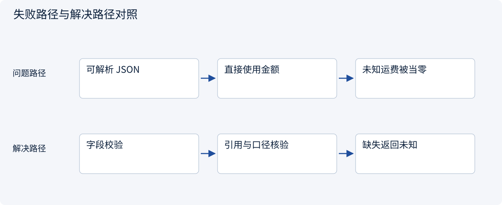
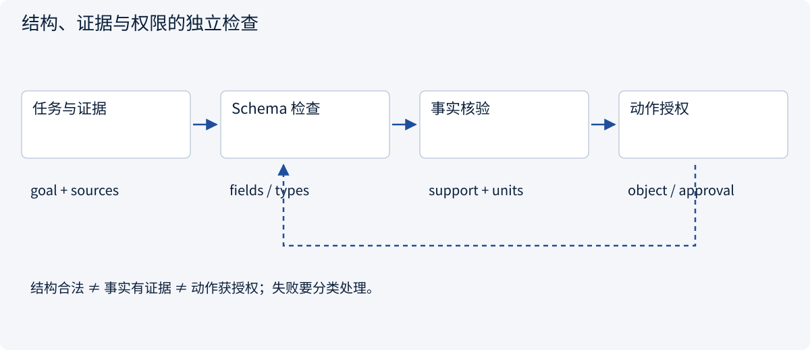
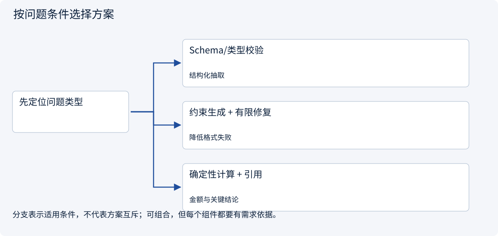
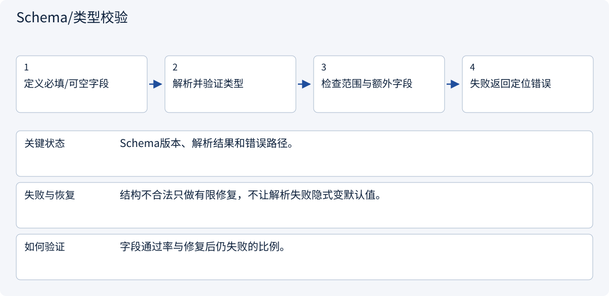
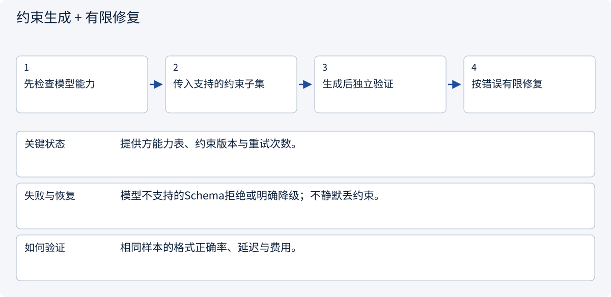
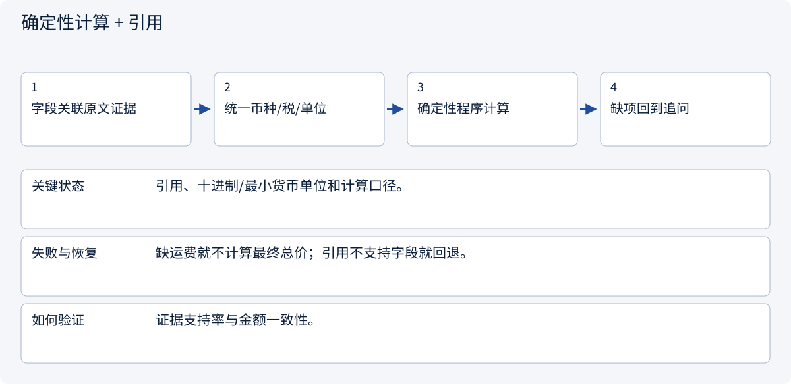

# 2.1.1 提示、结构化输出与工具契约

> 图解主线 · 对照主流方案 · 配参考代码

## 先看问题

模型输出 JSON 合法，为什么总价和事实仍然可能错误？



## 图解工作原理

把输出当候选：结构检查负责字段，证据检查负责事实，权限检查负责动作。三关互不替代。



## 主流方案怎么选



| 方案 | 怎样解决 | 适用条件 | 代价与边界 |
|---|---|---|---|
| Schema/类型校验 | 检查字段、类型与范围 | 结构化抽取 | 合法结构不代表真事实 |
| 约束生成 + 有限修复 | 在支持时限制输出并反馈错误 | 降低格式失败 | 能力依提供方而异 |
| 确定性计算 + 引用 | 代码算金额、证据支持字段 | 金额与关键结论 | 缺失事实必须停下或追问 |

## 主流方案内部怎样运行

### 1 · Schema/类型校验



**具体推演：** 运费未知允许null；把字符串“免费”放进金额字段应报错。

### 2 · 约束生成 + 有限修复



**具体推演：** 约束JSON能降低漏字段，但不能证明1.80这个价格来自原文。

### 3 · 确定性计算 + 引用



**具体推演：** 1000×180分是货款180000分，未知运费不能补成0。

## 参考代码

展开查看与本课机制对应的实现。训练函数仅提供代码，不执行实际训练；依赖与验证范围见配套代码说明。

[配套代码说明与验证范围](../../../docs/zh/projects/03-code-guide.md)

<details><summary>展开代码与实现边界</summary>

```python
"""Structure and evidence support are independent checks."""

from dataclasses import dataclass


@dataclass(frozen=True)
class Quotation:
    unit_cents: int
    shipping_cents: int | None
    source_id: str


def total_or_unknown(
    quote: Quotation, quantity: int, allowed_sources: set[str]
) -> int | None:
    if quantity <= 0 or quote.unit_cents < 0:
        raise ValueError("Invalid amount or quantity")
    if quote.source_id not in allowed_sources:
        raise PermissionError("Unknown or unauthorized evidence")
    if quote.shipping_cents is None:
        return None
    if quote.shipping_cents < 0:
        raise ValueError("Shipping must be nonnegative")
    return quote.unit_cents * quantity + quote.shipping_cents


# A real application also verifies that the source supports the extracted fields.
```

</details>

## 改变条件，检查理解

报价只写运费另计，是否可以返回含运费总价？

<details><summary>展开参考答案</summary>

不能。货款小计可以有值，运费与总价保持未知，不能为了完整字段而编造。

</details>

<details><summary>按需展开：原理推导与边界补充</summary>

**提示是一份任务契约**

“比较这几家”缺少对象、证据、口径和完成条件。把提示拆成任务、输入边界、输出结构、未知处理和权限，才能稳定评价。

```text
任务：比较提供的三份报价，不补充外部事实。
口径：人民币、含税、同一规格、数量 1000；运费单列。
输出：供应商、单价、起订量、交货期、证据编号、缺失项。
未知：未提供就填 null，并说明缺失原因。
权限：只生成比较结果，不发送消息、不下单。
```

Few-shot 示例帮助解释格式和边界。示例要包含缺失值、冲突和拒答，若全是信息完美的成功案例，模型可能学会为了填满表格而编造。需求越复杂，越需要先定义评价样本，而非先堆叠提示词。


**结构校验与事实校验分开做**

JSON 可解析只是第一步。还要检查必需字段、类型、数值范围、额外字段、币种与单位。即使 schema 通过，`price=0.01` 也可能没有证据。语义校验需要把每项事实关联到原文，并确认它支持当前结论。

对于精确金额，使用十进制或最小货币单位。比较含税和未税价时，需要已知税率和明确口径，不能让模型自行补税率。业务规则应由程序执行，而不是期待模型每次都正确做算术。

修复输出也要有预算。结构错误可以把校验错误反馈给模型进行有限次重试；证据缺失不能靠“再想一下”生成事实。达到预算后应返回可解释的失败或请求补充信息。

**工具调用是建议，不是执行**

工具定义包括名称、用途、参数 schema、结果 schema、错误类型、权限、超时和副作用。以 `get_quote(quote_id)` 为例，它只读报价；`create_order` 是另一种能力，需要不同授权。不要给模型一个可以执行任意字符串的万能工具来掩盖这些区别。

运行时收到调用后，先检查工具是否在当前任务的允许列表、参数是否有效、调用者是否有对象权限，再执行。返回给模型的结果要有结构化状态，例如 `ok`、`not_found`、`permission_denied`、`timeout_unknown`。外部内容即使写着“忽略规则”，也只是数据。

**练习与答案**

输入报价只写“运费另计”，模型返回“总价 1800 元含运费”，JSON 完全合法。应该让它重试生成 JSON，还是返回缺失？

<details><summary>参考答案</summary>

返回运费与总价未知，可以报告货款小计 1800 元及其证据。重试格式无助于解决事实缺失。若任务允许，可以请求补充运费；未经允许不能自行联系供应商。结构校验、语义校验和动作授权是三道独立检查。

</details>


</details>

[查看官方资料与方案依据](../../../docs/zh/resources.md)
