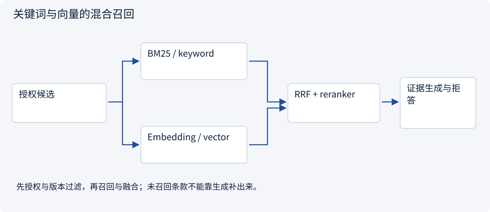
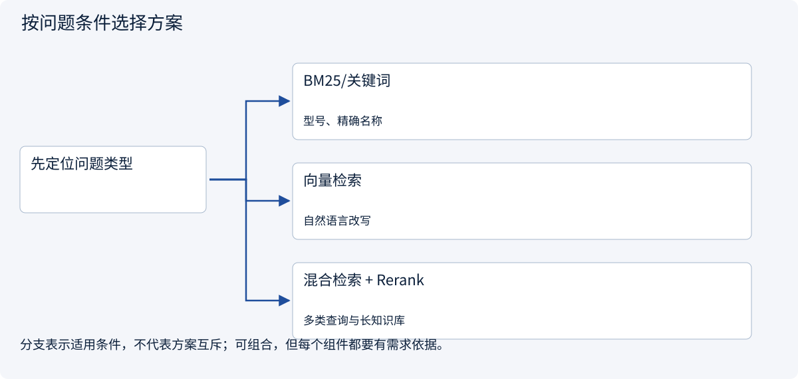
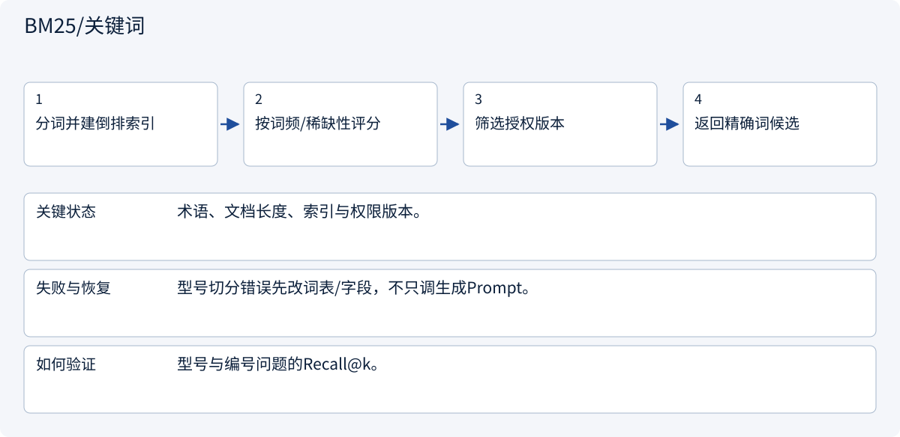
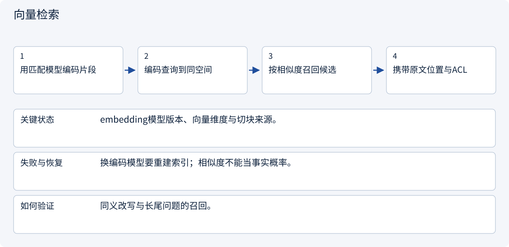
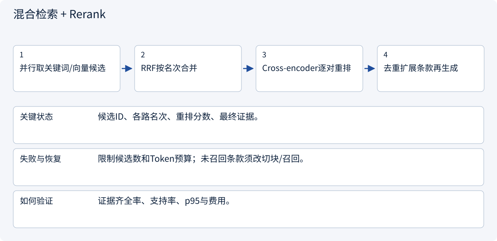
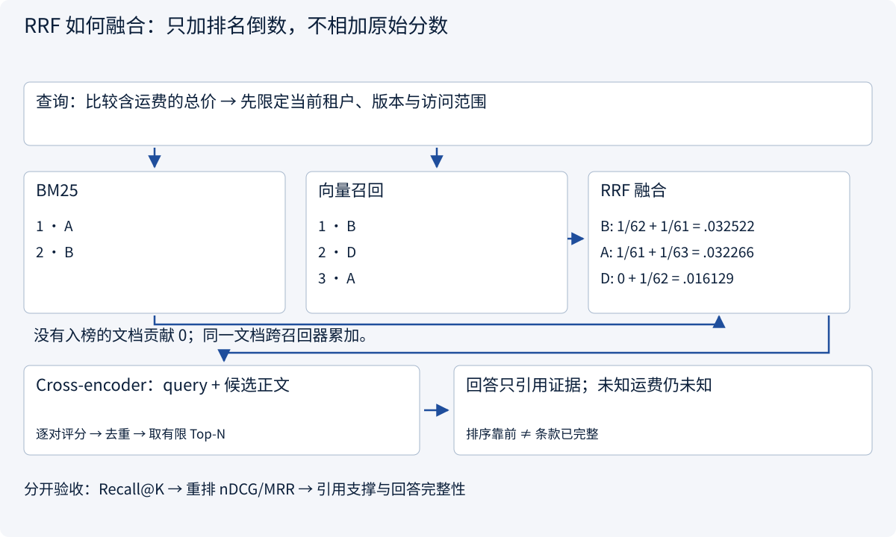

# 2.1.2 RAG：把检索与回答分别做对

> 图解主线 · 对照主流方案 · 配参考代码

## 先看问题

向量检索找到相似段落，却漏掉型号、限制条件或最新版本，怎么解决？


AI生成的查证场景插画：检索命中只是候选材料，回答仍需回到原文核对来源、版本与适用条件。画中的页面不是实际引用证据。

## 图解工作原理

关键词补精确匹配，向量补语义召回，RRF 合并排序，reranker 重排候选；最后核验引用与版本。



## 主流方案怎么选



| 方案 | 怎样解决 | 适用条件 | 代价与边界 |
|---|---|---|---|
| BM25/关键词 | 匹配术语与编号 | 型号、精确名称 | 同义改写易漏 |
| 向量检索 | 表示语义相近 | 自然语言改写 | 相似不等于支持 |
| 混合检索 + Rerank | 融合排名后精排 | 多类查询与长知识库 | 不能挽救入库缺失条款 |

## 主流方案内部怎样运行

### 1 · BM25/关键词



**具体推演：** 查询精确型号时，BM25能保留不适合语义改写的字符串。

### 2 · 向量检索



**具体推演：** “多久能到”和“交货周期”可能通过向量接近召回。

### 3 · 混合检索 + Rerank



**具体推演：** 价格与>500件另议必须同时出现；只找到一段不能承诺交期。

## 用具体数据推演边界



## 参考代码

展开查看与本课机制对应的实现。训练函数仅提供代码，不执行实际训练；依赖与验证范围见配套代码说明。

[配套代码说明与验证范围](../../../docs/zh/projects/03-code-guide.md)

<details><summary>展开代码与实现边界</summary>

```python
"""RRF combines rankings, not incompatible raw similarity scales."""

from collections import defaultdict
from collections.abc import Sequence


def reciprocal_rank_fusion(
    rankings: Sequence[Sequence[str]], allowed_ids: set[str], k: int = 60
) -> list[tuple[str, float]]:
    if k <= 0:
        raise ValueError("k must be positive")
    scores = defaultdict(float)
    for ranking in rankings:
        seen = set()
        for rank, document_id in enumerate(ranking, 1):
            if document_id not in allowed_ids or document_id in seen:
                continue
            scores[document_id] += 1 / (k + rank)
            seen.add(document_id)
    return sorted(scores.items(), key=lambda item: (-item[1], item[0]))


# Inputs should come from authorized BM25/vector retrieval. No embedding model is hidden here.
```

</details>

## 为什么混合召回之后，还要重排？

BM25 用倒排索引寻找查询词，结合词频饱和、稀有词权重和文档长度归一化。它擅长型号、编号与精确术语；分词把型号切错时，先修正字段/分析器。向量召回把查询与片段分别编码到匹配空间，适合同义改写；更换 embedding 模型后不能继续把旧向量与新查询混用。

**RRF** 对同一个文档累加 `1/(k + rank)`，未出现在一路排名中就贡献 0。这里 `k=60` 是平滑常数，**不是取 60 个候选**；候选窗口和最终 Top-N 是另外的参数。RRF 无需让 BM25 分数和向量相似度处于同一尺度，但它只看排名，不能判断片段是否真的完整回答了问题。

Cross-encoder 将“查询 + 候选正文”一起输入，逐对计算相关性，用更高成本精排有限候选。召回阶段为了覆盖，重排阶段为了区分；候选里根本没有运费条款时，重排和生成都无法恢复它。需要改入库、切块、召回窗口或补查原文。

| 观察到的问题 | 先查什么 | 应采用的处理 |
|---|---|---|
| 相关条款没进候选集 | 入库是否完整、切块、分词、向量版本、过滤条件 | 修复索引/召回，扩大有效候选窗口；评测 Recall@K |
| 条款在候选里但排得很后 | 查询-片段相关性、重复片段挤占 | 对有限候选重排、文档去重、按需要取父级上下文 |
| 片段排名高但条件缺失 | 相邻限定条款、表格表头和脚注 | 保留结构与定位，有限扩展上下文，不无限塞全文 |
| 证据完整但回答乱编 | 引用对齐、未知值规则、输出验收 | 验证每项结论来源；明确无证据项，不继续“优化检索” |

权限约束进入两路检索的过滤条件，并在读取正文时复核；不能先对全租户召回再随意把候选正文发给模型。图中的排序是虚构算例，未调用 embedding 或 reranker 模型。

依据：[Elasticsearch RRF](https://www.elastic.co/docs/reference/elasticsearch/rest-apis/reciprocal-rank-fusion)、[语义重排](https://www.elastic.co/docs/solutions/search/ranking/semantic-reranking)。


## 改变条件，检查理解

价格段找到但数量限制段没找到，应归因于生成还是检索？

<details><summary>展开参考答案</summary>

先归因于证据召回不全。重排序不能恢复候选里不存在的内容，还需检查切块与入库。

</details>

<details><summary>按需展开：原理推导与边界补充</summary>

**先解释为什么需要检索**

模型参数不能代表最新合同，也不能天然遵守文档权限。RAG 在回答时引入检索证据，让事实可以更新、引用和核验。它依赖知识库内容和检索质量；库里没有的答案仍然没有。


上半部分是离线或增量入库，下半部分是在线问题处理。索引保存的不只有向量，还需要文档 ID、版本、片段位置、更新时间、所有者与权限。删除和修订必须能追溯到旧片段并使缓存失效，不能只不断追加新向量。

**切块不是按字数剪碎**

按标题、段落、列表和表格语义边界切分，避免把“适用条件”与条款正文分开。重叠可以降低边界丢失，也增加重复检索和上下文占用。块过大降低定位精度，块过小丢失条件；用真实问题比较，而非照搬固定长度。

Embedding 将片段映射到向量。余弦相似度是 `q·d/(||q|| ||d||)`，反映向量方向接近程度，不是事实正确概率。型号、编号和精确术语适合关键词检索，语义改写适合向量检索；混合检索组合二者时需要处理分数尺度或使用排名融合。

一种排名融合是 `RRF(d)=Σ 1/(k+rank_i(d))`。`k` 调节不同名次的差距；它不是检索条数。之后可用 reranker 对少量候选重新排序。重排序能改善已有候选的顺序，无法补回从未召回的关键片段。

**一次失败怎么定位**

问题是“1000 件能否在十天内发货”。片段 A 写“常规交货期 7 天”，片段 B 写“数量超过 500 件须另议”。只召回 A 会产生错误承诺；都召回但忽略 B，是上下文使用或生成问题；原始扫描漏掉 B，则是入库问题。

需要保存可复盘的文档版本、检索候选、分数、最终证据和答案。权限过滤在检索候选形成前或检索过程中执行；若底层检索无法直接过滤，应在隔离的可信检索层内做严格授权，未授权内容不能进入模型、客户端或共享缓存。不能生成后才发现泄漏。

**分层评价，才能有方向地改进**

| 层次 | 问题 | 可用指标或检查 |
|---|---|---|
| 入库 | 条款和表格有没有丢失 | 原文抽检、版本与定位完整性 |
| 检索 | 关键证据进候选了吗 | Recall@k、MRR、分组召回 |
| 生成 | 答案是否被证据支持 | 引用支持率、事实正确率 |
| 系统 | 该拒答时是否拒答 | 无答案集、权限集、冲突集 |
| 体验 | 值不值得使用 | 延迟、费用、人工复核成本 |

若一题有 2 个必须同时存在的片段，top-5 只找回 1 个，证据片段 Recall@5 是 50%；但严格的“本题证据齐全率”是 0。先定义指标，再解释分数，不能用宽松指标代替业务完成。

**练习与答案**

把 top-k 从 5 增大到 50，检索召回上升但答案变差，可能发生了什么？

<details><summary>参考答案</summary>

更多重复、过期或矛盾片段占据上下文，使模型难以识别关键条件，也增加延迟。检查 rerank、版本过滤、去重与证据预算；分别观察检索指标和最终答案指标，不能因为召回提高就宣称系统改善。应保留拒答和冲突处理。

</details>


</details>

[查看官方资料与方案依据](../../../docs/zh/resources.md)
