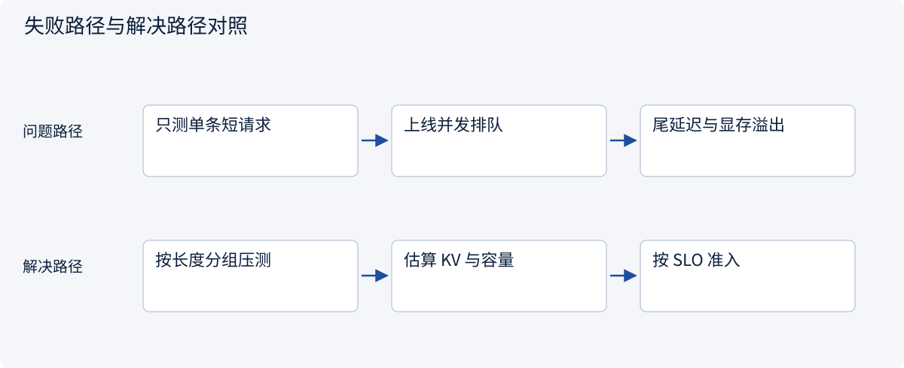
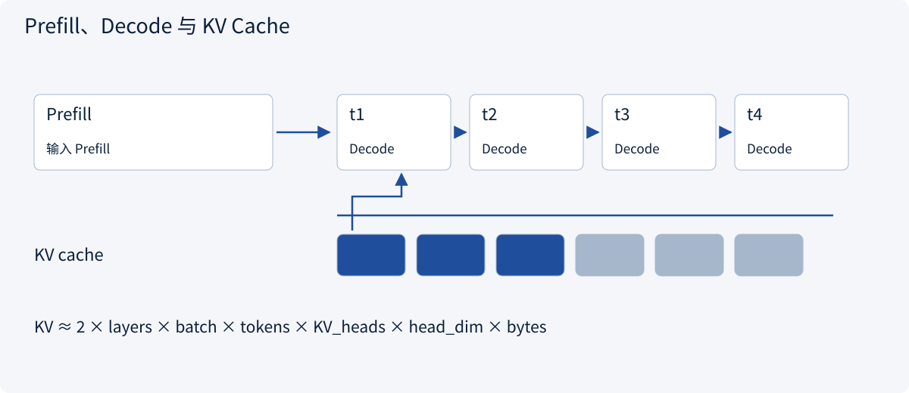
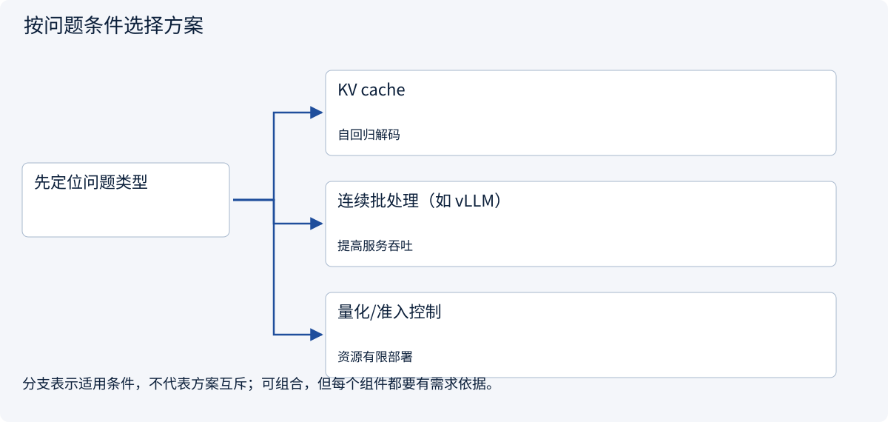
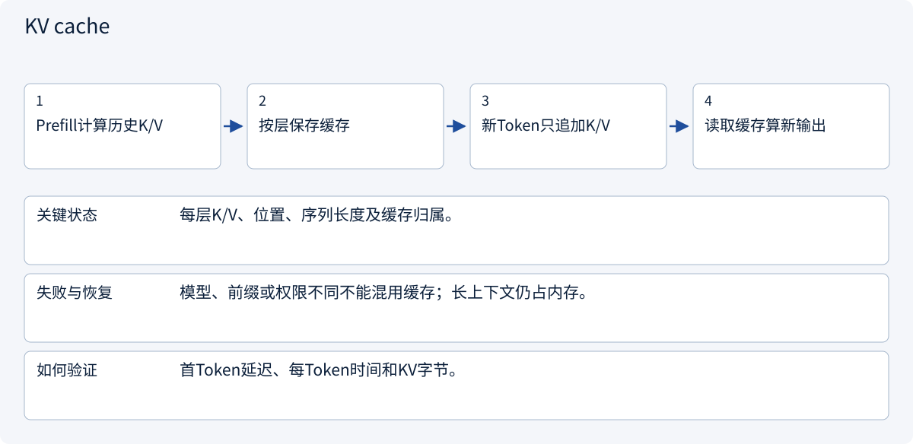
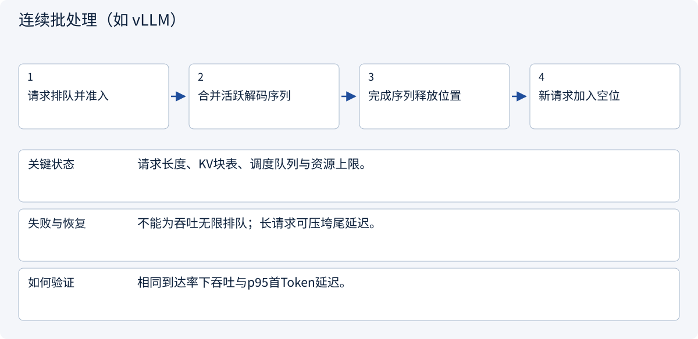
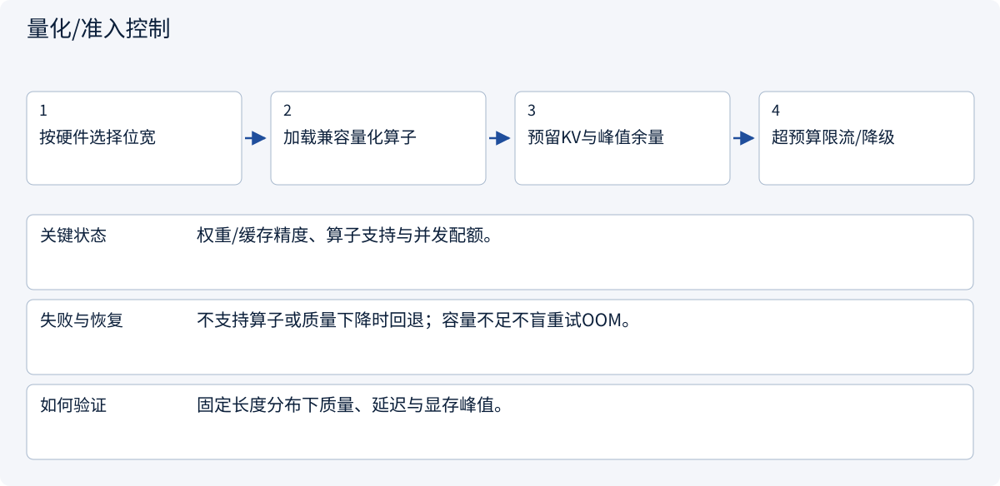

# 2.1.3 推理部署：延迟、吞吐、显存与评价

> 图解主线 · 对照主流方案 · 配参考代码

代码提供 KV 字节与准入的数值估算；缓存、连续批处理和量化收益须在真实服务与固定负载下验证。

## 先看问题

模型能运行，但长输入、长输出和并发请求使延迟与显存失控。




## 图解工作原理

分开测量 Prefill、Decode 和排队；KV cache 复用历史 K/V，批处理与量化需要按目标负载权衡。



## 主流方案怎么选



| 方案 | 怎样解决 | 适用条件 | 代价与边界 |
|---|---|---|---|
| KV cache | 复用历史 Key/Value | 自回归解码 | 长度与并发增加占用 |
| 连续批处理（如 vLLM） | 动态组织多请求 | 提高服务吞吐 | 可能增加排队与尾延迟 |
| 量化/准入控制 | 降低位宽或限制负载 | 资源有限部署 | 收益依硬件与精度验证 |

## 主流方案内部怎样运行

### 1 · KV cache



**具体推演：** B=1、32层、4096Token、8个KV头、头维128、每元素2字节：KV为512MiB，不含其他张量。

<details><summary>展开文字步骤、状态与失败边界</summary>

1. Prefill计算历史K/V
2. 按层保存缓存
3. 新Token只追加K/V
4. 读取缓存算新输出

**关键状态** 每层K/V、位置、序列长度及缓存归属。

**失败与恢复** 模型、前缀或权限不同不能混用缓存；长上下文仍占内存。

**如何验证** 首Token延迟、每Token时间和KV字节。

</details>

### 2 · 连续批处理（如 vLLM）



**具体推演：** vLLM类服务通过调度与KV管理提高利用率，但要按目标SLO测量。

<details><summary>展开文字步骤、状态与失败边界</summary>

1. 请求排队并准入
2. 合并活跃解码序列
3. 完成序列释放位置
4. 新请求加入空位

**关键状态** 请求长度、KV块表、调度队列与资源上限。

**失败与恢复** 不能为吞吐无限排队；长请求可压垮尾延迟。

**如何验证** 相同到达率下吞吐与p95首Token延迟。

</details>

### 3 · 量化/准入控制



**具体推演：** 权重能装入显卡，不代表还能容纳多用户长上下文。

<details><summary>展开文字步骤、状态与失败边界</summary>

1. 按硬件选择位宽
2. 加载兼容量化算子
3. 预留KV与峰值余量
4. 超预算限流/降级

**关键状态** 权重/缓存精度、算子支持与并发配额。

**失败与恢复** 不支持算子或质量下降时回退；容量不足不盲重试OOM。

**如何验证** 固定长度分布下质量、延迟与显存峰值。

</details>

## 参考代码

展开查看与本课机制对应的实现。训练函数仅提供代码，不执行实际训练；依赖与验证范围见配套代码说明。

[配套代码说明与验证范围](../projects/03-code-guide.md)

<details><summary>展开代码与实现边界</summary>

```python
"""Estimate a conventional MHA/GQA KV cache, excluding other allocations."""


def kv_bytes(
    layers: int,
    batch: int,
    length: int,
    kv_heads: int,
    head_dim: int,
    element_bytes: int = 2,
) -> int:
    dimensions = (layers, batch, length, kv_heads, head_dim, element_bytes)
    if any(value <= 0 for value in dimensions):
        raise ValueError("All dimensions must be positive")
    return 2 * layers * batch * length * kv_heads * head_dim * element_bytes


def admits_request(used_bytes: int, request_bytes: int, capacity_bytes: int) -> bool:
    if min(used_bytes, request_bytes, capacity_bytes) < 0:
        raise ValueError("Budgets cannot be negative")
    return used_bytes + request_bytes <= capacity_bytes


# Different architectures and cache quantization change this estimate.
```

</details>

## 改变条件，检查理解

吞吐提高但 p95 首 Token 延迟变差，算成功吗？

<details><summary>展开参考答案</summary>

取决于 SLO。离线吞吐和交互首 Token 是不同目标，必须在同负载条件比较。

</details>

<details><summary>按需展开：原理推导与边界补充</summary>

**一次生成有两个不同阶段**

Prefill 处理已知输入前缀，计算各层表示并产生可供后续复用的 Key/Value。Decode 逐步生成新 token，并读取已有缓存。输入长主要增加前缀处理成本，输出长会延长串行生成；只说“请求用了两秒”无法解释瓶颈。


KV cache 缓存历史 token 的 Key/Value，避免每步全部重算，但仍要关注不断增长的上下文。缓存不是长期记忆，也不会永久写入模型知识。跨请求前缀缓存还依赖精确前缀、模型配置和隔离策略；不能因为内容相似就认为能安全复用。

**估算缓存，理解并发限制**

对普通 MHA/GQA 的常见实现，一个粗略估算是：

```text
KV 字节数 ≈ 2 × 层数 × 批大小 × 序列长度 × KV 头数 × 每头维度 × 每元素字节数
```

因子 2 对应 K 和 V。取 32 层、批大小 1、4096 token、8 个 KV 头、每头 128 维、每元素 2 字节，约为 512 MiB。这里是估算，不含运行时、块管理和其他张量；不同架构、缓存精度与窗口注意力会改变公式。并发和上下文都翻倍时，缓存需求约变成 4 倍。

连续批处理把不同生命周期的请求组织在一起，改善硬件利用率；更大的批量可能提高吞吐，也可能增加排队与单请求延迟。量化降低权重或缓存存储成本，但速度收益取决于硬件、内核和任务，不能只看位宽。

**选择 API 还是自托管**

API 适合快速建立效果基线，省去模型服务运维；需要评价数据边界、版本变化、速率限制和成本。自托管允许控制权重、运行环境和数据路径，同时承担硬件、伸缩、内核兼容、监控和故障恢复。数据私有并不自动意味着只能用某一种方案，约束要具体到数据处理条件。

做容量规划时同时记录输入/输出长度分布、到达率、并发、首 token 延迟、每输出 token 时间、端到端延迟、错误率与每完成任务成本。p50 代表典型请求，p95/p99 揭示尾部体验；只用平均值会掩盖排队和超时。

**评价模型，也评价完整任务**

离线基准帮助缩小候选；真正选择时使用自己的合同、报价、缺失与对抗样本。保持提示、检索、工具预算可比。模型答案质量、JSON 格式、工具参数、权限拒绝和整个任务成功率分别统计。把超时请求排除在分母外会让结果失真。

超时后要区分“没有得到模型结果”和“外部动作结果未知”。前者可按预算重试，后者必须查询状态或走对账流程。这个区别将在 Agent runtime 中成为核心状态设计。

**练习与答案**

同一服务吞吐从 30 增至 50 token/s，但 p95 首 token 延迟从 1 秒变成 8 秒，能否直接认为优化成功？

<details><summary>参考答案</summary>

不能。更大批量可能提高总吞吐，却让交互请求排队更久。需要按使用场景评价：离线批任务看完成时间与成本，交互任务还要满足首 token 和端到端 SLO。记录负载、并发和长度分布，避免在不同条件下比较。

</details>


</details>

[查看官方资料与方案依据](../resources.md)
