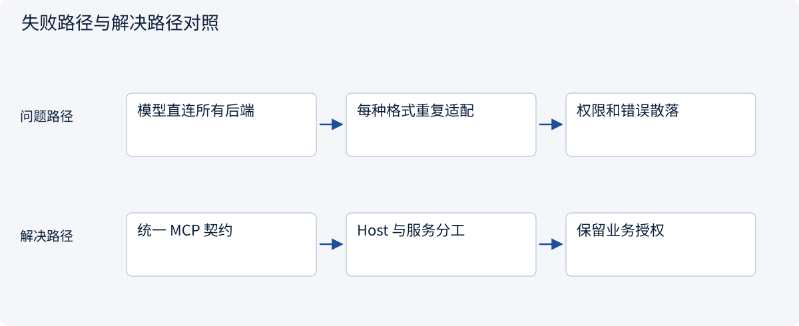
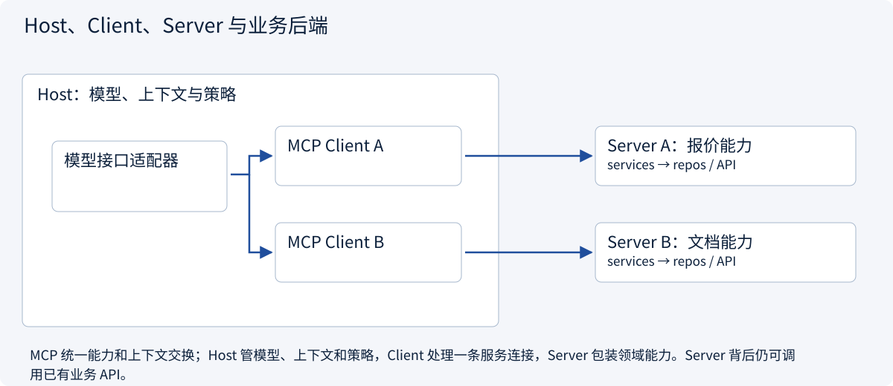
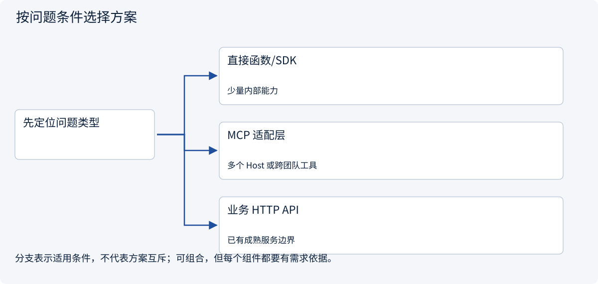

# 2.5.1 为什么需要协议，Host / Client / Server 各做什么？

> 图解主线 · 对照主流方案 · 配参考代码

本专题以 MCP 2026-07-28、官方 Python SDK 2.3.0 为基准；旧版握手另行标注。

## 先看问题

每接一个模型和一个工具都要写适配器，为什么统一成 MCP 仍然不能直接替你规划任务？




## 图解工作原理

MCP 统一能力和上下文交换；Host 管模型、上下文和策略，Client 处理一条服务连接，Server 包装领域能力。Server 背后仍可调用已有业务 API。



## 主流方案怎么选



| 方案 | 怎样解决 | 适用条件 | 代价与边界 |
|---|---|---|---|
| 直接函数/SDK | 在同一应用明确调用契约 | 少量内部能力 | 耦合各自接口 |
| MCP 适配层 | 通过协议列出和调用能力 | 多个 Host 或跨团队工具 | 仍需管理版本、认证和领域权限 |
| 业务 HTTP API | 暴露领域服务给各类客户端 | 已有成熟服务边界 | 可被 MCP 包装，不必重写业务 |

## 参考代码

展开查看与本课机制对应的实现。训练函数仅提供代码，不执行实际训练；依赖与验证范围见配套代码说明。

[配套代码说明与验证范围](../../../docs/zh/projects/03-code-guide.md)

<details><summary>展开代码与实现边界</summary>

```python
"""Discover real SDK tool schemas in memory, without a model or a subprocess."""


async def discover_capabilities() -> dict:
    from mcp import Client

    from .mcp_server_example import build_server

    async with Client(build_server()) as client:
        tools = await client.list_tools()
        return {
            "protocol": client.protocol_version,
            "tools": [
                {"name": tool.name, "input_schema": tool.input_schema}
                for tool in tools.tools
            ],
        }


# Host owns the model and policy. Client carries MCP messages. Server exposes capabilities.
```

</details>

## 一次报价问题究竟经过谁

1. 用户向 Host 提问“读出 A 的单价”。Host 选择报价服务及本任务允许的工具。
2. Client 发现 `read_quote` 及其参数契约；Host 把契约转换成所选模型支持的工具格式。
3. 模型提议 `quote_id=A`。Host 检查工具名、参数和任务范围，再通过 Client 发起 MCP 调用。
4. Server 的 handler 解析参数，service 校验对象权限，repo 读取虚构报价。返回 180 分/件及未知运费。
5. Host 把结果作为工具观察交回模型；报价是否可比较、报告是否完成，仍由应用验收。

**MCP 解决的是第 2–4 步之间的互操作契约。**模型选择、任务调度、上下文预算和采购审批没有因此消失。已有 HTTP API 可以由 MCP Server 包装，不要求推倒业务后端。


## 改变条件，检查理解

LLM 生成了一段 read_quote 的参数，它已经发送 MCP 请求了吗？

<details><summary>展开参考答案</summary>

没有。Host 先将模型调用映射为已授权的工具请求，再由 Client 发给 Server；模型输出不等于执行。

</details>

[查看官方资料与方案依据](../../../docs/zh/resources.md)
