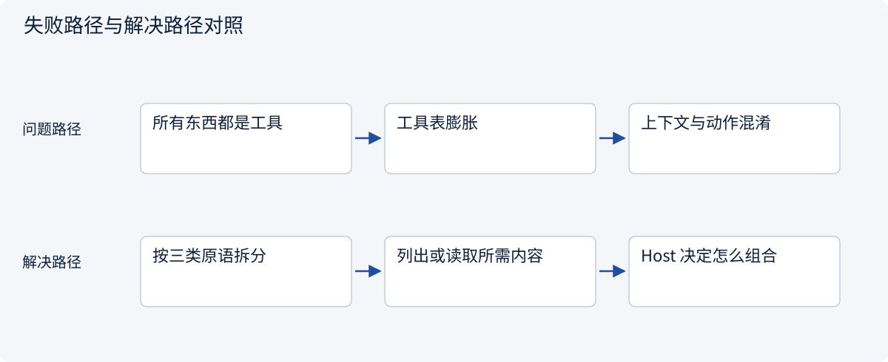
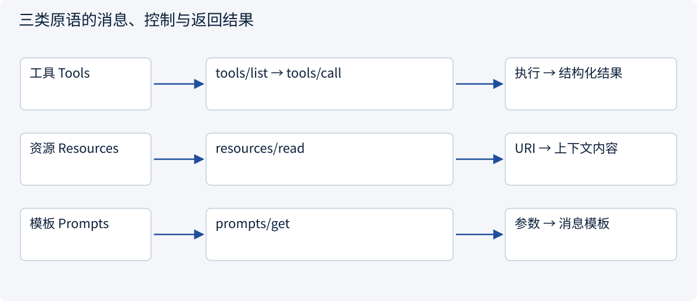
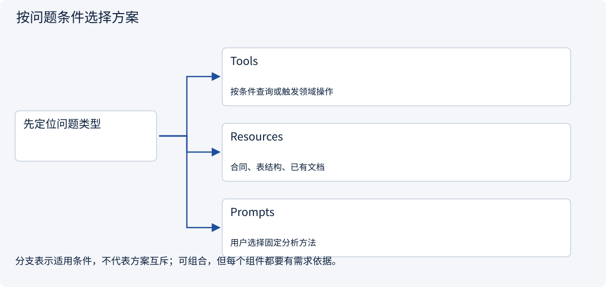

# 2.5.2 Tools、Resources、Prompts 怎么配合？

> 图解主线 · 对照主流方案 · 配参考代码

本专题以 MCP 2026-07-28、官方 Python SDK 2.3.0 为基准；旧版握手另行标注。

## 先看问题

读取报价、提供合同上下文、复用比较模板，为什么不全做成一个万能工具？



## 图解工作原理

Tool 是可执行能力，Resource 是由应用选用的上下文，Prompt 是可选择的交互模板。三者需要各自的发现、参数和授权规则，不能混为模型记忆。



## 主流方案怎么选



| 方案 | 怎样解决 | 适用条件 | 代价与边界 |
|---|---|---|---|
| Tools | tools/list 与 tools/call，包含输入/输出 Schema | 按条件查询或触发领域操作 | 是否只读不能只信注解 |
| Resources | resources/read 按 URI 取数据，模板另有列表 | 合同、表结构、已有文档 | 资源列表不保证包含所有模板实例 |
| Prompts | prompts/get 用参数渲染消息 | 用户选择固定分析方法 | 不是系统最高权限指令，也不会自行调用模型 |

## 参考代码

展开查看与本课机制对应的实现。训练函数仅提供代码，不执行实际训练；依赖与验证范围见配套代码说明。

[配套代码说明与验证范围](../../../docs/zh/projects/03-code-guide.md)

<details><summary>展开代码与实现边界</summary>

```python
"""The three server primitives do different work; none needs a model to be tested."""


async def inspect_primitives() -> dict:
    from mcp import Client

    from .mcp_server_example import build_server

    async with Client(build_server()) as client:
        tool = await client.call_tool("read_quote", {"quote_id": "A"})
        resource = await client.read_resource("quote://approved/A")
        prompt = await client.get_prompt("compare_quote", {"quote_id": "A"})
        return {
            "quotation": tool.structured_content,
            "context": [item.text for item in resource.contents],
            "template": [message.content.text for message in prompt.messages],
        }


# tools/call executes a capability; resources/read reads context; prompts/get renders a template.
```

</details>

## 同一份报价怎样分别暴露

| 需要 | 原语与消息 | 返回后发生什么 |
|---|---|---|
| 根据参数查询 A | `tools/list` → `tools/call` | 执行 `read_quote`，得到结构化字段与可能的执行错误 |
| 读取已批准报价正文 | `resources/list` 或模板发现 → `resources/read` | 返回 URI 内容；Host 决定是否选入上下文 |
| 选用比较方法模板 | `prompts/list` → `prompts/get` | 渲染消息，不自动调用模型，也不自动执行工具 |

`resources/list` 用于固定资源，`resources/templates/list` 描述可参数化 URI；不能假定模板的每个实例都在资源列表里。URI 是标识，不必是能用浏览器打开的网页地址。

`inputSchema` 描述输入，`outputSchema` 可描述结构化输出；展示文本在 `content`，程序可用字段在 `structuredContent`。当前 Python SDK 使用 `input_schema`、`structured_content` 等蛇形属性，SDK 负责线缆字段转换。一个只读 tool 仍可以执行查询；Resource 与 Tool 的区别不只是“有没有写权限”。


## 改变条件，检查理解

Server 返回 Prompt 模板，是否就启动了一个 Agent？

<details><summary>展开参考答案</summary>

没有。它返回消息模板；由 Host 决定是否采用、如何放入上下文以及何时调用模型。

</details>

[查看官方资料与方案依据](../../../docs/zh/resources.md)
