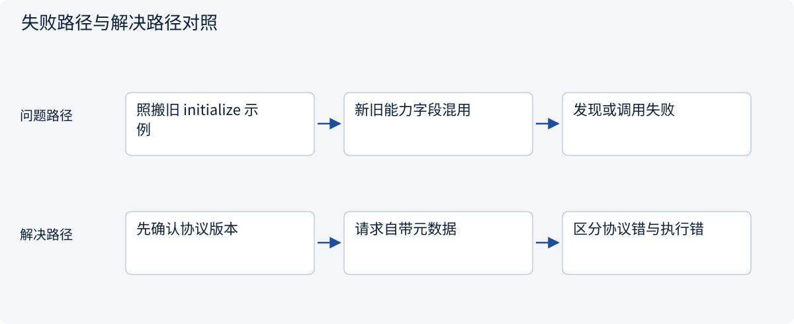
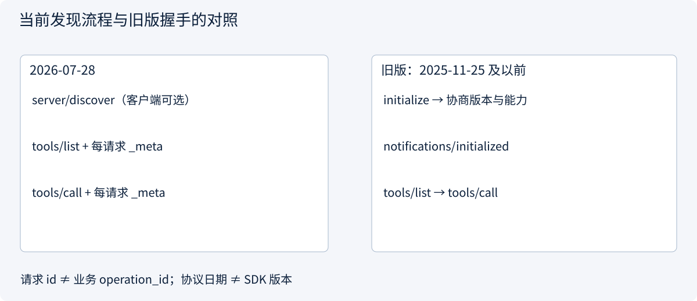
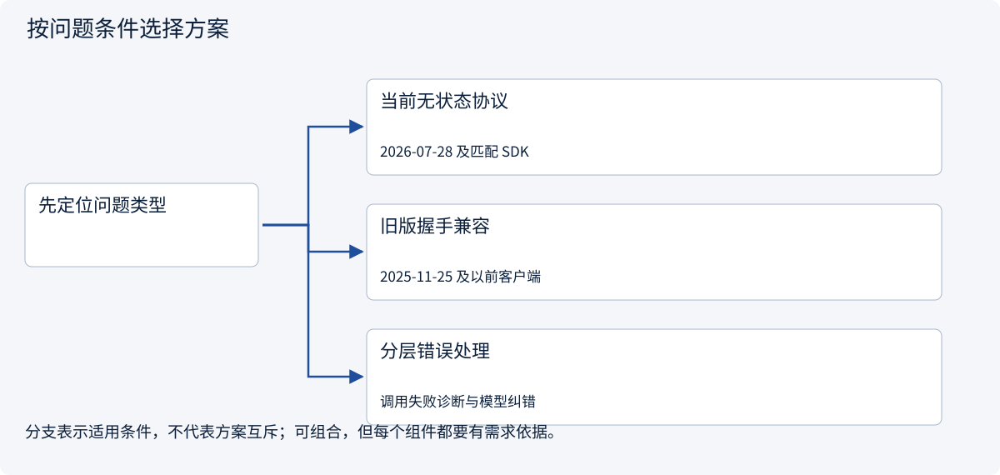

# 2.5.3 发现、JSON-RPC 与一次完整工具调用

> 图解主线 · 对照主流方案 · 配参考代码

本专题以 MCP 2026-07-28、官方 Python SDK 2.3.0 为基准；旧版握手另行标注。

## 先看问题

连上服务不代表工具可用；怎样识别版本、能力、请求、通知和两种错误？




## 图解工作原理

当前版本每个请求通过 _meta 携带版本等元数据；Client 可先调用 server/discover，再 tools/list 与 tools/call。请求 ID 只关联响应，不是幂等键。



## 主流方案怎么选



| 方案 | 怎样解决 | 适用条件 | 代价与边界 |
|---|---|---|---|
| 当前无状态协议 | 每请求声明版本，服务支持 server/discover | 2026-07-28 及匹配 SDK | 发现可缓存，权限和能力可能变化 |
| 旧版握手兼容 | initialize → initialized → operation | 2025-11-25 及以前客户端 | 要按旧规范/SDK实现，不能混接新流程 |
| 分层错误处理 | JSON-RPC error 与 result.isError 分开 | 调用失败诊断与模型纠错 | 工具成功仍需业务验收 |

## 参考代码

展开查看与本课机制对应的实现。训练函数仅提供代码，不执行实际训练；依赖与验证范围见配套代码说明。

[配套代码说明与验证范围](../../../docs/zh/projects/03-code-guide.md)

<details><summary>展开代码与实现边界</summary>

```python
"""Wire envelope examples, not a replacement for the official transport/SDK."""

PROTOCOL_VERSION = "2026-07-28"


def request(request_id: int, method: str, params: dict | None = None) -> dict:
    payload = dict(params or {})
    payload["_meta"] = {
        "io.modelcontextprotocol/protocolVersion": PROTOCOL_VERSION,
        "io.modelcontextprotocol/clientInfo": {
            "name": "teaching-client",
            "version": "1",
        },
    }
    return {"jsonrpc": "2.0", "id": request_id, "method": method, "params": payload}


def classify_response(message: dict) -> str:
    if "error" in message:
        return "protocol_error"
    result = message.get("result", {})
    if result.get("isError", False):
        return "tool_execution_error"
    if result.get("resultType") == "input_required":
        return "needs_follow_up"
    return "result_requires_business_validation"


# Request IDs correlate replies; they are not durable idempotency keys.
# 2025-11-25 and earlier used initialize + notifications/initialized instead.
```

</details>

## 看一条真实形状的当前请求

```json
{
  "jsonrpc": "2.0",
  "id": 3,
  "method": "tools/call",
  "params": {
    "name": "read_quote",
    "arguments": {"quote_id": "A"},
    "_meta": {"io.modelcontextprotocol/protocolVersion": "2026-07-28"}
  }
}
```

SDK 负责完整元数据和序列化；这里突出与模型生成的 `{quote_id:A}` 参数之间的区别。`server/discover` 是服务端必须实现、客户端可选择先调用的方法；发现结果可缓存，但不能缓存成永久权限。

| 层次 | 例子 | 处理 |
|---|---|---|
| HTTP/传输 | 401、403、连接中断、响应格式错误 | 检查认证、代理、超时与版本头；写结果不明时先对账 |
| JSON-RPC | 未知方法、非法参数、版本不兼容 | 根据错误修正请求或选择兼容版本，不无限重试 |
| 工具执行 | `result.isError=true` | 把失败作为观察，修正参数或停止；不伪装成成功事实 |
| 业务验收 | 返回合法报价但缺少交期证据 | 继续查证、追问或交付部分结果 |

**旧版单独看：**`2025-11-25` 及以前先 `initialize` 协商，再发不含 `id` 的 `notifications/initialized`，然后进入 operation。当前版不需要这套连接握手；不能只替换日期字符串来迁移。一般 JSON-RPC notification 不携带请求 `id`，也不期待对应响应。


## 改变条件，检查理解

tools/call 收到 result.isError=true，与 JSON-RPC error 是一回事吗？

<details><summary>展开参考答案</summary>

不是。前者是工具执行失败，后者是协议/请求层失败。两者也都不同于最终任务验收不通过。

</details>

[查看官方资料与方案依据](../../../docs/zh/resources.md)
