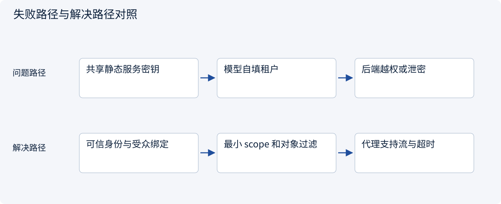
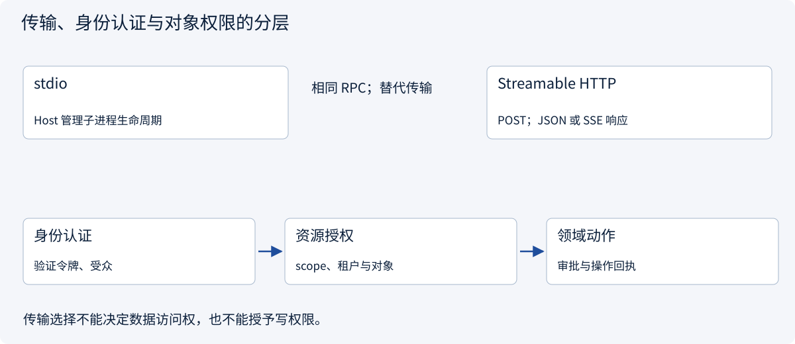
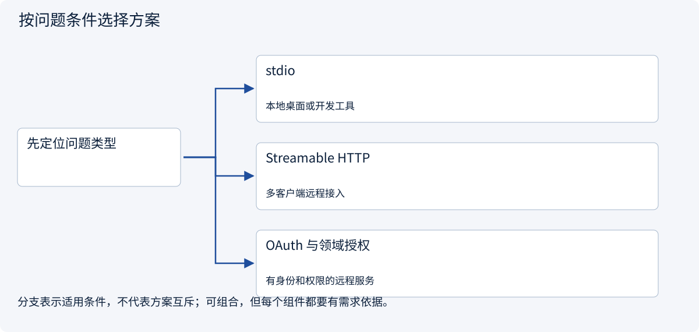

# 2.5.4 stdio、Streamable HTTP 与授权怎么选？

> 图解主线 · 对照主流方案 · 配参考代码

本专题以 MCP 2026-07-28、官方 Python SDK 2.3.0 为基准；旧版握手另行标注。

## 先看问题

本地演示能用，远程部署却出现 401、403、串租户或 SSE 被代理断开。该改哪一层？



## 图解工作原理

传输负责消息载体，认证证明身份，服务根据可信身份校验 scope 和对象。Streamable HTTP 可返回 JSON 或 SSE；它不等于旧 HTTP+SSE 传输。



## 主流方案怎么选



| 方案 | 怎样解决 | 适用条件 | 代价与边界 |
|---|---|---|---|
| stdio | SDK 启动子进程，以换行分隔消息 | 本地桌面或开发工具 | stdout 只能输出 MCP，进程需可靠关闭 |
| Streamable HTTP | 独立服务处理请求，可选择 SSE 响应 | 多客户端远程接入 | TLS、Origin、代理缓冲与超时需处理 |
| OAuth 与领域授权 | 获取面向 MCP 服务的令牌，再校验对象 | 有身份和权限的远程服务 | scope 不替代租户/文档权限；不透传上游 Token |

## 参考代码

展开查看与本课机制对应的实现。训练函数仅提供代码，不执行实际训练；依赖与验证范围见配套代码说明。

[配套代码说明与验证范围](../../../docs/zh/projects/03-code-guide.md)

<details><summary>展开代码与实现边界</summary>

```python
"""MCP SDK 2.3.0 transport references. No connection starts on import."""


async def list_local_tools() -> list[str]:
    import sys

    from mcp import Client, StdioServerParameters

    # Command and module are trusted Host configuration, never model-generated.
    # The official SDK owns subprocess startup, stream handling and shutdown.
    parameters = StdioServerParameters(
        command=sys.executable, args=["-m", "examples.mcp_server_example"]
    )
    async with Client(parameters) as client:
        result = await client.list_tools()
        return [tool.name for tool in result.tools]


async def list_remote_tools(endpoint: str, access_token: str) -> list[str]:
    import httpx2
    from mcp import Client
    from mcp.client.streamable_http import streamable_http_client

    if not endpoint.startswith("https://"):
        raise ValueError("Use TLS for a remote authenticated endpoint")
    async with httpx2.AsyncClient(
        headers={"Authorization": f"Bearer {access_token}"},
        timeout=httpx2.Timeout(30.0, read=300.0),
    ) as http_client:
        transport = streamable_http_client(endpoint, http_client=http_client)
        async with Client(transport) as client:
            result = await client.list_tools()
            return [tool.name for tool in result.tools]


# Obtain the token via your authorization flow; do not pass an upstream service token through.
# The HTTP server must validate audience/scope and resolve object access from trusted identity.
```

</details>

## 远程接入的四个边界

1. **传输：**stdio 由 SDK/Host 管理子进程与关闭；消息占用 stdout，日志去 stderr。选择它是协议场景所需，不是用任意 CLI 代替业务 SDK。
2. **HTTP：**Streamable HTTP 用请求携带 RPC，可返回 JSON，也可通过 SSE 交付消息。代理要正确传递版本与认证头，按部署要求配置流式响应和超时；不要照搬旧 `/sse` 接入路径。
3. **认证：**常见受保护远程服务使用 OAuth 获取面向该 MCP 服务的令牌。资源元数据帮助发现授权服务，客户端完成授权后携带访问令牌；服务验证受众、有效期与 scope。授权方案与部署需单独测试，示例不实现完整 OAuth 服务。
4. **领域授权：**从可信身份决定租户和可读报价。令牌合法不等于能读任意 quote_id；上游业务 Token 不能无校验透传，工具注解也不是安全策略。

示例 HTTP 客户端只展示已取得令牌后的调用方式，没有启动公开 HTTP Server。若扩展为网络服务，遵守项目端口约束，同时配置 TLS、Origin 检查、真实认证、最小权限和对象授权，不能直接把内存演示当成多租户部署。


## 改变条件，检查理解

工具参数包含 tenant=A，就能代表用户属于 A 吗？

<details><summary>展开参考答案</summary>

不能。身份和可访问范围来自经过验证的会话/令牌或可信本地配置，不来自模型生成的参数。

</details>

[查看官方资料与方案依据](../../../docs/zh/resources.md)
