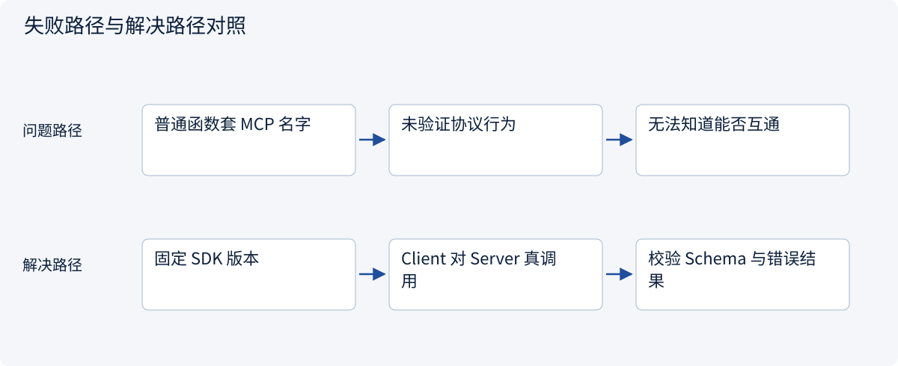
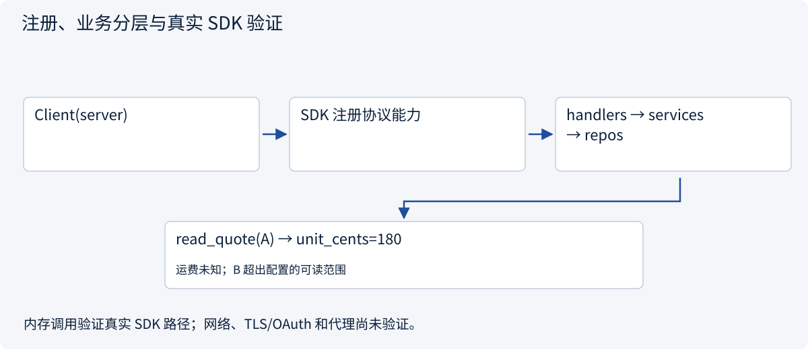
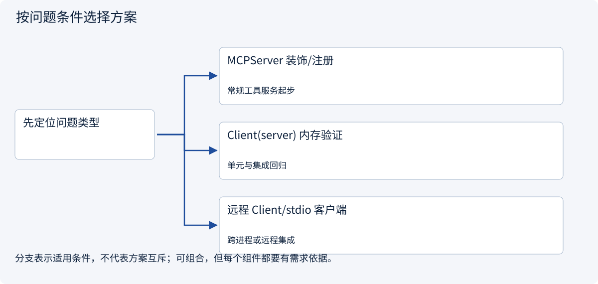

# 2.5.5 用官方 SDK 构建真实 Server 与 Client

> 图解主线 · 对照主流方案 · 配参考代码

本专题以 MCP 2026-07-28、官方 Python SDK 2.3.0 为基准；旧版握手另行标注。

## 先看问题

教程只给一个普通 Python 函数，却没有 MCP 发现、Schema 或真实客户端，如何补齐？



## 图解工作原理

用官方 SDK 2.3.0 的 MCPServer 注册三个原语，由 Client 真正发现和调用；业务权限仍经 handlers→services→repos。用内存连接验证，不依赖模型。



## 主流方案怎么选



| 方案 | 怎样解决 | 适用条件 | 代价与边界 |
|---|---|---|---|
| MCPServer 装饰/注册 | 类型注解生成输入契约 | 常规工具服务起步 | 注册不等于完整业务授权 |
| Client(server) 内存验证 | 真实 SDK 协议层但没有端口/子进程 | 单元与集成回归 | 不验证 TLS、代理或网络认证 |
| 远程 Client/stdio 客户端 | 替换传输接同一服务契约 | 跨进程或远程集成 | 仍须分别做传输与授权测试 |

## 参考代码

展开查看与本课机制对应的实现。训练函数仅提供代码，不执行实际训练；依赖与验证范围见配套代码说明。

[配套代码说明与验证范围](../../../docs/zh/projects/03-code-guide.md)

<details><summary>展开代码与实现边界</summary>

```python
"""Official Python SDK 2.3.0; protocol 2026-07-28. No external model required."""

from .mcp_app.domain import Quote
from .mcp_app.handlers import QuoteHandlers
from .mcp_app.repos import QuoteRepository
from .mcp_app.routes import register_capabilities
from .mcp_app.services import QuoteService


def build_server(allowed_ids: frozenset[str] = frozenset({"A"})):
    from mcp.server import MCPServer  # v2; not the v1 FastMCP import path.

    repository = QuoteRepository((Quote("A", 180, None), Quote("B", 170, 80)))
    handlers = QuoteHandlers(QuoteService(repository, allowed_ids))
    server = MCPServer("Quotation teaching server")
    register_capabilities(server, handlers)
    return server


if __name__ == "__main__":
    # stdio is a protocol-defined subprocess transport. stdout is reserved for MCP.
    # SDK clients own start/close/wait/kill; diagnostics belong on stderr.
    build_server().run(transport="stdio")
```

</details>

## 注册不是全部业务逻辑

示例暴露一个只读工具、一个资源、一个模板。MCP 注册层只绑定协议能力，handler 负责解析/错误映射，service 决定可读对象，repo 管虚构数据。

| 检查点 | 预期观察 |
|---|---|
| 发现工具 | 有 `read_quote`，`quote_id` 是必填字符串 |
| 调用 A | `unit_cents=180`，`shipping_cents=null`，不得伪造总价 |
| 调用范围外 B | 工具执行失败，不能读出其报价 |
| 读取 Resource | 返回 A 的文字上下文 |
| 获取 Prompt | 返回模板消息，不发送订单、不调用模型 |

本示例固定官方 `mcp==2.3.0`。v1 的 `from mcp.server.fastmcp import FastMCP` 不用于这份代码；v2 使用 `from mcp.server import MCPServer` 和 `from mcp import Client`。独立的 `fastmcp` 项目也不是这份依赖，不要混装教程 API。

内存连接使用真实 SDK 发现、参数验证与调用路径，不会启动子进程或开放端口。它不证明远程网络、OAuth、代理和其他 MCP Host 的兼容性；这些需要另做对应验收。


### 领域报价数据

与上方真实 SDK Server 装配为同一个实现。

<details><summary>展开代码与实现边界</summary>

```python
from dataclasses import dataclass


@dataclass(frozen=True)
class Quote:
    quote_id: str
    unit_cents: int
    shipping_cents: int | None
    currency: str = "CNY"
```

</details>

### 数据访问

与上方真实 SDK Server 装配为同一个实现。

<details><summary>展开代码与实现边界</summary>

```python
from .domain import Quote


class QuoteRepository:
    def __init__(self, quotes: tuple[Quote, ...]):
        self._quotes = {quote.quote_id: quote for quote in quotes}

    def read(self, quote_id: str) -> Quote:
        quote = self._quotes.get(quote_id)
        if quote is None:
            raise LookupError("Quotation not found")
        return quote
```

</details>

### 可信作用域与对象授权

与上方真实 SDK Server 装配为同一个实现。

<details><summary>展开代码与实现边界</summary>

```python
from .domain import Quote
from .repos import QuoteRepository


class QuoteService:
    def __init__(self, repository: QuoteRepository, allowed_ids: frozenset[str]):
        self._repository = repository
        self._allowed_ids = allowed_ids  # Trusted configuration, not model arguments.

    def read(self, quote_id: str) -> Quote:
        if quote_id not in self._allowed_ids:
            raise PermissionError("Quotation is outside the permitted scope")
        return self._repository.read(quote_id)
```

</details>

### 参数与协议错误映射

与上方真实 SDK Server 装配为同一个实现。

<details><summary>展开代码与实现边界</summary>

```python
from dataclasses import asdict

from .services import QuoteService


class QuoteHandlers:
    def __init__(self, service: QuoteService):
        self._service = service

    def read_quote(self, quote_id: str) -> dict[str, str | int | None]:
        """Read one authorized fictional quotation. No write or order action."""
        from mcp.server.mcpserver.exceptions import ToolError

        try:
            return asdict(self._service.read(quote_id))
        except (PermissionError, LookupError) as error:
            raise ToolError("Quotation unavailable in current scope") from error

    def quote_resource(self) -> str:
        """Read the approved quotation as textual context."""
        from mcp.server.mcpserver.exceptions import ResourceError

        try:
            quote = self._service.read("A")
        except (PermissionError, LookupError) as error:
            raise ResourceError("Quotation context unavailable") from error
        return f"Quote A: {quote.unit_cents} cents per unit; shipping unknown."

    def compare_prompt(self, quote_id: str) -> str:
        """Return a user-selectable template; this does not run a model."""
        return (
            f"Compare quotation {quote_id!r} using authorized sources. "
            "Keep missing shipping and unsupported facts unknown. Do not place an order."
        )
```

</details>

### 注册 Tool、Resource 与 Prompt

与上方真实 SDK Server 装配为同一个实现。

<details><summary>展开代码与实现边界</summary>

```python
from .handlers import QuoteHandlers


def register_capabilities(server, handlers: QuoteHandlers) -> None:
    # Registration only: parsing/error mapping is in handlers, business rules in services.
    server.tool(name="read_quote")(handlers.read_quote)
    server.resource("quote://approved/A")(handlers.quote_resource)
    server.prompt(name="compare_quote")(handlers.compare_prompt)
```

</details>

## 改变条件，检查理解

把内存测试通过写成“远程 OAuth 部署已通过”正确吗？

<details><summary>展开参考答案</summary>

不正确。内存测试验证发现、Schema、调用、原语与业务规则；没有验证网络、TLS、OAuth 或代理。

</details>

[查看官方资料与方案依据](../../../docs/zh/resources.md)
