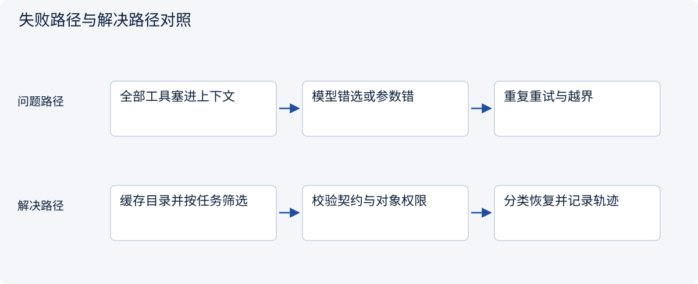
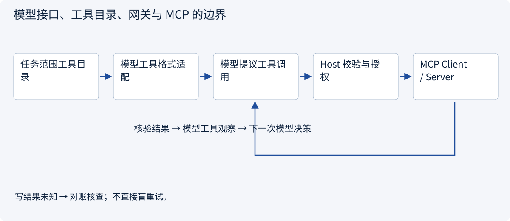
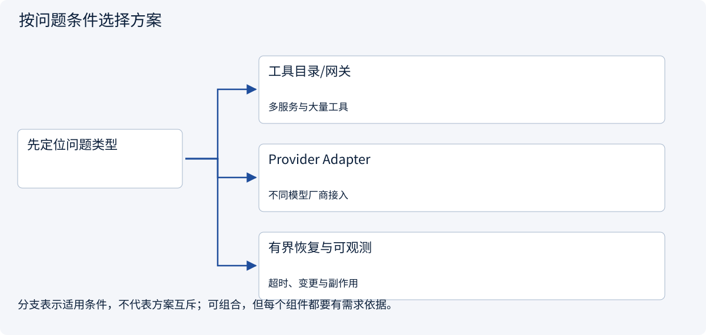

# 2.5.6 接入 Agent：工具膨胀、错误恢复与版本迁移

> 图解主线 · 对照主流方案 · 配参考代码

本专题以 MCP 2026-07-28、官方 Python SDK 2.3.0 为基准；旧版握手另行标注。

## 先看问题

接上十个 MCP Server 后工具太多、选错工具、版本不兼容；如何让它真正成为 Agent 的能力层？




## 图解工作原理

Host 按任务选择服务和工具，映射 Schema 到模型接口；调用前校验权限，调用后区分错误并回填观察。模型供应商接口不是 MCP，不能直接混传。



## 主流方案怎么选



| 方案 | 怎样解决 | 适用条件 | 代价与边界 |
|---|---|---|---|
| 工具目录/网关 | 按租户、任务、能力筛选工具，必要时惰性加载 | 多服务与大量工具 | 缓存需随 Schema/权限变化失效 |
| Provider Adapter | MCP Schema 映射模型工具定义，关联调用 ID | 不同模型厂商接入 | 不是所有 JSON Schema 都被模型支持 |
| 有界恢复与可观测 | 记录版本、工具、参数摘要和错误类别 | 超时、变更与副作用 | 未知写结果先对账；不能盲重试 |

## 参考代码

展开查看与本课机制对应的实现。训练函数仅提供代码，不执行实际训练；依赖与验证范围见配套代码说明。

[配套代码说明与验证范围](../../../docs/zh/projects/03-code-guide.md)

<details><summary>展开代码与实现边界</summary>

```python
"""Host-side validation before an MCP call; the server enforces object scope too."""


def check_quote_access(
    name: str,
    arguments: dict,
    allowed_tools: frozenset[str],
    allowed_quote_ids: frozenset[str],
):
    if name not in allowed_tools:
        raise PermissionError("Tool not exposed to this task")
    if name != "read_quote" or set(arguments) != {"quote_id"}:
        raise ValueError("Unexpected tool contract")
    if not isinstance(arguments["quote_id"], str):
        raise TypeError("quote_id must be a string")
    if arguments["quote_id"] not in allowed_quote_ids:
        raise PermissionError("Quotation outside task scope")


async def call_authorized(
    client,
    name: str,
    arguments: dict,
    allowed_tools: frozenset[str],
    allowed_quote_ids: frozenset[str],
):
    check_quote_access(name, arguments, allowed_tools, allowed_quote_ids)
    result = await client.call_tool(name, arguments)
    if result.is_error:
        raise RuntimeError("Tool execution failed; do not claim task completion")
    return result.structured_content


# A model-provider adapter must map MCP input_schema to the provider's tool format,
# correlate call IDs and return the observation in that provider's expected structure.
# MCP content remains untrusted evidence, not a new system instruction.
```

</details>

## 从“接通”到“可控使用”的落地结构

**工具膨胀：**先按可信租户与任务权限过滤服务，再按任务类别或检索选择少量工具。只把候选工具的 Schema 给模型；保存目录版本，工具列表或权限变化时让缓存失效。选择错误率、上下文 Token、调用成功率和漏掉必要工具的比例需要一起比较，不能只追求工具越少越好。

**Schema 映射：**MCP 定义不等于任意模型的函数格式。Provider Adapter 转换名称、说明和参数子集，保留映射表；模型不支持的 Schema 要显式降级或拒绝。回填时保持模型侧 tool-call id 与 MCP request id 的对应，业务 operation_id 则另存，不能混为一谈。

**结果与恢复：**Server 回传内容先验证结构与错误状态，再作为不可信观察进入上下文。读操作可以在预算内重试；外部写操作超时且结果未知时按稳定 operation_id 查询或对账。MCP 的任务/交互扩展需要检查双方能力，不会自动替应用实现持久化工作流。

**版本迁移：**当前版使用逐请求元数据和可选发现；旧握手、订阅和回调不能照搬。`sampling`、roots 等旧能力在当前规范中有弃用变化，不能据旧教程假定可用。目录缓存、工具 Schema 和客户端/服务端协议版本都应进入调试记录，日志不记录令牌。


## 改变条件，检查理解

MCP request id 与业务 operation_id 能共用一个随重试变化的编号吗？

<details><summary>展开参考答案</summary>

不应。前者匹配一次请求/响应；后者标识同一业务副作用，重试和恢复时必须稳定。

</details>

[查看官方资料与方案依据](../../../docs/zh/resources.md)
