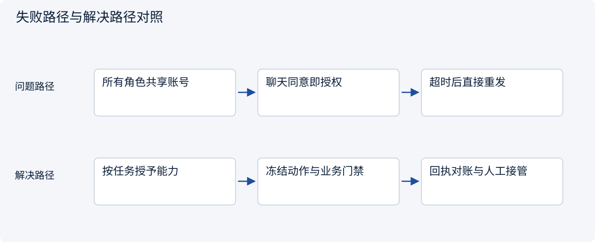
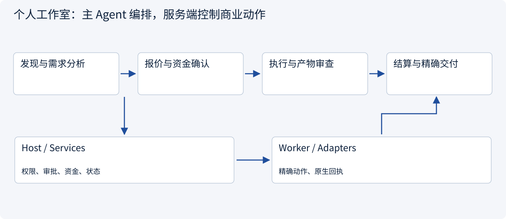
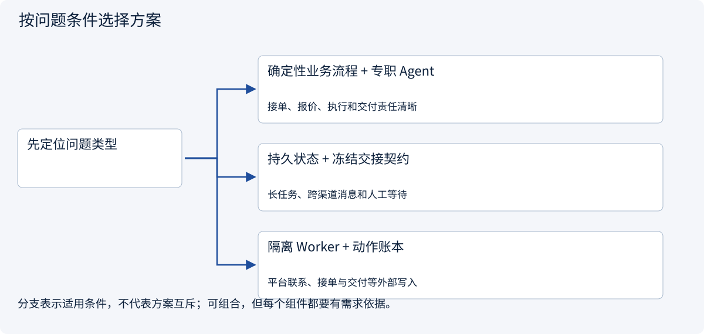
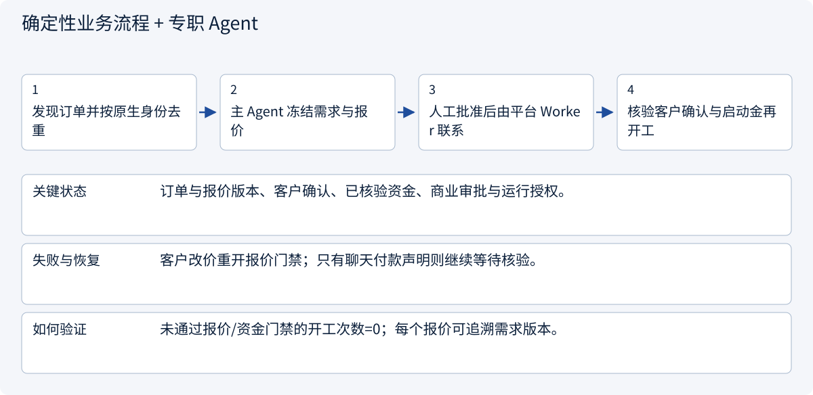
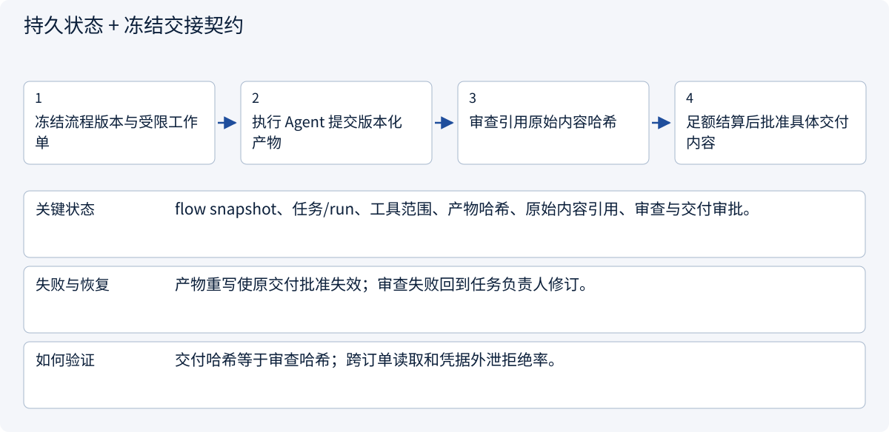
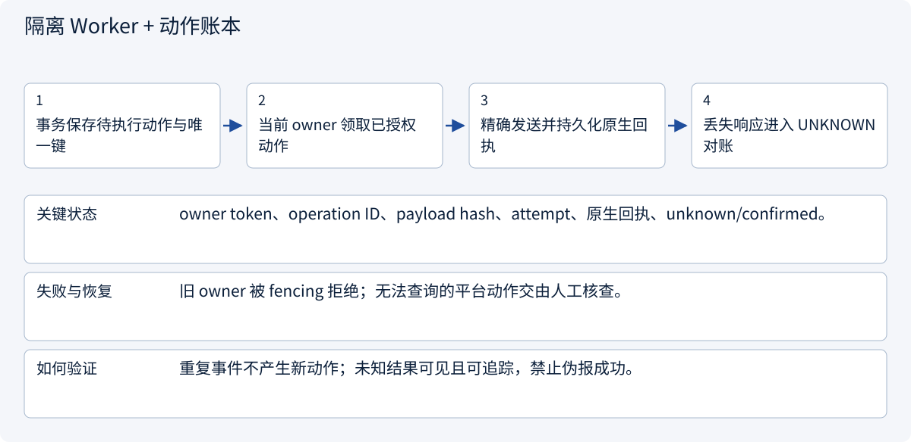
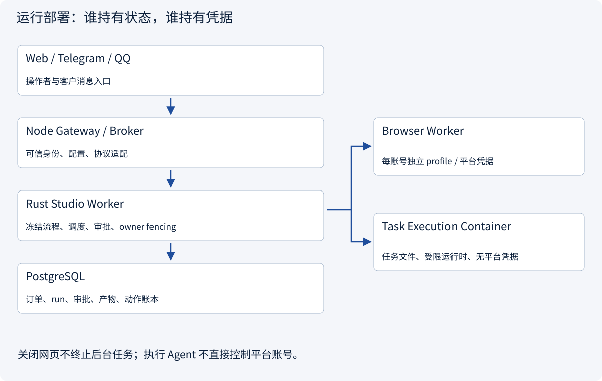
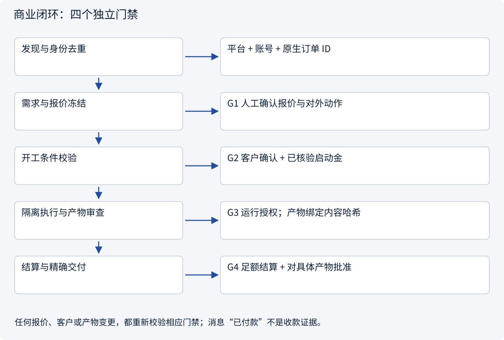
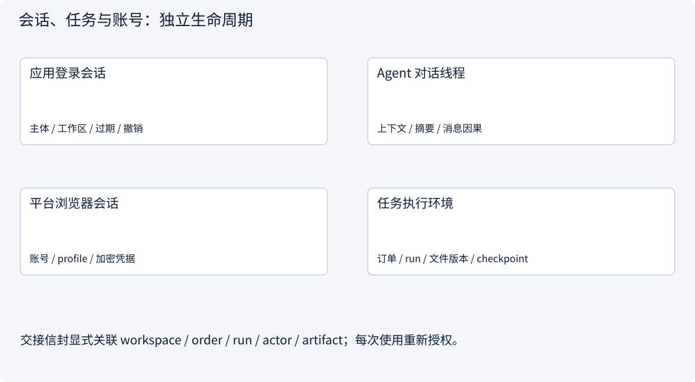
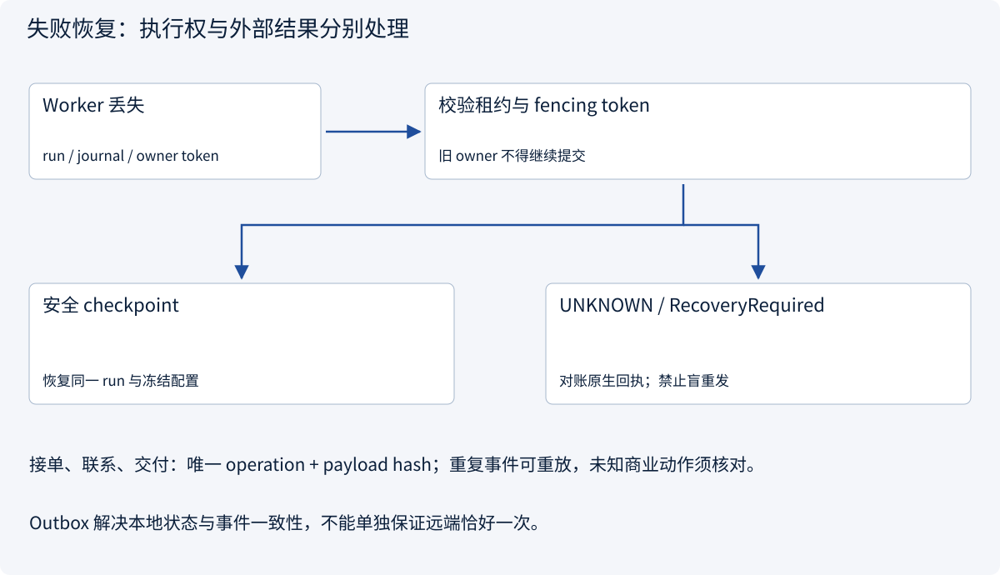

# 4.1 个人工作室：AI 接单到交付的多 Agent 架构

> 图解主线 · 对照主流方案 · 配参考代码

参考 ForgePilot 已有接单流程与运行边界，重新编写教学架构和纯 Python 门禁契约。案例区分已核验的项目机制、教学代码及待验证的生产集成。

## 先看问题

一个人经营 AI 接单工作室：谁负责找单、报价、执行与交付？网页关闭、Worker 崩溃、客户改价或回执丢失时，订单怎样继续且不越权？



## 图解工作原理

以订单为业务主线：主 Agent 解释需求、提出计划，专职 Worker 执行受限动作；服务端状态机、可信审批与资金证据决定能否推进。



## 主流方案怎么选



| 方案 | 怎样解决 | 适用条件 | 代价与边界 |
|---|---|---|---|
| 确定性业务流程 + 专职 Agent | 状态机控制门禁，模型处理需求与产物 | 接单、报价、执行和交付责任清晰 | 角色数量由任务需要决定 |
| 持久状态 + 冻结交接契约 | 订单版本、run、产物与审批显式关联 | 长任务、跨渠道消息和人工等待 | checkpoint 不等于远端恰好一次 |
| 隔离 Worker + 动作账本 | 账号凭据与任务执行分离；按原生回执对账 | 平台联系、接单与交付等外部写入 | 未知结果不能盲重发 |

## 主流方案内部怎样运行

### 1 · 确定性业务流程 + 专职 Agent



**具体推演：** 总价1000元、启动金300元：客户说“已付”不足以开工，须核验30000分的实际凭据。

### 2 · 持久状态 + 冻结交接契约



**具体推演：** 报告v3已批准；v4修改了附件，即使订单不变也必须重新审查交付。

### 3 · 隔离 Worker + 动作账本



**具体推演：** 平台已收到交付但响应丢失：保留原动作和内容，核对平台记录，不能生成新键重新发。

## 参考代码

展开查看与本课机制对应的实现。训练函数仅提供代码，不执行实际训练；依赖与验证范围见配套代码说明。

[配套代码说明与验证范围](../../../docs/zh/projects/03-code-guide.md)

<details><summary>展开代码与实现边界</summary>

```python
"""Pure studio business gates; trusted facts come from an authorized service.

These checks do not authenticate a caller, consume an approval, send a message,
or commit a payment. The governance/outbox examples implement those boundaries.
Amounts use integer minor units. A customer chat message is never payment proof.
"""

from dataclasses import dataclass
from enum import Enum


class GateError(ValueError):
    """The proposed transition lacks matching, current business evidence."""


class ApprovalKind(str, Enum):
    RUN = "run"
    QUOTE = "quote"
    DELIVERY = "delivery"


@dataclass(frozen=True)
class Order:
    workspace: str
    order_id: str
    revision: int
    customer: str
    quote_revision: int
    currency: str
    total_minor: int
    deposit_minor: int

    def __post_init__(self) -> None:
        if not all((self.workspace, self.order_id, self.customer)):
            raise GateError("missing order identity")
        if self.revision < 1 or self.quote_revision < 1:
            raise GateError("invalid revision")
        if len(self.currency) != 3 or not self.currency.isascii():
            raise GateError("currency must be an uppercase three-letter code")
        if not self.currency.isalpha() or not self.currency.isupper():
            raise GateError("currency must be an uppercase three-letter code")
        if type(self.total_minor) is not int or type(self.deposit_minor) is not int:
            raise GateError("amounts must be integer minor units")
        if not 0 < self.deposit_minor <= self.total_minor:
            raise GateError("require 0 < deposit <= total")


@dataclass(frozen=True)
class ApprovalFact:
    """Server-loaded fact, never accepted directly as a client's assertion."""

    kind: ApprovalKind
    order: Order
    expires_at: int
    authority_epoch: int
    artifact_hash: str = ""


@dataclass(frozen=True)
class PaymentFact:
    workspace: str
    order_id: str
    quote_revision: int
    currency: str
    cumulative_minor: int
    reference: str
    verified: bool


@dataclass(frozen=True)
class CustomerConfirmation:
    order: Order
    native_message_id: str


def require_approval(
    approval: ApprovalFact,
    kind: ApprovalKind,
    order: Order,
    now: int,
    authority_epoch: int,
    artifact_hash: str = "",
) -> None:
    if approval.kind != kind or approval.order != order:
        raise GateError("approval kind or immutable snapshot mismatch")
    if approval.expires_at <= now or approval.authority_epoch != authority_epoch:
        raise GateError("expired approval or changed authority")
    if approval.artifact_hash != artifact_hash:
        raise GateError("reviewed artifact differs")


def require_payment(order: Order, payment: PaymentFact, required_minor: int) -> None:
    expected = (order.workspace, order.order_id, order.quote_revision, order.currency)
    actual = (
        payment.workspace,
        payment.order_id,
        payment.quote_revision,
        payment.currency,
    )
    if actual != expected or not payment.verified or not payment.reference:
        raise GateError("payment evidence is unverified or belongs to another quote")
    if type(payment.cumulative_minor) is not int:
        raise GateError("invalid payment amount")
    if payment.cumulative_minor < required_minor:
        raise GateError("insufficient verified funds")


def require_start(
    order: Order,
    quote_approval: ApprovalFact,
    run_approval: ApprovalFact,
    confirmation: CustomerConfirmation,
    payment: PaymentFact,
    *,
    now: int,
    authority_epoch: int,
) -> None:
    """A run approval cannot substitute for quote approval or verified funds."""
    require_approval(quote_approval, ApprovalKind.QUOTE, order, now, authority_epoch)
    require_approval(run_approval, ApprovalKind.RUN, order, now, authority_epoch)
    if confirmation.order != order or not confirmation.native_message_id:
        raise GateError("customer has not confirmed this exact order")
    require_payment(order, payment, order.deposit_minor)


def require_delivery(
    order: Order,
    approval: ApprovalFact,
    payment: PaymentFact,
    artifact_hash: str,
    *,
    now: int,
    authority_epoch: int,
) -> None:
    if not artifact_hash:
        raise GateError("missing immutable artifact hash")
    require_approval(
        approval, ApprovalKind.DELIVERY, order, now, authority_epoch, artifact_hash
    )
    require_payment(order, payment, order.total_minor)


if __name__ == "__main__":
    order = Order("studio", "order-42", 1, "customer-7", 1, "CNY", 100000, 30000)
    quote = ApprovalFact(ApprovalKind.QUOTE, order, 200, 1)
    run = ApprovalFact(ApprovalKind.RUN, order, 200, 1)
    confirmation = CustomerConfirmation(order, "native-message-9")
    deposit = PaymentFact("studio", "order-42", 1, "CNY", 30000, "receipt-8", True)
    require_start(order, quote, run, confirmation, deposit, now=100, authority_epoch=1)
    print("Start gate passed; no external action performed")
```

</details>

## 场景、目标与设计依据

这是个人 AI 服务工作室的项目架构：操作者从平台发现需求，主 Agent 分析范围和报价，经过人工确认后联系客户；确认启动金后执行任务，审查成果并足额结算后再交付。例子采用总价1000元、启动金300元的报告订单。此金额只用于门禁测试，不是报价建议。

本轮只读核对 ForgePilot 的本地版本 `13d673c`：包括商业审批快照、资金校验、任务恢复和动作授权等实现。下面的部署分工来自该项目，角色划分、教学契约、评测门槛和实施阶段是本课程的设计建议。未修改 ForgePilot，也没有验证真实客户订单、平台支付或付费模型长任务。

### 先写清验收与边界

| 设计问题 | 本案例的明确选择 | 可检查的结果 |
|---|---|---|
| 自动化到哪一步 | 发现、分析、执行可自动；商业承诺、资金核验、最终交付经过明确门禁 | 每次外部写动作能定位批准人、精确内容及回执 |
| 为什么拆成多个 Agent | 平台身份、需求分析和隔离执行具有不同权限与生命周期 | 执行环境没有平台账号凭据；简单任务只开一个执行 Agent |
| 谁拥有最终事实 | 服务端订单、审批、产物与操作账本 | 模型文字不能覆盖状态、付款事实或审批记录 |
| 什么算完成 | 经审查的具体产物已按批准内容交付，并保存原生回执 | “生成成功”“发送意图”与“平台确认”分开统计 |

## 部署边界：UI、控制面与执行面



ForgePilot 的工作台采用 React/TypeScript，Node 层处理同源配置、代理和协议适配，Rust Studio Worker 持有后台流程与执行控制，PostgreSQL 保存权威状态。浏览器 Worker 按账号隔离会话；任务容器保存任务文件并受限执行，不能继承平台凭据。网页用于观察和控制，关闭网页不取消已持久化任务。

落地后端时仍按 routes → handlers → services → repos 分层：入口解析与可信身份、业务授权与事务、数据访问各有职责。多语言进程边界不能替代这些职责。小型工作室先保留一个业务控制面与少量 Worker，达到隔离或容量要求后再扩容。

## 角色与协作契约

| 角色 | 输入 → 产物 | 允许能力 | 必须停下的情况 |
|---|---|---|---|
| 发现 Worker | 平台查询 → 带原生订单ID的线索 | 指定账号的只读搜索 | 需登录或身份不匹配时等待处理，不跨账号代查 |
| 主 Agent | 线索、需求、历史 → 范围、报价、工作单 | 检索、分析、创建提案 | 缺验收口径、报价变化、客户要求超出范围 |
| 执行 Agent | 冻结工作单 → 版本化报告或代码 | 任务文件、受限计算、只读资料 | 缺输入、预算耗尽、需要新权限 |
| 审查 Agent / 人工 | 原始产物与验收表 → 问题清单、审查结果 | 读指定产物、执行明确检查 | 证据不足、内容变更、需要商业判断 |
| 平台动作 Worker | 已授权的精确动作 → 原生回执 | 指定账号、订单、动作和内容 | 哈希/版本不匹配、授权过期、结果未知 |
| 通知适配器 | 已提交事件 → 渠道回执 | 已绑定接收方的通知能力 | 身份绑定失效；不能把发通知当作订单交付 |

主 Agent 将工作单路由给唯一责任者；只对互相独立的资料采集并发。审查产物可以退回负责人修订，平台商业动作沿确定性流程推进，不由群聊投票授权。Agent 间传递 `workspace/order/task/run/sender/recipient/causation/deadline/artifact_ref`，交接必须显式确认。

原始产物引用包含内容哈希、字节数、源节点与版本、原 run、截断标记和回执ID。摘要便于理解，但不能替代被审查的完整原文。若有两个 Agent 给出相反付款判断，保留冲突并核验真实资金记录，不以多数意见更新事实。

## 四个独立门禁与订单状态



| 状态 | 推进事件 | 服务端必须核验 |
|---|---|---|
| discovered → scoped | 分析完成 | 平台原生身份去重；需求、客户、范围与验收版本齐全 |
| scoped → quote_review → customer_wait | 操作者批准，平台 Worker 联系 | 报价快照、收件对象、精确动作、当前授权、有效期 |
| customer_wait → ready | 客户确认及资金核验 | 确认对应当前报价；币种、订单、凭据、启动金满足要求 |
| ready → running | 运行授权与 Worker 领取 | 冻结流程、任务能力、预算、当前 owner token |
| running → artifact_review | 提交产物 | 原始内容已持久化，版本与哈希完整，检查结果可追踪 |
| artifact_review → settlement_wait | 审查通过 | 审查绑定具体内容；修改则回到审查 |
| settlement_wait → delivery_ready | 确认结清并批准交付 | 已核验累计金额≥总价；精确产物、账号和接收方一致 |
| delivery_ready → delivery_pending → completed | 执行并核验回执 | 单次消费授权、唯一操作记录、原生交付回执 |
| 任一外部动作 → reconciliation_required | 结果未知 | 保留原操作与载荷；查回执或人工对账，不能标成成功 |

这是教学状态机，不冒称 ForgePilot 的逐字枚举。取消前先判断是否已发生外部副作用；已发送内容不能靠本地回滚撤销。报价、客户或权限版本变化会使相关批准失效。启用自动运行不能取消商业门禁；必要的退款或补发是新动作，重新授权。

示例门禁代码只计算“当前业务条件是否满足”，输入假设已经由服务端可信加载。生产集成必须在同一事务中重新校验当前权限、消费批准、CAS 更新状态并创建唯一操作与 Outbox；不能把 `ApprovalFact` 当作客户端可自报的通行证。配套治理与 Outbox 代码分别展示这些事务约束。

## 会话、上下文、记忆怎样关联



应用登录会话决定当前操作者；Agent 线程承载推理上下文；平台浏览器会话绑定外部账号；任务环境承载文件与执行检查点。四者独立过期、撤销和恢复，不能用同一个 `session_id` 隐式代表全部权限。任务与订单可以活得比某次登录更久，新操作者继续处理前重新授权。

上下文只装载本订单所需需求、证据引用、当前状态、已授权能力和近期消息。报价经验、检查清单可以进入长期记忆；客户原文、凭据与订单事实按工作区和保留策略保存，记忆检索结果仍需对象权限校验。跨渠道消息按账号、会话和原生消息ID去重，以权威历史重建上下文，客户“已付款”的话只能成为待核验事项。

## Function Calling、MCP、Skills 在哪里

| 层 | 工作室中的用途 | 不能承担的职责 |
|---|---|---|
| Function Calling | 模型提出 `search_orders`、`propose_quote` 等结构化意图，Host 校验并执行 | 模型输出不授予账号权限，也不等于远端已执行 |
| MCP | 发现并调用可复用平台或资料能力；工具结果保留来源与错误 | MCP 连接建立不代表订单批准、付款或多 Agent 调度 |
| Skills | 按需装载需求访谈、估时、报价复核和交付审查方法，版本随 run 冻结 | 技能指令不能放宽权限、替代当前计划或批准商业动作 |

例如装载“报价复核”方法 → 模型以 Function Calling 提议查询资料 → Host 校验本订单能力 → MCP 调只读工具 → 结果回到报价提案 → 服务端请求人工审批。已有原生 API 或浏览器适配器也可直接由 Host 使用；不强制把所有内部调用包装成 MCP。

## 数据与一致性设计

| 权威记录 | 关键约束 | 典型冲突处理 |
|---|---|---|
| workflow_snapshot / order_revision | run 引用不可变流程；订单身份用平台/账号/原生ID | 流程更新只影响新版本，不热改在途商业动作 |
| task / run / work_unit | 单一负责人；owner token；预算与截止时间 | 旧 owner 提交被拒绝；依赖不齐不领取 |
| message / handoff | 原生去重键、因果、接收确认、原始材料引用 | 迟到和重复消息不覆盖新版本 |
| artifact / review | 内容哈希、字节数、来源与审查版本 | 内容变更重新审查，不静默覆盖已批准产物 |
| approval / payment_evidence | 当前权限、精确快照、有效期、单次消费；资金凭据引用 | 撤权、改价、换客户或币种不匹配均阻断推进 |
| operation / outbox / receipt | 唯一操作键、固定载荷、事务入队、原生回执 | 重复投递去重；未知结果对账，不换新键重发 |

数据库是业务事实源，向量库用于查找资料，模型会话用于思考；三者不互相替代。若以后选 Temporal，明确它负责执行历史，业务数据库负责订单与授权；跨系统一致性通过幂等命令与事件桥接，不声称单库事务可跨越工作流服务。

## 恢复、隔离与人工接管



ForgePilot 使用数据库领取与 owner fencing 等机制保护执行权，并依据持久化安全边界恢复任务。教学方案要求：保留同一 run、冻结配置和已提交产物；只有确认可重入的步骤自动恢复。模型或工具调用仍在途时保留未知状态，禁止把进程消失推断为调用失败。

平台 Worker 持有账号凭据；执行 Agent 只获得任务作用域文件、限额计算和必要网络能力。外部订单文本、网页和技能资源都当作不可信输入，不能覆盖服务端策略。隔离执行的资源限额、网络出口、挂载目录和取消边界由运行时实现；提示词和工作流确定性检查不构成 OS 安全隔离。

人工接管面板至少显示：停在哪个门禁、原始证据、具体待批准动作、冻结版本、最后回执和允许的恢复操作。处理人可以补证据、拒绝、重新报价或确认对账结果；每次变化记录操作者、原因与新版本，不能通过编辑聊天记录消除审计轨迹。

## 评测、监控与上线门槛

| 需要回答的问题 | 测试或监控方式 | 验收约束 |
|---|---|---|
| 多 Agent 是否值得 | 同批订单做单 Agent / 多 Agent 成对对照；固定工具、预算、模型版本 | 完整任务成功率、成本、p95、人工修订量分别报告；不杜撰收益 |
| 商业门禁是否有效 | 改客户/金额/币种/版本，伪造付款声明，先运行后审批 | 未授权接单、提前开工、未结清交付、错误产物交付均为0 |
| Worker 能否恢复 | 提交前后杀 Worker、双 owner、迟到消息、平台丢回执 | 状态/事件不分叉；旧 owner 被拒；未知动作不盲重发 |
| 能否定位阻塞 | 按 order/task/run/operation 关联 trace；记录排队、审批、运行、交付阶段耗时 | 对账积压、租约过期、预算耗尽、跨订单拒绝有责任人与告警 |
| 产物是否可靠 | 验收清单、证据覆盖、可重复检查；抽样人工审查 | 不以审查 Agent 的自评分代替客户验收 |

订单及操作ID用于 trace 与日志关联，避免作为指标高基数标签。指标按阶段、Worker类型和错误类别聚合。日志保留哈希、状态、耗时与必要引用，不写凭据或客户全文。门槛中的0是本案例要求，不是已经得到的生产统计。

## 多仓库参考与最终选型

核对日期：2026-11-13。参考仓库用于机制比较，不要求同时安装；以下“采用”是本课程的架构选择，不声称 ForgePilot 使用这些框架。

| 一手资料 | 它回答的问题 | 本案例采用或保留的边界 |
|---|---|---|
| ForgePilot 本地版本 `13d673c` | 接单、报价、启动金、隔离执行、交付怎样形成真实业务闭环 | 采用订单主线、商业门禁、冻结交接及账号/执行隔离；真实平台商业链仍待验证 |
| [LangGraph](https://github.com/langchain-ai/langgraph) 与 [interrupt 实现](https://github.com/langchain-ai/langgraph/blob/main/libs/langgraph/langgraph/types.py) | 有状态 Agent 怎样暂停并继续 | 采用持久化与明确续接思路；节点从头重入，批准前后副作用须另设幂等边界 |
| [Temporal Python SDK](https://github.com/temporalio/sdk-python) | 长业务流程怎样分离确定性控制与外部活动 | 作为持久执行候选；不与自建调度器同时争夺状态所有权，工作流 sandbox 不等于安全沙箱 |
| [CrewAI](https://github.com/crewAIInc/crewAI#understanding-flows-and-crews) | 角色自主协作与精确流程控制怎样组合 | 采用按专长组织工作单、业务流程包住自主环节的思路；不把角色名称当作权限 |
| [Microsoft Agent Framework](https://github.com/microsoft/agent-framework) | 顺序、并发、交接等协作模式怎样表达 | 作为多语言编排替代候选；[AutoGen](https://github.com/microsoft/autogen)已归档，仅作历史模式参考 |
| [MCP Python SDK](https://github.com/modelcontextprotocol/python-sdk) | 能力怎样统一暴露给 Host | 采用发现与调用契约；本课程固定SDK版本，业务授权仍归服务端 |
| [Agent Skills](https://github.com/agentskills/agentskills) | 工作方法怎样版本化并按需加载 | 采用元数据→正文→资源披露；技能不是权限票据或当前任务状态 |

本例先沿用一个持久业务控制面与专职 Worker，不为了展示框架同时引入多套调度器。迁移到 LangGraph 或 Temporal 前先决定谁持有执行历史、如何关联业务事务及如何处理未知外部动作，再以故障测试验收。

## 分阶段实施与本地验证

第一阶段完成只读线索、需求提案、冻结订单和人工报价；第二阶段接入资金证据、受限执行与产物审查；第三阶段添加精确交付、回执账本、故障恢复与监控。只有完整商业闭环通过验收后，才扩大自动化范围和并发。

```sh
python3 examples/studio_contracts.py
python3 -m unittest discover -s tests -p 'test_studio_contracts.py' -v
python3 -m unittest discover -s tests -p 'test_governance.py' -v
python3 -m unittest discover -s tests -p 'test_outbox_recovery.py' -v
```

这些检查覆盖局部门禁、授权事务和模拟远端恢复。没有部署整个工作室后端，没有验证真实客户身份、银行入账、平台发信和实际多 Agent 模型收益。后续复用的 Outbox 例子仍使用采购草稿字段，只展示事务机制，不能直接作为接单平台连接器。


### 事务与恢复入口

可复用的 SQLite 事务与模拟远端机制；接入工作室须替换采购领域字段并保留门禁与幂等约束。

<details><summary>展开代码与实现边界</summary>

```python
"""Read this assembly with the layered implementation and independent schema.

A local demonstration of atomic queueing and lost-response recovery; no queue
service, model, training, network call or real purchase is started by import.
"""

from .outbox.handlers import DraftHandler
from .outbox.repos import OutboxRepository
from .outbox.routes import enqueue_entry
from .outbox.services import DraftService


def enqueue_approved(
    connection, request: dict, trusted_tenants: frozenset[str], now: int
):
    service = DraftService(OutboxRepository(connection))
    return enqueue_entry(DraftHandler(service), request, trusted_tenants, now)


# Core transaction: validate approval → CAS approved/queued → INSERT unique Outbox → commit.
# Delivery: persist unknown → lookup/create_or_get same key → commit receipt.
# Never infer remote failure from timeout; require dedup/query or manual reconciliation.
# The full repository, service and schema are reproduced in the architecture appendix.
```

</details>

### 幂等远端契约

可复用的 SQLite 事务与模拟远端机制；接入工作室须替换采购领域字段并保留门禁与幂等约束。

<details><summary>展开代码与实现边界</summary>

```python
from dataclasses import dataclass
from typing import Protocol


@dataclass(frozen=True)
class Operation:
    operation_id: str
    task_id: str
    tenant: str
    payload: str
    fingerprint: str
    state: str
    receipt: str | None


class IdempotentDraftBackend(Protocol):
    """Adapter MUST deduplicate key+payload and reject key reuse with changed payload."""

    def create_or_get(self, operation_id: str, payload: str) -> str: ...

    def lookup(self, operation_id: str) -> str | None: ...
```

</details>

### 审批入队与未知结果恢复

可复用的 SQLite 事务与模拟远端机制；接入工作室须替换采购领域字段并保留门禁与幂等约束。

<details><summary>展开代码与实现边界</summary>

```python
"""Transactional queueing and a separate idempotent effect/reconciliation boundary."""

import hashlib

from .domain import IdempotentDraftBackend
from .repos import OutboxRepository


class DraftService:
    def __init__(self, repository: OutboxRepository):
        self.repository = repository

    @staticmethod
    def validate_approval(task: dict, now: int) -> None:
        # Stored payload is canonical JSON from the trusted approval service.
        actual_hash = hashlib.sha256(task["payload"].encode()).hexdigest()
        if (
            task["approved_until"] <= now
            or task["approved_hash"] != actual_hash
            or task["fingerprint"] != actual_hash
        ):
            raise PermissionError("Approval expired or payload changed")

    def enqueue(
        self,
        tenant: str,
        task_id: str,
        operation_id: str,
        now: int,
        allowed_tenants: frozenset[str],
    ) -> None:
        if tenant not in allowed_tenants:
            raise PermissionError("Tenant outside trusted identity scope")
        with self.repository.transaction():
            task = self.repository.task(task_id, tenant)
            if task["state"] != "approved":
                raise ValueError("Expected approved task; reconcile existing operation")
            self.validate_approval(task, now)
            # CAS + unique event insert share ONE transaction. Insert failure rolls back CAS.
            self.repository.queue(task, operation_id)

    def deliver(
        self, tenant: str, operation_id: str, backend: IdempotentDraftBackend, now: int
    ) -> str:
        # Worker identity/tenant selection is supplied by trusted dispatch infrastructure.
        # This is synchronous local polling, not a deployed broker/lease implementation.
        with self.repository.transaction():
            operation = self.repository.operation(operation_id, tenant)
            if operation.state == "confirmed":
                assert operation.receipt is not None
                return operation.receipt
            self.repository.mark_unknown(operation)
        # Persist uncertainty BEFORE network I/O. A crash after a successful remote write
        # leaves 'unknown', so recovery queries the same key instead of inventing a new one.
        receipt = backend.lookup(operation_id)
        if receipt is None:
            # An expired approval does not prevent looking up an earlier effect,
            # but it must prevent starting a fresh write attempt.
            with self.repository.transaction():
                task = self.repository.task(operation.task_id, tenant)
                self.validate_approval(task, now)
                if task["payload"] != operation.payload:
                    raise PermissionError("Queued payload changed")
            receipt = backend.create_or_get(operation_id, operation.payload)
        with self.repository.transaction():
            self.repository.confirm(operation, receipt)
        return receipt
```

</details>

### 同一事务中的 CAS 与 Outbox

可复用的 SQLite 事务与模拟远端机制；接入工作室须替换采购领域字段并保留门禁与幂等约束。

<details><summary>展开代码与实现边界</summary>

```python
"""SQLite persistence; services own transaction scope, repositories execute it."""

import sqlite3
from contextlib import contextmanager
from pathlib import Path

from .domain import Operation


class OutboxRepository:
    def __init__(self, connection: sqlite3.Connection):
        self.connection = connection
        self.connection.row_factory = sqlite3.Row

    def initialize(self) -> None:
        self.connection.execute("PRAGMA foreign_keys=ON")
        self.connection.executescript(
            Path(__file__).with_name("schema.sql").read_text()
        )

    @contextmanager
    def transaction(self):
        # Explicit begin also works with isolation_level=None; no network inside it.
        self.connection.execute("BEGIN IMMEDIATE")
        try:
            yield
            self.connection.commit()
        except BaseException:
            self.connection.rollback()
            raise

    def seed_approved(self, task_id, tenant, payload, fingerprint, expires_at) -> None:
        """Fixture only: real approval issuance must authenticate the approver."""
        with self.transaction():
            self.connection.execute(
                "INSERT INTO tasks VALUES (?, ?, ?, ?, ?, ?, ?, 1)",
                (
                    task_id,
                    tenant,
                    payload,
                    fingerprint,
                    fingerprint,
                    expires_at,
                    "approved",
                ),
            )

    def task(self, task_id: str, tenant: str) -> dict:
        row = self.connection.execute(
            "SELECT * FROM tasks WHERE task_id=? AND tenant=?", (task_id, tenant)
        ).fetchone()
        if row is None:
            raise LookupError("Task unavailable in tenant scope")
        return dict(row)

    def queue(self, task: dict, operation_id: str) -> None:
        changed = self.connection.execute(
            "UPDATE tasks SET state='queued',version=version+1 "
            "WHERE task_id=? AND tenant=? AND version=? AND state='approved'",
            (task["task_id"], task["tenant"], task["version"]),
        ).rowcount
        if changed != 1:
            raise RuntimeError("Stale task state/version")
        self.connection.execute(
            "INSERT INTO outbox VALUES (?, ?, ?, ?, ?, ?, NULL)",
            (
                operation_id,
                task["task_id"],
                task["tenant"],
                task["payload"],
                task["fingerprint"],
                "pending",
            ),
        )

    def operation(self, operation_id: str, tenant: str) -> Operation:
        row = self.connection.execute(
            "SELECT * FROM outbox WHERE operation_id=? AND tenant=?",
            (operation_id, tenant),
        ).fetchone()
        if row is None:
            raise LookupError("Operation unavailable in tenant scope")
        return Operation(**dict(row))

    def mark_unknown(self, operation: Operation) -> None:
        self.connection.execute(
            "UPDATE outbox SET state='unknown' WHERE operation_id=? AND state='pending'",
            (operation.operation_id,),
        )
        self.connection.execute(
            "UPDATE tasks SET state='executing',version=version+1 "
            "WHERE task_id=? AND state='queued'",
            (operation.task_id,),
        )

    def confirm(self, operation: Operation, receipt: str) -> None:
        # Repeated identical receipts are safe; contradictory receipts need investigation.
        old = self.operation(operation.operation_id, operation.tenant)
        if old.receipt is not None and old.receipt != receipt:
            raise RuntimeError("Conflicting remote receipts")
        self.connection.execute(
            "UPDATE outbox SET state='confirmed',receipt=? WHERE operation_id=?",
            (receipt, operation.operation_id),
        )
        self.connection.execute(
            "UPDATE tasks SET state='confirmed',version=version+1 "
            "WHERE task_id=? AND state!='confirmed'",
            (operation.task_id,),
        )
```

</details>

### 数据库约束与状态

<details><summary>展开代码与实现边界</summary>

```sql
CREATE TABLE tasks (
    task_id TEXT PRIMARY KEY,
    tenant TEXT NOT NULL,
    payload TEXT NOT NULL,
    fingerprint TEXT NOT NULL,
    approved_hash TEXT NOT NULL,
    approved_until INTEGER NOT NULL,
    state TEXT NOT NULL CHECK (state IN ('approved', 'queued', 'executing', 'confirmed')),
    version INTEGER NOT NULL
);
CREATE TABLE outbox (
    operation_id TEXT PRIMARY KEY,
    task_id TEXT NOT NULL UNIQUE REFERENCES tasks(task_id),
    tenant TEXT NOT NULL,
    payload TEXT NOT NULL,
    fingerprint TEXT NOT NULL,
    state TEXT NOT NULL CHECK (state IN ('pending', 'unknown', 'confirmed')),
    receipt TEXT
);
```

</details>

## 改变条件，检查理解

允许 Agent 自动运行，是否就允许它自动改价、认可付款并提交任意新版本成果？

<details><summary>展开参考答案</summary>

不允许。运行授权、商业报价、资金证据和具体产物交付分别校验；任何作用域、报价或产物变化都重新通过相应门禁。

</details>

[查看官方资料与方案依据](../../../docs/zh/resources.md)
