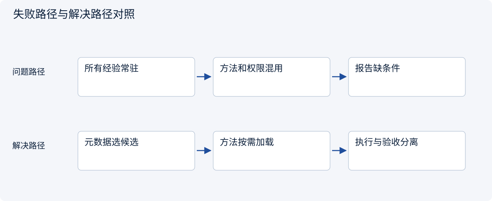
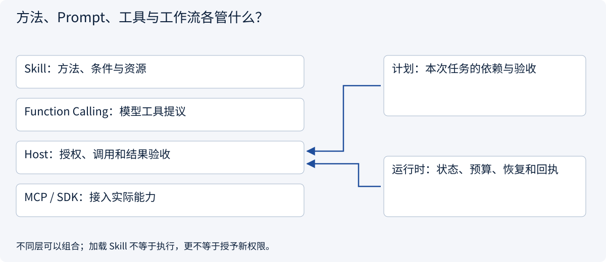
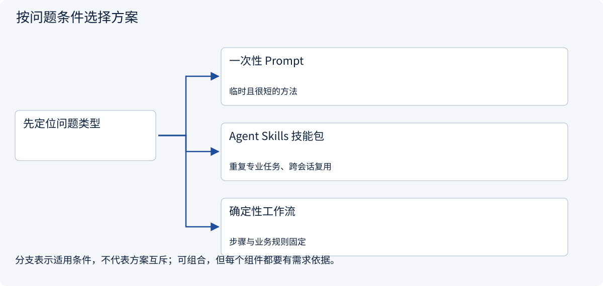
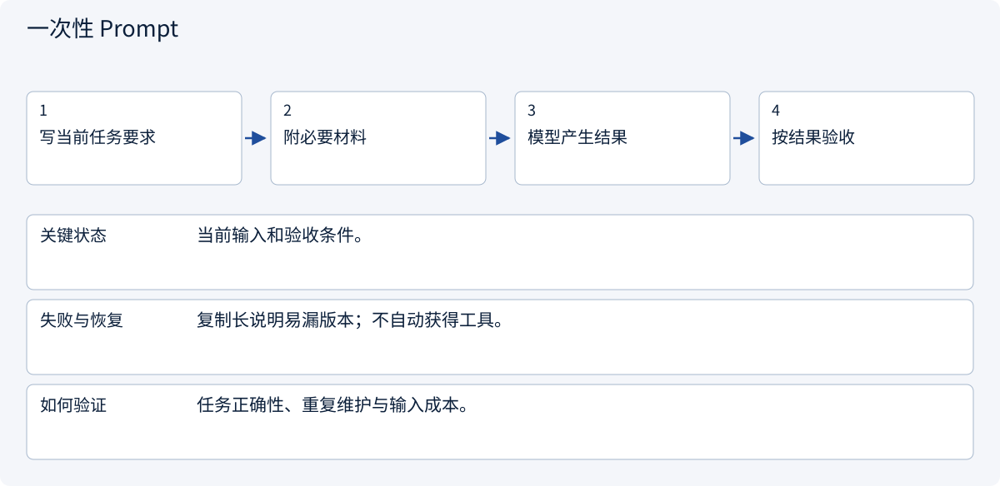
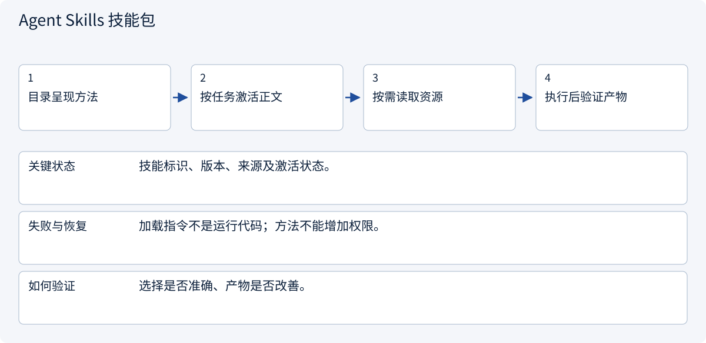
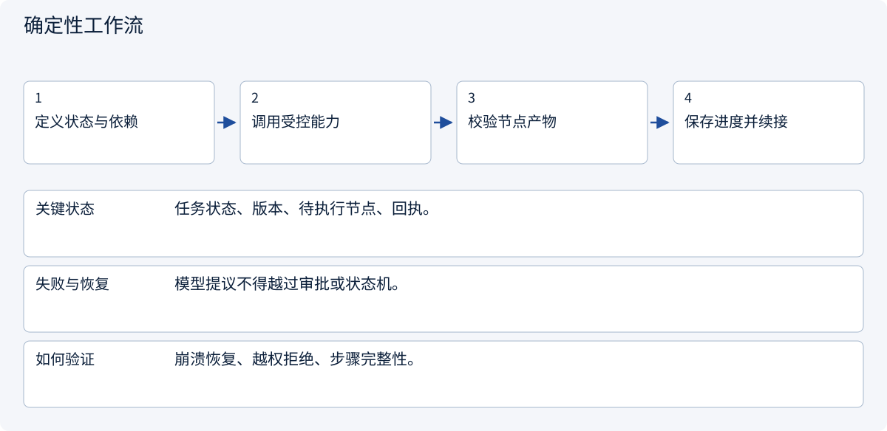

# 2.6.1 方法、Prompt、工具与工作流各管什么？

> 图解主线 · 对照主流方案 · 配参考代码

基于 Agent Skills 公开格式；版本、摘要固定与工具绑定是本例 Host 约定，不是通用执行权限。

## 先看问题

把操作经验复制进每次 Prompt，为什么仍然选错工具、遗漏条件？把它存成 Skill 就会自动执行吗？




## 图解工作原理

Skill 打包可复用方法与配套资源；模型选择方法并提出动作，Host 管上下文、执行与权限。计划描述本次依赖，MCP 提供外部能力接入。



## 主流方案怎么选



| 方案 | 怎样解决 | 适用条件 | 代价与边界 |
|---|---|---|---|
| 一次性 Prompt | 在当前任务直接交代要求 | 临时且很短的方法 | 易重复、难版本化 |
| Agent Skills 技能包 | 按需加载方法及引用资源 | 重复专业任务、跨会话复用 | 需要发现、触发和版本管理 |
| 确定性工作流 | 程序决定路径与验收 | 步骤与业务规则固定 | 不适合把所有开放推理写成分支 |

## 主流方案内部怎样运行

### 1 · 一次性 Prompt



**具体推演：** 一次性改写段落用短 Prompt 即可。

<details><summary>展开文字步骤、状态与失败边界</summary>

1. 写当前任务要求
2. 附必要材料
3. 模型产生结果
4. 按结果验收

**关键状态** 当前输入和验收条件。

**失败与恢复** 复制长说明易漏版本；不自动获得工具。

**如何验证** 任务正确性、重复维护与输入成本。

</details>

### 2 · Agent Skills 技能包



**具体推演：** 报价审查技能规定保留未知运费，实际报价由工具提供。

<details><summary>展开文字步骤、状态与失败边界</summary>

1. 目录呈现方法
2. 按任务激活正文
3. 按需读取资源
4. 执行后验证产物

**关键状态** 技能标识、版本、来源及激活状态。

**失败与恢复** 加载指令不是运行代码；方法不能增加权限。

**如何验证** 选择是否准确、产物是否改善。

</details>

### 3 · 确定性工作流



**具体推演：** 创建草稿前审批由服务规则落实，不只写在 Skill 里。

<details><summary>展开文字步骤、状态与失败边界</summary>

1. 定义状态与依赖
2. 调用受控能力
3. 校验节点产物
4. 保存进度并续接

**关键状态** 任务状态、版本、待执行节点、回执。

**失败与恢复** 模型提议不得越过审批或状态机。

**如何验证** 崩溃恢复、越权拒绝、步骤完整性。

</details>

## 参考代码

展开查看与本课机制对应的实现。训练函数仅提供代码，不执行实际训练；依赖与验证范围见配套代码说明。

[配套代码说明与验证范围](../projects/03-code-guide.md)

<details><summary>展开代码与实现边界</summary>

```python
"""Assemble the example Host; no scanning of user-installed skills or execution."""

import json
from pathlib import Path

from .skill_app.domain import Policy, RegistryEntry, Session
from .skill_app.repos import SkillRepository
from .skill_app.services import SkillService


def build_host(root: Path | None = None) -> tuple[SkillService, Session]:
    base = root or Path(__file__).with_name("skills")
    manifest = json.loads((base / "registry.json").read_text())
    registry = {
        name: RegistryEntry(
            row["version"],
            row["sha256"],
            tuple(row["bindings"]),
            row["metadata_sha256"],
        )
        for name, row in manifest.items()
    }
    service = SkillService(SkillRepository(base), registry, frozenset({"read_quote"}))
    session = Session(
        Policy(frozenset({"quote-review"}), frozenset({"read_quote"}), frozenset({"A"}))
    )
    return service, session


# Registry hashes/bindings are trusted deployment configuration, not model-generated.
# Do not auto-register a changed bundle using its freshly computed digest at runtime.
```

</details>

## 在架构中找准职责

| 部件 | 保存什么 | 决定什么 |
|---|---|---|
| Prompt | 本次任务指令与输入 | 当前轮要做什么 |
| Skill | 可复用方法、条件、资源 | 怎样完成某类专业任务 |
| Function Calling | 模型工具定义及调用提议 | 模型建议调用哪项能力、参数是什么 |
| MCP | Client/Server 能力与消息契约 | 能力怎样发现和交换 |
| 工作流 / Runtime | 任务状态、依赖、预算、回执 | 当前允许执行哪一步、失败怎样继续 |

这不是五种互斥产品。报价审查可以加载一个 Skill，再由模型提出 read_quote，Host 校验后使用 MCP 或直接 SDK；最后由确定性校验器验收报告。对一个很短的临时要求，普通 Prompt 已足够；对固定计算，直接函数比多一轮模型选择更合适。

**贯穿案例：** A 单价180分、运费未知，B 单价170分、运费80分。技能教会保留未知，工具提供证据，程序计算总价；本报告契约在所有总价已知前不宣布最便宜。技能不会让基础模型参数发生变化。


依据：[Agent Skills Specification](https://agentskills.io/specification), [Agent Skills Host Integration](https://agentskills.io/client-implementation/adding-skills-support)。


## 改变条件，检查理解

Skill、Function Calling、MCP 和工作流可以一起使用吗？

<details><summary>展开参考答案</summary>

可以。Skill 指导比较方法，Function Calling 表达模型提议，Host 授权后通过 MCP 或直接 SDK 执行，工作流保存任务状态。

</details>

[查看官方资料与方案依据](../resources.md)
