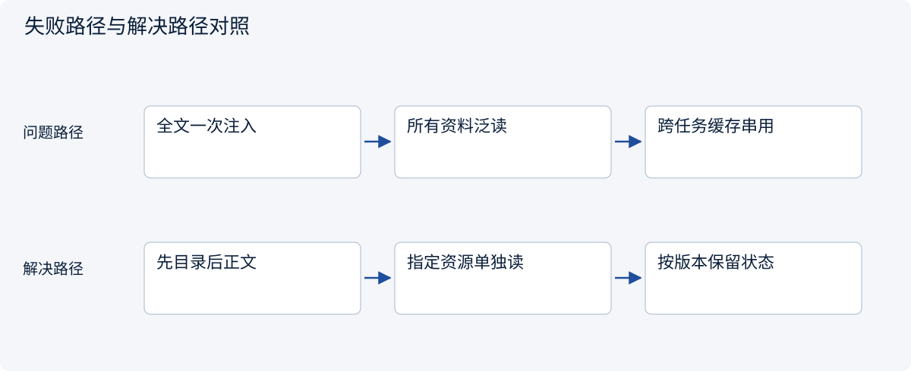
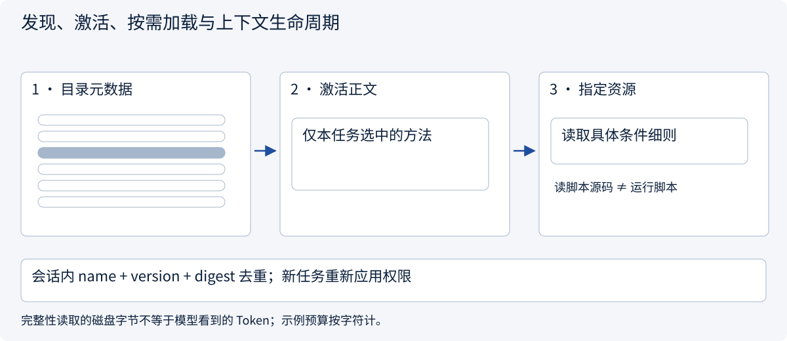
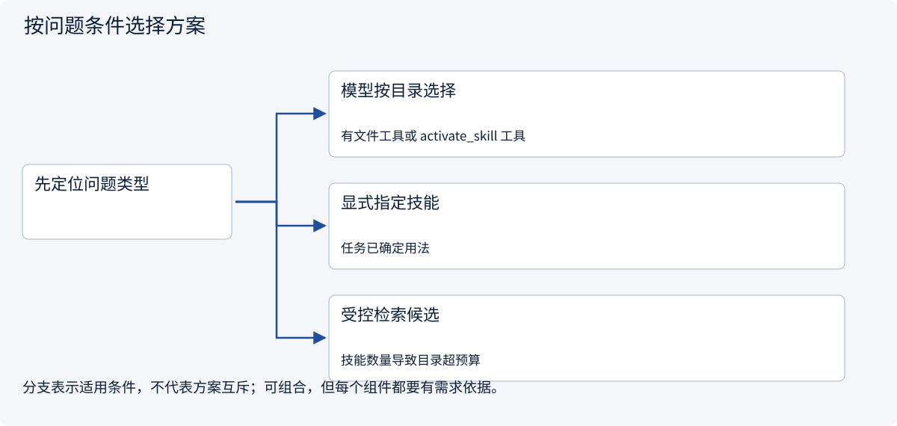
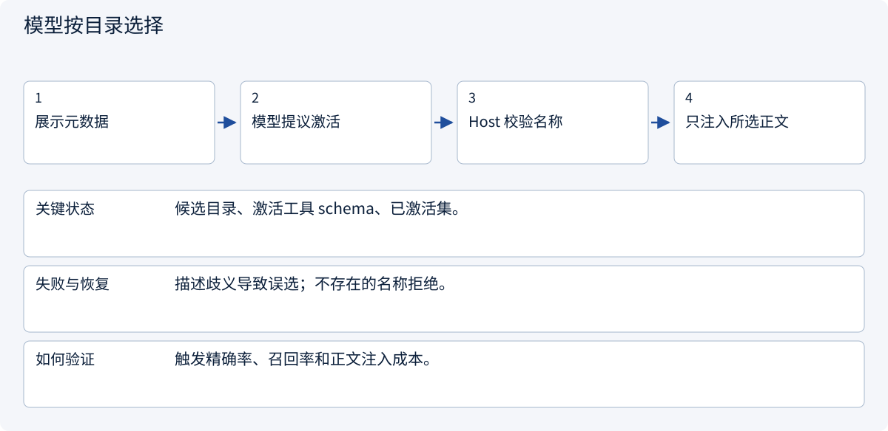
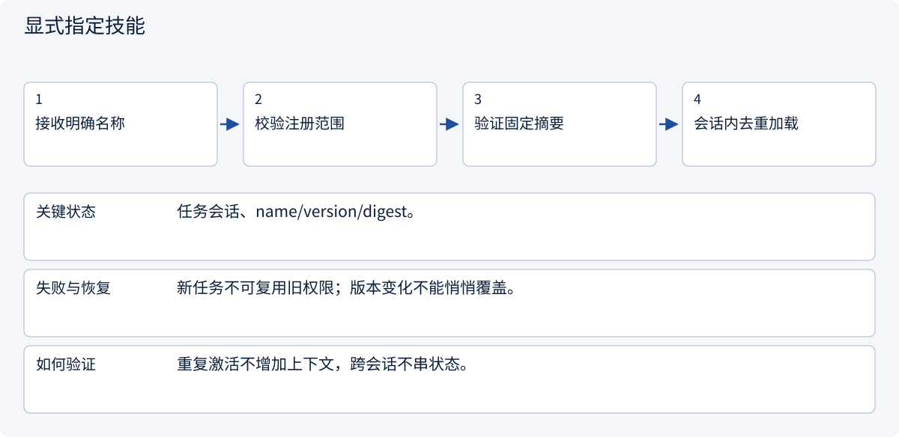
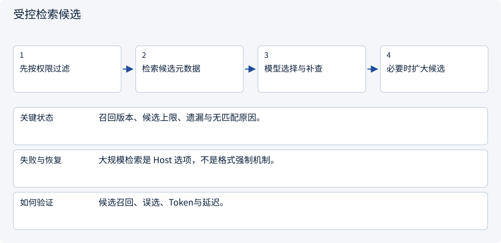

# 2.6.3 发现、激活、按需加载与上下文生命周期

> 图解主线 · 对照主流方案 · 配参考代码

基于 Agent Skills 公开格式；版本、摘要固定与工具绑定是本例 Host 约定，不是通用执行权限。

## 先看问题

装了很多 Skills 后上下文挤满；重复激活浪费 Token；压缩后又忘了本轮正在用哪一版。




## 图解工作原理

按目录、正文、资源三层披露；激活去重以任务会话为单位。正文进入上下文，脚本不自动执行；完整性读取与模型实际看到的内容需要区分。



## 主流方案怎么选



| 方案 | 怎样解决 | 适用条件 | 代价与边界 |
|---|---|---|---|
| 模型按目录选择 | 暴露名称描述，由模型选择并读取 | 有文件工具或 activate_skill 工具 | 要评测选择，不等于关键词匹配 |
| 显式指定技能 | 用户或可信流程指定名称 | 任务已确定用法 | 仍校验可用性、版本和任务权限 |
| 受控检索候选 | 按范围过滤后召回有限技能元数据 | 技能数量导致目录超预算 | 召回漏掉的技能模型无法选择 |

## 主流方案内部怎样运行

### 1 · 模型按目录选择



**具体推演：** 不是查到“报价”两字就机械选择；让模型判断任务意图。

### 2 · 显式指定技能



**具体推演：** 同一 quote-review 本轮激活两次只保存一份正文。

### 3 · 受控检索候选



**具体推演：** 200个长正文不全塞入；候选无关时不强行激活。

## 参考代码

展开查看与本课机制对应的实现。训练函数仅提供代码，不执行实际训练；依赖与验证范围见配套代码说明。

[配套代码说明与验证范围](../../../docs/zh/projects/03-code-guide.md)

<details><summary>展开代码与实现边界</summary>

```python
"""Three disclosure stages; repeated activation is deduplicated per task session."""

from .skill_host import build_host


def disclosure_trace() -> dict:
    service, session = build_host()
    catalog = service.catalog(
        session.policy
    )  # Only name + description enter the catalog.
    first = service.activate("quote-review", session)
    again = service.activate("quote-review", session)
    assert first is again
    reference = service.resource("quote-review", "references/conditions.md", session)
    return {
        "catalog": catalog,
        "active_count": len(session.active),
        "requested_resource": reference,
        "context": service.context(session),
    }


# Integrity checks read bundle bytes without injecting all those bytes into model context.
# This uses a character limit for illustration; a real Host should budget with its tokenizer.
```

</details>

## 目录便宜，不等于可以无限放大

主流基础模式是让模型看到名称与描述，再通过文件读取或 activate_skill 一类工具取得选中正文。显式用户指定也可以直接走激活。大规模候选检索是另一种 Host 设计，要先过滤范围并测召回；不能把一个关键词匹配函数冒充通用意图选择器。

| 时点 | 进入模型上下文 | 本例另外做什么 |
|---|---|---|
| 发现 | name、description | 只对可信注册项读取元数据 |
| 激活 | 所选正文、版本、来源 | 校验包摘要与绑定，任务会话内去重 |
| 资源请求 | 指定细则/模板/脚本源码 | 拒绝越界路径，检查字符预算；不执行脚本 |
| 压缩/恢复 | 活动技能身份、适用规则或可核验引用 | 保留固定版本；若恢复引用，应重载原批准字节 |

完整性校验会在本地读取包字节，但不会把全部资源注入模型；“按需披露”描述的是上下文成本，不等于硬盘只读一个文件。本例使用字符数作预算，生产应接模型 tokenizer。仅有会话内状态，不声称实现跨进程恢复或 OS 沙箱；存储假定可信且只读。

正文或脚本更新后旧摘要拒绝加载。正式升级应保留旧包供活动任务续接，创建新版本注册，再决定何时把新任务切换过去。


依据：[Official 1](https://agentskills.io/client-implementation/adding-skills-support)。


### 会话与可信策略

Host 示例；固定输入与可注入适配器，不调用模型。

<details><summary>展开代码与实现边界</summary>

```python
from collections.abc import Awaitable, Callable
from dataclasses import dataclass, field


@dataclass(frozen=True)
class Descriptor:
    name: str
    description: str
    version: str  # Custom metadata, not a required Agent Skills field.
    declared_tools: str = ""  # Experimental declaration; never grants authority here.


@dataclass(frozen=True)
class RegistryEntry:
    version: str
    digest: str
    bindings: tuple[str, ...]
    metadata_digest: str = ""


@dataclass(frozen=True)
class Policy:
    allowed_skills: frozenset[str]
    allowed_tools: frozenset[str]
    quote_ids: frozenset[str]


@dataclass(frozen=True)
class Activated:
    name: str
    version: str
    digest: str
    instructions: str


@dataclass
class Session:
    policy: Policy
    char_limit: int = 12000  # Demonstration character budget, NOT a token estimate.
    active: dict[str, Activated] = field(default_factory=dict)
    resources: dict[tuple[str, str], str] = field(default_factory=dict)


ToolAdapter = Callable[[str, dict, Policy], Awaitable[dict]]
```

</details>

### 格式读取与包完整性

Host 示例；固定输入与可注入适配器，不调用模型。

<details><summary>展开代码与实现边界</summary>

```python
"""Bounded reads of an explicitly supplied, trusted, read-only package root."""

import hashlib
import json
import re
from dataclasses import asdict
from pathlib import Path

from .domain import Descriptor


def parse_frontmatter(text: str, directory_name: str) -> tuple[Descriptor, str]:
    import yaml

    lines = text.splitlines(keepends=True)
    if not lines or lines[0].strip() != "---":
        raise ValueError("Missing YAML frontmatter")
    end = next((i for i in range(1, len(lines)) if lines[i].strip() == "---"), None)
    if end is None:
        raise ValueError("Unclosed YAML frontmatter")
    metadata = yaml.safe_load("".join(lines[1:end]))
    if not isinstance(metadata, dict):
        raise TypeError("Frontmatter must be a mapping")
    name, description = metadata.get("name"), metadata.get("description")
    if (
        not isinstance(name, str)
        or not re.fullmatch(r"[a-z0-9]+(?:-[a-z0-9]+)*", name)
        or len(name) > 64
        or name != directory_name
    ):
        raise ValueError("Invalid skill/directory name")
    if not isinstance(description, str) or not 1 <= len(description.strip()) <= 1024:
        raise ValueError("Invalid description")
    extra = metadata.get("metadata", {})
    if not isinstance(extra, dict) or any(
        not isinstance(k, str) or not isinstance(v, str) for k, v in extra.items()
    ):
        raise ValueError("metadata must map strings to strings")
    tools = metadata.get("allowed-tools", "")
    if not isinstance(tools, str):
        raise TypeError("allowed-tools must be a string")
    return Descriptor(name, description, extra.get("version", ""), tools), "".join(
        lines[end + 1 :]
    ).strip()


def descriptor_digest(descriptor: Descriptor) -> str:
    return hashlib.sha256(
        json.dumps(asdict(descriptor), sort_keys=True).encode()
    ).hexdigest()


def snapshot_digest(files: dict[str, bytes]) -> str:
    digest = hashlib.sha256()
    for path, content in sorted(files.items()):
        # Length prefixes avoid ambiguous concatenation of filenames and bytes.
        label = path.encode()
        digest.update(len(label).to_bytes(8, "big") + label)
        digest.update(len(content).to_bytes(8, "big") + content)
    return digest.hexdigest()


class SkillRepository:
    def __init__(self, root: Path):
        self.root = root.resolve(strict=True)
        self.reads: list[str] = []  # Observable demonstration of disclosure stages.

    def package(self, name: str) -> Path:
        if not re.fullmatch(r"[a-z0-9]+(?:-[a-z0-9]+)*", name) or len(name) > 64:
            raise ValueError("Invalid skill name")
        path = self.root / name
        if path.is_symlink() or not path.resolve(strict=True).is_relative_to(self.root):
            raise PermissionError("Package escapes trusted root")
        return path

    def metadata(self, name: str) -> Descriptor:
        path = self.package(name) / "SKILL.md"
        if path.is_symlink():
            raise PermissionError("Symlinked entrypoint")
        self.reads.append(f"{name}:metadata")
        header = []
        # Read frontmatter without exposing the body or resources to the catalog.
        with path.open(encoding="utf-8") as source:
            for line in source:
                header.append(line)
                if sum(map(len, header)) > 16384:
                    raise ValueError("Oversized metadata")
                if len(header) > 1 and line.strip() == "---":
                    break
        descriptor, _ = parse_frontmatter("".join(header), name)
        return descriptor

    def snapshot(self, name: str) -> dict[str, bytes]:
        package = self.package(name)
        files, total = {}, 0
        for path in sorted(package.rglob("*")):
            if "__pycache__" in path.parts or path.suffix == ".pyc":
                continue  # Build artifacts are not part of this package manifest.
            if path.is_symlink():
                raise PermissionError("Symlinks are unsupported in this example")
            if not path.is_file():
                continue
            if path.stat().st_size > 65536:
                raise ValueError("Oversized resource")
            content = path.read_bytes()
            total += len(content)
            if total > 262144:
                raise ValueError("Oversized skill bundle")
            files[path.relative_to(package).as_posix()] = content
        self.reads.append(f"{name}:integrity-snapshot")
        return files


# Snapshot bytes are read for integrity; only requested content enters model context.
# Read-only trusted storage is assumed: this is not an OS sandbox or a TOCTOU defense.
```

</details>

### 激活、资源和绑定服务

Host 示例；固定输入与可注入适配器，不调用模型。

<details><summary>展开代码与实现边界</summary>

```python
import json
from pathlib import PurePosixPath

from .domain import Activated, Policy, RegistryEntry, Session, ToolAdapter
from .repos import (
    SkillRepository,
    descriptor_digest,
    parse_frontmatter,
    snapshot_digest,
)


class SkillService:
    def __init__(
        self,
        repository: SkillRepository,
        registry: dict[str, RegistryEntry],
        available_tools: frozenset[str],
    ):
        self.repository, self.registry, self.available_tools = (
            repository,
            registry,
            available_tools,
        )

    def eligible(self, name: str, policy: Policy) -> RegistryEntry:
        entry = self.registry.get(name)
        if entry is None or name not in policy.allowed_skills:
            raise PermissionError("Skill unavailable to this task")
        if not set(entry.bindings) <= (policy.allowed_tools & self.available_tools):
            raise PermissionError("Required binding unavailable or unauthorized")
        return entry

    def catalog(self, policy: Policy) -> list[dict]:
        result = []
        for name in sorted(self.registry):
            try:
                entry = self.eligible(name, policy)
            except PermissionError:
                continue
            descriptor = self.repository.metadata(name)
            if descriptor_digest(descriptor) != entry.metadata_digest:
                raise PermissionError("Catalog metadata changed after registration")
            result.append({"name": name, "description": descriptor.description})
        return result

    def verified(
        self, name: str, policy: Policy
    ) -> tuple[RegistryEntry, dict[str, bytes]]:
        entry = self.eligible(name, policy)
        files = self.repository.snapshot(name)
        if snapshot_digest(files) != entry.digest:
            raise PermissionError("Bundle changed since trusted registration")
        descriptor, _ = parse_frontmatter(files["SKILL.md"].decode(), name)
        if descriptor.version != entry.version:
            raise PermissionError("Pinned version mismatch")
        return entry, files

    @staticmethod
    def fits(session: Session, content: str) -> None:
        used = sum(len(x.instructions) for x in session.active.values())
        used += sum(map(len, session.resources.values()))
        if used + len(content) > session.char_limit:
            raise ValueError("Skill context character budget exhausted")

    def activate(self, name: str, session: Session) -> Activated:
        entry, files = self.verified(name, session.policy)
        if name in session.active:
            return session.active[
                name
            ]  # No duplicate injection, but integrity was rechecked.
        _, body = parse_frontmatter(files["SKILL.md"].decode(), name)
        self.fits(session, body)
        loaded = Activated(name, entry.version, entry.digest, body)
        session.active[name] = loaded
        return loaded

    def resource(self, name: str, relative: str, session: Session) -> str:
        if name not in session.active:
            raise ValueError("Activate the skill first")
        path = PurePosixPath(relative)
        if (
            path.is_absolute()
            or ".." in path.parts
            or not path.parts
            or path.parts[0] not in {"references", "assets", "scripts"}
        ):
            raise PermissionError("Resource path outside bundle conventions")
        _, files = self.verified(name, session.policy)
        key = (name, path.as_posix())
        if key in session.resources:
            return session.resources[key]
        content = files[path.as_posix()].decode("utf-8")
        self.fits(session, content)
        session.resources[key] = (
            content  # Returning source never executes a bundled script.
        )
        return content

    async def invoke(
        self,
        name: str,
        tool: str,
        arguments: dict,
        session: Session,
        adapter: ToolAdapter,
    ) -> dict:
        if name not in session.active:
            raise ValueError("Activate the skill first")
        entry, _ = self.verified(name, session.policy)
        if tool not in entry.bindings:
            raise PermissionError("Tool is not a trusted binding for this skill")
        return await adapter(tool, arguments, session.policy)

    def context(self, session: Session) -> str:
        # Structured packaging aids provenance; it is not an authorization mechanism.
        return json.dumps(
            [
                {
                    "source": "approved-skill",
                    "name": x.name,
                    "version": x.version,
                    "digest": x.digest,
                    "instructions": x.instructions,
                }
                for x in session.active.values()
            ],
            ensure_ascii=False,
        )
```

</details>

### 激活请求边界

Host 示例；固定输入与可注入适配器，不调用模型。

<details><summary>展开代码与实现边界</summary>

```python
from dataclasses import asdict

from .domain import Session
from .services import SkillService


class SkillHandler:
    def __init__(self, service: SkillService):
        self.service = service

    def activate(self, request: dict, session: Session) -> dict:
        if set(request) != {"name"} or not isinstance(request["name"], str):
            raise ValueError("Expected one skill name")
        return asdict(self.service.activate(request["name"], session))
```

</details>

### 协议入口装配

Host 示例；固定输入与可注入适配器，不调用模型。

<details><summary>展开代码与实现边界</summary>

```python
from .domain import Session
from .handlers import SkillHandler


def activate_entry(handler: SkillHandler, request: dict, session: Session) -> dict:
    """Transport-neutral entry: the Host injects the trusted task session."""
    return handler.activate(request, session)
```

</details>

## 改变条件，检查理解

目录阶段扫描了文件，是否等于全部正文都消耗了模型 Token？

<details><summary>展开参考答案</summary>

不是。磁盘读取、完整性检查和注入模型上下文是不同操作。示例预算是字符数，不伪称 tokenizer 结果。

</details>

[查看官方资料与方案依据](../../../docs/zh/resources.md)
