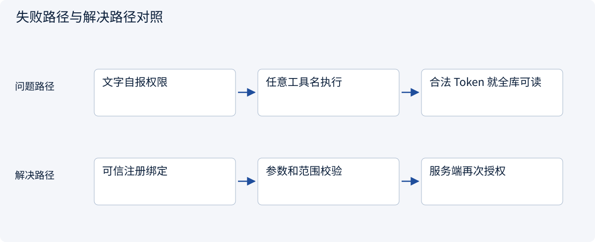
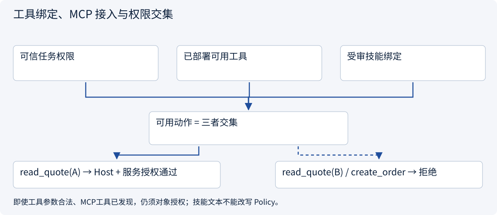
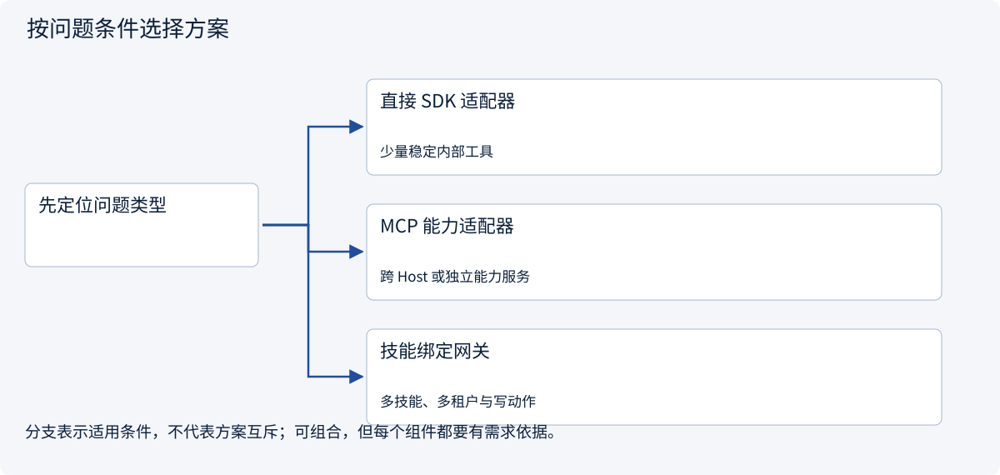
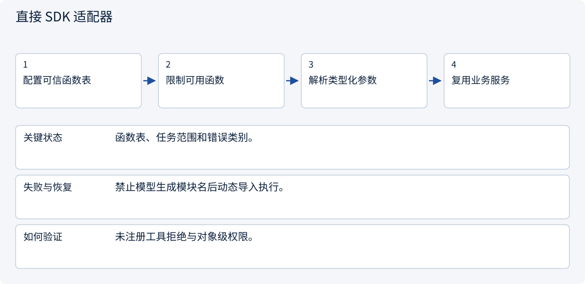
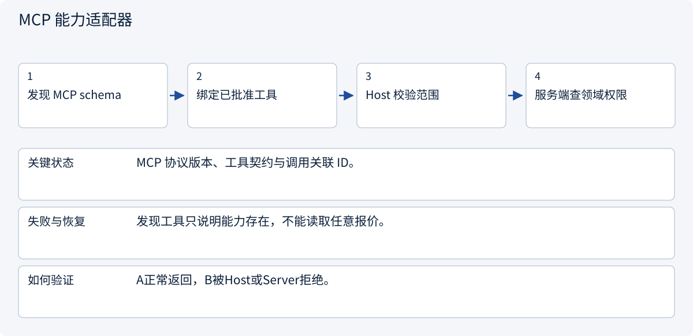
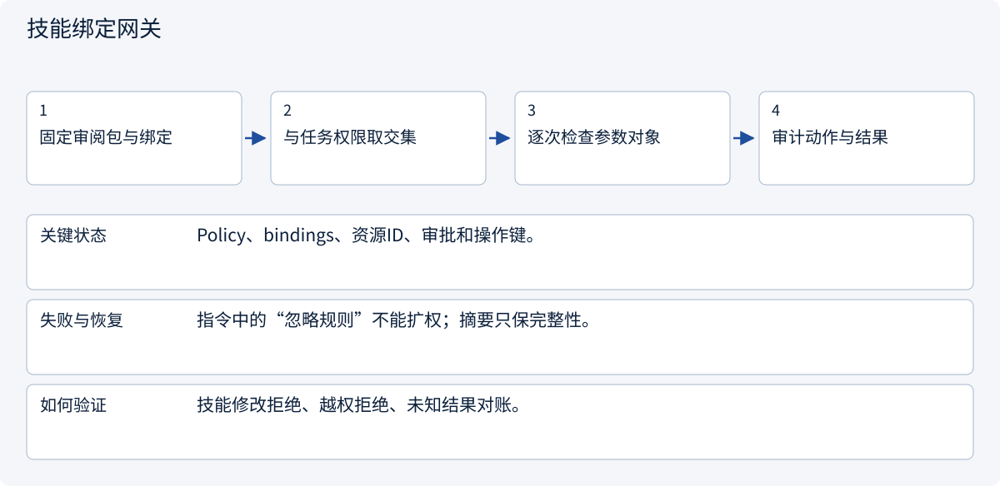

# 2.6.4 工具绑定、MCP 接入与权限交集

> 图解主线 · 对照主流方案 · 配参考代码

基于 Agent Skills 公开格式；版本、摘要固定与工具绑定是本例 Host 约定，不是通用执行权限。

## 先看问题

Skill 写着“读取所有报价并创建订单”，是否就能扩大工具权限？发现了 MCP 工具就可以调用任意对象吗？



## 图解工作原理

可信任务范围、已部署能力、受审技能绑定共同约束可用动作；服务端再次校验对象。Skill 提供方法，Function Calling 表达提议，MCP 承载外部能力调用。



## 主流方案怎么选



| 方案 | 怎样解决 | 适用条件 | 代价与边界 |
|---|---|---|---|
| 直接 SDK 适配器 | 方法调用已注册的应用能力 | 少量稳定内部工具 | 仍需对象授权与错误映射 |
| MCP 能力适配器 | Client 调用 Server 公开契约 | 跨 Host 或独立能力服务 | 协议成功不证明业务完成 |
| 技能绑定网关 | 取任务权限与可信绑定交集 | 多技能、多租户与写动作 | 声明不是授权；副作用另需审批幂等 |

## 主流方案内部怎样运行

### 1 · 直接 SDK 适配器



**具体推演：** 报价读取可用直连 SDK；比较方法仍由 Skill 提供。

### 2 · MCP 能力适配器



**具体推演：** 真实 SDK 测试读A；读B不得返回报价170。

### 3 · 技能绑定网关



**具体推演：** 激活方法后仍不能创建订单或读取另一客户记录。

## 参考代码

展开查看与本课机制对应的实现。训练函数仅提供代码，不执行实际训练；依赖与验证范围见配套代码说明。

[配套代码说明与验证范围](../../../docs/zh/projects/03-code-guide.md)

<details><summary>展开代码与实现边界</summary>

```python
"""Skill method + trusted Host policy + an actual in-memory MCP call; no LLM."""

from .mcp_host_bridge import call_authorized, check_quote_access
from .mcp_server_example import build_server
from .skill_host import build_host


async def review_quote(quote_id: str) -> dict:
    from mcp import Client

    service, session = build_host()
    service.activate("quote-review", session)
    check_quote_access(
        "read_quote",
        {"quote_id": quote_id},
        session.policy.allowed_tools,
        session.policy.quote_ids,
    )
    async with Client(build_server()) as client:

        async def adapter(tool, arguments, policy):
            return await call_authorized(
                client, tool, arguments, policy.allowed_tools, policy.quote_ids
            )

        return await service.invoke(
            "quote-review", "read_quote", {"quote_id": quote_id}, session, adapter
        )


# The skill explains how to review a quote. It does not grant access to B or create orders.
```

</details>

## 从方法到真实调用，必须经过 Host

可用绑定来自可信部署配置，并与本次任务权限和当前可用工具取交集。本例只绑定 read_quote；用户、模型或技能正文不能把 create_order 填进来。绑定的语义名可由适配器映射到某个 MCP Server 工具，或直接 SDK；不把 Host 专用绑定字段写成通用规范。

调用仍经两次边界检查：Host 校验提议的工具名/参数/报价范围，MCP Server 的 service 再校验可读对象。激活方法只是准备上下文，既不执行脚本，也不自动调用工具。

真实内存 SDK 例子返回 A 的 unit_cents=180、shipping_cents=null。请求 B 在任务范围检查被拒绝；发现 B 的能力、合法工具 schema、成功认证都不能替代对象授权。后续写动作还需单独审批、操作键和未知结果核查。

**测试范围：** 没有模型请求、网络采购或训练。SDK 测试证明所列契约与拒绝路径，不证明任意第三方技能安全。摘要固定用于检测变更，不能把恶意包变成可信包。


依据：[Official 1](https://agentskills.io/client-implementation/adding-skills-support), [Official 2](https://modelcontextprotocol.io/docs/2026-07-28/learn/architecture)。


## 改变条件，检查理解

将 allowed-tools 写进 SKILL.md，能否绕过 Host 禁止的 create_order？

<details><summary>展开参考答案</summary>

不能。本例完全以可信 Policy 和注册绑定约束能力；实验声明不改变任务权限，更不能替代服务端授权。

</details>

[查看官方资料与方案依据](../../../docs/zh/resources.md)
