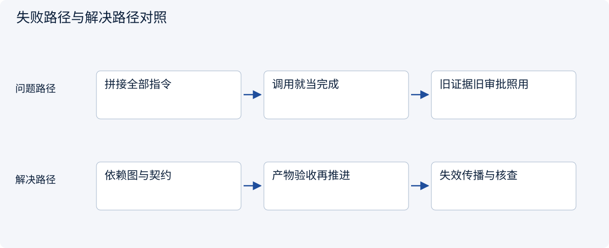
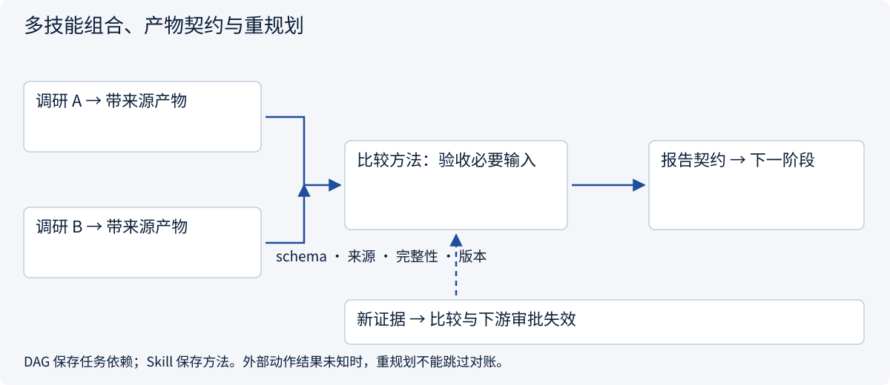
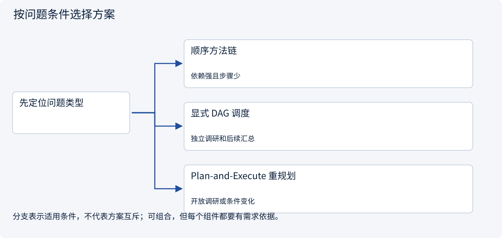
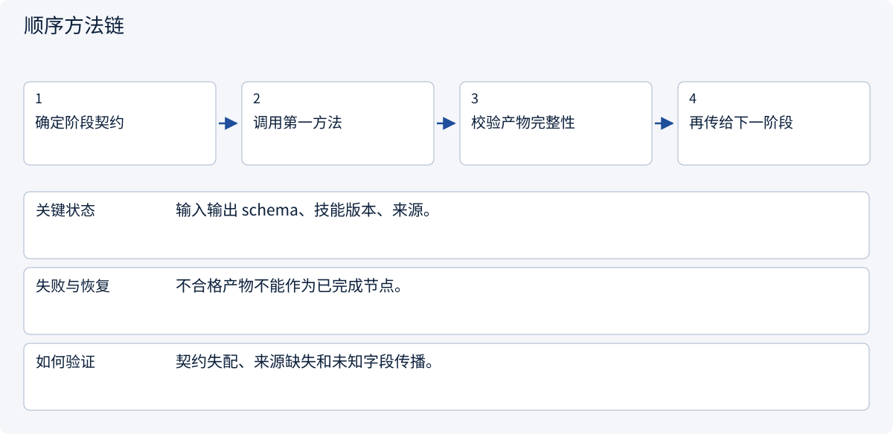
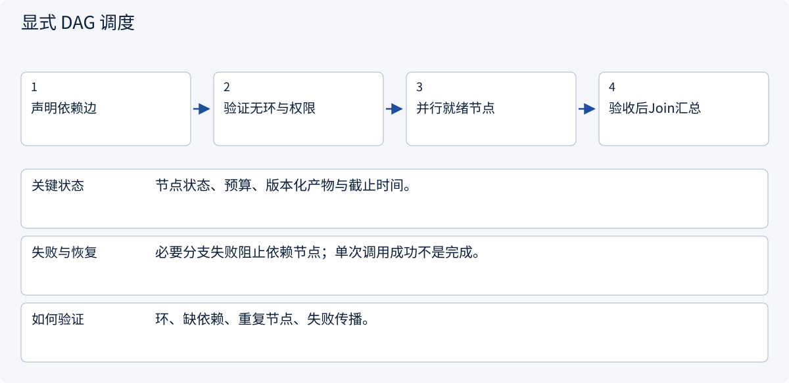
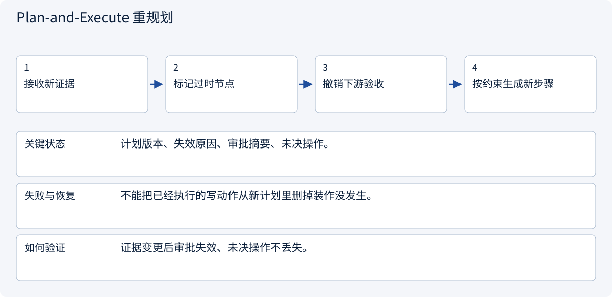

# 2.6.5 多技能组合、产物契约与重规划

> 图解主线 · 对照主流方案 · 配参考代码

基于 Agent Skills 公开格式；版本、摘要固定与工具绑定是本例 Host 约定，不是通用执行权限。

## 先看问题

把三个 Skill 正文拼起来，为什么仍出现顺序错误、互相冲突，以及旧报价沿用旧审批？




## 图解工作原理

组合以任务计划和类型化产物为边界；方法不代替状态机。依赖就绪且产物验收成功才推进，新证据使下游产物失效，未决外部动作先对账。



## 主流方案怎么选



| 方案 | 怎样解决 | 适用条件 | 代价与边界 |
|---|---|---|---|
| 顺序方法链 | 前一产物验收后供下一步骤 | 依赖强且步骤少 | 中间失败停止，不能机械续跑 |
| 显式 DAG 调度 | 按依赖和技能可用性选择就绪节点 | 独立调研和后续汇总 | Join、取消与冲突须定义 |
| Plan-and-Execute 重规划 | 证据变化触发局部计划修订 | 开放调研或条件变化 | 冻结权限与已发生动作，不让重规划抹除 |

## 主流方案内部怎样运行

### 1 · 顺序方法链



**具体推演：** 审查报告必须保留A运费未知，不能让下一步当全量比较。

### 2 · 显式 DAG 调度



**具体推演：** 两个独立地区可并行，但比较等所有必要证据。

### 3 · Plan-and-Execute 重规划



**具体推演：** 报价变动重做比较和审批；创建结果未知先对账。

## 参考代码

展开查看与本课机制对应的实现。训练函数仅提供代码，不执行实际训练；依赖与验证范围见配套代码说明。

[配套代码说明与验证范围](../../../docs/zh/projects/03-code-guide.md)

<details><summary>展开代码与实现边界</summary>

```python
"""Compose artifacts with explicit contracts; do not concatenate arbitrary skill bodies."""

from dataclasses import dataclass

from .skill_planning import Step, ready_steps


@dataclass(frozen=True)
class Artifact:
    contract: str
    skill_version: str
    source_ids: tuple[str, ...]
    complete: bool


def next_steps(
    plan: list[Step],
    completed: dict[str, Artifact],
    allowed: set[str],
    expected_contracts: dict[str, str],
) -> list[Step]:
    names = {step.name for step in plan}
    if not set(completed) <= names:
        raise ValueError("Artifact refers to an unknown plan node")
    for node, artifact in completed.items():
        if (
            not artifact.complete
            or artifact.contract != expected_contracts[node]
            or not artifact.source_ids
        ):
            raise ValueError("Artifact lacks acceptance, matching schema or provenance")
    return ready_steps(plan, set(completed), allowed)


# A new quote version invalidates its comparison and dependent approval artifacts.
# The caller must remove invalid descendants; the plan never treats a call as completion.
```

</details>

## 用产物契约组合，而不是叠加角色指令

一个方法产出的报告应携带 schema 版本、来源、完整/未完整标记；下一步先验收它，再使用其结果。通用格式可组合，不代表任何两个技能放在一起都兼容。

| 故障 | 处理 |
|---|---|
| 上游声称完成，但缺运费 | 保留未完成，不推进依赖比较 |
| 输出 schema 不同 | 显式适配或拒绝，不能让模型猜字段含义 |
| 两个方法冲突 | 由可信任务约束与产物契约裁决，必要时补问 |
| 报价已变更 | 失效比较和下游审批，保留变更原因与证据版本 |
| 工具写结果未知 | 先对账；不能因新计划把旧操作遗忘 |

参考实现检查产物完整性和来源后才调用就绪节点选择。它展示编排契约，不自动规划所有步骤，也没有安装多个第三方技能。实际多方法并行还须接入 Runtime 的预算、取消、检查点和版本策略。


依据：[Official 1](https://agentskills.io/specification)。


## 改变条件，检查理解

新版报价改变总价后，能否只重算报告而保留旧的动作审批？

<details><summary>展开参考答案</summary>

不能。审批绑定动作摘要及证据条件；变更应使依赖比较/审批失效，已经发出的操作仍要核查。

</details>

<details><summary>按需展开：原理推导与边界补充</summary>

**计划如何更新，而不是越写越长**

初始计划是“先确认经营主体，再比较市场，再形成建议”。研究中发现目标平台要求特定企业资料，此时需要回到可行性判断，而不是沿旧计划继续列商品。好的规划会显式更新目标、依赖和完成标准，不是把失败动作换个措辞再试。

反思也应基于可观察证据：来源是否过时、任务是否缺字段、工具是否失败。让模型对自己的答案说“我觉得很好”不是独立验证；应使用检查表、外部证据或独立评测。

**学习活动与自检**

把你熟悉的一项工作写成一页 Skill，然后请另一人仅凭这页说明完成任务。记录他在哪些地方需要猜测，再补足前提和验收标准。接着加入一个中途变更，例如预算减半，检查计划是否会重新评估，而不是盲目推进。

自检：能否区分 Skill、工具、计划和记忆？是否知道谁有权更新计划和批准新增承诺？是否能识别 Skill 中来自外部内容的不可信指令？是否为无限反思、无限重试设置终止条件？

阅读 [Deep Agents](https://github.com/langchain-ai/deepagents) 的规划与长任务思路，并结合自己的任务评估，而不是因为框架有待办列表就认为规划问题已经解决。

**理解题与参考答案**

**1. 计划生成后应始终不变吗？**

参考答案：不应。新证据、范围变化和失败都可能要求重新规划。


</details>

[查看官方资料与方案依据](../../../docs/zh/resources.md)
